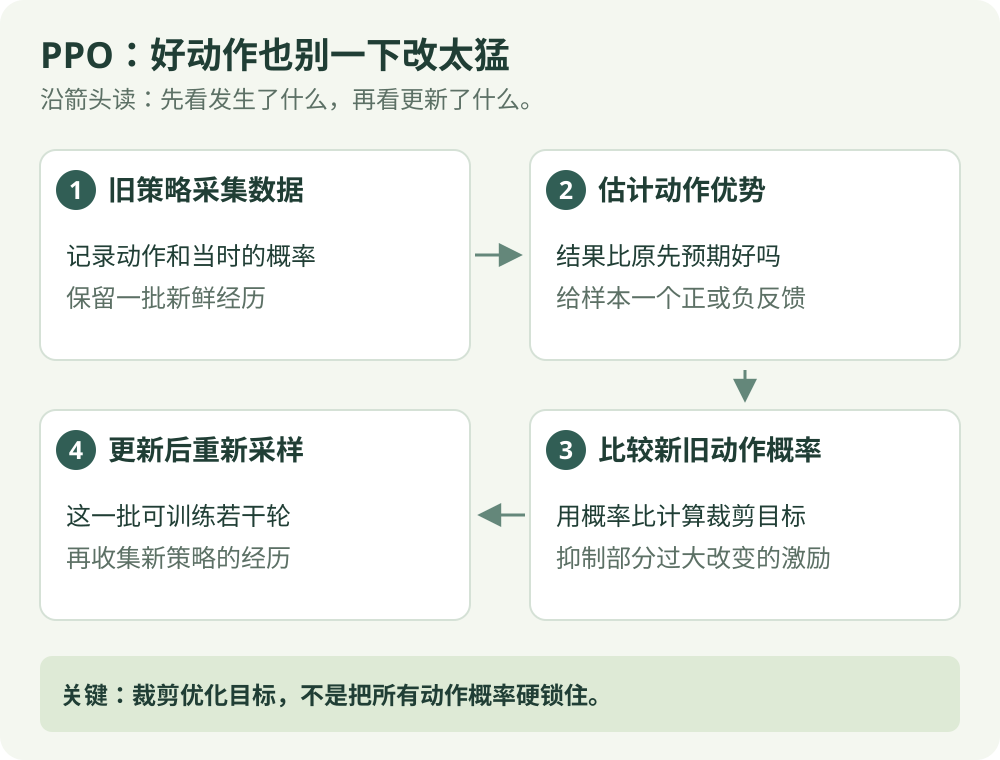

# PPO：算法直觉

[算法直觉](ppo.md) · [公式讲解](../math/ppo.md) · [Python 实践](../code/ppo.md)

同策略 / 限制更新

## 一句话理解

对表现好于预期的动作，增加它被选择的机会；增加到一定程度后，这条样本不再提供继续增加的额外激励。

## 先看这张图

{ .rl-figure loading=lazy }

[打开图示大图](../assets/ppo.svg)

图中每个框只展示主要学习关系，完整细节见后面的公式与代码。

## 这几个词是什么意思

**优势**：结果比原先预期好还是差。**概率比**：在同一状态，新策略给采样动作的概率除以旧策略给它的概率；连续动作则比较概率密度。**裁剪**：在优化目标里限制这个比值的部分作用。

## 用数字举例

旧策略选择向右的概率是 0.2，新策略变成 0.3，概率比为 1.5。如果这个动作的优势为正，且裁剪范围是 0.8 到 1.2，裁剪后的目标不再因这条样本的概率比继续变大而增加。这里变化的是训练目标，不是环境发给机器人的奖励。

## 一条经验很好，也不要无限追着它改

旧策略向右概率 0.2，一次向右表现好于预期。更新后的概率如果变成 0.3，比率为 1.5。PPO-Clip 在这条正优势样本的目标里，将继续增大比率的额外收益截平，帮助减少过度追逐这一条经验。

这并不是执行时把 0.3 强行改回某个固定值。网络参数同时影响许多样本，其他梯度仍可能让概率变化。必须把“目标里的裁剪”与“真的限制每个动作概率”分开理解。

一批经验可以有限次数重复学习，然后再采新数据。旧概率来自收集这批经验的策略，必须保留；如果每轮把它换成新概率，比率的比较基准就丢了。

## 它怎么工作

1. 用旧策略采集一批数据，并保存采样动作的旧对数概率。
2. 计算回报与优势。
3. 比较新旧策略选择同一动作的概率。
4. 用裁剪目标做多轮小批量更新，同时训练价值函数。
5. 换用更新后的策略，重新采集数据。

## 为什么可以重复用这一批数据

概率比修正新旧策略差异，裁剪限制某些方向上的激励。PPO 仍是同策略方法，不等于可以像 DQN 那样长期从巨大旧经验池随意取数据。

## 优点与限制

适用于离散或连续动作，训练流程相对清晰。裁剪并不保证所有动作概率变化都很小，也不保证每次更新都提高回报；奖励尺度、优势估计与采样质量仍然重要。

## 在放牧研究里如何理解

如果输出连续平面速度和角速度，PPO 可以作为候选方法之一。先验证仿真中的观测、奖励和终止，再讨论算法表现。

## 为什么总要拿采样时的旧概率作比较

设旧策略在某状态向右的概率是 0.2，它在收集这批数据时真的选了向右。之后同一条样本会被用来更新多次，但比较基准始终是这个 0.2。

| 更新中重新算出的新概率 | 除以旧概率 0.2 | 解释 |
| --- | --- | --- |
| 0.2 | 1 | 与采样时一样 |
| 0.24 | 1.2 | 相对增加 20%，绝对只增加 0.04 |
| 0.3 | 1.5 | 相对增加 50% |

对优势为正的这条记录，裁剪阈值 0.2 会让比率超过 1.2 后不再带来额外目标提升。如果这次表现比预期差、优势为负，想做的是降低概率，此时要关注另一边的 0.8。公式篇会分别计算这两种情况。

“相对变化 20%”与“概率加 0.2”不是一回事，更不表示模型每次必须改到 0.24。实际参数由整批样本共同推动，裁剪只改变其中一种学习激励。

## 同一批数据为什么可以练习几遍，但不能永远练？

采样时，旧策略已经决定这条记录怎样产生：在哪个状态选哪个动作、当时给它多少概率。之后多轮更新继续使用同一份旧概率作基准，比较当前策略变化；收集下一批数据时，才建立那一批自己的旧策略基准。

PPO 通过裁剪改变目标对大幅变化的激励。好动作已经大幅增大概率时，继续增大不再提升这条样本的裁剪项；坏动作大幅减小概率时，也有对应的一侧限制。但共享参数、别的样本和价值损失仍可影响更新，所以这不是所有概率被强行限制在某个范围。

数据由旧策略生成，当前策略变得太远后，继续重复这批经历会更难代表当前行动的结果。有限轮数、重新采样和监测更新幅度，各有用途；不能只提高 n_epochs 就保证学得更好。

若“策略参数怎样改变概率”还不清楚，先读[网络入门](../network-basics.md)中的参数与输出区别。

## 检查自己是否看懂

**概率比为 1.5，裁剪后为 1.2，动作概率一定被硬改回去吗？**

??? success "展开答案"

    不会。裁剪改变目标函数的激励，并不直接把实际概率设为某个值。

## 从曲线看裁剪

{ .rl-figure loading=lazy }

[打开图示大图](../assets/ppo-clip.svg)

正优势时右侧变平；负优势时左侧变平。橙色虚线是未裁剪目标，绿色实线是使用 `min` 得到的裁剪目标。曲线展示目标值，横轴只比较同一采样动作的新旧概率。

## 进一步阅读

[Spinning Up：PPO](https://spinningup.openai.com/en/latest/algorithms/ppo.html)
