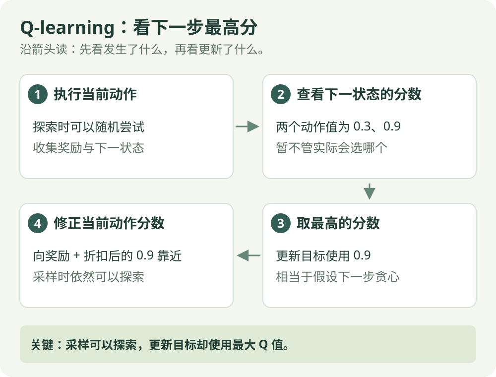
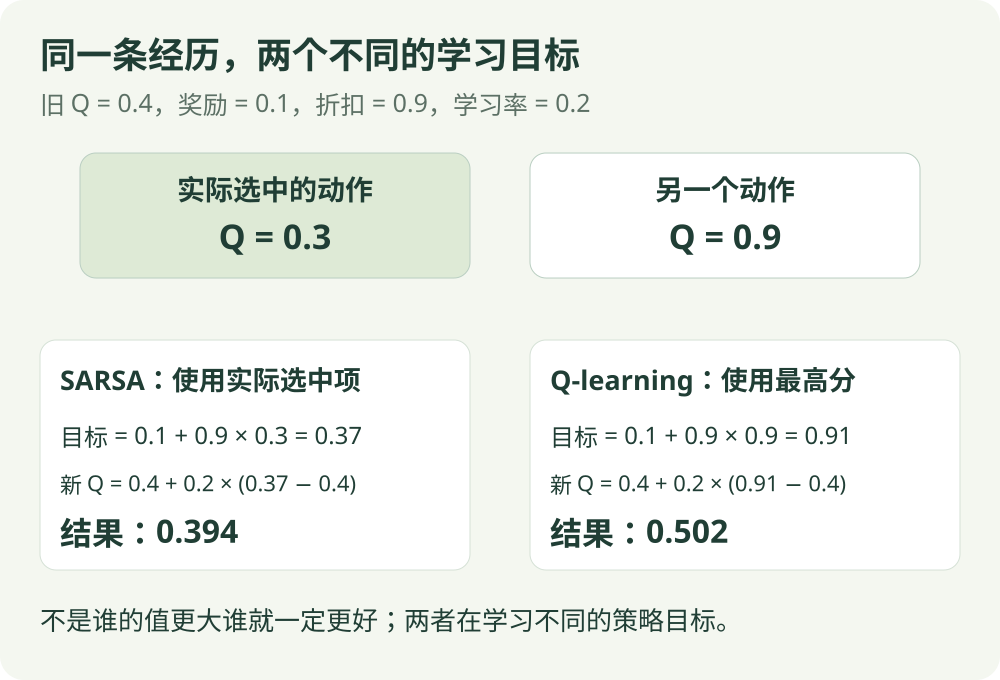

# Q-learning：算法直觉

[算法直觉](q-learning.md) · [公式讲解](../math/q-learning.md) · [Python 实践](../code/q-learning.md)

异策略 / 表格控制

## 一句话理解

更新时，按照下一步最高的动作分数估计未来。

## 先看这张图

{ .rl-figure loading=lazy }

[打开图示大图](../assets/q-learning.svg)

图中每个框只展示主要学习关系，完整细节见后面的公式与代码。

## 这几个词是什么意思

**采样策略**：收集经验时怎么选动作。**目标策略**：正在学习其收益的决策规则。Q-learning 的采样可以探索，目标使用贪心选择。

## 用走廊举例

你向右走一步，发现下一位置向右分数高、向左分数低。无论采样策略下一步是否随机向左，更新目标都使用下一位置的最高 Q 值。这样，探索时积累的数据也能用来学习贪心决策的价值。

## 同一段经历，为什么会得到另一个目标

沿用 SARSA 页的假想记录：在状态 3 向右，奖励 0.1，来到状态 4。那里向左分数 0.3、向右分数 0.9；接下来探索恰好会向左。

| 算法 | 对后续行动的假设 | 本次目标（折扣 0.9） |
| --- | --- | --- |
| SARSA | 接着执行已经选好的向左 | 0.1 + 0.9 × 0.3 = 0.37 |
| Q-learning | 从下一状态起，按当前最高分选 | 0.1 + 0.9 × 0.9 = 0.91 |

Q-learning 的当前旧分数若是 0.4、学习率 0.2，更新后为 `0.4 + 0.2 × (0.91 − 0.4) = 0.502`。实际经历没有变化，改变的是“后续怎样走”的估计方式。

这也解释了为什么 Q-learning 可以边随机探索、边学习贪心决策的价值。随机走错的那一步仍会得到自己的经验和更新，算法没有把失败记录删掉。

先读明白这一个差别，再看 DQN：DQN 的核心仍有“下一状态最大分数”，只是它使用网络保存分数，而不是小表格。

## 它怎么工作

1. 初始化 Q 表。
2. 用 ε-greedy 选动作，既尝试新动作，也利用已有经验。
3. 记录奖励和下一状态。
4. 用即时奖励加下一状态最高分作为目标，修正当前动作分数。

## “异策略”是什么意思

采样策略可能随机探索，被学习的目标策略却选择最高分动作，两者不同。异策略不是“任何旧数据都永远有效”，仍需要覆盖重要状态与动作，并考虑环境是否变化。

## 为什么可以随机走，却学习最高分的走法？

这里有两套职责。行为策略负责收集经验，允许探索；目标中的 max 则询问“到下一位置后，若按当前最高分行动，有多少后续价值”。两者可以不同，所以称为异策略学习。

探索动作并不是被忽略：这一步实际做了哪个动作，便更新当前那个动作的 Q；若这步掉进失败终点，也必须写入失败奖励。max 只描述下一位置的后续参考，不能把刚发生的失败替换成一个成功动作。

一个从未执行过的动作，即使初始分数看起来很高，也缺少直接证据。经典表格收敛结论需要合适的访问和学习率等条件；有限的 3000 局演示不保证任意任务都得到最优结果。先检查数据覆盖，再看高分是不是来自真实经历。

## 优点与限制

更新规则简单，适合小规模离散环境。状态和动作太多时，Q 表存不下，也很难让每格都得到足够训练，DQN 用网络来缓解表格规模问题。

## 在放牧研究里如何理解

可以先把羊群中心所在区域与机器人的相对方位离散化，作为教学环境。但这种离散化会丢失信息，不能直接代表连续场地上的完整放牧问题。

## 检查自己是否看懂

**实际下一动作值为 0.3，最高分为 0.9，更新用哪个？**

??? success "展开答案"

    用 0.9；采样时实际选哪个动作，不改变这里取最大值的规则。

{ .rl-figure loading=lazy }

[打开图示大图](../assets/sarsa-vs-q.svg)

## 进一步阅读

[Sutton 与 Barto 教材，第 6 章](https://incompleteideas.net/book/the-book-2nd.html)

[David Silver 对应课程讲义](https://davidstarsilver.wordpress.com/wp-content/uploads/2025/04/lecture-5-model-free-control-.pdf)
