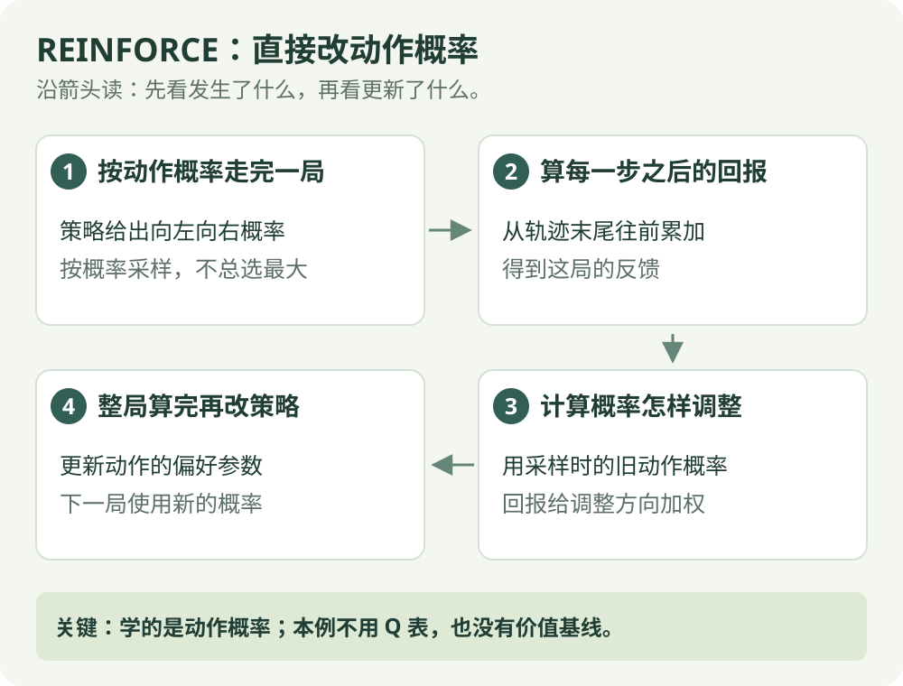

# REINFORCE：算法直觉

[算法直觉](reinforce.md) · [公式讲解](../math/reinforce.md) · [Python 实践](../code/reinforce.md)

同策略 / 策略梯度

## 一句话理解

把一局的回报作为反馈，直接调整选择动作的概率。

## 先看这张图

{ .rl-figure loading=lazy }

[打开图示大图](../assets/reinforce.svg)

图中每个框只展示主要学习关系，完整细节见后面的公式与代码。

## 这几个词是什么意思

**策略参数**：决定动作概率的可调数字。**softmax**：把每个动作的偏好数字转成总和为 1 的概率。**梯度**：指出怎样微调参数能改变某个分数或概率。

## 用走廊举例

在当前位置，向左向右各有一定概率。一局结束后，算法拿着该局的回报回看每一步，计算如何调整策略参数。它不是先给所有动作打分再挑最大的，而是直接学习概率分布。

## 分数表之外，还可以直接学习选择概率

如果向左和向右各有 50% 的机会，REINFORCE 可以直接调整这两个机会。它保存动作偏好，用 softmax 转成概率，再按概率走完一局。偏好是可调数字，概率是由这些数字计算出来的结果。

这像根据一次完整尝试给当时的选择提供反馈。但一次成功可能只是运气，所以并不是“赢了一次，就永远只选这一边”。每步的回报、同状态的多次访问，以及整幕梯度的合并都会影响更新。

下面的入门实现没有 Critic，也没有基线。先理解这一版，再比较 A2C 为什么多了价值估计模块。

## 它怎么工作

1. 根据当前策略的概率分布采样完整回合。
2. 计算每个时间点之后的折扣回报。
3. 计算采样动作的对数概率对参数的梯度。
4. 用回报加权梯度，做策略更新。

## 回报的正负怎么影响更新

本篇手写版本没有减去基线。某一步的回报为正时，其梯度贡献倾向提高采样动作的概率；为负时则倾向降低。加入状态基线后，比较的是“回报 − 基线”。因此，“比另一局好”不自动意味着这次更新就会提高该动作概率，所有步骤的贡献还要一起相加。

## 为什么不一定越学越好

高回报的轨迹可能只是运气好，单次更新不保证提升。回报方差大时，学习会抖动；可以加入与动作无关的状态基线，减少波动。基线不能随意减去任何数而不检查其条件。

## 与 Actor-Critic 的联系

REINFORCE 的基础版本等一局结束，用真实回报。Actor-Critic 增加价值估计模块，利用估计或优势帮助策略更快获得反馈。

## 编程形式

本栏目先用表格 softmax 策略手写 REINFORCE。它没有神经网络，但确实在更新策略参数，便于看清“概率如何被改变”。

## 检查自己是否看懂

**本例没有基线时，回报为负会怎样？**

??? success "展开答案"

    在这一步的梯度贡献中，会降低采样动作的概率；所有步骤的贡献汇总后才更新。用了基线则看“回报减基线”的正负。

## 进一步阅读

[Spinning Up：策略梯度](https://spinningup.openai.com/en/latest/algorithms/vpg.html)

[David Silver 对应课程讲义](https://davidstarsilver.wordpress.com/wp-content/uploads/2025/04/lecture-7-policy-gradient-methods.pdf)
