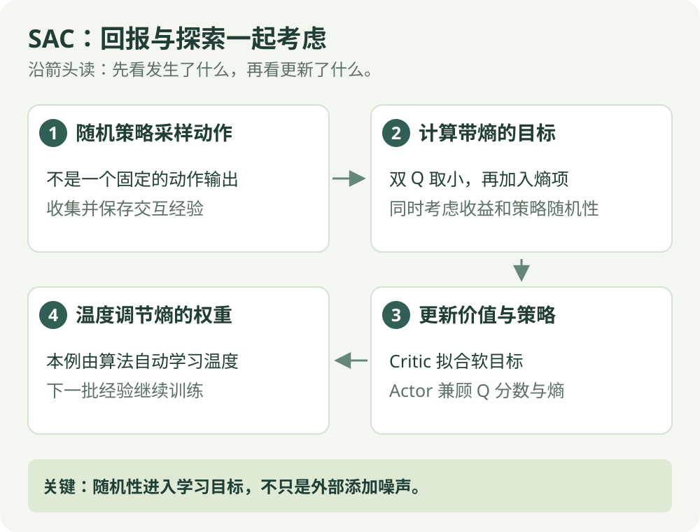

# SAC：算法直觉

[算法直觉](sac.md) · [公式讲解](../math/sac.md) · [Python 实践](../code/sac.md)

异策略 / 最大熵

## 一句话理解

既学如何拿奖励，也让策略保留一定的选择余地。

## 先看这张图

{ .rl-figure loading=lazy }

[打开图示大图](../assets/sac.svg)

图中每个框只展示主要学习关系，完整细节见后面的公式与代码。

## 这几个词是什么意思

**熵**：描述策略分布有多分散。**温度**：控制熵项在目标里有多大分量。连续动作的熵与动作单位有关，不能直接等同于动作数量。

## 先用选方向理解熵，再回到连续动作

先临时用“左、右”两个离散选择帮助理解熵，不把这个例子当成本页连续 SAC 的实现：

| 选择方式 | 左的机会 | 右的机会 | 直觉 |
| --- | --- | --- | --- |
| 几乎固定 | 0.99 | 0.01 | 选择余地很少 |
| 均衡选择 | 0.5 | 0.5 | 两边都经常尝试，熵更高 |

SAC 学连续动作时，Actor 输出的是分布的参数，例如某个高斯分布的均值和标准差，再从分布抽取动作并变换到允许范围。标准差描述散开程度，实际学出的分布由回报与熵目标共同决定。

若某一动作的 Critic 评分高，但只准极窄范围动作，和评分略低、可选范围更宽的策略相比，哪种更合算取决于温度权重。温度大时更重视熵，但不能只按“越随机越好”做选择。

连续情况下，某个精确动作值对应的是密度；判断落入一小段区间的概率，要把这段区间里的密度累计。公式中的 log 正是对密度取对数，不能拿“概率一定不超过 1”的规则直接套用。

## 不只追求高分，还把保留选择余地写进目标

如果策略过早只尝试一种动作，可能漏掉另一种更好的做法。SAC 在收益目标里加入策略熵项，让学习同时考虑回报与分布的分散程度。它学的是随机动作分布，不只是在固定 Actor 外面临时加噪声。

温度是熵的权重：较大时，优化目标更看重熵；不表示机器人本体温度，更不意味着越大越好。示例的 auto 会学习这个权重，而不是始终使用公式算例的 0.2。

连续动作的“精确取某个数”的概率与密度不是同一个量；密度可以大于 1。这一点影响对数与熵的正负，先记住边界，再看下一篇数值计算。

## 它怎么工作

1. 随机策略产生连续动作，收集经验。
2. 从回放池抽样，更新两个价值网络。
3. 策略同时考虑 Critic 分数与熵项。
4. 缓慢更新目标价值网络；若启用自动温度调节，再更新熵权重。

## 与 TD3 的区别

TD3 的基本 Actor 是确定性的，采样探索靠外部噪声。SAC 本身学习随机策略，熵直接进入优化目标。两者通常都使用双 Q 与经验回放。

## 本篇讲哪个版本

本篇讲常见的连续动作、双 Q、无独立 V 网络版本。早期 SAC 与离散 SAC 有不同细节，本示例使用 Stable-Baselines3 的连续动作 SAC。

## 在放牧研究里如何理解

可用于连续速度控制的比较实验，但探索不等于有效探索。温度参数、奖励尺度与环境设计仍决定学习表现。

## 检查自己是否看懂

**温度越大，是否就保证放牧成功率越高？**

??? success "展开答案"

    没有这种保证。熵项权重更大，但任务成绩仍取决于奖励、环境与训练效果。

## 进一步阅读

[Spinning Up：SAC](https://spinningup.openai.com/en/latest/algorithms/sac.html)
