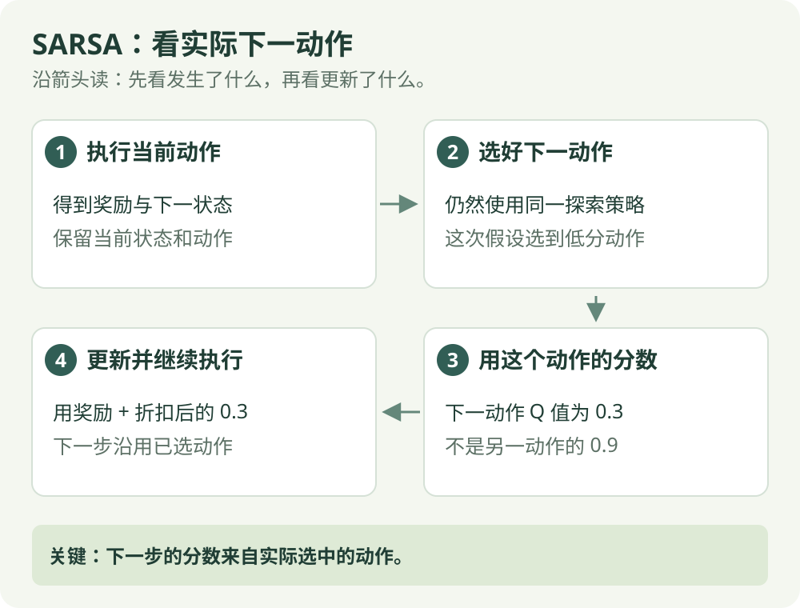

# SARSA：算法直觉

[算法直觉](sarsa.md) · [公式讲解](../math/sarsa.md) · [Python 实践](../code/sarsa.md)

同策略 / 表格控制

## 一句话理解

学习时，把自己接下来实际会做的动作也考虑进去。

## 先看这张图

{ .rl-figure loading=lazy }

[打开图示大图](../assets/sarsa.svg)

图中每个框只展示主要学习关系，完整细节见后面的公式与代码。

## 这几个词是什么意思

**Q 表**：按“位置 + 动作”存分数。**ε-greedy**：多数时候选高分动作，少数时候随机试一下；随机试也可能选到高分动作。

## 名字从哪里来

一次更新使用五项信息：当前状态 S、当前动作 A、奖励 R、下一状态 S、下一动作 A，因此叫 SARSA。

## 用走廊举例

当前位置向右走后，下一位置有一个高分动作和一个低分动作。如果探索策略恰好选中了低分动作，SARSA 会用这个实际选中的动作分数作为未来估计。它学的是包括探索行为在内的当前策略。

## 把名字拆成一条五格记录

SARSA 这个名字来自 State、Action、Reward、State、Action，正好是更新要用的五项：

| 当前情况 | 现在的动作 | 收到奖励 | 下一情况 | 已选好的下一动作 |
| --- | --- | --- | --- | --- |
| 状态 3 | 向右 | 0.1 | 状态 4 | 向左 |

这是专门比较算法的假想奖励，未沿用走廊的 −0.01。假设状态 4 的向左分数 0.3、向右分数 0.9。虽然向右看起来更好，但探索机制这次选了向左，SARSA 就按 0.3 估计接下来的收益。

折扣 0.9 时，当前向右动作的目标是 `0.1 + 0.9 × 0.3 = 0.37`。若旧分数 0.4、学习率 0.2，新分数为 0.394，略微下降。**“刚刚向右”与“下一步向左”属于不同时刻，不矛盾。**

下一轮真的要执行刚选好的向左。若更新时用向左的分数，执行前却又重新抽了向右，就不能再说这次目标对应后续实际采取的动作。代码中的动作交接因此很重要。

## 它怎么工作

1. 用 ε-greedy 策略选动作：大部分时候选高分动作，少数时候随机探索。
2. 执行动作，得到奖励和下一状态。
3. 用同一套策略选下一动作。
4. 用这个下一动作的 Q 值更新当前 Q 值，并真正执行下一动作。

## 和 Q-learning 的区别

SARSA 是 **同策略** 方法：产生数据与被评估的决策规则一致。Q-learning 的目标则假设下一步选 Q 值最大的动作，即使采样时没有选它。

## 在放牧研究里如何理解

可以先把机器人指令离散为几个方向，用小表格理解算法。如果部署时也持续探索，SARSA 的价值目标会反映探索带来的影响，但这不等于它在所有任务里更安全或更好。

## 检查自己是否看懂

**下一步最高分为 0.9，但实际选到 0.3，用哪个？**

??? success "展开答案"

    用 0.3，下一步真正执行的也必须是刚选好的动作。

{ .rl-figure loading=lazy }

[打开图示大图](../assets/sarsa-vs-q.svg)

## 进一步阅读

[Sutton 与 Barto 教材，第 6 章](https://incompleteideas.net/book/the-book-2nd.html)

[David Silver 对应课程讲义](https://davidstarsilver.wordpress.com/wp-content/uploads/2025/04/lecture-5-model-free-control-.pdf)
