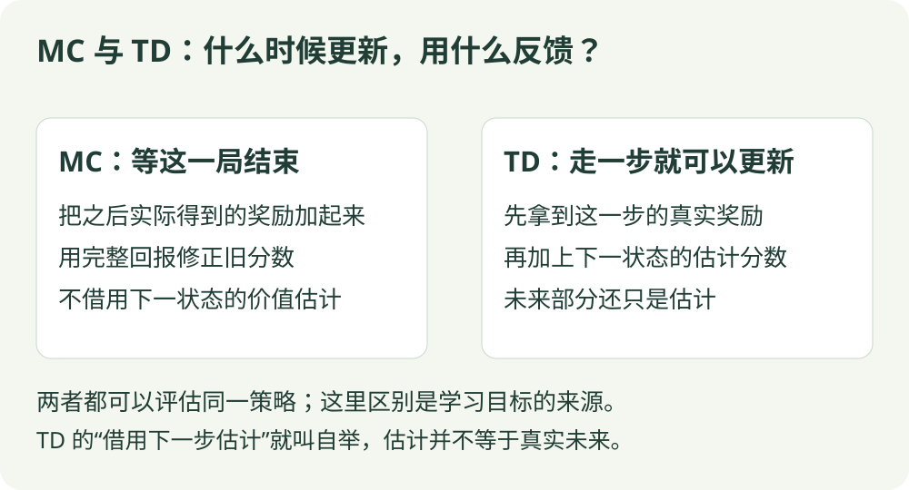

# 时序差分 TD(0)：算法直觉

[算法直觉](td.md) · [公式讲解](../math/td.md) · [Python 实践](../code/td.md)

逐步更新 / 价值评估

## 一句话理解

刚走一步，就用眼前奖励和对下一步的估计修正分数。

## 先看这张图

{ .rl-figure loading=lazy }

[打开图示大图](../assets/td.svg)

图中每个框只展示主要学习关系，完整细节见后面的公式与代码。

## 这几个词是什么意思

**自举**：用已有估计帮助更新另一个估计。**TD 误差**：刚算出的目标减去原先的分数。

## 用走廊举例

你原来认为当前位置值 0.3。走一步得到了 −0.01，而下一位置估计值 0.8。按折扣 0.95 看，新目标是 −0.01 + 0.95 × 0.8 = 0.75。当前位置的分数向 0.75 靠近一点。

## 整局还没结束，为什么也能学

站在位置 3 时，你觉得未来平均能得 0.3 分。走到位置 4，刚收到 −0.01，又知道位置 4 暂时估为 0.8。虽然还没走到终点，也能把“眼前代价加后面的估计”合成一个临时目标。

这个目标像一份会修订的参考答案，并不是已经发生的全部结果。下一位置估计错了，当前更新也会受影响；多次访问与继续修正才帮助改善估计。

MC 等完整结果，TD 先用估计补上还没发生的部分。TD 可以更早更新，却没有因此免除采样误差与价值估计误差。

## 它怎么工作

1. 按固定策略选择动作。
2. 观察奖励和下一状态。
3. 计算一步目标与当前估计之间的差。
4. 用这个差更新当前状态的价值。

## 和 MC 的区别

MC 使用完整回报；TD 使用部分奖励加上自己的估计，这叫 **自举**。因此 TD 可以更早更新，但目标本身也可能不准。TD(0) 的 0 表示这里使用最基础的一步版本，不代表学习率为零。

## 本篇的边界

TD(0) 在这里是策略价值评估，不直接负责找最优动作。SARSA 与 Q-learning 可以理解为把类似的 TD 更新用于动作价值和控制。

## 在放牧研究里如何理解

走一步就能利用新观测更新价值，适合理解长时间交互任务中的学习信号。真实终止时没有后续价值；仅因外部时间限制截断时，通常仍要估计后续价值。

## 还没到终点，凭什么能更新

你在位置 3，原来估计它值 0.3。走到位置 4，付出本步代价 −0.01；旧表中位置 4 值 0.8。虽然还不知道最终成功与否，但可以先利用这个已有判断。

| 心里问的问题 | 计算 | 得到什么 |
| --- | --- | --- |
| 这次经历给出了什么新参考？ | −0.01 + 0.95 × 0.8 | 目标 0.75 |
| 和原来差多远？ | 0.75 − 0.3 | 误差 0.45 |
| 这次只相信十分之一，怎么改？ | 0.3 + 0.1 × 0.45 | 新价值 0.345 |

位置 4 的 0.8 也可能估错，所以这里只改一点，之后有新经历再修正。目标 0.75 不是环境额外给的奖励，环境本步只给了 −0.01。

这就是 TD 与 MC 的核心区别：MC 等结局，把之后实际收到的奖励加起来；TD 提前用“已经发生的一步 + 尚未发生部分的估计”给出反馈。本例只学状态分数，实际怎么走仍由随机策略决定。

## 检查自己是否看懂

**下一状态已经真正终止，还要加未来估计吗？**

??? success "展开答案"

    不加。终止后已经没有这个回合的后续奖励。

{ .rl-figure loading=lazy }

[打开图示大图](../assets/mc-vs-td.svg)

## 进一步阅读

[Sutton 与 Barto 教材，第 6 章](https://incompleteideas.net/book/the-book-2nd.html)

[David Silver 对应课程讲义](https://davidstarsilver.wordpress.com/wp-content/uploads/2025/04/lecture-4-model-free-prediction-.pdf)
