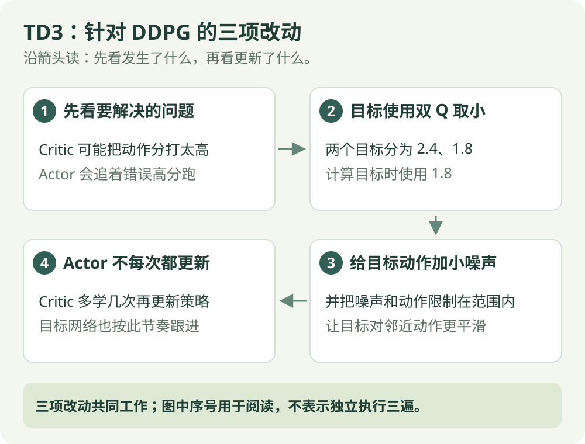

# TD3：算法直觉

[算法直觉](td3.md) · [公式讲解](../math/td3.md) · [Python 实践](../code/td3.md)

异策略 / 连续动作

## 一句话理解

给 DDPG 的分数估计和策略更新加三道改进。

## 先看这张图

{ .rl-figure loading=lazy }

[打开图示大图](../assets/td3.svg)

图中每个框只展示主要学习关系，完整细节见后面的公式与代码。

## 这几个词是什么意思

**双 Critic**：两个独立的 Q 估计。**目标平滑**：算未来目标时，对目标动作加小幅有界噪声。**延迟更新**：Critic 更频繁更新，Actor 与目标网络更新较少。

## 三项设计各解决什么

1. **双 Q 取较小值**：目标使用两个估计中的较小者，减轻过高估计的影响。
2. **延迟策略更新**：Critic 多更新几次，Actor 和目标网络再跟进，避免决策者过快追逐尚不可靠的分数。
3. **目标策略平滑**：给目标动作加入有界小噪声，避免把某个很窄的虚假高分尖峰当作好动作。

## 噪声有两种，不要混淆

交互时的噪声用于探索；计算目标时的噪声用于平滑学习目标。前者改变采集到的轨迹，后者改变 Critic 学习时使用的目标动作。

## 为什么有两个评分器，还要控制更新节奏

一个评分器如果在某个动作附近估得特别高，Actor 可能专门追着这个虚高分走。TD3 让两个 Critic 对下一动作分别评分，目标取较小的一个，减少乐观误差的传播。

同时，让 Critic 多更新几次，再更新 Actor；算目标时还给下一动作加有界小噪声。这三项分别作用于评分目标、学习节奏和目标动作，不能只记成“加了两份网络”。

取小也可能偏保守，两个评分器也可能一起估错。算法设计是缓解某类问题的方法，不是判断动作绝对正确的证明。

## 学习流程

采样并回放 → 构造带噪声的目标动作 → 两个目标 Q 取小 → 更新两个 Critic → 每隔若干次更新 Actor 和目标网络。

## 适用范围与限制

这里讲标准连续动作 TD3。双 Q 并不能保证没有估计偏差，也可能更保守。其有效性需要通过相同条件下的实验比较。

## 在放牧研究里如何理解

与 DDPG 使用相同连续动作接口，有利于做算法对照。记录路径、成功率和训练成本，不能只根据训练奖励选方法。

## 把三项改进放进同一次学习

继续用 −1～1 的假想动作范围。目标 Actor 给下一状态动作 0.4，训练目标的小噪声为 0.1，因此用动作 0.5 去查询两个目标 Critic。

| 顺序 | 数字例子 | 要解决什么 |
| --- | --- | --- |
| 目标动作平滑 | 0.4 + 0.1 = 0.5 | 不只盯着某一个极窄的动作点 |
| 双 Q 取小 | 两份预测 2.4、1.8，采用 1.8 | 减少虚高预测传给上一状态 |
| 计算共同目标 | 奖励 0.1，折扣 0.9，得到 1.72 | 两个当前 Critic 都练习预测这个目标 |
| 延迟改 Actor | 如每更新 Critic 两次，再改 Actor 一次 | 让评分先修正一阵，再让动作跟着变 |

这里的动作 0.5 只用于算训练目标，不会因此真的在下一时刻执行。实际探索动作由交互流程另行产生。这正是两种噪声最容易混淆的地方。

取较小分数不代表知道真值，也可能偏低。TD3 只是在训练设计中减少一类误差，最终是否有效还得通过环境中的表现判断。

## 三项改进针对的是三处不同的问题

双 Q 的两个评分器都对给定观测和动作给分，目标采用较小值，减少一类偏高参考。它们没有分别控制两台机器人，也不是把两个动作平均后执行。

目标平滑在**计算后续参考时**给动作一个有界小扰动；探索噪声在**收集经历时**改变实际行动。一个服务于学习目标，一个服务于试探环境，不能因为都出现 noise 就当成同一个参数。

延迟更新先让 Critic 多做一些学习，再让 Actor 借用评分的变化方向。这是在安排优化次数，机器人仍按环境接口正常行动。即便双 Q 取小，也不能保证无偏或永远正确；低估、数据不足和模型误差仍可能存在。

## 检查自己是否看懂

**双 Q 取小在训练的每一个位置都使用吗？**

??? success "展开答案"

    不是。标准 TD3 的 Critic 目标取双 Q 中较小值；Actor 通常使用第一个 Critic 的评分。

## 进一步阅读

[Spinning Up：TD3](https://spinningup.openai.com/en/latest/algorithms/td3.html)
