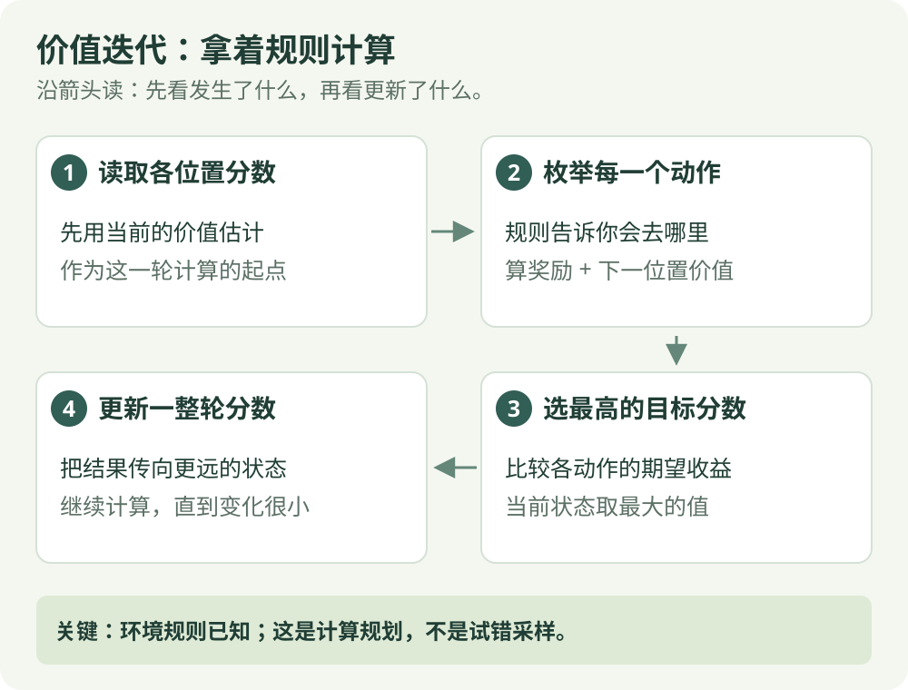

# 价值迭代：算法直觉

[算法直觉](value-iteration.md) · [公式讲解](../math/value-iteration.md) · [Python 实践](../code/value-iteration.md)

已知模型 / 规划

## 一句话理解

拿着已知规则，算出每个位置最好能有多大收益。

## 先看这张图

{ .rl-figure loading=lazy }

[打开图示大图](../assets/value-iteration.svg)

图中每个框只展示主要学习关系，完整细节见后面的公式与代码。

## 这几个词是什么意思

**环境模型**：告诉你某个动作会导致什么结果；如果结果不确定，还要知道各结果的概率。**价值**：从这里开始，之后的奖励大概能累积多少。

## 用走廊举例

一条走廊右端奖励 +1，左端奖励 −1，中间每走一步扣 0.01。起初所有位置的分数都是 0。先算终点附近的位置，再把这些信息一轮轮传到更远的位置，最终得到每个位置的长期分数。

## 分数怎样从终点一格一格传回来

想象你拿到了走廊的地图：每个位置向左、向右会到哪里，奖励是多少，都已经知道。你现在做的是在纸上算分数，不必先真的走一局。

开始时每个位置估计为 0，折扣取 0.95。只看靠近右端的两个位置：

| 计算轮次 | 位置 5 向右的分数 | 位置 4 向右的分数 | 为什么 |
| --- | --- | --- | --- |
| 第 1 轮 | 1 | −0.01 | 从 5 到终点立即拿到 1；从 4 到 5 时，读取的旧价值还是 0 |
| 第 2 轮 | 1 | −0.01 + 0.95 × 1 = 0.94 | 第 1 轮已经把位置 5 评为 1，现在这条信息传给位置 4 |

同理，再一轮就能把右侧收益传到位置 3。每个位置还要计算向左的候选分数，再挑两者较大者。**传播的是长期收益估计，不是机器人每轮向左或向右移动。**

如果地图未知，不能凭空调用所有动作的真实结果；那就要通过 MC、TD 等方法从实际经历里学。先区分“已经知道规则、计算走法”和“边尝试边认识结果”，后面的算法就容易分清。

## 它怎么工作

1. 为每个状态设置初始价值。
2. 枚举这个状态下的动作，计算即时奖励与下一状态的折扣价值。
3. 取其中最大的数，作为这个状态的新价值。
4. 重复更新，直到价值变化足够小；然后选择价值最高的动作。

## 和其他算法的区别

价值迭代需要环境模型：知道状态转移概率和奖励。它属于动态规划，不需要先通过大量交互猜规则。策略迭代则交替进行“评估当前策略”和“改进策略”，是另一条动态规划路线。

## 在放牧研究里如何理解

如果将场地划成少量格子，并给出简化的羊群转移规则，可以用它验证小模型。真实羊群状态复杂、转移未知时，直接枚举整个模型通常不可行。

## 容易误解的地方

这里更新的是所有可能动作的期望，而不是只看下一次实际发生的结果。模型错误时，计算再精确也只是在求错误模型的解。

## 检查自己是否看懂

**只有地图和规则、没有采样轨迹，能用价值迭代吗？**

??? success "展开答案"

    可以。它依赖已知模型做规划，代码用已知的 `step` 规则枚举两个动作。

## 进一步阅读

[Sutton 与 Barto 教材，第 4 章](https://incompleteideas.net/book/the-book-2nd.html)

[David Silver 对应课程讲义](https://davidstarsilver.wordpress.com/wp-content/uploads/2025/04/lecture-3-planning-by-dynamic-programming-.pdf)
