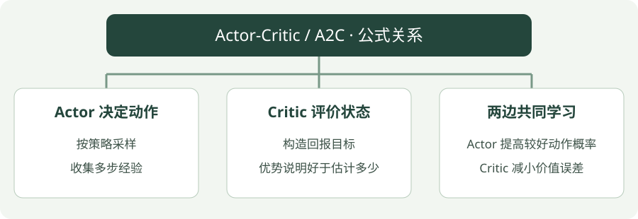

# Actor-Critic / A2C：公式讲解

[算法直觉](../intuition/a2c.md) · [公式讲解](a2c.md) · [Python 实践](../code/a2c.md)

先读 [公共符号与回报](index.md)，再看本页。所有数值例子都只用于说明一次更新。

!!! tip "先用一句人话读公式"

    优势估计 = 回报目标 − 原先状态价值；策略利用优势调整概率，价值模块向回报目标靠近。

!!! tip "读完这页，你应该能做到"

    算出一步优势，分清 Actor 与 Critic 的学习目标。

    **先会这些就够了**：TD 误差、策略与价值。

## 看图梳理

{ .learning-figure }

[打开大图](../../assets/learning/rl-math-a2c.svg)

**Actor 决定动作**：按策略采样，收集多步经验；**Critic 评价状态**：构造回报目标，优势说明好于估计多少；**两边共同学习**：Actor 提高较好动作概率，Critic 减小价值误差。

## 同一条经历，给两个模块两种任务

对 Critic，参考目标是 0.55，旧预测是 0.2，要减小二者误差。对 Actor，差值 0.35 是权重，鼓励相应动作在类似情况下更容易被选到。两个损失都用了这条经历，优化目的却不同。

log π 可以先按“采样动作对数概率”理解，负号用来适配梯度下降。正优势乘上负 log 概率形成策略损失；减少这个损失对应提高该动作的概率倾向，不是降低环境奖励。

本页先讲一步目标；n 步版本则先累计这几步奖励，再在片段末尾用价值补上还没观察到的收益。若已经真正终止，就没有末尾未来价值可补。

## 优势：结果比预期好多少

一步版本可以用 TD 误差近似优势：

$$
\hat A_t=r_{t+1}+\gamma(1-d_t)V_\phi(s_{t+1})-V_\phi(s_t)
$$

$$
L_{\mathrm{actor}}=-\frac1B\sum_t\log\pi_\theta(a_t\mid s_t)\,\operatorname{stopgrad}(\hat A_t)
$$

$$
L_{\mathrm{critic}}=\frac1B\sum_t(V_\phi(s_t)-\operatorname{stopgrad}(\hat R_t))^2
$$

## 逐项读懂

$\theta$ 是策略参数，$\phi$ 是价值参数；$B$ 是样本数。$\hat R_t$ 是估计回报目标。`stopgrad` 表示更新策略时把优势当成固定权重，不沿这条路径训练价值函数。前面的负号来自优化器通常做梯度下降，而策略希望提高带正优势动作的概率。

回报目标也要视为固定数字。即使它包含旧价值估计，更新当前 Critic 时也不沿目标项反向传播。优势是带采样噪声的估计，不是对某个动作好坏的精确证明。

## 算一次看看

当前价值 0.2、奖励 0.1、下一价值 0.5、折扣 0.9且未终止，则优势为 0.35。Actor 得到正反馈；Critic 的一步目标为 0.55，也会向这个值靠近。

## 从一步到一段

$$
\hat R_t=\sum_{k=0}^{n-1}\gamma^k r_{t+k+1}+\gamma^n V_\phi(s_{t+n})
$$

这是中途未遇到终止时的 n 步目标；若提前真正终止，只累计到终点且不自举。A2C 常按一段 rollout 更新，实际实现也可以用 GAE；不要把一步优势例子误认为代码内部唯一的计算方式。

## 同一个目标怎样生成两个损失

沿用目标 0.55、旧状态价值 0.2，优势为 0.35。假设 Actor 对本次采样动作的概率为 0.4：

| 模块 | 当前要计算什么 | 数值 |
| --- | --- | --- |
| Actor | −log(0.4) × 0.35 | 约 0.321 |
| Critic | (0.2 − 0.55)² | 0.1225 |

若仅把动作概率提高为 0.5，并在这一小步中保持优势不变，Actor 项变成 `−log(0.5) × 0.35 ≈ 0.243`，损失下降。若 Critic 预测升为 0.3，它的误差变 `(0.3 − 0.55)² = 0.0625`，也下降。这样就能看见两个模块各自朝哪个目标学习。

stopgrad 可以理解成“这一小步把参考数字钉住”。否则 Actor 可能通过改变优势的计算而降低损失，含义就不是用既定评价来调整动作概率了。

以上都是单条样本且忽略熵正则的演算。完整一批会求平均，网络也可能共享部分参数；不能承诺每条样本的概率都严格按单条分析变化。

## 多步回报为什么还有段末的价值？

假设收集了两步，奖励为 0.1、0.2，随后并未真正终止，段末状态价值估计为 0.5，折扣 0.9。两步目标为：

`0.1 + 0.9 × 0.2 + 0.9² × 0.5 = 0.685`

前两项来自已经观察到的奖励，最后一项补上片段结束后尚未观察到的回报。旧状态价值若为 0.2，优势为 0.485。若第二步后真正终止，就只剩 `0.1 + 0.9 × 0.2 = 0.28`，优势为 0.08；即时奖励没有被清掉，只有后续估计被去掉。

Critic 用回报目标拟合 V，Actor 用优势给 log 概率加权。先把参考固定，再分别保留各自预测的梯度。价值预测可能影响优势估计，但在这次策略损失中不能让它通过改变评价本身来规避既定反馈。

## 与代码对照

`n_steps=32` 控制收集多少步再更新。当前示例使用 SB3 A2C 默认的 `gae_lambda=1.0`，因此实际优势来自一段采样中的多步回报减旧价值；采样片段结束且未真正终止时，会用末尾价值估计补上后续收益。本页开头的一步 TD 只是帮助理解优势的简化例子。

实现还包含价值损失权重与可选的熵项。Actor-Critic 是方法家族，A2C 是这里使用的具体版本。

## 不看答案，自己判断一次

回报目标为 0.55，旧价值为 0.2。优势是多少？是否证明该动作永远更好？

??? success "查看推理与答案"

    优势估计是 0.35。它是由这批数据和价值估计得到的反馈，带有噪声，不能证明动作在所有情况下都更好。

## 进一步阅读

[Stable-Baselines3：A2C](https://stable-baselines3.readthedocs.io/en/master/modules/a2c.html)
