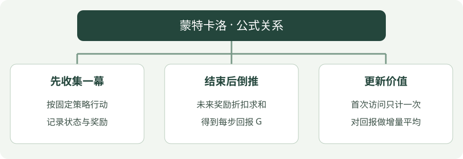

# 蒙特卡洛（MC）：公式讲解

[算法直觉](../intuition/mc.md) · [公式讲解](mc.md) · [Python 实践](../code/mc.md)

先读 [公共符号与回报](index.md)，再看本页。所有数值例子都只用于说明一次更新。

!!! tip "先用一句人话读公式"

    新均值 = 旧均值 +（本次回报 − 旧均值）÷ 已统计次数。

!!! tip "读完这页，你应该能做到"

    从末尾倒推回报，再把新样本加入平均。

    **先会这些就够了**：奖励与回报、平均数。

## 看图梳理

{ .learning-figure }

[打开大图](../../assets/learning/rl-math-mc.svg)

**先收集一幕**：按固定策略行动，记录状态与奖励；**结束后倒推**：未来奖励折扣求和，得到每步回报 G；**更新价值**：首次访问只计一次，对回报做增量平均。

## 把“折扣求和”和“跨回合平均”分成两步

第一步在**一条轨迹内部**算回报：当下奖励权重是 1，再下一步是 γ，再后面是 γ²。终点的奖励也算进去，但终点之后没有奖励。

第二步在**多个访问该状态的回合之间**取平均。若已有两个样本，均值 0.5，第三个样本为 0.8，总和原来是 1.0，加入后为 1.8，除以 3 得 0.6。增量公式只是用“旧均值与新差距”算出同一个答案，N 必须先增加到 3。

两步分别回答“这一次结果是多少”和“这套策略平均怎么样”。回报有运气成分，加入一次样本不等于已经得到精确价值。

## 先算真实回报

$$
G_t=\sum_{k=0}^{T-t-1}\gamma^k r_{t+k+1}
$$

$T$ 是回合结束时间；$r_{t+1}$ 是动作后收到的奖励。$G_t$ 就是从时间 $t$ 往后把奖励打折加起来，不是只有最后一个奖励。

## 再求平均

$$
V(s)\leftarrow V(s)+\frac{1}{N(s)}[G_t-V(s)]
$$

- $N(s)$：该状态已被统计的回合数，本篇采用首次访问。
- 方括号：本次真实回报与旧均值的差。
- $1/N(s)$：样本越来越多时，每个新样本对平均值的影响变小。

## 算一次看看

一条轨迹的奖励是 −0.01、−0.01、+1，折扣为 0.9，则第一步的回报为 −0.01 − 0.009 + 0.81 = 0.791。如果该状态先前两次回报平均为 0.5，加入第三次结果后，均值变成 $0.5+(0.791-0.5)/3=0.597$。

## 公式为什么这样写

这是平均数的增量写法，和把所有样本相加再除以数量等价，但不用保存所有历史回报。固定学习率版本也存在，但不再是普通算术平均。

## 从奖励列表倒着填一张回报表

折扣 0.9，奖励列表为 `[−0.01, −0.01, 1]`。结束后没有未来奖励，先把“更后面的回报”设为 0。

| 时间下标 t | 本步奖励 | 已算出的后续回报 | 本时刻回报 |
| --- | --- | --- | --- |
| 2，最后一步 | 1 | 0 | 1 + 0.9 × 0 = 1 |
| 1 | −0.01 | 1 | −0.01 + 0.9 × 1 = 0.89 |
| 0，第一步 | −0.01 | 0.89 | −0.01 + 0.9 × 0.89 = 0.791 |

这张表解释了为什么代码倒序循环：算 t=0 时必须先知道 t=1 的回报。倒序的是计算过程，机器人实际行动仍按时间正序发生。

随后才跨回合平均。当前状态已有 2 次记录、均值 0.5；加入 0.791 后，计数先变 3，差距为 0.291，本次修正量为 0.291 ÷ 3 = 0.097，新均值 0.597。**回报表每局重建，价值表和计数表跨局保留。**

## 平均数更新可以从小学算式推出来

如果前 N−1 个样本的平均是 V_old，那么之前的总和就是 `(N−1) × V_old`。现在加入新回报 G，新平均为：

`V_new = ((N−1) × V_old + G) / N`

把分子写成 `N × V_old + (G − V_old)`，再除以 N，就得到：

`V_new = V_old + (G − V_old) / N`

这正是正文的增量平均公式。N 是**已经包含新样本的次数**；在代码中要先增加 counts，再使用它。除以次数使每条样本在普通平均中具有相同最终权重，不等于越到后面就把早先的样本忘光。

回报递推也来自拆第一项：`G_t = r_{t+1} + γ × G_{t+1}`。把后续回报展开，便是奖励、γ 倍下一奖励、γ² 倍再下一奖励；从终点倒推只是方便利用已经算好的后续值。

## 与代码对照

`total = reward + gamma * total` 从后向前算回报；`visited` 保证一幕只统计某状态第一次出现；`counts[s]` 对应 $N(s)$。代码评估均匀随机策略，不在更新后改策略。

## 不看答案，自己判断一次

先前两个样本的平均回报为 0.5，第三次回报为 0.8，新平均是多少？

??? success "查看推理与答案"

    0.5 + (0.8 − 0.5) / 3 = 0.6。分母是加入新样本后的次数 3。

## 进一步阅读

[Sutton 与 Barto 教材，第 5 章](https://incompleteideas.net/book/the-book-2nd.html)

[David Silver 对应课程讲义](https://davidstarsilver.wordpress.com/wp-content/uploads/2025/04/lecture-4-model-free-prediction-.pdf)
