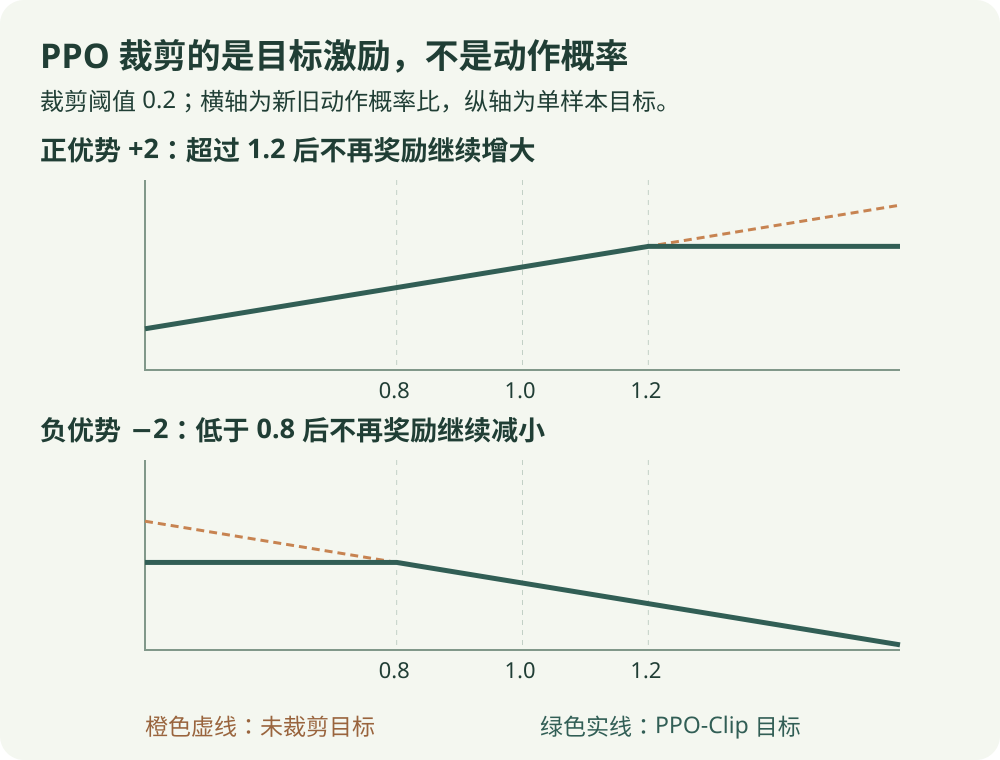

# PPO：公式讲解

[算法直觉](../intuition/ppo.md) · [公式讲解](ppo.md) · [Python 实践](../code/ppo.md)

先读 [公共符号与回报](index.md)，再看本页。所有数值例子都只用于说明一次更新。

!!! tip "先用一句人话读公式"

    对每条样本，比较“概率比 × 优势”和“裁剪后的概率比 × 优势”，取较小者；平均后作为要提高的目标。

!!! tip "读完这页，你应该能做到"

    分别计算正负优势的裁剪目标，不把裁剪误认为硬改概率。

    **先会这些就够了**：优势、新旧策略；本页讲 PPO-Clip。

## 看图梳理

{ .learning-figure }

[打开大图](../../assets/learning/rl-math-ppo.svg)

**先用旧策略采样**：保留旧 log 概率，估计优势；**比较新旧概率**：概率比率乘优势，裁剪目标的优化激励；**有限次数更新**：对一批数据多轮优化，裁剪不是概率硬限制。

## 概率比

$$
\rho_t(\theta)=\frac{\pi_\theta(a_t\mid s_t)}{\pi_{\mathrm{old}}(a_t\mid s_t)}
$$

代码通常用 $\exp(\log\pi_\theta-\log\pi_{\mathrm{old}})$ 计算。$\rho=1$ 表示这条样本对应动作的概率没变；$\rho>1$ 表示更容易选到。

## PPO-Clip 目标

$$
L^{\mathrm{clip}}(\theta)=\frac1B\sum_t\min\left(\rho_t\hat A_t,\operatorname{clip}(\rho_t,1-\epsilon,1+\epsilon)\hat A_t\right)
$$

这是要 **最大化** 的策略目标。写成优化器损失时通常取负号。

- $\hat A_t$：优势估计，正表示比预期好，负表示比预期差。
- $\epsilon$：裁剪阈值，不是 ε-greedy 的探索概率。
- `clip`：把概率比限制在指定范围。
- `min`：使用两个目标中更保守的一个。

## 正负优势各算一次

先算“原比率 × 优势”，再算“裁剪比率 × 优势”，最后比较两个数，取较小的那个。**负数要按数轴比较，不能比较绝对值。**

$\epsilon=0.2$，优势为 +2，概率比为 1.5：原项为 3，裁剪项为 2.4，取 2.4。

优势为 −2，概率比为 0.5：原项为 −1，裁剪项为 −1.6，取 −1.6。这限制了通过大幅降低坏动作概率而得到的额外目标提升。相反方向的变化不一定被裁剪，所以裁剪不是参数距离的硬约束。

## 优势如何估计

$$
\hat A_t=\delta_t+\gamma\lambda\delta_{t+1}+(\gamma\lambda)^2\delta_{t+2}+\cdots
$$

这是 GAE 的直观形式，$\delta$ 是 TD 误差，$\lambda$ 调节使用多远的误差信号。真正终止时不继续累加下一幕；rollout 边界用价值估计处理。GAE 并非 PPO 独有。实际计算只沿当前采样片段回溯，不把重置后的新回合误差加进上一回合；外部时间截断需要使用截断前的最终观测处理自举。

可以把 $\lambda$ 理解成“把后面几步的误差也算进来多少”。这里的代码使用默认值 0.95，并在策略更新前对优势做标准化，所以上面的 ±2 是说明裁剪算术的例子。

## 与代码对照

`clip_range` 对应 $\epsilon$，`n_steps` 是采样长度，`n_epochs` 是同批数据更新轮数。完整训练还包括价值损失和可选熵项。旧动作对数概率必须来自采样时的策略，不能每轮用新策略覆盖。

## 从曲线看裁剪

{ .rl-figure loading=lazy }

[打开图示大图](../assets/ppo-clip.svg)

正优势时右侧变平；负优势时左侧变平。橙色虚线是未裁剪目标，绿色实线是使用 `min` 得到的裁剪目标。曲线展示目标值，横轴只比较同一采样动作的新旧概率。

## 不看答案，自己判断一次

优势为 −2，比率为 0.5，裁剪范围为 0.8～1.2。两项分别是多少，min 选哪一个？

??? success "查看推理与答案"

    原项 −1；裁剪项 0.8 × (−2) = −1.6；取 −1.6。注意“较小”是数值较小，不是绝对值较小；实际概率不会被强制改到边界。

## 进一步阅读

[Spinning Up：PPO](https://spinningup.openai.com/en/latest/algorithms/ppo.html)
