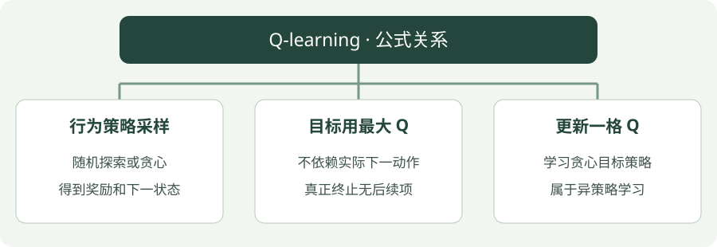

# Q-learning：公式讲解

[算法直觉](../intuition/q-learning.md) · [公式讲解](q-learning.md) · [Python 实践](../code/q-learning.md)

先读 [公共符号与回报](index.md)，再看本页。所有数值例子都只用于说明一次更新。

!!! tip "先用一句人话读公式"

    目标 = 奖励 + 折扣 × 下一状态的最大 Q 值；当前 Q 向目标挪一点。

!!! tip "读完这页，你应该能做到"

    指出目标中使用的是下一状态最大的 Q。

    **先会这些就够了**：Q 表、贪心选择。

## 看图梳理

{ .learning-figure }

[打开大图](../../assets/learning/rl-math-q-learning.svg)

**行为策略采样**：随机探索或贪心，得到奖励和下一状态；**目标用最大 Q**：不依赖实际下一动作，真正终止无后续项；**更新一格 Q**：学习贪心目标策略，属于异策略学习。

## 核心公式

$$
Q(s_t,a_t)\leftarrow Q(s_t,a_t)+\alpha\left[r_{t+1}+\gamma(1-d_t)\max_{a'}Q(s_{t+1},a')-Q(s_t,a_t)\right]
$$

## 逐项读懂

唯一关键变化是 $\max_{a'}$：不是用实际下一动作的 Q 值，而是用下一状态中最高的 Q 值。它在估计“接下来按贪心策略行动”的收益。

$a'$ 是用于枚举下一状态动作的占位符，和当前动作 $a_t$ 不是同一个变量。

## 最大值与最大动作

训练更新用 `max(q[next_state])` 获取最高分；选动作则需要找到这个最高分属于哪个动作。并列时，示例随机打破平局，避免总是偏向第一个动作。

## 把 max 的范围圈出来

已知当前 Q=0.4、奖励 0.1、折扣 0.9、步长 0.2，下一状态两个动作 Q=[0.3, 0.9]，未终止。

| 顺序 | 计算 | 注意读取位置 |
| --- | --- | --- |
| 1 | max(0.3, 0.9) = 0.9 | 比较同一个下一状态的不同动作 |
| 2 | 0.1 + 0.9 × 0.9 = 0.91 | 第一个 0.9 是折扣，第二个是最高 Q |
| 3 | 0.91 − 0.4 = 0.51 | 目标减去当前动作旧 Q |
| 4 | 0.4 + 0.2 × 0.51 = 0.502 | 写回当前这一格 |

不要对整张表取最大，也不要把即时奖励 0.1 放进 max 的候选项。下标告诉你从哪里读取，比记住“取最大”三个字更重要。

若真的到终点，第一行的未来评分就不需要：目标只等于本次奖励。奖励为 1 时，本例新 Q 为 `0.4 + 0.2 × (1 − 0.4) = 0.52`；终点奖励没有被丢掉。

## max 从“最优后续走法”这个问题中来

Q-learning 不要求目标跟随实际下一动作。它用下一状态的最高当前 Q 作参考，表达“这一动作完成后，后续采用贪心选择”的目标。即时奖励仍由本次实际经历给出；可以乐观参考后续，但不能伪造刚发生的事实。

例如这次在 s=3 做 a=0，来到 ns=2：被修改的是 q[3][0]，max 应读取 q[2]。即使 q[3][1] 很大，也不是这一目标的未来项。先用索引画箭头，再做数值计算，能避免最常见的写错行错误。

该更新反复向 Bellman 最优目标靠近。有限表格、充分访问、合适的学习率等条件对经典收敛结论很重要；神经网络版本还有函数近似的影响。学习目标是什么，与有限数据下有没有已经达到这个目标，是两件事。

## 与代码对照

`target` 里的 `max(q[ns])` 对应公式中的最大值；`done` 时目标只保留即时奖励。表格方法的经典收敛结论有访问覆盖与学习率等条件，不代表任意常数学习率、有限训练或神经网络版本都能得到最优解。

{ .rl-figure loading=lazy }

[打开图示大图](../assets/sarsa-vs-q.svg)

## 自己算一次

拖动数字，观察一次更新

<label>当前旧估计 <output data-display="current">0.4</output><input type="range" data-value="current" aria-label="当前旧估计" min="-1" max="2" step="0.01" value="0.4"></label>
<label>本次奖励 <output data-display="reward">0.1</output><input type="range" data-value="reward" aria-label="本次奖励" min="-1" max="1" step="0.01" value="0.1"></label>
<label>实际下一动作的 Q 值 <output data-display="next">0.3</output><input type="range" data-value="next" aria-label="实际下一动作的 Q 值" min="-1" max="2" step="0.01" value="0.3"></label>
<label>另一个下一动作的 Q 值 <output data-display="other">0.9</output><input type="range" data-value="other" aria-label="另一个下一动作的 Q 值" min="-1" max="2" step="0.01" value="0.9"></label>
<label>折扣因子 <output data-display="gamma">0.9</output><input type="range" data-value="gamma" aria-label="折扣因子" min="0" max="1" step="0.01" value="0.9"></label>
<label>学习率 <output data-display="alpha">0.2</output><input type="range" data-value="alpha" aria-label="学习率" min="0" max="1" step="0.01" value="0.2"></label>

<label class="rl-terminal"><input type="checkbox" data-value="terminal"> 下一状态真正终止</label>

SARSA：目标 0.37 → 新 Q 0.394

Q-learning：目标 0.91 → 新 Q 0.502

这是一次更新的演示；滑块改变输入，不会训练机器人。

<noscript>当前显示默认值。启用浏览器 JavaScript 后可拖动滑块。</noscript>

## 不看答案，自己判断一次

下一状态两个动作的 Q 为 0.3、0.9，尚未终止；下一步探索准备选 0.3 对应的动作。Q-learning 的未来项使用哪个 Q？

??? success "查看推理与答案"

    使用下一状态的最高 Q，即 0.9；采样动作与目标中假定的后续动作可以不同。

## 进一步阅读

[Sutton 与 Barto 教材，第 6 章](https://incompleteideas.net/book/the-book-2nd.html)

[David Silver 对应课程讲义](https://davidstarsilver.wordpress.com/wp-content/uploads/2025/04/lecture-5-model-free-control-.pdf)
