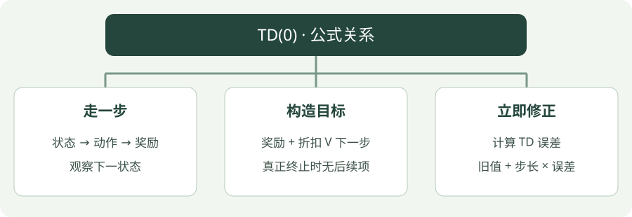

# 时序差分 TD(0)：公式讲解

[算法直觉](../intuition/td.md) · [公式讲解](td.md) · [Python 实践](../code/td.md)

先读 [公共符号与回报](index.md)，再看本页。所有数值例子都只用于说明一次更新。

!!! tip "先用一句人话读公式"

    目标 = 刚收到的奖励 + 折扣 × 下一状态估计；新分数 = 旧分数 + 学习率 ×（目标 − 旧分数）。

!!! tip "读完这页，你应该能做到"

    先算一步目标，再算误差和新价值。

    **先会这些就够了**：下一状态价值、学习率。

## 看图梳理

{ .learning-figure }

[打开大图](../../assets/learning/rl-math-td.svg)

**走一步**：状态 → 动作 → 奖励，观察下一状态；**构造目标**：奖励 + 折扣 V 下一步，真正终止时无后续项；**立即修正**：计算 TD 误差，旧值 + 步长 × 误差。

## 学习率是在调“这次相信目标多少”

先设旧值为 0.3、目标为 0.75。差距是 0.45。学习率 0.1 表示沿差距走十分之一，增加 0.045；新值 0.345。学习率 0 表示不改，1 表示这一次完全跟随目标。

在步长位于 0～1 时，新值是旧值和目标之间的加权折中，不会因为这一条更新越过目标。但这只解释表格里一格数的更新，不是所有神经网络优化的通用保证。

下面的 γ 决定未来收益权重，α 决定这次修改幅度。把 γ 调小不是把学习率调小：它改变目标本身，而不是只让学习更慢。

## 一步目标与误差

$$
y_t=r_{t+1}+\gamma(1-d_t)V(s_{t+1})
$$

$$
\delta_t=y_t-V(s_t),\qquad V(s_t)\leftarrow V(s_t)+\alpha\delta_t
$$

## 逐项读懂

- $y_t$：当前要追赶的目标，并非真实完整回报。
- $d_t$：真正终止时为 1，否则为 0。终止后没有未来价值。
- $\delta_t$：TD 误差，即“新目标 − 原来预测”。
- $\alpha$：学习率，控制朝目标移动多少。

## 把每个符号放回一条经历

以旧价值 0.3、奖励 −0.01、下一价值 0.8、折扣 0.95、学习率 0.1 为例：

| 量 | 从哪里来 | 这次是否被更新 |
| --- | --- | --- |
| 奖励 −0.01 | 刚执行动作后的环境反馈 | 否，已经发生的事实 |
| 下一价值 0.8 | 更新前的价值表 | 否，作为参考读一次 |
| 目标 0.75 | −0.01 + 0.95 × 0.8 | 临时算出来，不是价值表的另一格 |
| 当前价值 0.3 | 更新前的当前格 | 是，改为 0.345 |

如果只改变条件，把这一步设为真正终止，计算顺序仍不变，只是后续项为零：目标 −0.01，误差 −0.31，新值 `0.3 + 0.1 × (−0.31) = 0.269`。这里是人为改条件的算术比较，不代表走廊的真实终点奖励为 −0.01。

若只是采样时间到了，环境本身没有结束，不能使用这行“真正终止”的结果。截断要求重新开始收集，但是否继续估计未来取决于任务终点定义；外部时间限制通常保留自举。

## 为什么只观察一步，也能组成一个目标？

真实回报满足“第一步奖励 + 折扣后的剩余回报”。TD 不等剩余回报全部出现，暂时用下一状态的 V 估计它，所以目标是 `奖励 + γ × 下一状态估计`。这是替换未知部分为估计，不是把后续实际奖励读取出来。

更新式也能展开为 `新 V = (1−α) × 旧 V + α × 目标`。学习率在 0～1 时，它是旧预测与这次参考的加权折中。学习率决定**改变多少**；折扣决定**参考里怎样重视未来**，两个参数作用不同。

真正终止后没有剩余回报，未来部分为零；到终点时获得的即时奖励仍然存在。若是外部截断，应按任务定义和最终观测处理后续估计，不能只因为下一步需要 reset 就把未来一律抹掉。

## 与代码对照

`target` 对应 $y_t$，`values[state] += alpha * (...)` 对应更新。示例没有人工时间截断。对 Gymnasium，`terminated` 与 `truncated` 都要求重置环境，但时间限制截断通常不应把自举项清零。两者的处理取决于任务本身如何定义终点。

## 自己算一次

拖动数字，观察一次更新

<label>当前旧估计 <output data-display="current">0.3</output><input type="range" data-value="current" aria-label="当前旧估计" min="-1" max="2" step="0.01" value="0.3"></label>
<label>本次奖励 <output data-display="reward">-0.01</output><input type="range" data-value="reward" aria-label="本次奖励" min="-1" max="1" step="0.01" value="-0.01"></label>
<label>下一状态估计 <output data-display="next">0.8</output><input type="range" data-value="next" aria-label="下一状态估计" min="-1" max="2" step="0.01" value="0.8"></label>
<label>折扣因子 <output data-display="gamma">0.95</output><input type="range" data-value="gamma" aria-label="折扣因子" min="0" max="1" step="0.01" value="0.95"></label>
<label>学习率 <output data-display="alpha">0.1</output><input type="range" data-value="alpha" aria-label="学习率" min="0" max="1" step="0.01" value="0.1"></label>

<label class="rl-terminal"><input type="checkbox" data-value="terminal"> 下一状态真正终止</label>

目标 0.75 → 误差 0.45 → 新估计 0.345

这是一次更新的演示；滑块改变输入，不会训练机器人。

<noscript>当前显示默认值。启用浏览器 JavaScript 后可拖动滑块。</noscript>

## 不看答案，自己判断一次

旧价值 0.4、奖励 1、下一步真正终止，学习率 0.2。目标和新价值是多少？

??? success "查看推理与答案"

    目标为 1，不加终止后的价值。新值 = 0.4 + 0.2 × (1 − 0.4) = 0.52。

## 进一步阅读

[Sutton 与 Barto 教材，第 6 章](https://incompleteideas.net/book/the-book-2nd.html)

[David Silver 对应课程讲义](https://davidstarsilver.wordpress.com/wp-content/uploads/2025/04/lecture-4-model-free-prediction-.pdf)
