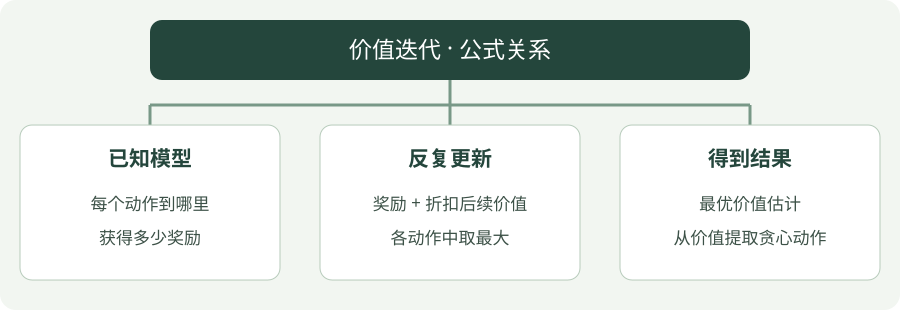

# 价值迭代：公式讲解

[算法直觉](../intuition/value-iteration.md) · [公式讲解](value-iteration.md) · [Python 实践](../code/value-iteration.md)

先读 [公共符号与回报](index.md)，再看本页。所有数值例子都只用于说明一次更新。

!!! tip "先用一句人话读公式"

    枚举动作 → 按发生概率平均各结果 → 取最高分 → 更新状态分数。

!!! tip "读完这页，你应该能做到"

    分清 max 和 argmax，并算出一次价值迭代。

    **先会这些就够了**：已知模型、奖励、价值。

## 看图梳理

{ .learning-figure }

[打开大图](../../assets/learning/rl-math-value-iteration.svg)

**已知模型**：每个动作到哪里，获得多少奖励；**反复更新**：奖励 + 折扣后续价值，各动作中取最大；**得到结果**：最优价值估计，从价值提取贪心动作。

## 核心公式

$$
V_{k+1}(s)=\max_a\sum_{s',r}p(s',r\mid s,a)\left[r+\gamma V_k(s')\right]
$$

## 逐项读懂

- $V_k(s)$：第 $k$ 轮时，对状态 $s$ 的长期收益估计。
- $p(s',r\mid s,a)$：做动作 $a$ 后，出现下一状态 $s'$ 与奖励 $r$ 的概率。这是已知模型。
- $r+\gamma V_k(s')$：眼前奖励，加上打折后的后续价值。
- 求和：把所有可能结果按发生概率加权，不只看一种结果。
- $\max_a$：算完各动作的期望后，选择最高的。

## 算一次看看

动作 A 的奖励为 −0.01，下一位置价值为 0.8，折扣为 0.95；目标为 0.75。动作 B 的下一位置价值为 0.2，相同奖励下目标为 0.18。本轮当前状态的新价值取 0.75。

## 如何得到策略

$$
\pi(s)\in\arg\max_a\sum_{s',r}p(s',r\mid s,a)[r+\gamma V(s')]
$$

$\arg\max$ 返回使分数最大的动作；$\max$ 返回分数本身。多个动作并列时，可以选择其中一个。

## 与代码对照

独立示例中 `candidates` 保存两个动作的目标，`max(candidates)` 就是价值迭代。`old` 是上一轮价值的拷贝，使本轮使用同一批旧估计。终止状态的未来价值为零。本例是确定性模型，因此求和退化为一个结果。

## 不看答案，自己判断一次

某动作以各 0.5 的概率到达两个位置，奖励均为 0，下一位置价值分别为 1 和 3，折扣 0.9。该动作的目标是多少？

??? success "查看推理与答案"

    先按概率平均：0.5 × 1 + 0.5 × 3 = 2；再折扣得到 1.8。不能直接取 3，那是挑结果而不是按概率求期望。

## 进一步阅读

[Sutton 与 Barto 教材，第 4 章](https://incompleteideas.net/book/the-book-2nd.html)

[David Silver 对应课程讲义](https://davidstarsilver.wordpress.com/wp-content/uploads/2025/04/lecture-3-planning-by-dynamic-programming-.pdf)
