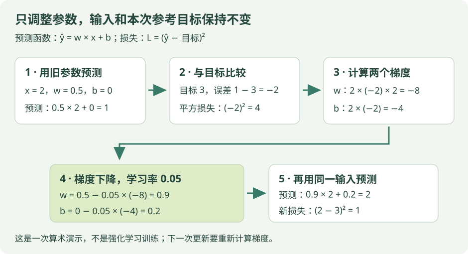

# 先读懂网络、损失和梯度：用两个可调数字走一遍

读 DQN、A2C、PPO 时，你会看到“网络预测”“计算损失”“更新参数”。这页先把网络缩小成两个可调数字，算清它们怎样改变预测，再回到算法。只需要乘法、加减和平方，不要求先安装 PyTorch。

!!! tip "这一页的阅读目标"

    能指出输入、参数、预测、目标和损失分别是什么；能解释为什么梯度计算后，还要另做参数更新。代码用于纸笔对照，不运行强化学习训练。

## 1. 先把预测函数当成两个旋钮

定义一个很简单的预测函数：

$$
\hat y=wx+b
$$

| 名字 | 它在做什么 | 本例的初始值 |
| --- | --- | --- |
| x | 输入，本次用来预测的一项数据 | 2 |
| w | 权重，决定输入对预测的影响 | 0.5 |
| b | 偏置，在乘法结果上加一个可调数 | 0 |
| ŷ | 根据当前参数算出的预测，读作 y 帽 | 0.5 × 2 + 0 = 1 |
| y | 本轮要拟合的参考目标 | 3 |

本次输入和目标固定，学习要调的是 w、b。w 与 b 不是状态或奖励，它们是函数内部的参数。同样的 x，参数变了，预测也会变。

这个线性函数只是理解网络的起点，并不是完整神经网络。多层网络会把许多可调运算和非线性变换接起来；初学先保留“输入 → 当前参数 → 预测”的关系，不必一口气理解全部层。

{ .learning-figure }

[打开大图](../assets/learning/network-first-update.svg)

## 2. 误差和损失为什么是两个数？

误差先用“预测减目标”计算：1 − 3 = −2。负号说明目前预测偏低。为了同时惩罚偏高与偏低，我们使用平方损失：

$$
L=(\hat y-y)^2
$$

| 当前预测 | 目标 | 误差 | 平方损失 |
| --- | --- | --- | --- |
| 1 | 3 | −2 | 4 |
| 2 | 3 | −1 | 1 |
| 3 | 3 | 0 | 0 |
| 4 | 3 | +1 | 1 |

损失给出偏离程度，却不能只凭“损失是 4”就知道每个参数该怎么改。误差的方向、参数怎样影响预测，还要接起来。实际算法可能采用别的损失，例如 DQN 库实现的平滑 L1，先看各页的定义。

## 3. 梯度告诉每个旋钮怎样影响损失

这份简单函数的梯度为：

$$
\frac{\partial L}{\partial w}=2(\hat y-y)x,\qquad
\frac{\partial L}{\partial b}=2(\hat y-y)
$$

符号 ∂L/∂w 可先读成“只把 w 改动一点，损失会怎样变化”。本例代入预测 1、目标 3、输入 2：

1. 损失对预测的变化率：`2 × (1 − 3) = −4`。
2. w 增加一点，预测的变化会乘上输入 x=2，所以 w 的梯度为 `−4 × 2 = −8`。
3. b 直接加到预测上，所以 b 的梯度为 `−4`。

这就是这里的**链式法则**：先看误差如何影响损失，再看参数如何影响预测，沿计算链相乘。多个参数各有自己的梯度；不能把同一个 −2 误差不加区别地塞给所有参数。

### 梯度为负，为什么参数会增加？

梯度下降用下面的规则：

$$
w_{\mathrm{new}}=w-\eta\frac{\partial L}{\partial w},\qquad
b_{\mathrm{new}}=b-\eta\frac{\partial L}{\partial b}
$$

η 是学习率，本例取 0.05。减去一个负数就是增加：

| 待更新参数 | 旧值 | 梯度 | 新值 |
| --- | --- | --- | --- |
| w | 0.5 | −8 | 0.5 − 0.05 × (−8) = 0.9 |
| b | 0 | −4 | 0 − 0.05 × (−4) = 0.2 |

两项梯度都从**同一份旧参数**算好，再进行这次更新。不能先改 w，又用改后的预测重算 b 的梯度，却声称仍是同一次旧参数上的更新。

## 4. 更新后再预测一次，才能知道发生了什么

新参数给出预测 `0.9 × 2 + 0.2 = 2`，误差为 −1，损失为 1。与旧损失 4 相比，这一小步更接近目标。

如果继续对同一对输入、目标做下一步，梯度变为 w 的 −4、b 的 −2；再用 0.05 更新，w=1.1、b=0.3，预测 2.5，损失 0.25。**下一步要用新参数重新计算，不能永远重复用最初的 −8、−4。**

这里只验证一个人为设定的例子。学习率过大可能跳过合适的位置，不是每种网络或每批数据都会损失下降；同一输入上拟合得更好，也不表示别的输入都更准。

## 5. 用带注释的代码对应这一次运算

下面是完整的算术片段，没有环境、采样或强化学习训练循环。按注释手算每一行即可。

```python title="一次参数更新 · 阅读用算术片段"
# 输入和参考目标：本次保持不变。
x, target = 2.0, 3.0

# 两个可调参数：这是模型本次开始时的状态。
weight, bias = 0.5, 0.0
learning_rate = 0.05

# 第一阶段：正向计算，从输入得到预测和损失。
prediction = weight * x + bias  # 1.0。
error = prediction - target    # -2.0，预测偏低。
loss_before = error**2          # 4.0。

# 第二阶段：用同一份旧预测算好两个参数的梯度。
grad_weight = 2.0 * error * x   # -8.0。
grad_bias = 2.0 * error         # -4.0。

# 第三阶段：梯度下降，减去学习率乘各自的梯度。
weight -= learning_rate * grad_weight  # 0.9。
bias -= learning_rate * grad_bias      # 0.2。

# 第四阶段：重新正向计算，检查本次更新后的结果。
new_prediction = weight * x + bias    # 2.0。
loss_after = (new_prediction - target)**2  # 1.0。

# 格式只影响显示：让这几个数字保留一位小数。
print(f"新参数：w={weight:.1f}, b={bias:.1f}")
print(f"新预测：{new_prediction:.1f}")
print(f"损失：{loss_before:.1f} -> {loss_after:.1f}")
```

按算术应得到：

```text
新参数：w=0.9, b=0.2
新预测：2.0
损失：4.0 -> 1.0
```

## 6. PyTorch 中常见的三步，各负责什么？

| 常见调用 | 它做的事情 | 对应本页哪一步 |
| --- | --- | --- |
| optimizer.zero_grad() | 清理之前保存的梯度，按当前学习安排重新累积 | 本页每次重新计算 grad_weight、grad_bias |
| loss.backward() | 沿记录的计算关系计算梯度 | 计算 −8 与 −4 |
| optimizer.step() | 优化器根据梯度修改参数 | 得到新 w=0.9、新 b=0.2 |

backward 计算梯度，本身不等于已经执行了优化器更新。PyTorch 默认会向参数的梯度中累积，因此一个普通批次的更新常先清理旧梯度；也有明确设计成多个批次累积后再更新的流程。自动微分的接口含义见 [PyTorch 官方入门](https://docs.pytorch.org/tutorials/beginner/basics/autogradqs_tutorial.html)。

本页展示的是简单梯度下降，SB3 内部也可能使用 Adam、RMSprop 等优化器。这些优化器除了当前梯度还会使用自身状态，不能照着本页数字断言库的每个参数也会变化同样幅度。

## 7. 回到强化学习：是谁提供参考目标？

| 算法中的模块 | 网络输出什么 | 学习信号从哪里来 |
| --- | --- | --- |
| DQN 的 Q 网络 | 每个离散动作的长期分数 | 奖励与目标网络的后续估计组成 TD 目标 |
| A2C / PPO 的 Critic | 当前状态的一个价值 V | 采样奖励和边界价值组成回报目标 |
| A2C / PPO 的 Actor | 动作分布的参数 | 采样动作的概率配合优势构成策略目标 |
| DDPG / TD3 的 Actor | 连续动作 | 当前 Critic 的评分通过动作传回梯度 |
| SAC 的 Actor | 连续动作分布的参数 | 评分与熵相关项共同形成策略损失 |

对于这些 RL 价值目标，参考值通常也来自估计，并非一份天然准确的标签。学会拟合当前目标，不等于已经学到真实价值。构造目标时常把参考项视为固定数字，这就是公式中 stopgrad、代码中 detach/no_grad 的相关含义；具体应固定哪条路径，要按算法区分。

Actor 不一定在拟合一个“正确动作标签”，也不一定用平方损失。它的目标是改变决策，让预计回报更高。先看输出代表价值、概率还是动作，再读对应损失，不能只因都用了网络就套同一条更新公式。

## 8. 一批样本、共享参数和独立评估

本例只算一个输入。一批有 64 条经验时，通常先分别得到各自预测和学习信号，再汇总损失，更新同一组网络参数。**共享参数**意味着修改一次参数，也可能改变未在本批出现的观测的预测；它不像查表那样只写一个独立格子。

评估时通常固定当前参数，只让策略做决定并记录回报，不继续执行上述学习更新。网络自己的随机选择、环境随机性和不同起始条件，仍可能导致不同得分，所以评估要注明条件与样本数。

??? example "纸笔自测：只算梯度，没有更新，会怎样？"

    若已算出 −8 与 −4，却没有修改 w、b，下一次用同样输入预测，仍为 1，损失仍为 4。计算出“应该怎么改”，与实际改变参数是两步。

    若把学习率从 0.05 改成 0，虽然梯度存在，参数仍不变。学习率决定本次改动幅度，不是下一步奖励的折扣率。

[返回公式导读](math/index.md) · [读 DQN 的目标](math/dqn.md) · [读 Actor-Critic](math/a2c.md)
