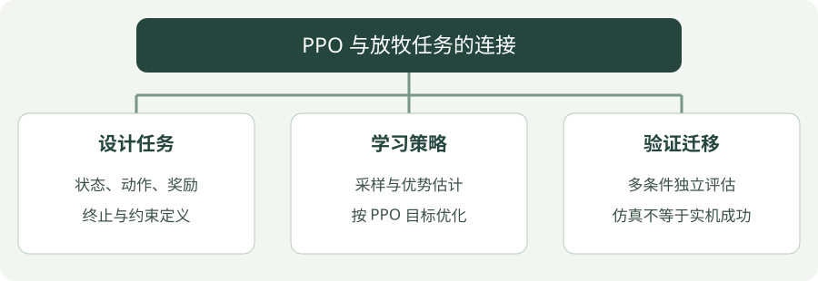

# PPO 与放牧任务

PPO 的系统笔记已按三部分整理：[算法直觉](intuition/ppo.md) · [公式讲解](math/ppo.md) · [完整 Python 实践](code/ppo.md)。本页保留它与放牧任务的联系。

## 看图梳理

{ .learning-figure }

[打开大图](../assets/learning/rl-ppo.svg)

**设计任务**：状态、动作、奖励，终止与约束定义；**学习策略**：采样与优势估计，按 PPO 目标优化；**验证迁移**：多条件独立评估，仿真不等于实机成功。

## 1. PPO 是什么？

PPO（Proximal Policy Optimization，近端策略优化）是一种策略梯度方法。它利用当前策略采集的数据更新策略，并通过限制更新幅度来减小训练不稳定的风险。

简单来说，就是让机器人通过不断尝试，
逐渐学会做出更好的决策。

## 2. PPO 在放牧机器人中的应用

假设我们有一台宇树 Go2 机器人。

机器人可以观察：

- 羊群的位置
- 羊群的运动方向
- 目标区域的位置

机器人可以输出：

- 前进速度
- 横向速度
- 转向角速度

通过奖励机制，让机器人学习如何驱赶羊群。

## 3. 训练前先定义环境

| 组成 | 在放牧任务中的含义 |
| --- | --- |
| 观测 | 机器人状态、羊群相对位置与目标位置 |
| 动作 | 有界的运动指令，例如平面速度与角速度 |
| 奖励 | 反映羊群向目标移动、聚集和控制代价 |
| 终止 | 达到目标、发生任务失败或超过时间限制 |

奖励只是学习信号；最终仍需用独立评估中的成功率、到达比例和完成时间判断策略表现。

## 4. Python 实践

带中文注释的学习代码见 [PPO 编程实践](code/ppo.md)，展示环境创建、训练调用、保存和独立评估的顺序。阅读即可，不需要创建 RL 环境或执行训练。

示例使用 CartPole 讲解训练流程。接入放牧仿真需要先实现自己的环境，再替换示例环境。

## 5. 如何理解一次更新

1. 用当前策略与环境交互，收集观测、动作、奖励和终止信息。
2. 估计回报与优势，判断动作相对于当前预期的表现。
3. 对这批数据执行若干轮策略与价值函数更新。
4. 用更新后的策略重新采样，重复上述流程。

PPO 的裁剪目标约束策略更新的激励，但不保证每次更新都让任务表现提升。训练曲线需要结合独立评估和失败案例阅读。

## 6. 实践时记录什么

- 观测与动作的范围、归一化方式。
- 各个奖励项的数值，避免只看总奖励。
- 训练步数、随机种子与环境配置。
- 固定评估场景下的成功率和失败原因。

[查看智能放牧实验路线](../herding/index.md)

