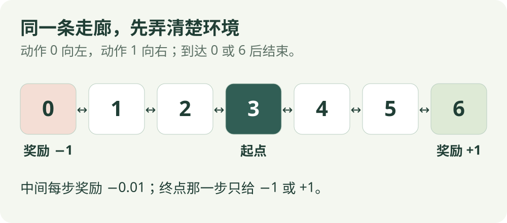

# 入门第一课：用一次经历理解强化学习

!!! tip "这页要弄懂什么"

    分清奖励、回报、价值和策略；用纸笔算一次更新。只需要会加减乘除，不需要安装环境或运行训练。

## 先把它想成“行动之后，修正判断”

机器人看到当前情况，做一个动作，再看到结果。算法利用这些经历，调整对动作或情况的判断，让以后的选择更符合我们设置的目标。

这里先用一条小走廊练习。它比真实放牧简单得多，便于把学习过程看清。

{ .rl-figure }

[打开大图](assets/corridor.svg)

从位置 3 出发，每次向左或向右走一步。到达右端 6 得 +1，到达左端 0 得 −1；其他每步 −0.01。两端都是终点。

## 四个词，用同一次经历解释

| 词 | 先这样理解 | 在走廊里的例子 |
| --- | --- | --- |
| 奖励 | 刚执行这一步得到的反馈 | 从 3 走到 4，得到 −0.01 |
| 回报 | 从现在开始，一路得到的奖励按时间加权后相加 | 连走三步到右端，累计这三步的反馈 |
| 价值 | 从某个位置出发，按指定走法，平均预计能得到多少回报 | 从位置 3 出发的长期分数估计 |
| 策略 | 在当前情况如何选动作 | 每次向右，或左右各以一半概率选择 |

“奖励”是已经收到的一步反馈；“价值”是对未来的估计。位置一样而走法不同，未来结果可能不同，所以价值通常要说明对应哪套策略。

## 先算回报：后面的奖励打多少折

假设这次连续向右：`3 → 4 → 5 → 6`，依次得到 `−0.01、−0.01、+1`。设折扣因子为 0.9。

| 时间 | 收到的奖励 | 权重 | 加入回报的数值 |
| --- | --- | --- | --- |
| 第一步 | −0.01 | 1 | −0.01 |
| 第二步 | −0.01 | 0.9 | −0.009 |
| 第三步 | +1 | 0.9² = 0.81 | +0.81 |

从位置 3 开始，这次经历的回报是 **0.791**。它是一次实际经历的结果，不能只凭这一局就认定所有可能走法的平均价值。

折扣因子不是“奖励发生的概率”，只是我们计算目标时给以后奖励的权重。

## 再算一次 TD 更新：只走一步也能修正

现在只看 `3 → 4` 这一步。假设位置 3 的旧估计是 0.2，位置 4 的估计是 0.5，折扣 0.9，学习率 0.2。

1. **先算目标**：`−0.01 + 0.9 × 0.5 = 0.44`。
2. **再算差距**：`0.44 − 0.2 = 0.24`。
3. **朝目标走一小步**：`0.2 + 0.2 × 0.24 = 0.248`。

新的估计是 **0.248**，不是直接改为 0.44。这一步用到了下一位置的估计，还不是整局完整回报。这样的“用估计帮助更新估计”叫自举。

!!! note "到达终点时怎样算"

    如果这一步已经真正终止，就没有下一步价值。目标只保留这一步收到的奖励。外部时间限制造成的截断不一定是真正终止，详见[公式导读](math/index.md#termination-and-truncation)。

## 不同算法，主要区别在哪里

| 想问的问题 | 先读哪几种算法 |
| --- | --- |
| 已经知道环境规则，能否直接算好走法？ | [价值迭代](intuition/value-iteration.md) |
| 某套走法平均怎么样？整局结束再看，还是每步都看？ | [MC](intuition/mc.md)、[TD](intuition/td.md) |
| 每个动作应该记多少分？怎样利用下一步？ | [SARSA](intuition/sarsa.md)、[Q-learning](intuition/q-learning.md)、[DQN](intuition/dqn.md) |
| 能否直接调整动作的选择概率？ | [REINFORCE](intuition/reinforce.md)、[A2C](intuition/a2c.md)、[PPO](intuition/ppo.md) |
| 动作是速度等连续数值，怎样学习？ | [DDPG](intuition/ddpg.md)、[TD3](intuition/td3.md)、[SAC](intuition/sac.md) |

这些分类有重叠。比如 PPO 既能处理离散动作，也能处理连续动作。选算法前先看动作类型、数据来源与任务约束，而不是先认定某个算法永远最好。

## 回到放牧机器人

走廊中的位置，在放牧任务里可能对应机器人与羊群的观测；向左向右，可能换成移动方向或速度。但真实任务还存在遮挡、定位误差、羊群响应和控制约束。

算法只会优化我们定义的学习目标。因此，“羊群更接近目标”的奖励，不自动保证安全、不惊扰羊群或成功完成整个放牧任务。这些要求需要进入任务设计，并用单独的评价指标检查。

## 用两道题检查自己

**1. 学习率改为 1，其他数字不变，新的估计是多少？**

??? success "查看答案"

    `0.2 + 1 × (0.44 − 0.2) = 0.44`，这次完全跟随目标。一步取 1 不代表长期学习必然更好。

**2. 连续向右的一局回报是 0.791，是否证明随机左右走的策略也有同样价值？**

??? success "查看答案"

    不能。随机走法会产生不同经历，还可能到达左端。它的价值需要对该策略下的可能结果求平均或用样本估计。

[继续读算法直觉 →](intuition/index.md){ .md-button .md-button--primary }
[查看公共符号](math/index.md){ .md-button }
