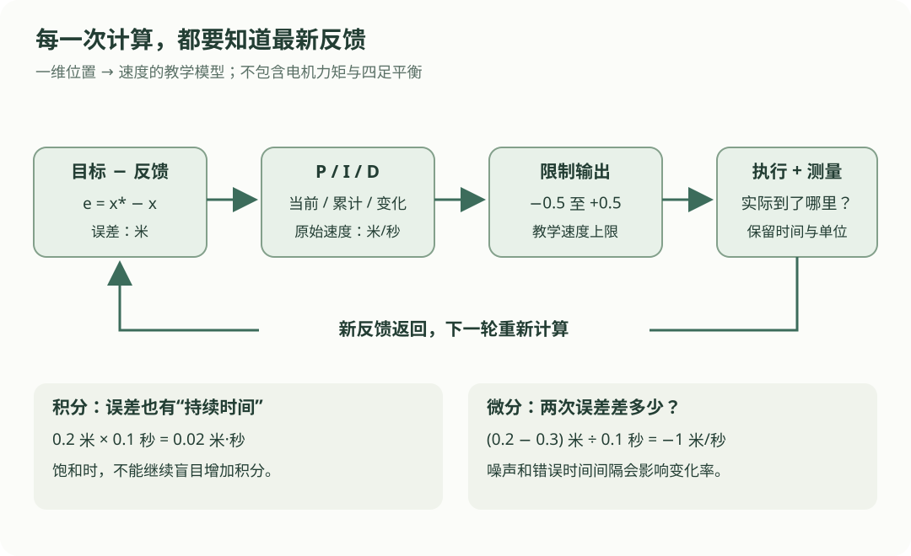

# 06 · 反馈控制与 PID：每次移动后，再看看差多少

## 本章的小任务

机器人沿一条直线移动，当前位置是 0 米，目标是 2 米。你要决定“下一小段时间该用多大速度”，执行后重新测量，再决定下一次速度。

先采用**一维、位置反馈、输出速度**的教学模型。它不包含电机力矩、四足平衡或障碍物。这几个假设决定了后面公式的含义；换成关节力矩控制时，增益单位和运动模型都要重新确定。

读完本章，应能解释：误差为什么要重新计算，P、I、D 各看哪一部分信息，以及速度已到上限时为什么不能继续盲目累加积分。

## 先看“反馈”回到了哪里

{ .learning-figure }

[打开控制闭环大图](../assets/learning/robotics-control.svg)

每轮都使用**新的反馈位置**。程序算出的速度只是指令；执行机构是否真的达到该速度，要靠下一次测量或估计来判断。把当前位置永远写成 0，会一直得到相同误差，不能构成实际机器人上的反馈闭环。

## 从三个数字开始理解 P

P 是 proportional，意思是“按比例”。差得多，给较大的修正；差得少，给较小的修正。

$$
e_k=x^*-x_k,\qquad u_k=K_p e_k
$$

| 符号 | 本章含义 | 单位 |
| --- | --- | --- |
| \(k\) | 第几次计算，例如第 0、1、2 轮 | 无单位 |
| \(x^*\) | 固定目标位置 | 米，m |
| \(x_k\) | 本轮反馈位置 | 米，m |
| \(e_k\) | 目标减反馈得到的误差 | 米，m |
| \(u_k\) | 本轮要求的沿线速度 | 米/秒，m/s |
| \(K_p\) | 每米误差对应多大速度 | 1/秒，s⁻¹ |

目标 2 米、当前位置 0 米，误差是 `2 − 0 = 2` 米。若 `Kp = 0.5 s⁻¹`，速度指令就是 `0.5 × 2 = 1 m/s`。正号表示向位置增大的方向移动。

如果当前位置是 2.2 米，误差是 −0.2 米，指令为 −0.1 m/s：在这个允许双向运动的模型里，向回移动。不能把负号删除；也不能默认所有机器人的执行接口都允许这个动作。

## 把两轮计算连起来

暂时假设机器人准确执行速度，且每轮速度保持 0.2 秒。理想模型为：

$$
x_{k+1}=x_k+u_k\Delta t
$$

`Δt` 是这一段持续的时间，单位秒；`速度 × 时间` 得到位移，单位米。

| 轮次 | 开始位置 | 误差 | 本轮速度 | 0.2 秒内位移 | 下一位置 |
| --- | --- | --- | --- | --- | --- |
| 0 | 0.00 m | 2.00 m | 1.00 m/s | 0.20 m | 0.20 m |
| 1 | 0.20 m | 1.80 m | 0.90 m/s | 0.18 m | 0.38 m |

第二轮不能继续拿初始误差 2 来计算。理想计算中用更新的位置；实际系统中应读取新的定位反馈，并考虑反馈时间和有效性。

### 先读一个短计算

这段代码只演示上述两轮理想位置更新，不控制任何机器人。

```python title="两轮 P 控制的纸笔计算"
target_m = 2.0       # 目标位置，米。
position_m = 0.0     # 理想模型的初始位置，米。
kp_per_s = 0.5       # 比例增益，1/秒。
dt_s = 0.2          # 每轮速度保持的时间，秒。

for step in range(2):
    error_m = target_m - position_m
    command_mps = kp_per_s * error_m
    # 仅在“速度被准确执行”的模型里，可以这样更新位置。
    position_m += command_mps * dt_s
    print(f"第 {step} 轮：速度 {command_mps:.2f} m/s，位置 {position_m:.2f} m")
```

预期输出：

```text
第 0 轮：速度 1.00 m/s，位置 0.20 m
第 1 轮：速度 0.90 m/s，位置 0.38 m
```

### P 越大，就一定越好吗？

在这个无延迟、无饱和、固定目标、准确执行速度的离散模型中，可以算出：

$$
e_{k+1}=(1-K_p\Delta t)e_k
$$

若希望误差最终缩小到 0，需要 `|1 − Kp × Δt| < 1`，即 `0 < Kp × Δt < 2`。这是**本模型的结论**，不能拿它当任意机器人的稳定性保证。

例如 `Kp × Δt = 0.1`，下一轮误差保留 90%；等于 1.5 时，误差乘 −0.5，符号交替但大小减半；等于 2.5 时，乘 −1.5，反而越来越大。采样时间也影响结果，不能只谈增益。

## I 与 D 分别多看了一件事

### I：记住一段时间内的累计误差

I 是 integral，即积分。离散计算可以理解为“每段误差乘持续时间，再相加”：

$$
I_k=I_{k-1}+e_k\Delta t
$$

若连续两段误差都为 0.2 米，每段 0.1 秒，积分从 0 变成 `0.02`，再变成 `0.04 m·s`。持续的小误差会逐渐积累出一份修正。

适当的积分项能在某些模型和稳定条件下减小持续偏差。它不会自动解决所有跟踪误差，也不是“越积越好”。测量失效、控制模式切换或目标大幅变化时，积分状态通常需要专门处理。

### D：看误差变化有多快

D 是 derivative，即变化率。最简单的离散近似是：

$$
D_k=\frac{e_k-e_{k-1}}{\Delta t}
$$

误差从 0.3 米降到 0.2 米，间隔 0.1 秒，变化率为 −1 m/s。若 D 增益为正，这一项倾向于减弱继续向前的修正。若误差正在增大，符号相反。

微分也会放大测量噪声。误差在 0.01 秒内抖动 0.01 米，变化率就有 1 m/s。实际系统常对测量或微分滤波；对误差直接微分还可能因目标突变产生大尖峰。这里先理解数值含义，不把这一差分当完整工程实现。

## 合在一起：一个离散 PID 写法

$$
u_k^{\mathrm{raw}}=K_p e_k+K_i I_k+K_d D_k
$$

| 项 | 用到的信息 | 本例增益单位 | 乘积单位 |
| --- | --- | --- | --- |
| P | 当前误差，m | \(K_p\)：s⁻¹ | m/s |
| I | 累积误差，m·s | \(K_i\)：s⁻² | m/s |
| D | 误差变化率，m/s | \(K_d\)：无量纲 | m/s |

三项必须变成相同单位才能相加。若输入是角度、输出是力矩，表中单位会改变；“PID 参数是没有单位的几个数”容易造成误用。

初学时可以先设 `Ki = Kd = 0` 理解 P，再逐个加入其他项。是否需要 I 或 D，要根据模型、噪声、采样和任务决定，不是每个控制器都必须三项齐全。

## 速度上限和积分饱和

假设允许的速度范围是 `[-0.5, 0.5] m/s`。原始计算得到 1 m/s，也只能发送 0.5 m/s。这叫**输出饱和**。

如果机器人已经到速度上限，积分却继续记下“还差很多”，之后接近目标时，这份积累仍可能把它往前推。这种问题叫积分饱和或 integral windup。

一种简单做法是**条件积分**：先试算本轮积分和输出；如果输出超过上限，且当前误差还要把输出推得更高，暂停增加积分。下限同理。若误差有助于从饱和方向退回来，则允许积分改变。

这只是抗积分饱和的一种方法。下面模型的上下限是对称固定速度限制，积分增益非负；复杂执行器还可能采用反算、跟踪实际输出或其他方法。

## 完整计算例子：四次反馈，积分什么时候保存？

先给定四条**假想反馈**，不假设它们由前一条速度生成。目标仍是 2 米，测得位置依次为 `1.0、1.0、1.8、1.9` 米，所以误差依次为 `1.0、1.0、0.2、0.1` 米。

下面代码独立阅读即可。它不调用硬件、不等待真实时间；`dt_s` 代表这份记录中相邻样本的时间间隔。为了突出积分，把 `Kd` 设为 0，代码保留 D 的计算位置供对照。

```python title="带条件积分的 PID 数值计算"
def clip(value, lower, upper):
    # 先不低于下限，再不高于上限。
    return max(lower, min(upper, value))


target_m = 2.0
measurements_m = [1.0, 1.0, 1.8, 1.9]
dt_s = 0.1                 # 假想样本间隔，必须大于 0。
kp, ki, kd = 1.0, 0.5, 0.0
limit_mps = 0.5            # 教学上限，不代表任何型号的能力。
integral_ms = 0.0          # 跨轮保存，单位是米·秒。
previous_error_m = None    # 首轮没有上一个误差。

for step, measured_m in enumerate(measurements_m):
    error_m = target_m - measured_m
    # 首轮把微分设为 0，避免凭空假定上一个误差为 0。
    derivative_mps = (0.0 if previous_error_m is None
                      else (error_m - previous_error_m) / dt_s)
    trial_integral_ms = integral_ms + error_m * dt_s
    trial_command = kp * error_m + ki * trial_integral_ms + kd * derivative_mps

    # 若新增积分进一步推向饱和方向，就不保存本轮新增积分。
    pushing_upper = trial_command > limit_mps and error_m > 0
    pushing_lower = trial_command < -limit_mps and error_m < 0
    if not (pushing_upper or pushing_lower):
        integral_ms = trial_integral_ms

    # 用最终保存的积分重算，再限制发送范围。
    raw_command = kp * error_m + ki * integral_ms + kd * derivative_mps
    command_mps = clip(raw_command, -limit_mps, limit_mps)
    previous_error_m = error_m
    print(f"第 {step} 轮：积分 {integral_ms:.3f} m·s，指令 {command_mps:.3f} m/s")
```

预期输出：

```text
第 0 轮：积分 0.000 m·s，指令 0.500 m/s
第 1 轮：积分 0.000 m·s，指令 0.500 m/s
第 2 轮：积分 0.020 m·s，指令 0.210 m/s
第 3 轮：积分 0.030 m·s，指令 0.115 m/s
```

| 阅读位置 | 先问什么 | 本例答案 |
| --- | --- | --- |
| `target_m - measured_m` | 正负方向怎样定义？ | 目标在前方时为正 |
| `error_m * dt_s` | 为什么乘时间？ | 累积的是误差持续的面积 |
| `trial_integral_ms` | 为什么不直接保存？ | 先检查新增积分会不会加重饱和 |
| `clip` | 限制的是哪一个量？ | 输出速度，不是测量位置 |
| 两个跨轮变量 | 哪些数据留到下一次？ | 已接受的积分与上一轮误差 |

第 2 轮手算：候选积分 `0 + 0.2 × 0.1 = 0.02`；输出 `1 × 0.2 + 0.5 × 0.02 = 0.21`，未饱和，积分被保存。

## 先预测，再展开练习

把第 2 轮误差改成 0.4 米，其他条件不变，积分和输出是多少？提示：前两轮积分仍为 0；先判断新输出是否超过 0.5。

??? example "展开参考答案"

    候选积分是 `0.4 × 0.1 = 0.04 m·s`，候选输出 `0.4 + 0.5 × 0.04 = 0.42 m/s`。未超过上限，所以保存积分 0.04，输出 0.42。后续轮次的积分起点也会改变。

再想一题：同样 0.1 米误差变化，实际间隔是 0.2 秒，程序却写成 0.1 秒，会怎样？

??? example "展开时间间隔的解释"

    微分变化率会被算成真实值的 2 倍；每次新增积分则只有正确值的一半。实际循环频率变化时，应使用正确的时间间隔，并处理过小、过大或无效间隔。

## 常见错误与下一步

- 把命令速度当测量速度，无法发现打滑、阻挡或执行失败。
- 把积分变量每轮归零，I 就失去了跨时间累计的作用。
- 只限制输出、不考虑积分状态，可能留下大量积累。
- 看到误差变小就认为增益正确；还要看超调、振荡、噪声、延迟和执行上限。
- 用这个一维公式直接替代四足平衡控制；四足底层需要处理接触、姿态和动力学。

控制读懂后，下一步学习怎样把目标、反馈和命令分给不同程序，以及怎样传递带时间和坐标信息的数据。

## 对照资料

本章的一维速度输入假设可对照 [Modern Robotics 作者课程：P 控制](https://modernrobotics.northwestern.edu/nu-gm-book-resource/11-3-motion-control-with-velocity-inputs-part-1-of-3/)，P 与 PI 的作用可对照 [同课程的 PI 控制章节](https://modernrobotics.northwestern.edu/nu-gm-book-resource/11-3-motion-control-with-velocity-inputs-part-2-of-3/)。本章离散数值、输出限制和条件积分代码是教学示例，参数没有针对真实机器人整定。

[返回学习路线](index.md) · [上一章：05 差速小车运动学](kinematics.md) · [下一章：07 ROS 2 节点与话题 →](ros2.md)
