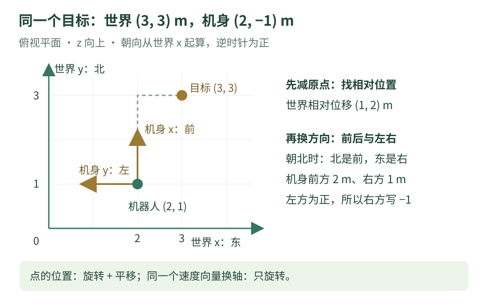

# 04 · 坐标系与二维变换：同一个目标，换一种说法

机器人在场地里朝北站着，目标在它前方 2 米、右方 1 米。世界地图会怎样写这个目标？为什么“向前”不能永远理解为地图上向右？本章先画方向，再用四则运算和简单三角函数换坐标。

!!! tip "学习目标与前置知识"

    先读 [02 · 位置、速度与时间](units.md)，知道 90 度是 π/2 弧度。第一次不必背矩阵，先会用相减找相对位置，再判断前后左右。

    读完后，应能把二维点从机身坐标转换为世界坐标，也能反向转换，并分清位置与速度向量的变换。

## 1. 看图：两套尺子，各有原点和方向

{ .learning-figure }

[打开大图](../assets/learning/robotics-frames.svg)

坐标系可以理解为“一套有原点、方向和单位的尺子”。位置 `(3, 3)` 只有配上这套尺子，才表示一个具体地点。

本教程的平面世界坐标记作 w：**x 向东、y 向北**；机身坐标记作 b：**x 朝机器人前方、y 朝机器人左方**。三维时 z 向上。俯视平面时，朝向从世界 x 正轴开始量，逆时针为正。

这是常用 ROS 约定，可核对 [REP 103 官方源文档](https://github.com/ros-infrastructure/rep/blob/master/rep-0103.rst)。设备或室内地图可能另有明确约定；接入前要核对，不能凭变量名猜方向。

| 世界朝向 | 本章 θ | 机身前方在世界里指向 |
| --- | --- | --- |
| 东 | 0 度 / 0 弧度 | 世界 x 正方向 |
| 北 | 90 度 / π/2 弧度 | 世界 y 正方向 |
| 西 | 180 度 / π 弧度 | 世界 x 负方向 |
| 南 | −90 度 / −π/2 弧度 | 世界 y 负方向 |

## 2. 先手算朝北的例子

给定同一时刻的数据，所有位置单位为米：机器人世界位置 `(2, 1)`，朝向 90 度；目标世界位置 `(3, 3)`。

第一步，先减掉机器人的位置：

```text
世界 x 相对位移 = 3 − 2 = 1 米，向东
世界 y 相对位移 = 3 − 1 = 2 米，向北
```

第二步，机器人朝北，所以世界向北对应机身前方，世界向东对应机身右方。机身 y 正方向是左，因此右方要写成负数：

```text
目标机身坐标 = (2, −1) 米
读成人话：前方 2 米，左方 −1 米，也就是右方 1 米。
```

这个结果不是机器人真的移动了，只是我们换了描述坐标。反过来，前方 2 米让世界 y 从 1 变成 3，右方 1 米让世界 x 从 2 变成 3，恢复目标 `(3, 3)`。

## 3. 一般朝向怎么换：旋转后，再加原点

设机器人世界位置为 $(x_r,y_r)$，机身朝向为 θ。目标在机身坐标中的两个分量为 $(x_b,y_b)$，转换到世界坐标：

$$
x_w=x_r+\cos\theta\,x_b-\sin\theta\,y_b
$$

$$
y_w=y_r+\sin\theta\,x_b+\cos\theta\,y_b
$$

下标 w、b 表示**在哪套坐标里描述**，不是乘法。下标 r 表示机器人坐标原点的世界位置。

| 部分 | 用人话解释 |
| --- | --- |
| `cosθ × xb, sinθ × xb` | 机身前方分量落在世界 x、y 上各有多少 |
| `−sinθ × yb, cosθ × yb` | 机身左方分量落在世界 x、y 上各有多少 |
| 最后加 `xr, yr` | 把旋转后的相对位移放到机器人所在位置 |

90 度时 `cosθ=0`、`sinθ=1`，所以 `xw=2−(−1)=3`、`yw=1+2=3`。先用这个特例核对方向，能避免符号记反。

### 想知道目标在身前还是身后，就反向转换

先得到相对世界位移：$\Delta x=x_w-x_r$、$\Delta y=y_w-y_r$。然后把轴转回去：

$$
x_b=\cos\theta\,\Delta x+\sin\theta\,\Delta y
$$

$$
y_b=-\sin\theta\,\Delta x+\cos\theta\,\Delta y
$$

代入朝北的例子：`xb=0×1+1×2=2`；`yb=−1×1+0×2=−1`。正向与反向的旋转符号不同，反向还要**先减原点**。

## 4. 矩阵只是把两行公式排整齐

如果看过矩阵，可以把旋转写成：

$$
R(\theta)=\begin{bmatrix}\cos\theta&-\sin\theta\\\sin\theta&\cos\theta\end{bmatrix},\qquad
p_w=R(\theta)p_b+p_r
$$

把 `R` 的第一行分别乘 `xb、yb`，再相加，就得到世界 x 的相对分量；第二行得到世界 y 的相对分量。矩阵没有额外魔法，只是缩短记法。

三维齐次变换也把旋转和平移放在一起，进一步阅读可查 [Modern Robotics 作者教材的变换章节](https://modernrobotics.northwestern.edu/nu-gm-book-resource/3-3-1-homogeneous-transformation-matrices/)。本章先停在二维，同一旋转公式不能直接代替完整三维姿态变换。

## 5. 位置要平移，向量换轴只旋转

机器人朝北，以机身速度 `(0.5, 0)` 米/秒向前运动。同一个物理线速度向量，在世界坐标中是 `(0, 0.5)` 米/秒。

换**同一个向量的坐标表达**时只旋转，不加机器人位置。如果给速度也加上 `(2,1)` 米，单位都不一致：米不能直接加到米/秒上。

$$
v_x^w=\cos\theta\,v_x^b-\sin\theta\,v_y^b,\qquad
v_y^w=\sin\theta\,v_x^b+\cos\theta\,v_y^b
$$

这里描述同一时刻、同一个物理速度向量在两套轴上的分量。若问题变成“目标相对于移动机身的位置随时间怎样变化”，机器人自身平移和转动也会影响结果；不能只旋转相对位置的差分，就宣称得到目标的世界速度。

## 6. 阅读代码：正向、反向与角度差一起核对

代码仅处理固定二维数字，使用 Python 标准库；没有机器人接口。机器人和目标位置属于同一时刻，全部位置为米、内部角度为弧度。

```python title="二维坐标往返核对 · 完整阅读示例"
import math


def body_to_world(bx, by, robot_x, robot_y, heading_rad):
    # 先旋转机身相对位置，再加机器人世界原点。
    c = math.cos(heading_rad)
    s = math.sin(heading_rad)
    wx = robot_x + c * bx - s * by
    wy = robot_y + s * bx + c * by
    return wx, wy


def world_to_body(wx, wy, robot_x, robot_y, heading_rad):
    # 先减原点，再使用反方向的旋转。
    dx = wx - robot_x
    dy = wy - robot_y
    c = math.cos(heading_rad)
    s = math.sin(heading_rad)
    bx = c * dx + s * dy
    by = -s * dx + c * dy
    return bx, by


def wrap_angle(angle_rad):
    # 等效角度统一到 [-pi, pi)，方便处理跨越 180 度的差值。
    return (angle_rad + math.pi) % (2.0 * math.pi) - math.pi


robot_x, robot_y = 2.0, 1.0
heading_rad = math.radians(90.0)
target_wx, target_wy = 3.0, 3.0

# 从世界目标求机身中的“前后、左右”。
bx, by = world_to_body(target_wx, target_wy, robot_x, robot_y, heading_rad)
print(f"目标机身坐标: ({bx:.3f}, {by:.3f}) m")

# 反向变回世界，用于检查是否恢复同一个点。
wx, wy = body_to_world(bx, by, robot_x, robot_y, heading_rad)
print(f"恢复世界坐标: ({wx:.3f}, {wy:.3f}) m")

# 这是同一个速度向量换坐标轴，不能再加位置。
body_vx, body_vy = 0.5, 0.0
world_vx = math.cos(heading_rad) * body_vx - math.sin(heading_rad) * body_vy
world_vy = math.sin(heading_rad) * body_vx + math.cos(heading_rad) * body_vy
print(f"世界速度: ({world_vx:.3f}, {world_vy:.3f}) m/s")

# 当前朝向 179 度，目标 -179 度，较短差值是逆时针 2 度。
current_rad = math.radians(179.0)
desired_rad = math.radians(-179.0)
error_rad = wrap_angle(desired_rad - current_rad)
print(f"较短朝向差: {math.degrees(error_rad):.3f} deg")
```

预期输出：

```text
目标机身坐标: (2.000, -1.000) m
恢复世界坐标: (3.000, 3.000) m
世界速度: (0.000, 0.500) m/s
较短朝向差: 2.000 deg
```

`bx, by = ...` 把函数返回的两个数分别接住；代码中的 `return wx, wy` 就是返回一对数。`c`、`s` 只是本函数里的简短名字，分别存余弦和正弦。

浮点数的 `cos(π/2)` 可能是非常接近 0 的小数，而非精确 0；显示到三位小数后为 0.000。做自动往返检查时用允许误差，不要要求计算机结果逐位完全等于手写整数。

### 为什么角度差要绕回来？

`−179 − 179 = −358` 度是直接相减，但方向绕圆周相连：逆时针 2 度也能到达同一个朝向。`wrap_angle` 给出区间 `[−π, π)` 中的等效差值。

恰好差 180 度时，两种转法长度相同，本函数选 −180 度；这是一种边界约定，不表示实际机器人一定应该那样转。避障、转向限制和连续轨迹还要另行处理。

## 7. ROS 里的三个常用名字

初次看到 `map`、`odom`、`base_link`，先把它们看成三套坐标尺：

| 名字 | 常用含义 | 初学时记住的区别 |
| --- | --- | --- |
| `base_link` | 固定在机器人机身上的坐标系 | 随机身移动和转动 |
| `odom` | 世界固定的局部参考 | 位姿变化连续，但估计会累计漂移 |
| `map` | 世界固定的全局参考 | 用定位修正漂移，估计可能发生跳变 |

标准关系常写作 `map → odom → base_link`；箭头表示坐标系之间的变换关系，不表示机器人必须先开到 map 再开到 odom。这些语义可核对 [REP 105 官方源文档](https://github.com/ros-infrastructure/rep/blob/master/rep-0105.rst)。

本章 `world` 是自行设定的教学世界坐标名字，不是要求所有 ROS 项目新增同名坐标。相机的光学坐标常用 x 右、y 下、z 前，不能直接当成机身 x 前、y 左、z 上。

## 8. 练习：目标在左边还是右边

机器人在世界 `(2,1)`，现在朝西，即 θ = 180 度。目标在世界 `(1,2)`。求目标机身坐标，并用人话说明方向。

**提示**：先减原点得 `(−1,1)`；朝西时机器人左边朝南。

??? example "展开参考答案"

    `cosπ=−1`，`sinπ=0`。机身 x 为 `−1×(−1)+0×1=1`；机身 y 为 `−0×(−1)+(−1)×1=−1`。

    结果 `(1,−1)` 米，即前方 1 米、右方 1 米。右方指北，与你画的图应一致。

    修改完整示例中的朝向和目标位置即可检查。若返回世界时又得到 `(1,2)`，说明方向转换自洽；这仍没有证明传入的观测本身准确。

## 9. 常见误区与自测

| 误区 | 检查方法 |
| --- | --- |
| 机身向前永远等于世界 x 正 | 先看机器人当前朝向 |
| 转换位置只旋转 | 检查两个原点是否重合；通常还要平移 |
| 速度也加机身世界位置 | 查单位，同一向量换轴只旋转 |
| 不同时间的位姿随意组合 | 使用目标观测对应时刻的变换或明确估计方法 |
| 二维朝向能表达全部三维姿态 | 俯仰、横滚和三维旋转需另行表示 |

请在纸上画出“朝北时的机身左方”，再解释为什么目标 `(3,3)` 在机身里不是 `(1,2)`，而是 `(2,−1)`。

[返回机器人学习路线](index.md) · [上一章：03 · 传感器与数据质量](sensors.md) · [下一章：05 · 差速小车运动学 →](kinematics.md)
