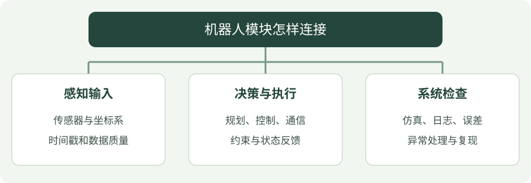

# 机器人学习概览

把算法的输出变成机器人可以稳定执行的动作，是这条学习路线的目标。

## 看图梳理

{ .learning-figure }

[打开大图](../assets/learning/robotics-index.svg)

**感知输入**：传感器与坐标系，时间戳和数据质量；**决策与执行**：规划、控制、通信，约束与状态反馈；**系统检查**：仿真、日志、误差，异常处理与复现。

## 学习路线

| 阶段 | 核心内容 | 实践目标 |
| --- | --- | --- |
| 数学基础 | 坐标变换、旋转、运动学 | 描述机器人与目标的相对位置 |
| 仿真基础 | MuJoCo 场景、关节与传感器 | 读取状态并执行简单动作 |
| 软件通信 | ROS 2 节点、话题、消息与时间戳 | 建立观测到控制的通信链路 |
| 导航规划 | 定位、地图、路径与避障 | 在简单场地到达目标点 |
| 运动控制 | 速度指令、反馈与执行约束 | 跟踪目标速度并记录误差 |

## 最小实践闭环

1. 定义世界坐标系与机器人坐标系。
2. 读取机器人状态，检查单位和时间戳。
3. 给出一个有界的目标或速度指令。
4. 记录实际轨迹，比较目标与执行结果。
5. 保存配置，使同一实验可以重复运行。

## 与放牧任务的连接

高层策略负责决定机器人向哪里移动，控制模块负责执行动作。需要记录控制频率、速度限制、观测延迟和动作延迟，避免把执行误差误判为策略问题。

## 后续笔记清单

- 坐标系与变换实例
- MuJoCo 场景搭建记录
- ROS 2 通信与日志记录
- Go2 控制接口实践

[返回研究主线](../herding/index.md) · [查找开源资料](../opensource/index.md)
