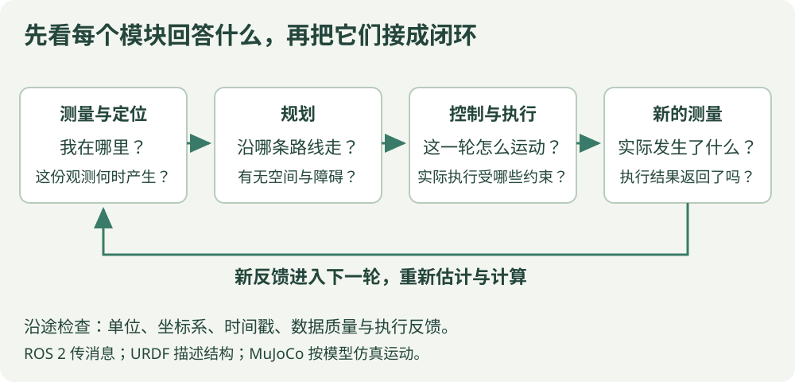

# 机器人技术：从零理解，到读懂一个闭环

机器人入门 / 14 章 / 配套图解与注释代码

机器人为什么知道自己在哪儿？为什么已经算出一条路线，还是没有走到目标？这套教程先把这些问题拆开，再把传感器、坐标、控制、软件通信和仿真接起来。

例子围绕移动机器人展开，最后联系**放牧机器人**。差速小车用来解释轮式运动学，简化关节用来解释仿真，四足机器人另有自己的执行约束。阅读时先看本章采用了哪种模型。

[从第一课开始 →](start.md){ .md-button .md-button--primary }

## 第一遍先走这三步

- **先读懂数字** · 01—04

    分清目标与观测，认识单位、时间和坐标。先能解释“这个位置是谁、在哪儿、何时测到”。

    [从机器人怎样工作开始 →](start.md)

- **再理解运动** · 05—06

    用差速小车和一维控制的小例子，跟着数字看一轮执行后，下一轮为什么要重新计算。

    [读运动学与反馈控制 →](kinematics.md)

- **最后接起模块** · 07—14

    逐步认识 ROS 2、结构、仿真和导航，最后跟着一个点模型追踪完整闭环。

    [查看软件通信第一课 →](ros2.md)

## 先看整条学习路线

{ .learning-figure }

[打开模块关系大图](../assets/learning/robotics-learning-route.svg)

**感知**提供测量，**定位**估计机器人在哪里，**规划**选择路线，**控制**根据目标和反馈计算动作，**执行机构**产生实际运动。下一次测量再告诉我们执行得怎么样。这条返回路径，就是“闭环”里的环。

ROS 2 负责组织程序和传递消息；URDF 描述机器人结构；MuJoCo 用模型计算仿真运动。它们各有用途，先学会说出具体问题，再学习对应工具。

## 零基础先读哪些章

第一遍完成 01–06，先能看懂一个机器人例子中的位置、方向、时间和反馈。07–10 学软件工具，11–14 再把定位、路线和四足任务接起来。

| 阶段 | 章节 | 学完能解释什么 |
| --- | --- | --- |
| 认识机器人 | [01 机器人怎样工作](start.md)、[02 位置、速度与时间](units.md) | 一个动作怎样从目标变成实际运动，米和米/秒怎样区分 |
| 读懂观测 | [03 传感器与数据质量](sensors.md)、[04 坐标系与变换](frames.md) | 测到什么、何时测到、同一个点为什么有不同坐标 |
| 计算运动 | [05 差速小车运动学](kinematics.md)、[06 反馈控制与 PID](control.md) | 轮速怎样改变位姿，误差怎样影响下一次指令 |
| 接起程序 | [07 ROS 2 节点与话题](ros2.md)、[08 tf2 与时间](tf2.md) | 数据怎样传递，怎样查询正确时刻的坐标变换 |
| 描述和仿真 | [09 URDF 机器人结构](urdf.md)、[10 MuJoCo 仿真基础](mujoco.md) | 连杆、关节、执行器和仿真状态分别是什么 |
| 到达目标 | [11 定位与里程计](localization.md)、[12 路径规划与避障](planning.md) | 估计位置和寻找路线怎样配合，路径为什么还需要控制跟踪 |
| 联系研究 | [13 四足机器人与放牧任务](quadrupeds.md)、[14 最小闭环小项目](project.md) | 怎样区分高层任务与底层运动，怎样用日志解释一次执行 |

不需要先学完全部 C++ 或强化学习。机器人概念与公式可以用纸笔阅读；代码主要用 Python 解释数据流。不熟悉列表、函数和缩进时，可先查 [Python 阅读入门](../programming/python-reading.md)。

## 同一个问题，贯穿各章

先设想机器人位于世界坐标 `(0, 0)` 米，要去 `(2, 0)` 米：

1. 传感器与定位告诉我们当前的**测量或估计**，并标明坐标系和时间。
2. 规划根据地图与机器人尺寸，寻找可行路线。
3. 控制比较目标与当前反馈，算出本轮指令。
4. 执行后重新观察，检查实际位置有没有按预期改变。

若目标位置变成 `(2, 1)`，规划问题变了；若当前位置数据晚了 0.3 秒，观测条件变了；若要求的速度超过接口上限，执行条件变了。看清变化发生在哪一环，才能选择合适的办法。

这里先把目标点固定下来，便于理解模块关系。放牧任务的目标可能随羊群位置变化，需要在同一坐标系、同一时间基准下重新计算。

## 每章怎样读

- **先读小任务**：说清本次输入和希望得到的结果。
- **看图和手算**：先跟踪两三个数字，再对照符号。
- **读短代码**：找输入、临时计算、返回值和长期保存的数据。
- **看完整示例**：按注明的文件和上下文理解，不把所有代码框拼成一个程序。
- **做小改动**：先预测结果，再展开练习答案核对理由。

数值程序使用虚构数据或简化模型，适合对照计算。ROS 2 与 MuJoCo 章节说明所用接口版本与前置条件；阅读这些章节不要求在这个网站项目中安装机器人软件。网站也不会启动任何示例。

## 第一次遇到的词，可以这样理解

| 词 | 通俗解释 | 容易混淆的地方 |
| --- | --- | --- |
| 位置 | 一个点在哪里 | 需要坐标系和单位 |
| 姿态 | 机器人朝向怎样 | 二维朝向角和三维完整旋转不同 |
| 位姿 | 位置与姿态放在一起 | 不是只有 x、y 两个数 |
| 观测 | 传感器或程序提供的数据 | 可能有误差、遮挡和延迟 |
| 里程计 | 根据运动增量累积的位置估计 | 累计误差可能逐渐变大 |
| 定位 | 估计自己在参考环境中的位姿 | 可以结合地图与多种观测 |
| 规划 | 根据要求选择路线或运动方案 | 一条路线不会自己执行 |
| 控制 | 根据要求与反馈，持续计算执行输入 | 输出可能是速度，也可能是力矩等其他量 |
| 仿真 | 根据选定模型计算运动结果 | 结果受模型与参数影响 |
| 日志 | 把时间、输入、指令和结果记下来 | 只有最终分数很难还原问题 |

## 怎样检查自己真的理解了

不用背完所有词。读完一个例子后，试着回答下面四个问题：

1. 这个数字来自测量、估计、目标，还是命令？
2. 它使用哪个坐标系、什么单位、哪个时刻？
3. 本次计算改变了什么，下一次反馈又从哪里来？
4. 换一个输入或假设，哪个结果应该随之改变？

??? example "先试一道：机器人一直显示当前位置 0，算出了速度，就已经闭环了吗？"

    如果程序每轮都使用同一个写死的 0，没有读取新测量或更新模型状态，它只是重复算同一条指令。闭环需要执行后的状态返回到下一次计算。第 14 章会把这条返回路径逐步写出来。

## 资料与约定

坐标与单位采用 [ROS REP 103](https://github.com/ros-infrastructure/rep/blob/master/rep-0103.rst) 的常见约定，各章仍会说明具体模型。定位、规划和控制的模块划分可对照 [Nav2 Jazzy 的概念说明](https://docs.nav2.org/jazzy/getting_started/navigation_concepts/)。软件章节链接到相应版本的官方文档。

[开始 01 · 机器人怎样工作 →](start.md) · [联系放牧研究](../herding/index.md)
