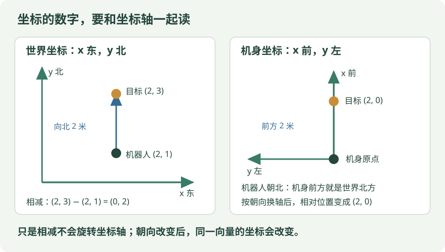

# 机器人学习概览

!!! tip "先抓住一个问题"

    同一条速度指令，换一个坐标系，意思可能完全不同。先把单位、方向和时间戳说清，再讨论控制算法。

把算法的输出变成机器人可以稳定执行的动作，是这条学习路线的目标。


## 看图梳理

{ .learning-figure }

[打开大图](../assets/learning/robotics-index.svg)

**感知输入**：传感器与坐标系，时间戳和数据质量；**决策与执行**：规划、控制、通信，约束与状态反馈；**系统检查**：仿真、日志、误差，异常处理与复现。


## 学习路线

### 先分清三个模块，再看工具名字

**定位**回答“我在哪里、朝哪里”；**规划**回答“怎么走到目标”；**控制**回答“怎样让机器人跟着要求运动”。它们会互相配合，但不是一件事。ROS 2 是组织通信与程序的工具，MuJoCo 是仿真工具，工具名称不能代替具体算法。

例如机器人在 (0,0)，目标在 (2,0)，单位米。定位给出当前位置；规划在没有障碍的简化条件下选择一条直线路径；控制持续读取实际位置，给出有界运动指令，让机器人沿路径前进。若前面有障碍，规划要改变路径；若轮子打滑或观测延迟，执行轨迹也可能偏离规划。

| 初学阶段先会的事 | 再继续学什么 |
| --- | --- |
| 看懂位置、方向、米与秒 | 坐标变换与运动学 |
| 区分目标值与实际反馈 | 跟踪误差与控制方法 |
| 知道一条数据由谁产生、谁接收 | ROS 2 节点与话题 |

### 位置、姿态、速度，不是同一种数据

| 量 | 它回答什么 | 二维例子 |
| --- | --- | --- |
| 位置 | 机器人在哪儿？ | `(2, 1)` 米 |
| 朝向角 | 机器人朝哪儿？ | 相对世界 x 轴逆时针 90° |
| 线速度 | 位置变化多快？ | 世界 y 方向 0.5 米/秒 |
| 角速度 | 朝向变化多快？ | 0.2 弧度/秒 |

“转到 90°”给的是目标朝向；“以 0.2 弧度/秒转动”给的是转动速度。若把两者混着传，数值即使都能写进程序，动作含义也完全不同。二维位姿通常包含位置和朝向；三维还需要描述高度及完整旋转。

先能描述一条指令怎样经过这些模块，不必第一次就把机器人软件全部接好。后面的最小闭环是在仿真里逐步实践的路线。

| 阶段 | 核心内容 | 实践目标 |
| --- | --- | --- |
| 数学基础 | 坐标变换、旋转、运动学 | 描述机器人与目标的相对位置 |
| 仿真基础 | MuJoCo 场景、关节与传感器 | 读取状态并执行简单动作 |
| 软件通信 | ROS 2 节点、话题、消息与时间戳 | 建立观测到控制的通信链路 |
| 导航规划 | 定位、地图、路径与避障 | 在简单场地到达目标点 |
| 运动控制 | 速度指令、反馈与执行约束 | 跟踪目标速度并记录误差 |

## 最小实践闭环

1. 定义世界坐标系与机器人坐标系。
2. 读取机器人状态，检查单位和时间戳。
3. 给出一个有界的目标或速度指令。
4. 记录实际轨迹，比较目标与执行结果。
5. 保存配置，使同一实验可以重复运行。

### 用一个数理解反馈控制

先把机器人简化为只能沿直线移动的点，目标位置为 2 米。当前测到 0 米，就还差 2 米；下一次测到 1.5 米，就只差 0.5 米。**反馈**就是反复读到实际位置，再用差距决定下一条命令。

下面是计算指令的小片段，不连接设备，也不代表完整机器人控制器。这里所有位置沿同一条世界坐标轴，速度上限 0.5 米/秒只是教学设定。

```python
# 三个输入都是示例数值；位置单位为米。
target_m = 2.0
current_m = 1.5
max_speed_mps = 0.5

# 差距为正时朝坐标正方向走；差距为负时朝反方向走。
error_m = target_m - current_m

# 系数单位为 1/秒：米乘以 1/秒，得到米/秒。
# 本例表示“每差 1 米，先请求 0.5 米/秒”。
gain_per_second = 0.5
requested_mps = gain_per_second * error_m

# 把请求限制在 [-0.5, 0.5] 米/秒之间。
# 先限制下界，再限制上界；结果仍然只是一个数字。
command_mps = min(max_speed_mps, max(-max_speed_mps, requested_mps))
print(command_mps)  # 预期输出 0.25，即本例请求正方向 0.25 米/秒。
```

| 当前测量位置 | 与目标的差距 | 限幅前请求 | 限幅后指令 |
| --- | --- | --- | --- |
| 0 米 | 2 米 | 1 米/秒 | 0.5 米/秒 |
| 1.5 米 | 0.5 米 | 0.25 米/秒 | 0.25 米/秒 |
| 2 米 | 0 米 | 0 米/秒 | 0 米/秒 |
| 2.2 米 | −0.2 米 | −0.1 米/秒 | −0.1 米/秒 |

表中每行是单独的一次测量示例，并不是已经模拟出的连续轨迹。这种“差多少，就按比例请求多少”的办法叫比例控制。它帮助理解反馈，但是否稳定、怎样避障、怎样处理打滑与时延，还取决于具体系统，不能把几行算式直接当作 Go2 实机控制程序。

### 把“计算一次”接成“反复反馈”，中间还差什么？

假设机器人理想地立即跟随速度，指令持续 0.1 秒：当前位置 1.5 米、指令 0.25 米/秒，就移动 `0.25 × 0.1 = 0.025` 米，到达 1.525 米。下次读到这个位置，再算误差 `2−1.525=0.475` 米，新指令是 `0.5 × 0.475=0.2375` 米/秒。

```text
测到位置 1.500 米 → 算指令 0.2500 米/秒 → 执行 0.1 秒
测到位置 1.525 米 → 算指令 0.2375 米/秒 → 再执行并重新测量
```

“重新测量”是关键。若每轮都把 current_m 固定为 1.5，程序反复算出的是同一个请求，并没有闭环反馈。上述位置变化只适用于理想点模型；真实日志要记录测量值，不能把预计位移直接当成传感器事实。何时算到达也需规定，比如误差不超过 0.02 米且速度足够小，而不是要求浮点位置刚好等于 2.0。

### ROS 2 中一条消息怎样流动

把“节点”先理解为负责某项工作的程序，例如读取传感器、估计位置、计算控制；把“话题”理解为约定名称和消息格式的数据通道。发布者写入消息，订阅者收到后处理。消息里的位置不会因为名字叫 position 就自动带有正确坐标系与单位。

在纸上画三个框：`位置估计节点 → 位置话题 → 控制节点`。位置估计节点负责告诉控制节点“测到哪里、何时测到、用哪个坐标系”；控制节点计算指令并交给执行接口。话题负责传数据，不负责证明数据准确、及时或可安全执行。这里是通信思路，不要求先安装 ROS 2。

## 与放牧任务的连接

### 坐标系：同一个“向前”为什么会变？

{ .learning-figure }

[打开坐标示例大图](../assets/learning/robotics-frames-example.svg)

在二维示例中，约定世界 x 轴向东、y 轴向北，机器人 x 轴朝前。机器人朝北时，机身坐标的速度 `(1, 0)` 米/秒，在世界坐标中就是 `(0, 1)` 米/秒，不能直接把两个分量原样复制。

设机身相对世界的朝向角为 ψ，逆时针为正，则速度变换为：

$$
v_x^w=\cos\psi\,v_x^b-\sin\psi\,v_y^b,\qquad
v_y^w=\sin\psi\,v_x^b+\cos\psi\,v_y^b
$$

上标 b 表示机身坐标，w 表示世界坐标。代入 ψ = 90° 就得到上面的结果。程序里的三角函数通常接收弧度，90° 应转换为 π/2。这里是在**同一时刻、对同一个物理速度向量换坐标轴表达**；转换位置还要加上机器人在世界中的位置。三维姿态不能直接照搬这个二维公式。坐标约定参考 [ROS REP 103 官方源文档](https://github.com/ros-infrastructure/rep/blob/master/rep-0103.rst)。

特别区分：机器人自身线速度在两套坐标轴中的分量可以这样旋转；“羊相对运动机器人坐标的位置随时间怎样变化”却还受到机器人平移与转向影响。即使羊在世界里静止，机器人向它移动，羊的机身相对坐标也会变化。因此对机身相对位置做差分，不应仅旋转一下就宣称得到羊的世界速度。

先不用背旋转公式，跟着图算一次位置：机器人位于世界 `(2, 1)`，面朝北；目标位于世界 `(2, 3)`。两者相减得到世界坐标中的相对向量 `(0, 2)`。因为机器人朝北，这个向量在机身坐标里是“前方 2 米、左方 0 米”，即 `(2, 0)`。**先相减找相对位置，再按朝向换坐标轴**。

机身坐标在这里采用 x 向前、y 向左、z 向上的约定。相机光学坐标常采用 x 向右、y 向下、z 向前；两者不能只改名字就互换。接入一个设备前，先查它实际的坐标约定。

### 时间戳：收到新消息，不一定拿到新观测

相机在 10.00 秒拍摄，策略在 10.15 秒收到结果，观测已晚了 0.15 秒。若目标在这段时间匀速移动 1 米/秒，其位置已经变化 0.15 米；这只是忽略加速的估算。应记录采集与接收时间，并明确是否使用同一时钟。

动作限幅也会改变实际执行：策略要求 2 米/秒，接口只允许 1 米/秒时，记录原始请求与执行值，才能分清策略选择和执行约束。限幅不等于完整的避障或安全控制。

高层策略负责决定机器人向哪里移动，控制模块负责执行动作。需要记录控制频率、速度限制、观测延迟和动作延迟，避免把执行误差误判为策略问题。

例如频率 10 Hz 表示理想情况下每秒处理 10 次，间隔是 `1/10 = 0.1` 秒；20 Hz 的间隔是 0.05 秒。频率变大不意味着延迟自动消失：相机每秒发 20 帧，但排队处理仍可能拿到 0.3 秒前的图像。

### 把数据写清楚，其他模块才用得对

下面是一份人读的接口说明，不是可直接发送的 ROS 消息格式。

| 字段 | 示例 | 接收方怎样使用 |
| --- | --- | --- |
| 采集时间 | 10.00 秒，同一实验时钟 | 与当前时刻比较，判断数据年龄 |
| 坐标系 | world，x 东、y 北 | 必要时先转换到控制需要的坐标系 |
| 位置 | x=2.0、y=1.0，单位米 | 与同一坐标系中的目标位置相减 |
| 朝向 | π/2，单位弧度 | 把机身方向与世界方向联系起来 |
| 有效标记 | 有效 / 定位丢失 | 定位丢失时不能把零当成可靠位置 |

接收方先检查这些约定，再计算控制。日志也应保留发送给控制器的指令和测到的实际运动，这样才看得出问题出在观测、决策还是执行。

## 后续笔记清单

??? example "不用启动机器人，先检查坐标理解"

    沿用世界 x 向东、y 向北的约定。机器人朝西，机身坐标中向前 1 米/秒，在世界坐标里是 (−1, 0) 米/秒。机身“向前”随朝向改变；不能固定写成世界 x 为正。

- 坐标系与变换实例
- MuJoCo 场景搭建记录
- ROS 2 通信与日志记录
- Go2 控制接口实践

[返回研究主线](../herding/index.md) · [查找开源资料](../opensource/index.md)
