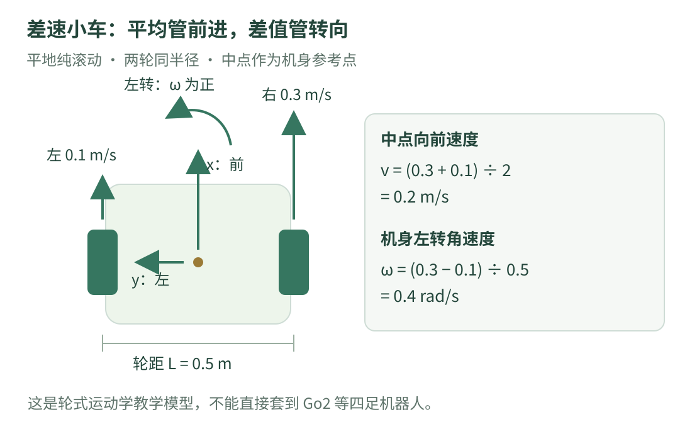

# 05 · 差速小车运动学：左右轮怎样决定前进和转向

一辆小车有两个独立驱动轮：左轮慢一点、右轮快一点，它会转向哪边？如果你希望它以 0.2 米/秒前进并以 0.4 弧度/秒左转，又应该给两轮多少速度？这一章从画图和手算开始。

!!! tip "学习目标与模型范围"

    先读 [04 · 坐标系与二维变换](frames.md)，知道米/秒、弧度/秒和朝向的含义。读完后，应能在左右轮速度与机身前进、转向速度之间转换。

    **差速小车是帮助理解运动学的例子，不是 Go2 或其他四足机器人的模型。** 我们假设两轮同半径、平地纯滚动、没有侧滑，机身参考点在两轮连线的中点。

## 1. 看图：两轮速度的平均决定前进，差值决定转向

{ .learning-figure }

[打开大图](../assets/learning/robotics-kinematics.svg)

机身 x 朝前、y 朝左、z 朝上。俯视时，向左转就是逆时针，角速度为正。本章左右轮的正速度都表示让小车向前滚动的速度。

注意这是一项**符号约定**：真实电机轴的正方向可能因为安装朝向而不同。控制器或驱动要先把电机数据转换成本章约定，不能直接凭“正转”二字套公式。

## 2. 运动学问“怎样运动”，不是“需要多大力”

运动学把位置、速度和几何联系起来。例如，两轮速度给定后，车身沿怎样的轨迹走？它暂时不求质量、摩擦力或电机转矩。

动力学进一步问：有多大质量、惯性和外力时，要怎样施力才会得到某种运动？一辆沉重小车不一定能瞬间跟随速度请求，所以运动学预测不能当成实际响应保证。

本章轮式模型的条件和机身速度关系，可核对 [Modern Robotics 作者教材的轮式机器人导论](https://modernrobotics.northwestern.edu/nu-gm-book-resource/13-1-wheeled-mobile-robots/) 与 [非完整约束轮式机器人建模](https://modernrobotics.northwestern.edu/nu-gm-book-resource/13-3-1-modeling-of-nonholonomic-wheeled-mobile-robots/)。数值例子由本站自行设定。

## 3. 四个量，先把单位写在旁边

| 符号 | 人话 | 单位 |
| --- | --- | --- |
| $v_L$ | 左轮沿地面前进的滚动线速度 | 米/秒 |
| $v_R$ | 右轮沿地面前进的滚动线速度 | 米/秒 |
| $L$ | 两轮接触中心之间的横向距离 | 米 |
| $v$ | 轮轴中点沿机身前方的线速度 | 米/秒 |
| $\omega$ | 机身朝向变化速度，左转为正 | 弧度/秒 |

这里的 $v_L$、$v_R$ 已是轮缘线速度，不是电机转速。$L$ 也不是车长，不是半轮距。先检查定义，再代入数字。

## 4. 手算：左 0.1、右 0.3 会怎样走

本例轮距 `L = 0.5` 米，左轮 `vL = 0.1` 米/秒，右轮 `vR = 0.3` 米/秒。

$$
v=\frac{v_R+v_L}{2},\qquad
\omega=\frac{v_R-v_L}{L}
$$

先算平均：`(0.3 + 0.1) / 2 = 0.2` 米/秒，中点在向前运动。再算差值：`(0.3 − 0.1) / 0.5 = 0.4` 弧度/秒，正数说明向左转。

为什么右轮快反而左转？右轮绕过的路比左轮更长，小车就绕向左边；想象两个人抬着一根横杆，右边的人走得更快，横杆会转向左边。

| 左轮 / 米每秒 | 右轮 / 米每秒 | 中点 v / 米每秒 | ω / 弧度每秒 | 直观结果 |
| --- | --- | --- | --- | --- |
| 0.2 | 0.2 | 0.2 | 0.0 | 直线前进 |
| 0.1 | 0.3 | 0.2 | 0.4 | 前进并左转 |
| 0.3 | 0.1 | 0.2 | −0.4 | 前进并右转 |
| −0.1 | 0.1 | 0.0 | 0.4 | 绕中点原地左转 |
| −0.2 | −0.2 | −0.2 | 0.0 | 直线后退 |

“原地转”的是中点；两个轮子仍在运动。机身上偏离中点的点也会绕圈，不能说车身每个位置都静止。

## 5. 反过来：希望 v、ω 这样，就求两轮速度

$$
v_L=v-\frac{L}{2}\omega,\qquad
v_R=v+\frac{L}{2}\omega
$$

希望 `v=0.2` 米/秒、`ω=0.4` 弧度/秒，`L=0.5` 米。转向造成的两边速度差的一半是 `0.5/2 × 0.4 = 0.1` 米/秒。

左轮：`0.2 − 0.1 = 0.1`；右轮：`0.2 + 0.1 = 0.3`，恢复上面的例子。

若两轮各有速度限制，v 与 ω 不能完全独立地随意增大。例如轮速范围都是 `[−0.3, 0.3]` 米/秒，要求 `v=0.3、ω=0.4` 时，右轮需要 0.4 米/秒，已超限。直接截断右轮会改变实际请求的前进与转向组合。

## 6. 轮缘速度与轮子转速别混淆

设轮半径 $r=0.05$ 米，轮子角速度记作 $\dot\phi$，单位弧度/秒。纯滚动时：

$$
v_{\mathrm{wheel}}=r\dot\phi
$$

左轮 0.1 米/秒对应 `0.1 / 0.05 = 2` 弧度/秒；右轮 0.3 米/秒对应 6 弧度/秒。

轮子转一圈经过的轮缘长度是 $2\pi r$。如果设备给的是转/分钟，还要把圈数和分钟换成弧度和秒：`弧度/秒 = 转/分钟 × 2π / 60`。电机侧编码器还可能受齿轮传动比影响。

轮子角速度和机身转向角速度都用弧度/秒，但绕的是不同轴，不能把右轮的 6 弧度/秒当成车身的 ω。

## 7. 世界位置怎样随时间变化

车身朝向 θ，机身中点只能沿前方速度 v 运动，则：

$$
\dot x=v\cos\theta,\qquad
\dot y=v\sin\theta,\qquad
\dot\theta=\omega
$$

上方的小点表示“对时间的变化率”，并不是点乘。`xdot` 表示世界 x 方向速度，`ydot` 表示世界 y 方向速度。

在很短时间 $\Delta t$ 内，可以用开始时朝向做近似：`x新 ≈ x旧 + v cosθ × Δt`，y 类似；`θ新 = θ旧 + ωΔt`。这叫显式欧拉近似。

本例开始朝东，持续 1 秒的左转段中，θ 从 0 增到 0.4 弧度。如果整整一秒都用 θ=0，会预计 `(0.2,0)`；实际上已经转弯，轨迹不是直线。

### 恒定速度的一段，可以计算圆弧

当这一整段中 v 和 ω 恒定，且 ω 不为 0，中点的带符号转弯半径为 `v/ω`；几何半径取 `|v/ω|`。若 v=0，中点原地转动，不画出非零半径的圆。本例几何半径 `0.2/0.4 = 0.5` 米，转角 0.4 弧度；从原点朝东出发：

```text
x = 0.5 × sin(0.4) ≈ 0.194709 米
y = 0.5 × (1 − cos(0.4)) ≈ 0.039470 米
朝向 = 0.4 弧度 ≈ 22.918 度
```

本段轨迹长度是 `v × 1秒 = 0.2` 米；起终点的直线距离稍小。这再次说明路程和位移大小不完全相同。

## 8. 阅读代码：换算轮速，并核对三种运动

下面完整示例只计算固定数字，不连接硬件。位置单位为米，内部朝向为弧度，时间为秒。位置预测假设整段轮速保持不变且严格满足纯滚动模型。

```python title="差速小车的固定数字计算 · 完整阅读示例"
import math


def wheels_to_body(left_mps, right_mps, track_m):
    if track_m <= 0.0:
        raise ValueError("轮距必须大于零")
    # 平均给出中点前进速度，差值给出转向速度。
    v_mps = (right_mps + left_mps) / 2.0
    omega_radps = (right_mps - left_mps) / track_m
    return v_mps, omega_radps


def body_to_wheels(v_mps, omega_radps, track_m):
    if track_m <= 0.0:
        raise ValueError("轮距必须大于零")
    # 左转时，左轮慢一点、右轮快一点。
    turn_mps = track_m * omega_radps / 2.0
    return v_mps - turn_mps, v_mps + turn_mps


def advance_pose(x_m, y_m, heading_rad, v_mps, omega_radps, dt_s):
    if dt_s < 0.0:
        raise ValueError("持续时间不能为负")

    # 恒定速度段的总转角和转角中点。
    turn_rad = omega_radps * dt_s
    half_turn = turn_rad / 2.0

    # 圆弧的弦长 = 弧长 × sin(半转角) / 半转角。
    # 直行时半转角是 0，比例的极限为 1，避免除以零。
    if half_turn == 0.0:
        chord_ratio = 1.0
    else:
        chord_ratio = math.sin(half_turn) / half_turn

    signed_chord_m = v_mps * dt_s * chord_ratio
    middle_heading = heading_rad + half_turn
    next_x = x_m + signed_chord_m * math.cos(middle_heading)
    next_y = y_m + signed_chord_m * math.sin(middle_heading)
    next_heading = heading_rad + turn_rad
    return next_x, next_y, next_heading


track_m = 0.5
cases = [
    ("直行", 0.2, 0.2),
    ("左转", 0.1, 0.3),
    ("原地左转", -0.1, 0.1),
]

for name, left_mps, right_mps in cases:
    v_mps, omega_radps = wheels_to_body(left_mps, right_mps, track_m)
    # 每个场景都独立从原点朝东开始，持续 1 秒，不是连续三段。
    x_m, y_m, theta = advance_pose(0.0, 0.0, 0.0, v_mps, omega_radps, 1.0)
    print(
        f"{name}: v={v_mps:.3f} m/s, omega={omega_radps:.3f} rad/s; "
        f"位置=({x_m:.3f}, {y_m:.3f}) m, 朝向={math.degrees(theta):.3f} deg"
    )

# 用反向公式检查左转请求；这一步只计算数字。
left, right = body_to_wheels(0.2, 0.4, track_m)
print(f"反求两轮: 左={left:.3f} m/s, 右={right:.3f} m/s")
```

预期输出：

```text
直行: v=0.200 m/s, omega=0.000 rad/s; 位置=(0.200, 0.000) m, 朝向=0.000 deg
左转: v=0.200 m/s, omega=0.400 rad/s; 位置=(0.195, 0.039) m, 朝向=22.918 deg
原地左转: v=0.000 m/s, omega=0.400 rad/s; 位置=(0.000, 0.000) m, 朝向=22.918 deg
反求两轮: 左=0.100 m/s, 右=0.300 m/s
```

### 第一次只读两个速度函数，再读位置预测

前两个函数就是第 4、5 节的公式。`advance_pose` 用弧线两端之间的直线段，也叫弦，计算本段终点；`middle_heading` 是这条弦对应的方向。

当 ω=0，转角为零，比例取 1，恢复普通的 `位移 = 速度 × 时间`。当 v=0，位移为零，但朝向仍增加 ωdt，恢复原地转向。

这个函数不是用真实传感器校正位置的定位器。若车轮打滑、轮径不准或轮速变化，预测就会偏离现实；从轮速累计位置称为里程计估计，不等于永远准确的全球位置。

## 9. 练习：原地右转应该怎样给两轮速度

轮距 0.5 米，希望中点 v=0、机身 ω=−0.4 弧度/秒。求左轮和右轮线速度，再说明持续 2 秒后理想模型的中点位置和朝向变化。

**提示**：先算 `Lω/2`，负角速度表示右转。位置不变不代表轮子不动。

??? example "展开参考答案"

    `Lω/2 = −0.1` 米/秒。左轮 `0−(−0.1)=0.1` 米/秒；右轮 `0+(−0.1)=−0.1` 米/秒。

    中点不平移，朝向改变 `−0.4 × 2 = −0.8` 弧度，约 −45.837 度。两个轮子朝相反方向运动。

    在完整示例的 cases 中添加 `("原地右转", 0.1, -0.1)` 可查看 1 秒结果；要核对 2 秒，需将对应 advance_pose 的最后一个输入改为 2.0。不要把半秒、一秒和两秒的结果混在一起。

## 10. 常见误区与下一步

| 误区 | 更准确的理解 |
| --- | --- |
| 左右轮公式能直接控制四足机器人 | 四足运动还涉及关节、接触、平衡等不同模型 |
| 轮子转速就是机身角速度 | 绕轴不同，要按几何关系换算 |
| L 是半轮距 | 本章 L 是两轮间完整距离 |
| 轮速给出就保证轨迹准确 | 纯滚动、几何参数和速度跟随都是模型条件 |
| 小车能瞬间横移到左边 | 本章普通差速模型不允许瞬时机身侧向速度 |

自己算出左轮 0.3、右轮 0.1 时的 v、ω，并解释为什么“运动预测”之后还要读取反馈。下一章学习如何根据误差调整请求。

[返回机器人学习路线](index.md) · [上一章：04 · 坐标系与二维变换](frames.md) · [下一章：06 · 反馈与控制 →](control.md)
