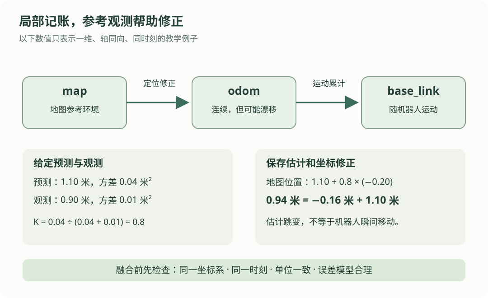

# 11 · 定位与里程计：我走了多少，现在又在哪里？

## 本章的小任务

机器人从起点向前移动。根据运动增量，它估计自己到了 1.1 米；另一个已经转换到同一参考系的观测认为它在 0.9 米。为什么会有两个位置？能不能直接求平均？怎样记录这次修正？

本章先用**一维直线上的位置**讲清信息来源，再解释二维系统中常见的 `map → odom → base_link`。示例全部使用假想数据，不读取真实传感器。

学完后，你应能区分：累计运动得到的里程计、结合参考环境的定位、建立环境表示的建图，以及同时做定位与建图的 SLAM。

## 先看两种信息怎样配合

{ .learning-figure }

[打开定位关系大图](../assets/learning/robotics-localization.svg)

你可以把里程计理解为“从出发点记账”：每走一小段，就把增量加到账上。定位还会利用“我看见的地标应该在哪里”等参考信息，检查这份账是否慢慢偏了。

## 四个词，先用走路理解

| 名称 | 主要问题 | 例子 |
| --- | --- | --- |
| 里程计，odometry | 相对之前，我移动了多少？ | 根据轮转、连续图像或惯性数据估计运动增量 |
| 定位，localization | 我在某个参考环境中的位姿是什么？ | 已知地图中，用激光与地图匹配估计位置和朝向 |
| 建图，mapping | 环境里有哪些结构，它们在哪里？ | 把多次观测对齐，建立墙体或占据栅格地图 |
| SLAM | 一边估计位姿，一边建立地图 | 机器人进入未知环境，运动与地图估计相互影响 |

有里程计，不等于已有地图；有地图，也不等于已知道机器人在地图中的哪里。里程计不仅来自车轮：视觉里程计和惯性相关估计也是常见来源。四足机器人没有左右轮编码器，可以结合惯性、腿部运动与接触、视觉等信息；具体方法有各自的模型和误差。

## 累计误差怎样出现

设机器人实际每段走 0.20 米，共走 5 段。某个简化运动估计每段都记成 0.22 米。

$$
\hat{x}_{k+1}=\hat{x}_k+\Delta\hat{x}_k
$$

| 符号 | 含义 | 单位 |
| --- | --- | --- |
| \(\hat{x}_k\) | 第 k 轮的位置估计；帽子表示估计 | 米 |
| \(\Delta\hat{x}_k\) | 本轮估计的移动增量 | 米 |
| \(k\) | 轮次编号 | 无单位 |

| 段数 | 实际累计距离 | 估计累计距离 | 估计减实际 |
| --- | --- | --- | --- |
| 1 | 0.20 m | 0.22 m | 0.02 m |
| 3 | 0.60 m | 0.66 m | 0.06 m |
| 5 | 1.00 m | 1.10 m | 0.10 m |

这里特意选了方向固定的偏差，便于看出积累。真实误差也可能变化、部分抵消或突然增大，不是所有情况都按同一斜率增长。

二维位姿还包含方向。方向估计稍有偏差，之后把“向前的增量”转到世界坐标时，横向位置也会偏。不能只修正 x、y，永远假定朝向准确。

## ROS 常见的三个坐标系

这里采用 [ROS REP 105 的移动平台约定](https://github.com/ros-infrastructure/rep/blob/master/rep-0105.rst)。这些名字表达不同职责，并不是三个传感器。

| 坐标系 | 用来表达什么 | 典型特征 |
| --- | --- | --- |
| `base_link` | 固定在机器人基座上的参考系 | 随机器人运动 |
| `odom` | 局部连续运动的参考系 | 机器人相对它的位姿通常平滑，但可随时间漂移 |
| `map` | 地图或较长期参考环境 | 定位修正可使机器人在其中的位姿出现跳变 |

通常组织为 `map → odom → base_link`。里程计提供 `odom → base_link`；定位提供或更新 `map → odom`，两者合起来得到机器人在地图中的位姿。具体来源和发布者必须在系统中明确。

为什么不直接让定位和里程计各自给 `base_link` 一个父坐标系？因为 tf 的关系按树组织，一个子坐标系应有一个父坐标系。两个程序抢着发布同一关系，也可能造成冲突。

### 一个不含旋转的修正例子

假设机器人在 `odom` 中的 x 是 1.10 米，定位后在 `map` 中的 x 应是 0.94 米。两个坐标系的轴方向相同，所有数对应同一时刻，则：

$$
x_{\mathrm{map}}=t_{\mathrm{map}\leftarrow\mathrm{odom}}+x_{\mathrm{odom}}
$$

平移修正是 `0.94 − 1.10 = −0.16 m`。保留局部里程计的连续位置 1.10，通过 −0.16 米的坐标修正，在地图中得到 0.94。

若存在旋转，必须使用前面[坐标系章节](frames.md)的旋转加平移，三维则使用完整刚体变换。上式只适合这一维、轴同向的例子。

## 两个估计怎样合并：先说明条件

“平均一下”只有在误差性质合适时才有理由。一个位置可能来自准确的地标，另一个可能已经长时间漂移，平均分配权重未必合适。

以下给出一个**一维线性估计的简化更新**。前提是：位置和观测使用同一坐标系、同一时刻；观测模型就是“位置加噪声”；误差无系统偏差，预测误差和观测噪声不相关；不确定度设置能合理描述数据。实际系统需要检验这些条件。

$$
K=\frac{P}{P+R},\qquad
\hat{x}_{\mathrm{new}}=\hat{x}_{\mathrm{pred}}+K(z-\hat{x}_{\mathrm{pred}})
$$

$$
P_{\mathrm{new}}=(1-K)P
$$

| 符号 | 通俗含义 | 单位 |
| --- | --- | --- |
| \(\hat{x}_{\mathrm{pred}}\) | 加入本次观测前的位置预测 | 米 |
| \(z\) | 本次位置观测 | 米 |
| \(P\) | 预测位置误差的方差 | 平方米，m² |
| \(R\) | 观测噪声的方差 | 平方米，m² |
| \(K\) | 本轮修正比例，也称增益 | 无单位 |
| \(z-\hat{x}_{\mathrm{pred}}\) | 观测与预测的差，也称残差或创新 | 米 |

方差描述误差的分散程度，越大表示越不确定。标准差是方差开平方，所以方差 `0.04 m²` 对应标准差 `0.2 m`，不是 0.04 米。

在这些简化条件下，预测方差比观测方差大，K 就较大，位置向观测修正得更多。K 并不是“这次一定有 80% 概率观测正确”。

### 逐步算一次

给定预测 1.10 米、观测 0.90 米、预测方差 `P = 0.04 m²`、观测方差 `R = 0.01 m²`：

1. 增益：`0.04 / (0.04 + 0.01) = 0.8`。
2. 残差：`0.90 − 1.10 = −0.20 m`。
3. 修正：`0.8 × (−0.20) = −0.16 m`。
4. 新位置：`1.10 − 0.16 = 0.94 m`。
5. 新方差：`(1 − 0.8) × 0.04 = 0.008 m²`。

如果只求平均，结果是 1.00 米。本例得到 0.94，是因为假设观测比预测更可靠。前面的增量演示人为设定真实位置为 1 米，更新公式并不会自动读到这项真值；0.94 仍然只是估计。

若这次观测是 0.70 米，同样权重会得到 `1.10 + 0.8 × (0.70 − 1.10) = 0.78 m`，反而比原先的 1.10 离真值更远。融合不保证每个样本都更接近真值，误差模型和异常观测处理仍然重要。前面人为设置的固定偏差，也不能当作这里无偏误差假设已经成立的证明。

## 先看一个很短的更新

```python title="一次同坐标、同时刻的位置更新"
prediction_m = 1.10    # 预测位置，米。
observation_m = 0.90   # 假想观测，已在相同参考系与时刻。
prediction_var = 0.04  # 预测方差，平方米。
observation_var = 0.01 # 观测方差，平方米。

gain = prediction_var / (prediction_var + observation_var)
updated_m = prediction_m + gain * (observation_m - prediction_m)
print(f"修正后位置：{updated_m:.3f} m")
```

预期输出：

```text
修正后位置：0.940 m
```

这个片段完整，可单独阅读。下面另一个完整示例还包括累积运动和记录坐标修正，不需要把两段拼接。

## 完整示例：从里程计记账，到保存修正

方差是为本次更新给定的教学输入，未从这 5 个运动增量自动推导。真实滤波器还要传播状态与不确定度，并处理相关性。

```python title="一维里程计与定位更新的数值示例"
import math

increments_m = [0.22] * 5   # 5 次估计增量，各 0.22 米。
odom_x_m = 0.0              # 局部参考系中的累计位置。
for increment_m in increments_m:
    odom_x_m += increment_m

observation_m = 0.90        # 本轮参考观测，同一时刻，米。
prediction_var_m2 = 0.04    # 给定的预测不确定度，平方米。
observation_var_m2 = 0.01   # 给定的观测不确定度，平方米。

# 这一次更新前，假设 map 与 odom 的平移修正为 0。
prediction_map_m = odom_x_m
gain = prediction_var_m2 / (prediction_var_m2 + observation_var_m2)
residual_m = observation_m - prediction_map_m
map_x_m = prediction_map_m + gain * residual_m
posterior_var_m2 = (1.0 - gain) * prediction_var_m2

# 一维且轴同向时，平移等于两个位置的差。
# 保留 odom 中累计的位置，单独记录 map <- odom 的修正。
map_from_odom_m = map_x_m - odom_x_m
print(f"里程计位置：{odom_x_m:.3f} m")
print(f"修正比例：{gain:.3f}")
print(f"地图位置：{map_x_m:.3f} m")
print(f"地图平移修正：{map_from_odom_m:.3f} m")
print(f"更新后标准差：{math.sqrt(posterior_var_m2):.3f} m")
```

预期输出：

```text
里程计位置：1.100 m
修正比例：0.800
地图位置：0.940 m
地图平移修正：-0.160 m
更新后标准差：0.089 m
```

| 代码位置 | 应怎样读 |
| --- | --- |
| `odom_x_m += increment_m` | 增量逐段累积，不是绝对位置每次相加 |
| `prediction_map_m` | 融合前先明确预测所在参考系 |
| `residual_m` | 比较的是同一位置量，不是轮速与位置混减 |
| `posterior_var_m2` | 保存不确定度；不能只留下一个看似精确的位置 |
| `map_from_odom_m` | 单独记录全局修正，便于理解局部连续与地图修正的职责 |

## 实际数据先检查什么

先检查时间。如果观测晚了 0.3 秒，机器人又在 0.5 m/s 匀速移动，这段时间就移动了 0.15 米。直接把旧观测当“此刻的位置”，可能把正常移动误当定位错误。时间对齐需要带时间戳的状态和模型，不能随意改掉观测时间。

再检查坐标与单位。相机像素、`base_link` 中的相对点、`map` 中的位置和经纬度不能直接平均。转换不仅需要单位换算，可能还需要相机几何、外参或地理投影。

还要检查观测是否异常。例如预测 1.1 米，观测突然变成 5 米，要查看遮挡、错误匹配、定位重置和时间问题。不能因为公式能算出结果，就无条件接受观测；异常判断阈值应结合误差模型和任务设置。

## 练习：换一种不确定度

仍然预测 1.1 米、观测 0.9 米，把观测方差改成 `0.04 m²`，预测方差保持 `0.04 m²`。提示：先算 K，再算位置与新方差。

??? example "展开参考答案"

    `K = 0.04 / 0.08 = 0.5`；新位置 `1.1 + 0.5 × (0.9 − 1.1) = 1.0 m`；新方差 `(1 − 0.5) × 0.04 = 0.02 m²`。只有在这份模型里两种误差方差相同等条件成立时，才得到等权平均。

再判断：地图中的位置修正了 0.2 米，机器人就真的瞬间移动了 0.2 米吗？

??? example "展开估计与真实运动的区别"

    不是。改变的是“我们认为机器人在哪里”的估计。要判断真实移动，还需查看运动观测和时间。把估计跳变当成真实速度，会产生不合理的速度尖峰。

## 常见错误与下一步

- 用初始坐标系的增量长期充当无漂移的全局真值。
- 把方差的平方米与位置的米混用，或把标准差直接代入要求方差的公式。
- 融合共享相同信息的估计却忽略相关性，导致过度自信。
- 在不同时间或不同参考系的两个数之间算残差。
- 认为地图越大就越容易定位；重复纹理、对称走廊和观测稀少也会造成歧义。

定位回答“我可能在哪里”。下一章用这个位置和环境表示，回答“从这里怎样走到那里”。位置有不确定度，路线也应留出合适余量。

## 对照资料

坐标职责与关系见 [ROS REP 105](https://github.com/ros-infrastructure/rep/blob/master/rep-0105.rst)；定位与导航的分工可对照 [Nav2 Jazzy 导航概念](https://docs.nav2.org/jazzy/getting_started/navigation_concepts/)。本章的单次一维更新用来解释残差、权重与方差，不是完整 EKF、AMCL 或 SLAM 实现。

[返回学习路线](index.md) · [上一章：10 MuJoCo 仿真基础](mujoco.md) · [下一章：12 路径规划与避障 →](planning.md)
