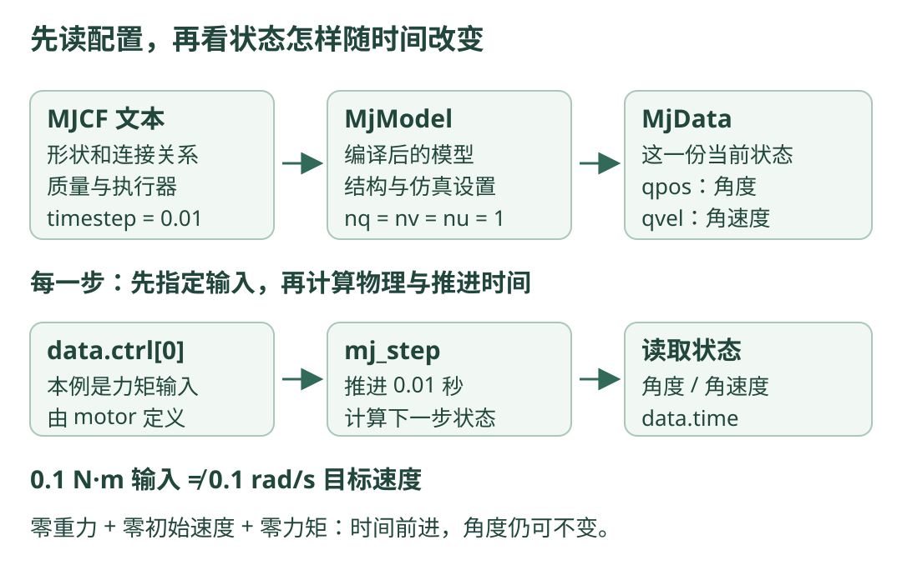

# 10 · MuJoCo：先理解一个关节怎样向前模拟

!!! tip "这一章的目标"

    区分机器人模型与当前状态，找到关节角、关节速度和执行器输入，并说明一次 `mj_step` 怎样把仿真时间向前推进。

    **前置知识**：[反馈控制](control.md)、[URDF 描述](urdf.md)，能读简单 Python 循环。这里固定使用 **MuJoCo 3.3.7 的 Python API、Python 3.12**；这是教学版本，不表示它是最新发行版。

## 仿真先回答“给定模型和输入，会发生什么？”

物理仿真用模型、当前状态和输入，计算接下来一小段时间后的状态。它可以帮助观察关节怎样运动，但模型参数、接触处理和传感器假设都会影响结果。

本章只描述一个固定底座上的转臂：它能绕 z 轴转动。这里不加载四足机器人，也不执行强化学习训练；所有代码供阅读，不需要安装 MuJoCo 或创建额外虚拟环境。

## 看图：配置与状态，分开存放

{ .learning-figure }

[打开大图](../assets/learning/robotics-mujoco.svg)

`model` 可以先看成“机器人和仿真设置”，`data` 看成“这一刻的运动状态和计算结果”。两个仿真实例可以使用相同模型，但拥有各自的 `data`，就像同一本说明书对应两台当前状态不同的机器。

## 六个名字，先翻译成人话

| 名字 | 它是什么 | 本章具体含义 |
| --- | --- | --- |
| MJCF | MuJoCo 自己的 XML 模型格式 | 描述底座、杆、关节和执行器 |
| `MjModel` | 编译后的模型与设置 | 形状、质量、关节数量、时间步等 |
| `MjData` | 当前状态、输入和计算缓冲 | 此刻角度、速度、仿真时间等 |
| `data.qpos` | 广义位置 | 本例唯一转动关节的角度，单位 rad |
| `data.qvel` | 广义速度 | 本例该关节的角速度，单位 rad/s |
| `data.ctrl` | 由程序指定的执行器输入 | 含义由执行器类型决定；本例为力矩输入 |

“广义”可以先理解为能描述这个模型自由度的一组数字。转动关节用角度，滑动关节用位移；包含自由关节或球关节时，位置还可能包含四元数，`qpos` 与 `qvel` 长度不一定相同。

本章只有一个 hinge 关节，因此 `qpos[0]` 和 `qvel[0]` 是明确的。换成复杂机器人，必须查关节名字与地址，不能把 `[0]` 永远解释为“机器人第一条腿”。

## 先分清输入与结果

想象用手轻轻扭一根杆：你施加的是力矩；杆实际转多快，是质量分布、阻尼和当前状态一起决定的结果。

本例 `<motor gear="1">` 作用在唯一 hinge 上，默认的直接力矩型设置使 `ctrl[0]=0.1` 对应 0.1 N·m 的关节力矩。它**不是 0.1 rad/s 的目标速度**。

若换成 `<position>` 或 `<velocity>` 执行器，控制输入会有不同含义。不要只看变量名 `ctrl` 就猜单位；先看 XML 中的执行器定义。[3.3.7 执行器参考](https://mujoco.readthedocs.io/en/3.3.7/XMLreference.html#actuator) 定义了这些设置。

## 完整文件一：learning_arm.xml

与上一章保持相同的底座、杆尺寸和质量，但用 MJCF 重新表达。把文件保存在自己选择的 `robotics_learning` 目录中；第二个文件也放在同一目录。

**教学简化：重力设为零，不添加地面或外部扰动。** 这样先看清时间步和状态，没有输入、没有初始速度时，杆不会自己动。零重力只是本章条件，不代表真实放牧机器人可以忽略重力。

```xml title="learning_arm.xml · 完整 MJCF 文件"
<mujoco model="learning_arm">
  <!-- XML 中的角度使用弧度，避免把 90 当成 90 rad。 -->
  <compiler angle="radian"/>
  <!-- 每次 mj_step 的仿真时间增量为 0.01 秒。 -->
  <option timestep="0.01" gravity="0 0 0"/>

  <worldbody>
    <!-- 没有 joint 的底座 body 固定在世界，不是可自由掉落的底座。 -->
    <body name="base_link" pos="0 0 0">
      <!-- box size 是半边长；完整尺寸为 0.2 × 0.2 × 0.1 米。 -->
      <geom name="base_geom" type="box" size="0.1 0.1 0.05"
            mass="2" rgba="0.25 0.50 0.40 1"/>
      <body name="arm_link" pos="0 0 0.1">
        <!-- 关节原点是本 body 原点，绕 z 正轴转动。 -->
        <joint name="arm_hinge" type="hinge" axis="0 0 1"
               limited="true" range="-1.5707963268 1.5707963268"
               damping="0.1"/>
        <!-- 完整杆长 0.4 米，中心距转轴 0.2 米。 -->
        <geom name="arm_geom" type="box" pos="0.2 0 0"
              size="0.2 0.02 0.02" mass="1"
              rgba="0.12 0.28 0.23 1"/>
      </body>
    </body>
  </worldbody>

  <actuator>
    <!-- gear=1、默认直接 motor：ctrl 是这个关节的力矩输入。 -->
    <motor name="arm_motor" joint="arm_hinge" gear="1"
           ctrllimited="true" ctrlrange="-0.5 0.5"/>
  </actuator>
</mujoco>
```

本模型没有显式 `<inertial>`，MuJoCo 编译器按杆的几何与质量推导惯性。这里是均匀长方体，和上一章的手算模型对应。复杂非均匀零件需要另行核对，不能看到漂亮几何就默认质量分布准确。

### URDF 和 MJCF，三个地方尤其容易混淆

| 项目 | 上一章 URDF | 本章 MJCF |
| --- | --- | --- |
| box 尺寸 | `size` 写完整边长 | `size` 写三个半边长 |
| 树的写法 | 分开列 link，再通过 joint 引用连接 | body 的嵌套直接表达父子关系 |
| 执行器 | 描述关节不等于已定义电机输入 | 本例单独写 `<actuator>` 指定输入含义 |

在本章 MJCF 中，底座 body 没有关节，因此焊定在世界。上一章 URDF 的根 link 只表示描述树的根，单靠那个名字并不保证加载进仿真后固定在世界。

MuJoCo 的关节范围采用约束处理，不能把数值积分中的关节限位说成完全不会越界的硬墙。本章不靠撞限位来停止杆。MJCF 也没有自动继承上一章 URDF 中的速度上限，两份文件必须分别检查。

## 完整文件二：simulation_reading.py

先设置一个小初始角度 0.2 rad，约 11.46°，初始角速度为 0。每一步输入力矩为零，在本章条件下角度保持不变。

```python title="simulation_reading.py · 完整文件，供阅读"
from pathlib import Path
import mujoco  # 第三方仿真库；这里不要求安装或执行。

# 两个文件放在同一目录；按脚本位置定位 XML。
xml_path = Path(__file__).with_name("learning_arm.xml")
model = mujoco.MjModel.from_xml_path(str(xml_path))  # 编译模型描述。
data = mujoco.MjData(model)  # 为这个模型创建一份当前状态。

# nq：位置向量长度；nv：速度向量长度；nu：执行器输入数量。
print(f"nq={model.nq}, nv={model.nv}, nu={model.nu}")

mujoco.mj_resetData(model, data)  # 回到模型的默认初始状态。
data.qpos[0] = 0.2  # 本例唯一 hinge 的角度，单位 rad。
data.qvel[0] = 0.0  # 初始角速度，单位 rad/s。
data.ctrl[0] = 0.0  # 唯一 motor 的力矩输入，单位 N·m。
mujoco.mj_forward(model, data)  # 重新计算派生量，不推进时间。

print(f"t={data.time:.2f} s, q={data.qpos[0]:.2f} rad")
for _ in range(10):  # 10 步 × 每步 0.01 秒 = 0.1 秒仿真时间。
    data.ctrl[0] = 0.0  # 先给本步输入；本例让杆保持静止。
    mujoco.mj_step(model, data)  # 计算动力学并推进一个时间步。

print(f"t={data.time:.2f} s, q={data.qpos[0]:.2f} rad")
```

API 可对照 [MuJoCo 3.3.7 的 Python 文档](https://mujoco.readthedocs.io/en/3.3.7/python.html) 与 [仿真流程说明](https://mujoco.readthedocs.io/en/3.3.7/programming/simulation.html)。这里的数值输出是根据零力矩、零初始速度和零重力条件推导的，不是本项目实际运行的结果。

```text title="本例条件下的预期输出"
nq=1, nv=1, nu=1
t=0.00 s, q=0.20 rad
t=0.10 s, q=0.20 rad
```

这里没有调用画面窗口，因此“没有看见杆”不表示仿真没有状态。仿真计算与显示是两件事，第一遍先读状态即可。

## 按步骤读这段程序

| 步骤 | 做了什么 | 哪个量变化 |
| --- | --- | --- |
| 1 | 读取 XML，编译 `MjModel` | 得到结构、设置与尺寸信息 |
| 2 | 创建并重置 `MjData` | 得到默认状态与输入 |
| 3 | 写入 q=0.2、速度=0、输入=0 | 人为设定本次实验的起点 |
| 4 | `mj_forward` | 更新派生量，时间仍为 0 |
| 5 | 每次先写输入，再 `mj_step` | 物理状态按本步输入向前积分 |
| 6 | 读取时间与角度 | 本例时间增长，角度不变 |

若在循环结束后才设置 `data.ctrl`，它不会穿越回之前的 10 个时间步。输入要在受其影响的 `mj_step` 之前给出。

### 时间步为什么不是“程序必须睡多久”？

`timestep=0.01` 是仿真时间步长。进行 100 步，对应 1 秒仿真时间；计算机现实中用多久，取决于模型规模、硬件和是否渲染。

`time.sleep(0.01)` 是让现实中的程序等待，它不等于积分一次动力学。设置小时间步通常意味着同样 1 秒仿真需要更多计算步，也不能保证任何模型都自动稳定。

### 为什么设置 qpos 后还要 mj_forward？

修改 `qpos` 是直接改状态数字；从它计算出的物体世界位置、传感器等派生量不一定马上同步。`mj_forward` 根据当前状态重新计算这些量，不把时间推到下一步。

`mj_step` 会推进时间。若只是想检查你设定的初始状态，用前者；若想让系统演化，再用后者。推进后若需要与当前 `qpos` 严格对应的派生几何量，也可以再调用 `mj_forward`；本例只打印角度，不涉及这一额外读数。

## 改成 0.1 N·m，会怎样？

用 0.1 N·m 输入，杆不是立即获得 0.1 rad/s。杆绕端部 z 轴的惯量约为 0.0534667 kg·m²；在初始角速度为零、尚未碰到限位时，阻尼力矩为零，初始角加速度约为：

$$
\ddot q = \frac{0.1}{0.0534667} \approx 1.87\ \mathrm{rad/s^2}.
$$

随着角速度增大，阻尼会影响运动。这个手算只描述本章理想杆在初始时刻的情况，不承诺后面每一步加速度都不变；数值积分方式也会影响离散轨迹。

想让杆到某个角度，需要反馈：读取当前角度，算误差，再算并限制力矩。可以对照下面这段**用于替换完整文件循环体的片段**：

```python title="替换循环体 · 这是力矩反馈片段"
target_rad = 0.4  # 教学目标角度，不是速度。
kp = 0.5  # 单位 N·m/rad；每差 1 rad，请求 0.5 N·m。
error_rad = target_rad - data.qpos[0]
requested_torque = kp * error_rad
data.ctrl[0] = min(0.5, max(-0.5, requested_torque))  # 按力矩限幅。
mujoco.mj_step(model, data)
```

本例初始误差 `0.4−0.2=0.2 rad`，请求 `0.5×0.2=0.1 N·m`。这只是理解反馈的一步，跟踪质量还需看阻尼、步长、误差曲线和运行时长，不能只凭几行代码说“已经稳定控制所有机器人”。

## 如果以后自己验证，文件放哪里？

```text title="自己选择的学习目录"
robotics_learning/
├── learning_arm.xml
└── simulation_reading.py
```

已有对应 MuJoCo 版本的读者，可以用该环境的 Python 打开 `simulation_reading.py`。无需为阅读创建环境；本站不安装依赖、不运行仿真，也不生成输出或下载包。

若自己记录实验，至少保留模型文本、库版本、初始 q/速度、输入方式、时间步和仿真步数。这些条件不同，结果就不一定可直接比较。

## 练习：改变仿真时长，再识别输入类型

保持时间步 0.01 秒，若想模拟 0.5 秒，应执行多少步？在完整文件零输入条件下，预期最终角度是多少？若改成力矩反馈，为什么 `target_rad` 不能直接赋给 `ctrl[0]`？

??? note "展开参考答案"

    `0.5/0.01=50` 步，循环次数改为 50。原完整文件的零重力、零输入、零初始速度条件下，最终角度仍为 0.2 rad，仿真时间为 0.5 秒。

    本模型的 `ctrl` 表示力矩，而 `target_rad` 表示角度，单位与含义不同。应根据角度误差计算力矩，并核对所选反馈方法。

    若 XML 改成位置型执行器，输入含义也随之改变；那时应重新解释参数，而不是沿用本章“ctrl 就是力矩”的结论。

## 常见错误与自测

| 错误 | 具体检查 |
| --- | --- |
| 把 URDF 的完整边长照抄到 MJCF box size | 本例 MJCF box 用半边长，杆 x 半长是 0.2 米 |
| 有关节却没有 actuator，仍访问 ctrl[0] | 没有执行器时 nu 可能为 0，输入数组没有这格 |
| 改状态后以为派生坐标自动同步 | 修改后先 `mj_forward`，再读相关派生量 |
| 认为 qpos 与 qvel 永远同长度 | 本例成立，带四元数的关节模型可能不成立 |
| 认为仿真稳定就能直接上实机 | 参数误差、通信延迟、实际约束等还需另外评估 |

自测：请给 qpos、qvel、ctrl 各标一个本例单位；说明 forward 与 step 的差别；说明为何原例中时间前进但杆不动。

[返回学习路线](index.md) · [上一章：URDF 描述](urdf.md) · [下一章：定位与地图 →](localization.md)
