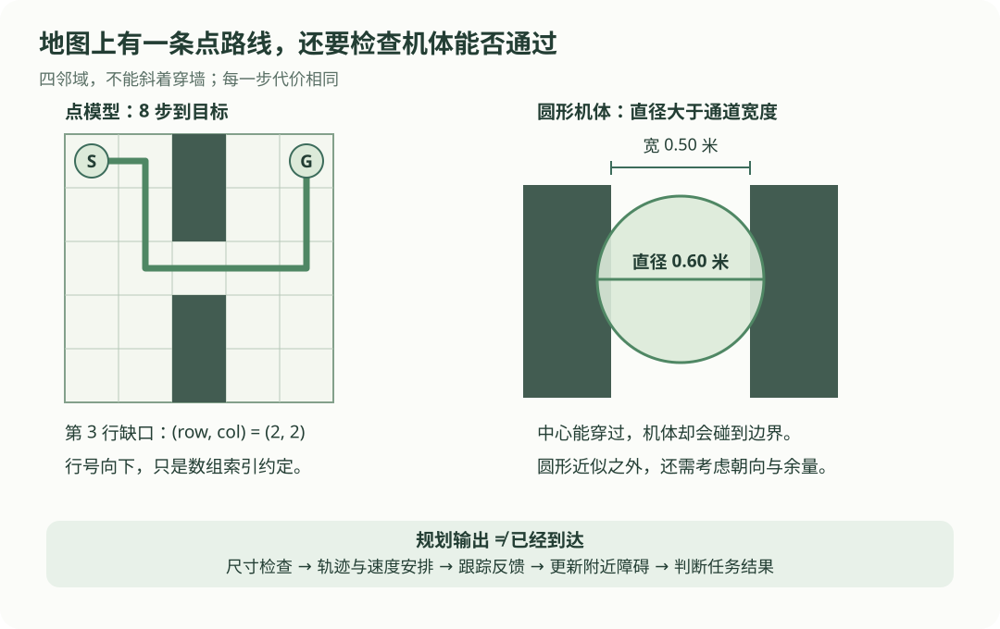

# 12 · 路径规划与避障：找到一条路，还要能走过去

## 本章的小任务

从一张 5 × 5 的小地图左上角走到右上角，中间有一道墙，只有第三行有缺口。先在纸上找到一条路，再让代码用同样的地图搜索。

本章先把机器人当成点，只能向上、下、左、右移动一个格子，每步代价相同。这个模型适合解释搜索过程；随后会检查机器人尺寸、跟踪与动态障碍，把“地图上有路”和“实际能执行”分开。

学完后，应能说清 BFS 怎样按层寻找最短步数，A* 为什么同时看已经走的代价与未来估计，以及规划为什么还需要定位与控制配合。

## 先看路径经过哪个缺口

{ .learning-figure }

[打开路径与通道大图](../assets/learning/robotics-planning.svg)

图中的路线只是点模型下的一条路线。真实机器人有体积，不能只检查中心有没有碰到黑色方块。右侧用通道宽度提醒我们：缺口存在，不代表机体可以通过。

## 地图、路径、轨迹分别是什么

| 名称 | 可以怎样理解 | 例子 |
| --- | --- | --- |
| 地图 | 哪些地方可用，有哪些结构 | 栅格中 0 是可走，1 是障碍 |
| 路径，path | 从起点到终点经过哪些位置 | 一串点，暂时不要求每点的到达时间 |
| 轨迹，trajectory | 随时间应该在哪里、怎样运动 | 指定位置、速度以及对应时刻 |
| 规划器 | 按模型和要求选路径或轨迹 | 搜索绕过墙的格子序列 |
| 跟踪控制器 | 根据目标与实际反馈算指令 | 向下一个路径点靠近，偏离时修正 |
| 局部避障 | 针对附近障碍调整近期运动 | 发现新障碍后减速、绕行或停止 |

“最短”也必须先说明指标：步数最少、长度最短、耗时最少或总代价最低可能得到不同路线。这里先只讨论**每步代价 1 的最少步数**。

## 把地图写成明确的数据

`S` 是起点，`G` 是终点，`#` 是障碍，`.` 是可走格子：

```text
S . # . G
. . # . .
. . . . .
. . # . .
. . # . .
```

代码用 `(row, col)` 表示“行、列”，从 0 开始。行号向下增大，列号向右增大；它是数组索引，**不是 ROS 中 y 轴向左的机体坐标**。

起点是 `(0, 0)`，终点是 `(0, 4)`。中间一列的障碍是 `(0, 2)、(1, 2)、(3, 2)、(4, 2)`，只有 `(2, 2)` 可以跨过去。

沿一条最短路线：先向右 1 格，向下 2 格，向右 3 格，再向上 2 格，共 8 步。另一些顺序也能得到 8 步，所以答案不一定只有一条。

## BFS：先找 1 步能到的，再找 2 步能到的

BFS 是 breadth-first search，广度优先搜索。把它想成一圈一圈往外问：

1. 起点算第 0 层。
2. 把起点所有可走邻居加入队列，成为第 1 层。
3. 依次处理第 1 层，再加入尚未发现的第 2 层。
4. 找到目标后，沿“是谁发现我的”往回找，就得到路线。

**队列**像排队取号：先进入的点先处理。记录“已经发现”是为了防止同一个格子被左右来回加入。

| 刚处理的格子 | 新发现的可走邻居 | 为什么不加其他点 |
| --- | --- | --- |
| `(0, 0)` | `(0, 1)`、`(1, 0)` | 上方和左方越界 |
| `(0, 1)` | `(1, 1)` | `(0, 2)` 是墙，起点已发现，上方越界 |
| `(1, 0)` | `(2, 0)` | `(1, 1)` 已在队列，起点已发现，左方越界 |

BFS 在这张**有限、每条边代价相同**的图上，保证首次发现目标对应最少步数。如果有泥地步价 5、平地步价 1，只比较层数就不够了，需要考虑代价。

## 先读“邻居”这一小段

对于 `(1, 1)`，向右是 `(1, 2)`，向下是 `(2, 1)`，向左是 `(1, 0)`，向上是 `(0, 1)`。是否可用还要检查地图边界和障碍。

```python title="把四个方向变成候选邻居"
row, col = 1, 1
directions = [(0, 1), (1, 0), (0, -1), (-1, 0)]
for dr, dc in directions:
    # 方向增量加到当前位置；这里只生成候选，还没有检查碰撞。
    neighbor = (row + dr, col + dc)
    print(neighbor)
```

预期输出：

```text
(1, 2)
(2, 1)
(1, 0)
(0, 1)
```

## 完整示例：用队列找到路径

本例使用 Python 标准库的 `deque`，它适合从一端加入、另一端取出。程序只搜索给定数组，不调用导航软件或机器人。

```python title="四邻域、单位步价的 BFS 路径搜索"
from collections import deque

grid = [
    [0, 0, 1, 0, 0],
    [0, 0, 1, 0, 0],
    [0, 0, 0, 0, 0],
    [0, 0, 1, 0, 0],
    [0, 0, 1, 0, 0],
]


def is_free(cell):
    row, col = cell
    # 先确认下标有效，再读取格子，避免越界。
    return (0 <= row < len(grid)
            and 0 <= col < len(grid[0])
            and grid[row][col] == 0)


def bfs(start, goal):
    if not is_free(start) or not is_free(goal):
        return None  # 起点或终点不在可走区域。

    queue = deque([start])
    # parent 同时记录发现过哪些点，以及每个点的前一个点。
    parent = {start: None}
    directions = [(0, 1), (1, 0), (0, -1), (-1, 0)]

    while queue:
        current = queue.popleft()  # 先加入的点，先被处理。
        if current == goal:
            path = []
            # 从终点向前追溯到起点，最后把列表反转。
            while current is not None:
                path.append(current)
                current = parent[current]
            return path[::-1]

        row, col = current
        for dr, dc in directions:
            neighbor = (row + dr, col + dc)
            if is_free(neighbor) and neighbor not in parent:
                parent[neighbor] = current  # 加入队列时就标记已发现。
                queue.append(neighbor)

    return None  # 所有可达格子处理完，仍然没有找到目标。


path = bfs((0, 0), (0, 4))
if path is None:
    print("没有可行路径")
else:
    print("路径：", path)
    steps = len(path) - 1        # 9 个点之间只有 8 次移动。
    cell_size_m = 0.5            # 教学地图每格宽 0.5 米。
    print(f"步数：{steps}")
    print(f"格子中心路线长度：{steps * cell_size_m:.1f} m")
```

预期输出：

```text
路径： [(0, 0), (0, 1), (1, 1), (2, 1), (2, 2), (2, 3), (2, 4), (1, 4), (0, 4)]
步数：8
格子中心路线长度：4.0 m
```

| 阅读位置 | 怎样理解 |
| --- | --- |
| `is_free` | 检查边界与占据状态；本例仍是点模型 |
| `parent = {start: None}` | 起点已发现，它没有前一个点 |
| `popleft()` | 按先来先处理的顺序，保持层次搜索 |
| `neighbor not in parent` | 同一个点只首次加入，避免循环 |
| `path[::-1]` | 把反向追溯列表变回起点到终点 |
| `len(path) - 1` | 点的数量和相邻移动次数相差 1 |

若换了邻居顺序，可能输出另一条同样 8 步的路线。不要把具体坐标列表当唯一正确答案；应检查起终点、每步合法、无障碍和总代价。

## A*：已经花了多少，再估计还要多少

地图更大时，BFS 会向很多方向扩展。A* 给候选点一个优先分数：

$$
f(n)=g(n)+h(n)
$$

| 符号 | 含义 | 本例单位 |
| --- | --- | --- |
| \(n\) | 一个候选格子 | 无单位 |
| \(g(n)\) | 从起点到 n 的当前最佳已知代价 | 步数 |
| \(h(n)\) | 从 n 到目标的剩余代价估计 | 步数 |
| \(f(n)\) | 经过 n 的总成本估计，用来决定先搜索谁 | 步数 |

这里四邻域每步 1，可以用曼哈顿距离：

$$
h(n)=|r_n-r_G|+|c_n-c_G|
$$

`r`、`c` 是行和列，`G` 是目标，竖线表示绝对值。忽略墙体时，至少还需要这么多横向和纵向步数；墙只会让路更长，不会让路更短。

从起点出发，右邻居 `(0, 1)` 的 `g = 1，h = 3，f = 4`；下邻居 `(1, 0)` 的 `g = 1，h = 5，f = 6`。A* 倾向先考察右边，但碰到墙仍要绕行，不能把估计距离当已找到的真实路线。

### “A* 找最优”需要哪些条件？

在有限图、非负边代价等前提下，需要剩余估计**不高估**真实最小代价，这叫可采纳性。如果实现把已处理点永久关闭，还需要一致性，或者允许在找到更好代价时重新打开该点。

一致性要求相邻点满足 `h(n) ≤ cost(n, next) + h(next)`。本例曼哈顿距离、四邻域与单位步价满足这一条件。允许斜向移动、改变步价后，需要重新检查估计是否适用。

A* 通常在**目标成为当前最低分并被取出处理**时结束，不能在第一次看见目标邻居时就结束。还要保存最优已知 `g`，较差路线不能覆盖较好路线。

| 搜索方式 | 适合本章哪种情况 |
| --- | --- |
| BFS | 每步代价相同，找最少步数 |
| Dijkstra | 非负且可不同的边代价，不使用剩余估计 |
| A* | 在已走代价之外，用适用的剩余估计引导搜索 |

最优只针对给定的图和代价函数，不等于真实世界里最安全、最平稳或耗时最少。这里先完成可读的 BFS，再用相同地图和公式理解 A*；没有把半段 A* 伪代码当完整实现。

## 为什么点路线还不能直接交给机器人

### 1. 机器人有尺寸

假设通道宽 0.50 米，机器人用半径 0.30 米的圆近似，直径就有 0.60 米，放不进去。即使中心能沿缺口经过，也没有足够空间。

一种简化处理是把障碍向外扩展“机器人半径 + 余量”，再给中心点规划。圆形近似适用于本例；长方形机体的可行性还与朝向有关。栅格离散与未观测区域也需要处理。

### 2. 转弯和速度受限

折线路径可能在一个格点瞬间转 90°，真实机器人不能以任意速度实现这个转角。还需要轨迹时间安排、速度或加速度限制，以及跟踪控制。四足机器人还受步态、接触与地形影响。

### 3. 地图会过时

原来空的格子后来可能被羊、人员或其他障碍占据。机器人执行时仍需更新附近观测和可行性判断，必要时停止或重新规划。到达目标的判定也要同时考虑定位、容差与任务条件。

[Nav2 Jazzy 的调参指南](https://docs.nav2.org/jazzy/configuration_and_development/tuning_guide/)讨论了机体轮廓和障碍周围代价等实践问题。其软代价分布、真实轮廓碰撞检查，与这里二值圆形膨胀的教学解释并不完全相同。

## 练习：关掉缺口

把 `grid[2][2]` 从 0 改成 1，起终点不变，会输出什么？提示：中间一列现在从上到下都封住，四邻域不允许跨越墙体。

??? example "展开参考答案"

    输出“没有可行路径”。算法会处理完左边所有可达点，队列变空后返回 `None`。没有路径是合法结果，不能为了总有输出而穿过障碍。

再问：原地图若每格从 0.5 米改为 0.25 米，步数和格子中心路线长度分别怎样变？

??? example "展开单位换算答案"

    这份数组与连通关系不变，仍然 8 步；表示的长度变成 `8 × 0.25 = 2.0 m`。真实机器人尺寸没有随地图格子自动缩小，所以物理可行性要重新检查。

## 常见错误与下一步

- 只检查终点格子，忽略移动段经过障碍或斜向穿角。
- 把未知格子默认成安全区域，未说明这个假设。
- 把 BFS 最少步数当不同步价下的最低成本。
- 把首次发现 A* 目标当正确结束条件。
- 有路径就报告到达；规划输出与实际执行结果需要分别记录。

## 对照资料

A* 的代价与剩余估计可对照 [Modern Robotics 作者课程：图搜索](https://modernrobotics.northwestern.edu/nu-gm-book-resource/10-2-4-graph-search/)；规划、控制与环境表示的分工见 [Nav2 Jazzy 导航概念](https://docs.nav2.org/jazzy/getting_started/navigation_concepts/)。本章 BFS 只适用于给出的规则栅格模型，不是完整 Nav2 或动态避障实现。

[返回学习路线](index.md) · [上一章：11 定位与里程计](localization.md) · [下一章：13 四足机器人与放牧任务 →](quadrupeds.md)
