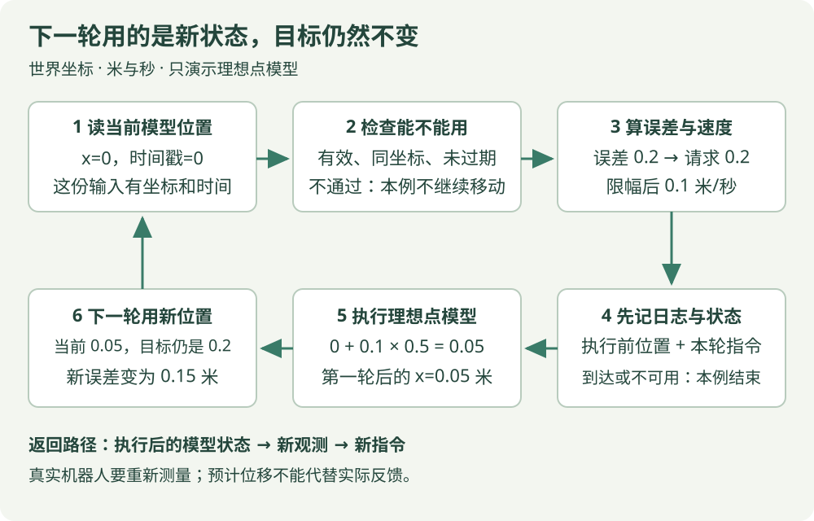

# 14 · 最小闭环小项目：让一个点逐步接近目标

!!! tip "这章要完成什么"

    用一个完整的小例子接起“观测 → 检查 → 计算 → 执行 → 新观测”，看懂日志里每个数的来源，并解释数据过期时为什么改变处理分支。

    **先会这些**：位置与速度、比例控制、Python 的函数与字典。可以回查 [第 02 章](units.md)、[第 06 章](control.md)和 [Python 阅读入门](../programming/python-reading.md)。

## 1. 先把任务缩小到能手算

本章把运动对象简化成二维平面上的一个点，没有体积、障碍、惯性和关节。它理想地立即执行世界坐标中的速度。本章用它理解软件闭环，所有输入与结果都是**教学模型数据**。

目标固定为 `(0.2, 0)` 米，初始位置 `(0, 0)` 米。每隔 0.5 秒计算一次，速度大小不超过 0.1 米/秒；离目标不超过 0.015 米时，输出到达状态和零速度。

| 条件 | 本章设定 | 为什么先说清 |
| --- | --- | --- |
| 坐标 | 世界 x 向东、y 向北 | 当前位置、目标、速度用同一套坐标 |
| 时间 | 同一模型时钟，单位秒 | 可以计算数据年龄和移动时间 |
| 执行 | 速度瞬间跟随命令 | 才能用速度乘时间直接更新模型位置 |
| 环境 | 没有障碍的平面 | 本章没有计算避障路线 |
| 观测 | 模型位置，暂不加噪声 | 先看清程序链路，再研究测量误差 |

差速小车不能任意横移；四足机器人还要满足步态、接触和执行接口约束。它们不能直接用本章的点模型代替。本章也不向设备发送命令。

{ .learning-figure }

[打开小项目流程大图](../assets/learning/robotics-project.svg)

## 2. 一轮到底算哪些数

当前位置是 `(0, 0)`，目标是 `(0.2, 0)`，先算位置差：`(0.2, 0)` 米。比例系数取 1/秒，原始速度请求是 `(0.2, 0)` 米/秒。

请求的速度大小 0.2 超过上限 0.1，所以把两个分量一起缩小为原来的一半，得到 `(0.1, 0)` 米/秒。保持 0.5 秒，点沿 x 移动 `0.1 × 0.5 = 0.05` 米。

```python title="只看第一轮 · 独立算术片段"
# 所有量沿同一条世界 x 轴；不是机器人接口调用。
target_x_m, current_x_m = 0.2, 0.0
gain_per_s, dt_s = 1.0, 0.5
max_speed_mps = 0.1

error_x_m = target_x_m - current_x_m  # 先得到 0.2 米。
requested_x_mps = gain_per_s * error_x_m  # 请求 0.2 米/秒。
command_x_mps = min(max_speed_mps, max(-max_speed_mps, requested_x_mps))
next_x_m = current_x_m + command_x_mps * dt_s  # 模型执行后的位置。
print(f"next x = {next_x_m:.3f} m")  # next x = 0.050 m。
```

这段只解释一轮。把它接成闭环，还必须让 next_x_m 成为下一轮的当前位置，并根据它重新算误差。目标保持不变，当前状态却不断变化。

### 二维限幅，为什么要一起缩放

如果原始速度为 `(0.1, 0.1)` 米/秒，它的大小为 `sqrt(0.1²+0.1²)≈0.1414` 米/秒。只分别把 x、y 限到 0.1，合成速度仍超过 0.1。

完整程序先计算速度大小，再把两个分量同时乘 `0.1/0.1414≈0.7071`，得到约 `(0.0707, 0.0707)`。方向保持不变，合成大小变为 0.1。这是本章采用的**合成速度上限**，不同接口也可能分别约束分量，必须按接口说明区分。

## 3. 观测和指令，分开保存

下面固定使用一份字段齐全的字典，数值字段已经是浮点数，valid 是布尔值。它是本章的数据约定，不是某种现成 ROS 消息。

| 字段 | 含义 | 本例第一轮 |
| --- | --- | --- |
| x_m、y_m | 当前模型位置，米 | 0、0 |
| stamp_s | 这份状态对应的模型时刻，秒 | 0 |
| frame | 坐标名称 | world |
| valid | 这份位置是否有效 | True |

指令另用 `(vx, vy, status)` 返回：两个世界速度分量和一个状态文字。返回速度不会自动改变当前位置；模型执行函数的更新才改变位置。

数据年龄为 `当前时刻 − 状态时间戳`。本章规定超过 0.2 秒算过期，负年龄也不接受；负数可能说明时钟或时间戳约定不一致。每轮观测是新生成的，所以正常例子的年龄始终为 0。

## 4. 完整程序：三个阶段各负责什么

第一遍先读 main 中的顺序，再根据函数名找它的定义。read_model_state 提供模型观测，decide_velocity 检查并计算指令，main 中两次位置赋值负责执行点模型。

这是完整 Python 标准库程序。可保存为 `point_loop.py` 对照阅读；不需要 ROS 2、MuJoCo 或 RL 环境。下方练习是对本文件的修改，不能再整段拼进同一个文件。

```python title="point_loop.py · 完整数值示例"
from math import hypot, isfinite  # 长度计算和有限数检查。

TARGET = (0.2, 0.0)  # 世界坐标目标，单位米。
GAIN_PER_S = 1.0     # 比例系数，单位 1/秒。
MAX_SPEED_MPS = 0.1  # 合成速度上限，米/秒。
TOLERANCE_M = 0.015  # 点到目标的距离不超过它就判到达。
MAX_AGE_S = 0.2      # 本例允许的观测年龄上限，秒。


def read_model_state(x_m, y_m, now_s):
    # 模型中直接读当前位置；这里没有真实传感器。
    return {"x_m": x_m, "y_m": y_m, "stamp_s": now_s,
            "frame": "world", "valid": True}


def decide_velocity(observation, now_s):
    # 只处理正文约定的完整字典；外部接口还应检查字段和类型。
    if not observation["valid"] or observation["frame"] != "world":
        return 0.0, 0.0, "invalid"
    # NaN/无穷值无法作为可靠的距离与速度输入。
    if not all(isfinite(observation[key]) for key in ("x_m", "y_m", "stamp_s")):
        return 0.0, 0.0, "invalid"
    age_s = now_s - observation["stamp_s"]
    if not isfinite(now_s) or age_s < 0.0 or age_s > MAX_AGE_S:
        return 0.0, 0.0, "stale"

    # 两个位置在同一坐标系，才能这样直接相减。
    error_x_m = TARGET[0] - observation["x_m"]
    error_y_m = TARGET[1] - observation["y_m"]
    if hypot(error_x_m, error_y_m) <= TOLERANCE_M:
        return 0.0, 0.0, "reached"

    vx = GAIN_PER_S * error_x_m  # 比例控制的原始请求。
    vy = GAIN_PER_S * error_y_m
    speed = hypot(vx, vy)       # 两个分量合成后的速度大小。
    if speed > MAX_SPEED_MPS:
        scale = MAX_SPEED_MPS / speed
        vx, vy = vx * scale, vy * scale  # 同比例缩小，保留方向。
    return vx, vy, "moving"


def main():
    x_m, y_m = 0.0, 0.0  # 模型初始位置，单位米。
    dt_s = 0.5           # 模型每轮推进的时间，秒。
    for index in range(20):  # 最多检查 20 轮，避免无限等待。
        now_s = index * dt_s
        observation = read_model_state(x_m, y_m, now_s)
        vx, vy, status = decide_velocity(observation, now_s)
        # 记录的是“本轮执行前的位置 + 本轮指令”，不是混用两个时刻。
        print(f"t={now_s:.1f} x={x_m:.4f} y={y_m:.4f} "
              f"vx={vx:.4f} vy={vy:.4f} status={status}")
        if status != "moving":
            break  # 到达或数据不可用时，结束这个模型演示。
        # 仅在本章理想点模型里，把速度乘时间得到位移。
        x_m += vx * dt_s
        y_m += vy * dt_s
    else:
        # 达到轮数上限仍未成功，就明确记录未完成。
        print("budget exhausted")


if __name__ == "__main__":
    main()  # 直接启动文件时才调用；网页展示不会执行。
```

## 5. 预期日志逐行解释

```text
t=0.0 x=0.0000 y=0.0000 vx=0.1000 vy=0.0000 status=moving
t=0.5 x=0.0500 y=0.0000 vx=0.1000 vy=0.0000 status=moving
t=1.0 x=0.1000 y=0.0000 vx=0.1000 vy=0.0000 status=moving
t=1.5 x=0.1500 y=0.0000 vx=0.0500 vy=0.0000 status=moving
t=2.0 x=0.1750 y=0.0000 vx=0.0250 vy=0.0000 status=moving
t=2.5 x=0.1875 y=0.0000 vx=0.0000 vy=0.0000 status=reached
```

| 时刻 | 本轮误差 | 本轮速度大小 | 保持 0.5 秒后到哪儿 |
| --- | --- | --- | --- |
| 0 | 0.2 米 | 0.1 米/秒，受到上限约束 | x=0.05 米 |
| 0.5 | 0.15 米 | 0.1 米/秒，受到上限约束 | x=0.1 米 |
| 1.0 | 0.1 米 | 0.1 米/秒 | x=0.15 米 |
| 1.5 | 0.05 米 | 0.05 米/秒 | x=0.175 米 |
| 2.0 | 0.025 米 | 0.025 米/秒 | x=0.1875 米 |
| 2.5 | 0.0125 米 | 0，已在容差内 | 本例结束，没有下一次移动 |

最后没有刚好落在 0.2，而是按**已经约定的距离容差**判到达。这个条件只检查点的位置，没有检查真实机器人的姿态、实际速度、接触状态或保持时间。

### 不熟悉的三种写法，分别在检查什么

`hypot(x, y)` 计算两个分量组成的长度，等价于本章的平方和开根号。`all(...)` 问“里面每项判断是不是都成立”：代码依次检查 x_m、y_m、stamp_s 是否为有限数，有一项不通过就返回 invalid。

`vx, vy, status = decide_velocity(...)` 是调用一次函数，把它返回的三项分别接住，不是调用三次。位置字典仍保存观测，vx、vy 是新算出的指令，不能把两个含义混成一份数据。

for 的 else 只有循环没有被 break 提前退出时才执行。初学可以读成“20 轮都检查完，仍没有进入停止分支，就显示轮数用完”。它不是与 status 的 if 配对。

## 6. 给异常分支也算一次

下面片段沿用完整文件的函数定义，放在 main 中循环之前单独观察也可以。它不改变正常循环的模型状态。

```python title="时间戳测试 · 放在已有定义之后"
# 当前是 1.0 秒，这份状态却对应 0.7 秒。
old_state = read_model_state(0.0, 0.0, 0.7)
print(decide_velocity(old_state, 1.0))  # (0.0, 0.0, 'stale')。

# 无效数据不是一个合法的“当前位置恰好为零”。
invalid_state = read_model_state(0.0, 0.0, 1.0)
invalid_state["valid"] = False
print(decide_velocity(invalid_state, 1.0))  # (0.0, 0.0, 'invalid')。
```

这里返回零，只表示本例不继续给出移动请求。真实系统中，“提出零速度”到“机器人已经停止”之间，还存在通信、控制器、执行器和制动响应，必须用实际状态确认。不能用一条日志文字证明停止已经发生。

## 7. 用日志定位问题

先同时记录**目标、观测时间、观测坐标、原始请求、实际发出的指令、执行反馈**。本例目标和参数固定，因此没有每行重复打印；任务可变时要记录对应值。

| 现象 | 先查看哪份数据 | 本例能回答什么 |
| --- | --- | --- |
| 误差一直不变 | 新观测中的位置、状态是否更新 | 是否只在重复算写死的位置 |
| 请求大但发出的小 | 原始请求与限幅后的指令 | 上限是否正在起作用 |
| 突然进入 stale | 当前时间与状态时间戳 | 数据年龄是否超过 0.2 秒 |
| 宣称到达但位置未等于目标 | 误差与距离容差 | 是否按容差判定，而不是按精确相等 |
| 模型能到，实际执行偏离 | 设备测量、接口约定与实际反馈 | 点模型没有解释的动力学与执行差异 |

## 8. 动手练习：一次只改一个条件

<div class="practice-card" markdown="1">

<p class="practice-kicker">先在纸上预测，再看答案</p>

<p class="practice-title">把速度上限降一半，第一步会怎样？</p>

**从哪里开始**：完整程序只把 MAX_SPEED_MPS 改为 0.05，其他条件不变。

1. 先写出初始原始请求和限幅后的速度。
2. 算第一轮结束时的位置。
3. 若再把目标改为 `(0.2, 0.2)`，两个分量能否各取 0.05？

??? tip "需要一点提示？"

    位移是本轮指令乘 0.5 秒；二维上限限制的是 hypot(vx, vy)，不是单独两个分量。

??? example "查看推理与结果"

    原始 x 请求仍是 0.2 米/秒，限幅后是 0.05；第一轮移动 0.025 米，因此新位置是 `(0.025, 0)`。

    对角目标的原始请求是 `(0.2, 0.2)`。两个分量同缩后各约 0.03536，合成大小 0.05；若各取 0.05，合成会约为 0.07071，超过上限。

    这里只修改常量，不要把第二份完整程序或重复 main 追加进同一个文件。

</div>

## 9. 接入放牧任务时，哪些约定需要重新写

点模型完成了数据检查与计算顺序的演示。放牧机器人还需要把羊群观测转换为高层目标或运动方案，再由机器人的控制系统执行。目标随羊群变化时，每轮要说明使用哪一帧羊群状态。

在项目说明里写清机器人使用什么观测、动作坐标与单位、数据何时有效、动作如何限幅、完成怎样判定。定位丢失、羊群遮挡、障碍、地面条件都可能影响这条链路，不能仅凭本例的到达日志推断放牧成功。

这份模块分工可对照 [Nav2 的规划与控制职责](https://docs.nav2.org/jazzy/getting_started/navigation_concepts/navigation_servers/)，坐标和单位对照 [ROS REP 103](https://github.com/ros-infrastructure/rep/blob/master/rep-0103.rst)。本章点模型、参数与输出是独立设计的教学算例。

[返回学习路线](index.md) · [上一章：13 四足机器人与放牧任务](quadrupeds.md) · [继续了解放牧研究](../herding/index.md)
