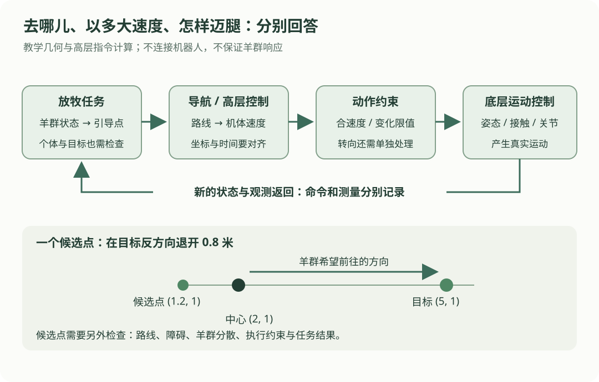

# 13 · 四足机器人与放牧任务：把“去哪里”和“怎样迈腿”分清楚

## 本章的小任务

羊群中心在地图中的 `(2, 1)` 米，目标区域中心在 `(5, 1)` 米。先算一个机器人可以考虑的引导位置，再把机器人到该位置的误差变成受约束的高层速度。

这里计算的是**假想二维任务指令**，不控制关节、不连接 Go2 或其他四足机器人。它用来理解模块之间怎样衔接，不是已经验证有效的放牧策略，也不代表用户已经完成这些研究。

读完应能区分：羊群任务目标、机器人导航目标、高层机体速度、底层关节与接触控制，以及命令和实际测量。

## 先看不同层分别管什么

{ .learning-figure }

[打开四足任务分层大图](../assets/learning/robotics-quadrupeds.svg)

羊群要去哪儿，机器人要站在哪儿，机器人该怎样迈腿，是三个相关但不同的问题。一个高层程序即使只输出三个速度数，底层仍需要决定支撑、摆腿、姿态和执行器动作。

## 从轮式例子转到四足，要改哪些认识

| 前面的轮式教学例子 | 四足系统里需要重新考虑什么 |
| --- | --- |
| 左右轮速决定平面运动 | 四足没有同样的左右轮模型，运动与腿部接触和步态有关 |
| 地面平整、运动在二维平面 | 地形起伏、身体姿态与脚接触会影响可执行动作 |
| 速度指令被模型准确执行 | 真实机体速度可能因延迟、限制、打滑和地形而偏离命令 |
| 机器人当一个点 | 机体、腿的活动范围与朝向都影响占据空间 |

不要把差速车的 `v = r(ωR + ωL)/2` 直接套到四足机器人。机器人类型不同，底层模型和接口含义也不同。

### 这里出现的几个词

- **步态**：脚的支撑与摆动如何随时间安排。不同步态不是单纯换一个“速度值”。
- **支撑脚**：当前与地面接触并参与支撑的脚；接触估计也可能有误差。
- **关节位置、速度、力矩**：底层与电机相关的变量，分别常用 rad、rad/s、N·m。
- **机体速度**：机器人基座参考点的平移速度，以及转向角速度。
- **高层任务**：例如到一个引导位置、沿路线移动；它通常借助已有运动控制能力。

四足控制中常见强化学习、模型预测控制、优化和经典控制等方法。方法选择取决于模型、数据、平台与任务，不能因为是四足机器人就默认只有 PPO。

## 第一步：一个可手算的候选引导点

先想象希望羊群朝目标方向移动，在羊群中心的目标反方向取一个点：

$$
\mathbf{n}=\frac{\mathbf{g}-\mathbf{c}}{\|\mathbf{g}-\mathbf{c}\|},\qquad
\mathbf{p}^*=\mathbf{c}-d\mathbf{n}
$$

| 符号 | 本章含义 | 单位 |
| --- | --- | --- |
| \(\mathbf{c}\) | 假想羊群中心，二维位置 | 米 |
| \(\mathbf{g}\) | 目标区域中心，二维位置 | 米 |
| \(\mathbf{n}\) | 从羊群中心指向目标的单位方向 | 无单位 |
| \(d\) | 沿反方向退开的距离 | 米 |
| \(\mathbf{p}^*\) | 机器人候选引导位置 | 米 |
| \(\|\cdot\|\) | 向量长度：二维时为平方和开根号 | 与向量一致 |

中心 `(2, 1)`，目标 `(5, 1)`，差为 `(3, 0)`，长度为 3，所以单位方向为 `(1, 0)`。取 `d = 0.8 m`，候选位置为 `(2, 1) − 0.8 × (1, 0) = (1.2, 1.0)` 米。

这是一个**几何候选点**。它不保证羊群响应、不处理散开的个体、不检查障碍，也没判断机器人去这个点的路会不会穿过羊群。需要把这些约束和任务评价另外接上。

若中心与目标恰好相同，分母是 0，方向没有定义。应该进入任务判定或另一个明确分支，不能用一个很小的数掩盖“方向不存在”。

## 第二步：从位置误差得到高层速度

假设机器人在 `(1.0, 0.5)` 米，候选位置是 `(1.2, 1.0)` 米。地图中的误差为 `(0.2, 0.5)` 米。

采用一个教学比例控制：

$$
\mathbf{v}_{\mathrm{world}}^{\mathrm{raw}}=K_p(\mathbf{p}^*-\mathbf{p})
$$

`p` 为机器人基座参考点的估计位置，单位米；`Kp` 的单位为 s⁻¹；输出是同一参考点的平移速度，单位 m/s。取 `Kp = 1 s⁻¹`，原始速度就是 `(0.2, 0.5) m/s`。

其合速度不是 0.5，而是 `√(0.2² + 0.5²) ≈ 0.539 m/s`。每个分量都没超限，不代表合速度没超限。

### 保留方向，限制合速度

若教学限制是 `vmax = 0.4 m/s`，把整个向量等比例缩小：

$$
\mathbf{v}_{\mathrm{limited}}=
\min\left(1,\frac{v_{\max}}{\|\mathbf{v}^{\mathrm{raw}}\|}\right)
\mathbf{v}^{\mathrm{raw}}
$$

非零速度时，本例缩放比例约为 `0.4 / 0.539 = 0.743`，得到 `(0.149, 0.371) m/s`。零向量单独返回零，不进行除法。

若要求从零开始，0.2 秒内速度变化最多 `0.5 m/s² × 0.2 s = 0.1 m/s`，还要限制本轮速度变化向量的长度。因此本轮只取原方向上合速度 0.1，世界坐标速度约为 `(0.037, 0.093) m/s`。

这里约束的是**相邻指令**的变化，不保证真实加速度等于指令变化率。实际动作范围也不是一个圆形限速就能全部描述，可能与横移、转向、步态、负载和地形有关。

## 第三步：看清接口要哪个坐标系

假设机器人当前朝向角 `θ = π/2`，机体前方朝向世界坐标的正 y。若接口需要机体坐标中的平移速度，同一个基座参考点的世界平移速度可表示为：

$$
v_x^b=\cos\theta\,v_x^w+\sin\theta\,v_y^w,
\qquad
v_y^b=-\sin\theta\,v_x^w+\cos\theta\,v_y^w
$$

`w` 表示世界坐标分量，`b` 表示机体坐标分量；θ 是机体相对世界的二维朝向角，使用弧度。采用机体 x 向前、y 向左的约定。

世界速度约 `(0.037, 0.093)`，变成机体速度约 `(0.093, −0.037)`：向前并向右。旋转不会改变这个向量的长度。

这一步是在两个轴系中表示**同一个平移速度向量**，不能拿来计算两个不同刚体点的速度，也不能忽略旋转参考系中的位置求导项。这里先在世界系限制速度变化，再旋转当前指令，避免把不同朝向下的旧机体分量直接相减。

## 朝向控制：角度误差要绕回最近方向

假设希望机器人朝向目标方向，目标朝向为 0 rad，当前朝向为 π/2 rad。最短角度误差是 −π/2，不是反向绕很大一圈。

将差角归一到 `[-π, π)`：

$$
e_\theta=((\theta^*-\theta+\pi)\bmod 2\pi)-\pi
$$

采用 `ωraw = Kθ × eθ`，角误差单位 rad，`Kθ` 单位 s⁻¹，角速度单位 rad/s。若 `Kθ = 1 s⁻¹`、教学角速度限幅 `0.6 rad/s`，输出就是 −0.6 rad/s。

这只是独立的简化转向计算。真实高层控制还需检查平移与转向的联合可行性，以及角加速度限制；下面没有宣称同时满足这些更完整条件。

## 完整例子：只算数，不发送指令

以下各位置都假定已对齐到同一地图与同一时刻。`previous_world` 是同一世界参考系中的上次平移指令；其余限制均为教学选值，不是 Go2 规格。

```python title="候选引导点到高层速度的纯计算"
import math


def limit_vector(vector, max_norm):
    # 按长度整体缩放，保留方向；零向量不需要除法。
    length = math.hypot(*vector)
    if length == 0.0 or length <= max_norm:
        return vector
    scale = max_norm / length
    return (vector[0] * scale, vector[1] * scale)


center = (2.0, 1.0)          # 羊群中心，世界坐标，米。
goal = (5.0, 1.0)            # 目标区域中心，世界坐标，米。
robot = (1.0, 0.5)           # 机器人基座参考点，米。
yaw_rad = math.pi / 2        # 当前朝向，弧度。
offset_m = 0.8
kp_per_s = 1.0
dt_s = 0.2
max_speed_mps = 0.4
max_change_mps = 0.5 * dt_s  # 教学加速度限值 × 本轮时间。
previous_world = (0.0, 0.0)

dx, dy = goal[0] - center[0], goal[1] - center[1]
distance_m = math.hypot(dx, dy)
if distance_m == 0.0:
    raise ValueError("中心与目标重合：需要先做任务判定，方向未定义")
direction = (dx / distance_m, dy / distance_m)
target = (center[0] - offset_m * direction[0],
          center[1] - offset_m * direction[1])

raw_world = (kp_per_s * (target[0] - robot[0]),
             kp_per_s * (target[1] - robot[1]))
limited_world = limit_vector(raw_world, max_speed_mps)
change_world = (limited_world[0] - previous_world[0],
                limited_world[1] - previous_world[1])
change_world = limit_vector(change_world, max_change_mps)
command_world = (previous_world[0] + change_world[0],
                 previous_world[1] + change_world[1])

# 同一基座平移速度，用当前机体的轴重新表示。
c, s = math.cos(yaw_rad), math.sin(yaw_rad)
command_body = (c * command_world[0] + s * command_world[1],
                -s * command_world[0] + c * command_world[1])
target_yaw = math.atan2(direction[1], direction[0])
yaw_error = (target_yaw - yaw_rad + math.pi) % (2 * math.pi) - math.pi
omega_rps = max(-0.6, min(0.6, 1.0 * yaw_error))

print(f"候选位置：({target[0]:.3f}, {target[1]:.3f}) m")
print(f"世界速度：({command_world[0]:.3f}, {command_world[1]:.3f}) m/s")
print(f"机体速度：({command_body[0]:.3f}, {command_body[1]:.3f}) m/s")
print(f"合速度：{math.hypot(*command_body):.3f} m/s")
print(f"转向角速度：{omega_rps:.3f} rad/s")
```

预期输出：

```text
候选位置：(1.200, 1.000) m
世界速度：(0.037, 0.093) m/s
机体速度：(0.093, -0.037) m/s
合速度：0.100 m/s
转向角速度：-0.600 rad/s
```

| 代码位置 | 先理解哪件事 |
| --- | --- |
| `direction` | 只保留方向，和距离分开 |
| `target` | 候选导航点不是最终任务成功状态 |
| 两次 `limit_vector` | 先限制速度长度，再限制指令变化长度 |
| `command_body` | 转换表达方式，没有新增真实运动 |
| `omega_rps` | 平移和角速度单位不同，不能一起求二维长度 |

## 把数值例子接到真实任务前，还缺什么

### 观测必须带时间、坐标与质量

羊群观测在 9.7 秒，机器人状态在 10.0 秒，直接相减会混合不同时间。需要保存原时间戳，并根据适用模型处理时间对齐与延迟；时钟不同也需要校准。

若数据失效，高层应进入明确定义的等待、重观测或停止请求等分支。发出零速度请求不等于机器人已经瞬间停止，应继续检查执行状态与反馈。具体响应由平台和控制模式决定。

### 一群羊不能只剩一个中心

中心接近目标时，个别羊仍可能离得很远。还要观察分散程度、个体是否进入目标区域、机器人与羊的距离、越界和任务持续时间等指标。几何候选点没有覆盖这些问题，详见[放牧研究笔记](../herding/index.md)。

### 底层控制不是三行速度公式

底层可能需要确定脚的接触时序、身体姿态、地面反力与关节动作。关节力矩与机体速度之间不是固定的逐分量换算。仿真也要建好结构、质量、执行器和接触参数。

可对照 [MuJoCo 3.3.7 的动力学与接触计算说明](https://mujoco.readthedocs.io/en/3.3.7/computation/index.html)。本章的平面指令计算没有模拟这些底层动力学，也不能据此证明机器人可稳定行走。

## 官方接口怎样阅读

[Unitree SDK2 官方 Go2 高层示例](https://github.com/unitreerobotics/unitree_sdk2/blob/main/example/go2/go2_sport_client.cpp)展示了高层运动请求与状态接收；[相应的 SportClient 头文件](https://github.com/unitreerobotics/unitree_sdk2/blob/main/include/unitree/robot/go2/sport/sport_client.hpp)可帮助检查参数与接口声明。这两个链接指向仓库主分支，内容可能继续变化；这里仅用于认识高层接口，不提供可直接发送的调用代码。

使用实机时，必须核对**实际 SDK 提交、型号、固件、坐标约定、控制模式与指令范围**。不能从一个示例里的速度数推导完整允许范围，也不能把函数调用返回理解为动作已经完成。高层接口和底层关节接口不应混为一类。

## 练习：朝向换了，速度还是同一个向量吗？

世界速度保持 `(0.037, 0.093) m/s`，若当前朝向变成 0 rad，机体分量是多少？提示：cos 0 = 1，sin 0 = 0。

??? example "展开参考答案"

    机体速度仍为约 `(0.037, 0.093) m/s`，对应向前并向左。合速度保持约 0.1 m/s。这里改变的是当前轴的方向，所以表达分量变化；实际平移向量本身没有变化。

再问：羊群中心已经到目标中心，能否只用本章公式宣告完成？

??? example "展开任务判定的解释"

    不能。方向公式在两点重合时未定义，并且中心到达不能证明所有羊都在目标区域。需要单独设置任务成功判定和对应控制分支，处理个体分散、持续时间、误差与越界等条件。

## 常见错误与下一步

- 把差速轮公式当成四足底层运动模型。
- 直接给两个速度分量分别限幅，却误以为合速度也满足上限。
- 把前一时刻机体系分量与当前不同朝向的机体系分量直接相减。
- 看命令日志就声称机器人完成动作，忽略真实反馈和延迟。
- 只看羊群中心，不观察个体和约束。

下一章会用一个简单可追踪的闭环，把目标、反馈、指令、状态更新和日志接到一起。先学会解释每轮发生了什么，再接入更复杂的模型。

[返回学习路线](index.md) · [上一章：12 路径规划与避障](planning.md) · [下一章：14 最小闭环小项目 →](project.md)
