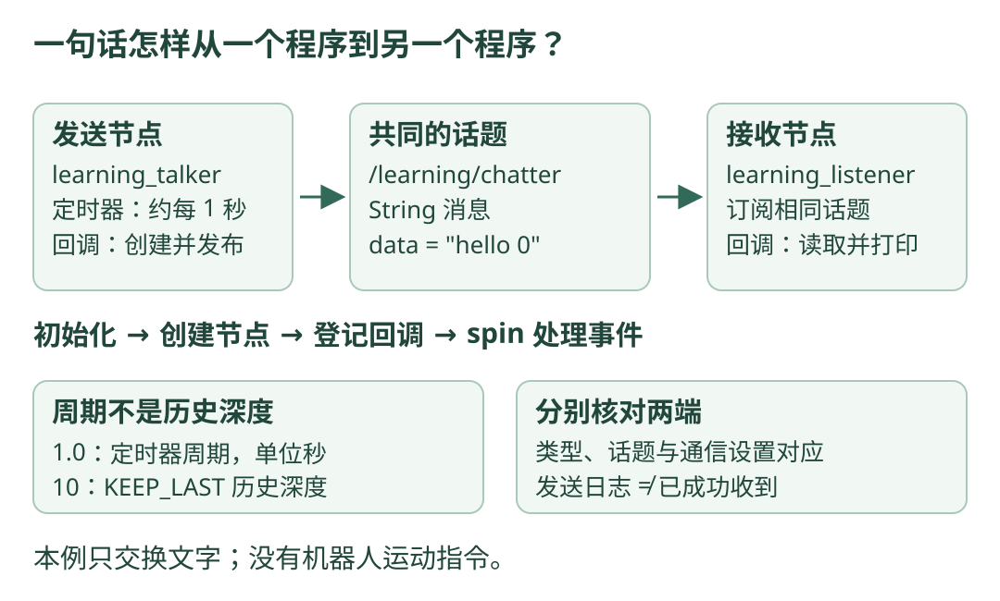

# 07 · ROS 2：让两个小程序交换消息

!!! tip "这一章只解决一件事"

    一个程序每秒发送一句话，另一个程序收到后把它打印出来。读完后，你应能区分节点、话题、消息和回调，并说明一条消息经过了哪些步骤。

    **前置知识**：能读懂 Python 的类、函数和缩进；还不熟悉时，先看 [Python 阅读入门](../programming/python-reading.md)。不需要机器人，也不需要先学完整 ROS 软件包的构建。

## 先把 ROS 2 想成程序之间的通信工具

假设一个程序负责读取相机，另一个负责处理图像。它们需要约定：传什么内容、内容叫什么名字、接收者怎样处理。ROS 2 提供组织这些程序及通信的工具。

本章先用文字替代图像，把通信过程看清楚。它不包含导航算法，也不会发送机器人运动指令。

**版本约定：ROS 2 Jazzy、Ubuntu 24.04、系统 Python 3.12。** 本章命令属于 Ubuntu 的 Bash 终端。Windows 读者可以直接按注释阅读，先不安装任何东西。Jazzy 的 Ubuntu 二进制安装路线与目标平台见 [官方安装说明源文件](https://github.com/ros2/ros2_documentation/blob/jazzy/source/Installation/Ubuntu-Install-Debs.rst) 和 [REP 2000](https://github.com/ros-infrastructure/rep/blob/master/rep-2000.rst)。

## 看图：发出一句话，到收到一句话

{ .learning-figure }

[打开大图](../assets/learning/robotics-ros2.svg)

图中的 `/learning/chatter` 是话题名。节点名字不同没有关系；**双方要对应同一个话题、兼容的消息类型和通信配置**。

## 四个词，先用人话理解

| 词 | 可以怎样理解 | 本章的具体对象 |
| --- | --- | --- |
| 节点 node | 一个能参与 ROS 通信的工作单位 | `learning_talker` 与 `learning_listener` |
| 话题 topic | 消息流的名字，便于发送方和接收方找到彼此 | `/learning/chatter` |
| 消息 message | 每次传递的具体内容及其数据结构 | `std_msgs/msg/String`，正文在 `data` 字段 |
| 回调 callback | 到了某个时机，由系统调用的函数 | 每秒发送；收到消息后打印 |

一个进程可以包含多个节点；本章为了简单，每个脚本只有一个节点。话题也不是“一个只允许两个人参加的聊天室”：一个发布者可以对应多个订阅者。

### Python 类只负责把相关东西放在一起

`class Talker(Node)` 表示本章的 `Talker` 使用 ROS 的 `Node` 能力。`super().__init__("learning_talker")` 调用节点初始化，并给节点起名字。

`self.publisher` 可以读成“这个节点保存的发布工具”。`self.publish_once` 可以读成“这个节点发送一次消息的函数”。`self` 让不同节点拥有各自的数据，读代码时先不纠结继承的全部细节。

`node = Talker()` 会创建一个 Talker 对象，并自动执行它的 `__init__` 初始化函数。`def __init__(self)` 是先写下初始化步骤，`Talker()` 才是实际创建；不需要再手动调用一次 `node.__init__()`。接收方的 `Listener()` 也是相同读法。

### 定时器和 spin 分别做什么？

定时器登记的是：“每隔大约 1 秒，请调用 `publish_once`。”这不等于在代码登记的那一行就开始持续发送。

`rclpy.spin(node)` 让程序进入处理事件的循环。定时器到期、消息到达等事件需要被处理，相应回调才有机会执行。操作系统调度和回调耗时会影响时间间隔，普通定时器不是严格实时的硬件时钟。

## 完整文件一：接收方

先看接收方，因为它的工作最直接：收到一句话，再打印一句话。文件名为 `listener.py`。后面的“可选验证”会说明文件放哪里。

```python title="listener.py · 完整文件"
import rclpy  # ROS 2 的 Python 客户端库，不是 Python 自带模块。
from rclpy.executors import ExternalShutdownException
from rclpy.node import Node
from std_msgs.msg import String  # 消息结构中有一个字符串字段 data。


class Listener(Node):
    def __init__(self):
        super().__init__("learning_listener")  # 这是节点名，不是话题名。
        # 保存订阅对象；消息到达时，调用 receive_once(msg)。
        self.subscription = self.create_subscription(
            String,                  # 接收的消息类型。
            "/learning/chatter",     # 接收的话题名字。
            self.receive_once,       # 回调函数，不能写成 receive_once()。
            10,                      # KEEP_LAST 历史深度，不是接收频率。
        )

    def receive_once(self, msg):
        # msg 是收到的 String 消息，msg.data 才是它的文字正文。
        self.get_logger().info(f"收到：{msg.data}")


def main():
    rclpy.init()  # 先准备 ROS 通信，再创建节点。
    node = Listener()
    try:
        rclpy.spin(node)  # 持续处理消息回调，直到退出。
    except (KeyboardInterrupt, ExternalShutdownException):
        pass  # Ctrl+C 或 ROS 上下文关闭时，转入清理步骤。
    finally:
        node.destroy_node()  # 释放本节点的订阅、定时器等资源。
        rclpy.try_shutdown()  # 尚未关闭时关闭；已关闭时也可安全调用。


if __name__ == "__main__":
    main()  # 直接打开这个 Python 文件时才进入主流程。
```

`self.receive_once` 没有括号，是把函数交给 ROS，告诉它以后调用谁。写成 `self.receive_once()` 则会在创建订阅时立刻调用；这时还没有收到的消息，参数也对不上。

## 完整文件二：发送方

文件名为 `talker.py`。计数从 0 开始，每次发送后加 1。

```python title="talker.py · 完整文件"
import rclpy
from rclpy.executors import ExternalShutdownException
from rclpy.node import Node
from std_msgs.msg import String


class Talker(Node):
    def __init__(self):
        super().__init__("learning_talker")
        self.publisher = self.create_publisher(
            String, "/learning/chatter", 10  # 类型、话题名、历史深度。
        )
        self.count = 0  # 这个数字会跨越多次回调保留下来。
        self.timer = self.create_timer(1.0, self.publish_once)

    def publish_once(self):
        msg = String()  # 先创建符合约定结构的消息对象。
        msg.data = f"hello {self.count}"  # 把正文写进 data 字段。
        self.publisher.publish(msg)  # 发到 /learning/chatter 话题。
        self.get_logger().info(f"发送：{msg.data}")
        self.count += 1  # 准备下一次的编号。


def main():
    rclpy.init()
    node = Talker()
    try:
        rclpy.spin(node)  # 使定时器回调得到执行。
    except (KeyboardInterrupt, ExternalShutdownException):
        pass
    finally:
        node.destroy_node()
        rclpy.try_shutdown()


if __name__ == "__main__":
    main()
```

这两个脚本使用的 API 和发布订阅结构可对照 [Jazzy 官方 Python 教程源文件](https://github.com/ros2/ros2_documentation/blob/jazzy/source/Tutorials/Beginner-Client-Libraries/Writing-A-Simple-Py-Publisher-And-Subscriber.rst) 及 [rclpy 的节点接口](https://github.com/ros2/rclpy/blob/jazzy/rclpy/rclpy/node.py)。这里把示例写成独立脚本，便于先理解通信。

## 按顺序，追踪一次 hello 0

| 步骤 | 发生的事 | 你应该注意什么 |
| --- | --- | --- |
| 1 | 两个脚本分别初始化并创建节点 | 节点名不同，话题名相同 |
| 2 | 订阅方登记接收回调，发送方登记定时器 | 登记回调不等于回调已经执行 |
| 3 | 两个脚本进入 `spin` | 开始持续处理事件 |
| 4 | 定时器回调创建 `String` 并填入 `hello 0` | 文字在 `msg.data`，不是对象名字里 |
| 5 | 发布者发送消息，自己的计数改为 1 | 发送方打印不等于接收方已成功收到 |
| 6 | 接收方的回调处理到达的消息 | 读取 `msg.data`，打印 `收到：hello 0` |

通信建立需要发现对方，先启动接收方也不能保证一定收到编号 0。判断基本通信是否成功，应看接收方有没有持续收到后续文字，而不是要求两侧每一行时间戳完全相同。

## 只阅读时，预期看到什么？

以下是**省略日志时间戳和节点前缀后的内容示意**，不是本项目已经运行的记录。

```text title="发送方的日志正文示意"
发送：hello 0
发送：hello 1
发送：hello 2
```

```text title="接收方的日志正文示意"
收到：hello 0
收到：hello 1
收到：hello 2
```

`String` 的正文没有自动携带坐标系、单位和采样时间，因此它适合这个文字练习，不能靠一句任意字符串就建立可靠的传感器数据约定。

## 已有 Ubuntu Jazzy 时，怎样验证？

**以下是可选操作说明，本网站不会替你安装或执行。** 已按官方说明安装 ROS 2 Jazzy，并能使用 `rclpy`、`std_msgs` 时，把两个完整文件保存到自己的 `~/robotics_learning/` 目录。这里不使用本网站的虚拟环境。

```text title="你自己创建的文件目录"
robotics_learning/
├── listener.py
└── talker.py
```

打开两个 Ubuntu Bash 终端；每个终端都准备自己的 ROS 环境。`source` 让当前终端知道 ROS 库在哪里；它不是创建新虚拟环境。

```bash title="终端 A · 先开启接收方"
source /opt/ros/jazzy/setup.bash
export ROS_DOMAIN_ID=84  # 两个终端使用相同的教学通信域。
cd ~/robotics_learning
python3 listener.py
```

```bash title="终端 B · 再开启发送方"
source /opt/ros/jazzy/setup.bash
export ROS_DOMAIN_ID=84
cd ~/robotics_learning
python3 talker.py
```

`ROS_DOMAIN_ID` 是通信分组的一项配置；相同域编号不意味着可以忽略防火墙、网络或 QoS。这里选 84 只为让两个学习终端对应起来。

每个脚本都持续运行；按各自终端的 Ctrl+C 退出。若在第三个终端查看话题，该终端也要执行相同的 `source` 和 `export`，再查看：

```bash title="终端 C · 只观察教学话题"
ros2 topic list
ros2 topic info /learning/chatter
ros2 topic echo /learning/chatter
```

话题列表通常还有 ROS 自己的话题。`echo` 可能显示 `data: hello 3` 等内容；只读到较后的编号是正常的，它不是默认回放全部历史消息。

## 深度 10 和每秒一次，别混为一谈

`create_timer(1.0, ...)` 决定发送回调的名义周期；`create_publisher(..., 10)` 的 10 用于默认 KEEP_LAST 的历史深度。本例双方使用一致的默认 QoS 设置。

QoS 可以先理解为“通信质量约定”，包含历史保留、可靠性等设置。历史深度不是“永远保存 10 条给所有后来的人”，也不保证接收者不会落后。后来加入的订阅者能否收到以前的数据，还涉及 durability 等策略。[官方 QoS 概念说明源文件](https://github.com/ros2/ros2_documentation/blob/jazzy/source/Concepts/Intermediate/About-Quality-of-Service-Settings.rst) 对这些策略作了区分。

## 动手想一想：让消息每半秒发送一次

先不运行代码。请指出应修改哪一行，并说明 10 是否也必须改成 20。再把消息正文改成 `sample 0`、`sample 1` 的形式。

??? note "展开参考答案"

    修改的是 `Talker.__init__` 中的定时器周期，以及 `publish_once` 中的正文；其余代码沿用完整文件。

    ```python title="替换相应行 · 不是独立完整文件"
    # 替换 __init__ 中原来的 create_timer 行。
    self.timer = self.create_timer(0.5, self.publish_once)
    # 替换 publish_once 中原来的 msg.data 行。
    msg.data = f"sample {self.count}"
    ```

    名义周期 0.5 秒，对应约 2 次/秒。深度 10 不必为了改变周期而自动翻倍；它属于另一项配置。

## 常见错误与自测

| 现象或想法 | 先检查什么 |
| --- | --- |
| `No module named rclpy` | 是否在约定的 ROS 系统环境；是否为当前终端 source；是否误用了网站 Python 环境 |
| 发送方有日志，接收方没有 | 话题名、类型、域编号、QoS 是否对应；接收脚本是否在 spin |
| `String` 对象直接赋成普通字符串 | 应先 `String()`，再给 `.data` 赋值 |
| 把订阅回调写成带括号的调用 | 应交给 ROS 一个函数，等待消息到达时调用 |
| 认为定时器每秒必准点 | 回调运行和系统调度可能延迟；不要据此承诺严格实时控制 |

读完后试着回答：谁创建消息？谁决定发送周期？接收方为什么不需要一个 `while True`？为什么看到“发送”还要检查“收到”？能说清这四点，再继续学习带坐标和时间的消息。

[返回学习路线](index.md) · [上一章：反馈控制](control.md) · [下一章：tf2 与坐标变换 →](tf2.md)
