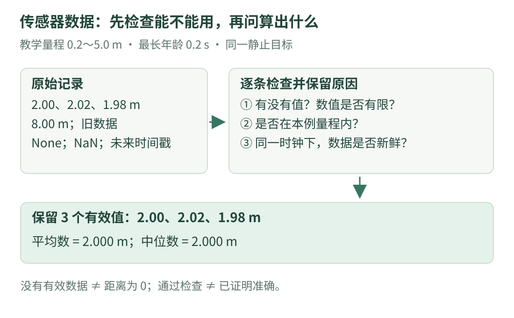

# 03 · 传感器与数据质量：先判断数据能不能用

机器人前方的测距设备连续给出 `2.00、2.02、1.98、8.00` 米。前三次都在 2 米附近，最后一次为什么变成 8 米？该求平均，直接相信最新值，还是先查时间和有效范围？这一章教你按顺序检查。

!!! tip "学习目标与前置知识"

    先读 [02 · 位置、速度与时间](units.md)。读完后，应能区分原始测量与状态估计，理解噪声、偏差和异常值，并能检查单位、时间戳、范围和缺失数据。

    不需要先学概率论；我们只用一小组虚构的距离数据说明思路。

## 1. 看图：先检查，再统计

{ .learning-figure }

[打开大图](../assets/learning/robotics-sensors.svg)

传感器像一位“提供线索的人”。线索可能有噪声，也可能缺失；状态估计把线索和模型结合，推测机器人的位置或速度。测量和估计都有不确定性。

## 2. 常见传感器各自测什么

| 设备 | 最直接提供什么 | 初学者容易多想一步 |
| --- | --- | --- |
| 摄像头 | 图像，像素中的颜色与亮度 | 一张普通图像不自动给出每个点的米制距离 |
| 深度相机 | 图像及深度相关数据 | 无效深度、遮挡和坐标约定仍需检查 |
| 激光雷达 | 多个方向上的距离观测 | 扫描不一定是整张同一时刻拍下的照片 |
| 超声 / 红外测距 | 视场内的一次距离观测 | 不一定知道回波物体在视场中的精确方向 |
| 编码器 | 轮子或关节转动相关测量 | 轮子转了多少不保证地面位移是多少 |
| IMU | 角速度、加速度等测量或估计 | 不直接保证长期无漂移的位置 |
| GNSS 接收机 | 根据卫星信号估计位置等 | 遮挡、多路径及坐标参考会影响使用 |

本表是测量含义的入门说明，具体输出以设备说明和驱动为准。不要因为设备名字相同，就认定量程、单位和无效值约定也相同。

例如 [ROS 2 Jazzy 的 LaserScan 官方消息定义](https://github.com/ros2/common_interfaces/blob/jazzy/sensor_msgs/msg/LaserScan.msg) 明确了距离、角度、扫描时间等字段，采集时间戳对应首束激光，并提供相邻束时间间隔。机器人运动时，整帧扫描的不同束可能对应不同位姿。

## 3. 噪声、偏差、异常值，先用数字区分

设真实静止距离在教学例子里是 2.00 米。

| 数据现象 | 本例数字 | 通俗解释 |
| --- | --- | --- |
| 随机噪声 | 1.98、2.02、2.00 | 围绕某个值上下晃动 |
| 系统偏差 | 2.10、2.11、2.09 | 测量整体偏向同一侧 |
| 异常观测 | 2.00、2.02、8.00 | 与当前预期明显不一致的一次观测 |
| 缺失 / 无效 | `None`、`NaN` 等 | 这次没有可用的数值，具体约定由接口定义 |

“8 米”并不天然意味着错误：物体可能真的移开了，或设备看到了更远的背景。**异常是相对于量程、场景和模型而言的**，应结合其他信息判断。

### 准确和稳定也不是同一回事

十次都测到 2.10 米，看起来很稳定；但若真实距离是 2.00 米，就有 0.10 米偏差。把十次平均后仍约为 2.10 米，平均并没有消除这份共同偏差。

重复测量可以帮助观察波动；想知道是否偏准，需要有可信参考、合适标定方法和覆盖实际工作条件的检查。

IMU 的角速度通常以弧度/秒表达，加速度以米/秒平方表达；一些姿态字段是估计而非原始测量。字段的“不提供”和“协方差未知”也有约定，可核对 [ROS 2 Jazzy 的 Imu 官方消息定义](https://github.com/ros2/common_interfaces/blob/jazzy/sensor_msgs/msg/Imu.msg)。静止时加速度读数是否已去重力，必须查驱动约定，不能默认它为零。

## 4. 四道检查：为什么要按顺序做

先假定本章设备输出米制标量距离，教学有效量程是 `[0.2, 5.0]` 米，最长允许数据年龄为 0.2 秒。这些是虚构设置。

1. **有没有值**：`None` 表示本例缺失，不能直接拿来乘除。
2. **数值是否有限**：`NaN`、正无穷和负无穷不进入本例普通距离统计。
3. **是否在量程内**：小于 0.2 或大于 5.0 不被本例接受。
4. **时间能否使用**：同一时钟下年龄须在 0～0.2 秒，未来时间戳也不接受。

实际处理还需要查坐标系、标定和设备状态。我们在本章先固定为“同一个静止目标、同一个测距坐标含义”，避免把不同对象的距离混到一组统计。

!!! note "本例规则不是所有传感器的通用协议"

    有些真实消息把无穷当作带特殊含义的状态，例如固定距离二值测距的检测 / 未检测。应按设备和消息约定解释，不能一律改成 0。可查 [ROS 2 Jazzy 的 Range 官方消息定义](https://github.com/ros2/common_interfaces/blob/jazzy/sensor_msgs/msg/Range.msg)。

零也不一定是无效值。某些量可以合法为零；本例距离 0 米不接受，是因为设定量程下限为 0.2 米。

## 5. 手算：平均数会被大数拉动

先暂时忽略量程，看看 `2.00、2.02、1.98、8.00` 的两种统计。

**算术平均数**：把四个数加起来再除以四：`14.00 / 4 = 3.50` 米。一个 8 米把结果拉离 2 米附近。

**中位数**：先排序：`1.98、2.00、2.02、8.00`。共有偶数个数，中位数取中间两个的平均：`(2.00 + 2.02) / 2 = 2.01` 米。

中位数较少受单个极端数影响，但它也不是“真值探测器”。如果目标真的从 2 米移到 8 米，把旧值和新值混在一起仍可能误导判断。

现在按本例量程先剔除 8 米，留下三个数：平均数为 2.00 米，中位数也为 2.00 米。这个结果依赖我们的量程设定和静止目标条件。

## 6. 阅读代码：保留原因，比只删掉数据更有用

完整示例使用 `math` 和 `statistics`，都是 Python 标准库。列表里的记录都是虚构数据；每条记录用 `(采集时刻, 距离)` 表示。

```python title="检查虚构测距记录并统计 · 完整阅读示例"
import math
import statistics


def check_reading(timestamp_s, distance_m, now_s):
    # 本例把 None 明确约定为“这次没有读数”。
    if distance_m is None:
        return "缺失"

    # 排除 NaN 和无穷，避免它们混入普通距离统计。
    if not math.isfinite(distance_m):
        return "非有限数"

    # 本例量程包含两个边界；实际参数要查设备说明。
    if not 0.2 <= distance_m <= 5.0:
        return "超出量程"

    # 时间戳同样需要是可计算的有限数。
    if not math.isfinite(timestamp_s):
        return "时间无效"
    age_s = now_s - timestamp_s
    if age_s < 0.0:
        return "未来时间戳"
    if age_s > 0.2:
        return "观测过旧"

    return "有效"


now_s = 10.0  # 全部记录与当前时刻使用同一个实验时钟。
readings = [
    (9.90, 2.00),
    (9.92, 2.02),
    (9.94, 1.98),
    (9.96, 8.00),
    (9.50, 2.01),
    (9.98, None),
    (9.99, float("nan")),
    (10.10, 2.00),
]

valid_distances = []
for number, (timestamp_s, distance_m) in enumerate(readings, start=1):
    # 先检查，再决定是否加入统计列表。
    reason = check_reading(timestamp_s, distance_m, now_s)
    print(f"记录 {number}: {reason}")
    if reason == "有效":
        valid_distances.append(distance_m)

# 空列表没有平均数或中位数；不要把“没有数据”显示为 0 米。
if valid_distances:
    average_m = statistics.mean(valid_distances)
    median_m = statistics.median(valid_distances)
    print(f"有效数量: {len(valid_distances)}")
    print(f"平均距离: {average_m:.3f} m")
    print(f"中位距离: {median_m:.3f} m")
else:
    print("没有有效数据，需要另外处理")
```

预期输出：

```text
记录 1: 有效
记录 2: 有效
记录 3: 有效
记录 4: 超出量程
记录 5: 观测过旧
记录 6: 缺失
记录 7: 非有限数
记录 8: 未来时间戳
有效数量: 3
平均距离: 2.000 m
中位距离: 2.000 m
```

### 怎样读这个数据结构

`(9.90, 2.00)` 是有顺序的两个值：先时间，后距离。`enumerate(..., start=1)` 给每条记录一个从 1 开始的展示编号；这个编号与列表内部从 0 开始的下标不是一回事。

`return` 一旦执行，函数就结束，所以每条记录只报告首先发现的问题。真实诊断也可以保存多种问题；本例为便于阅读采用一个原因。

`if valid_distances` 问“列表是不是非空”。先保证有数据再求平均，避免把缺失伪装成零。数学统计函数及其对 `NaN` 的注意事项，可核对 [Python 官方 statistics 文档](https://docs.python.org/3.14/library/statistics.html)。

## 7. 为什么滤波有时会“显得反应慢”

假设每 0.1 秒测一次，过去两次都为 2 米，最新一次突然变成 1 米。三点移动平均为 `(2 + 2 + 1) / 3 = 1.667` 米，而最新测量是 1 米。

平均把新旧数据混合，所以结果更平滑，但真实变化发生时也可能跟得慢。窗口越大，历史影响通常越明显；不能只追求曲线好看。

滤波输出要保留时间含义和方法说明。把它记成“此刻绝对真实的距离”，会让后面的定位、规划和控制误以为没有延迟和不确定性。

## 8. 练习：没有数据，与距离为零有何区别

在上述完整示例中，把前三条有效记录也改成 `None`，其他记录不变。最后应输出 0 米还是“没有有效数据”？为什么？

**提示**：机器人不知道距离，不等于知道物体就在传感器原点。

??? example "展开参考答案"

    应走入空列表分支，输出“没有有效数据，需要另外处理”。本例用 None 表示缺失，不能把它替换成一个看似精确的距离。

    实际系统需要定义无有效观测时如何暂停当前决策、等待恢复或进入其它状态；本例只报告事实，没有实现设备控制。

第二题：量程合格、时间新鲜的一组数全是 2.10 米，参考真值是 2.00 米。多平均几次是否必然消除 0.10 米偏差？

??? example "展开偏差问题的答案"

    不会。共同的系统偏差不会因为平均而自动消失。需要排查标定、设备安装、环境和参考本身；重复测量主要帮助描述波动。

## 9. 常见误区与继续学习

| 误区 | 更准确的做法 |
| --- | --- |
| 测距为 8 米就肯定坏了 | 先查量程，再结合场景与其他观测 |
| 数值稳定就一定准确 | 分别检查波动和相对参考的偏差 |
| 均值 / 中位数就是实际距离 | 它们只是统计结果，依赖数据条件 |
| IMU 静止时所有数都应为 0 | 查是否去重力、坐标轴及输出约定 |
| 剔除无效数后就完成感知 | 还要考虑标定、坐标、时间和不确定性 |

本章各设备字段说明可核对前文 ROS 官方定义；完整代码只为解释固定数据处理，不是通用驱动或状态估计器。下一章把“相同位置，为什么有不同坐标”讲清楚。

[返回机器人学习路线](index.md) · [上一章：02 · 位置、速度与时间](units.md) · [下一章：04 · 坐标系与二维变换 →](frames.md)
