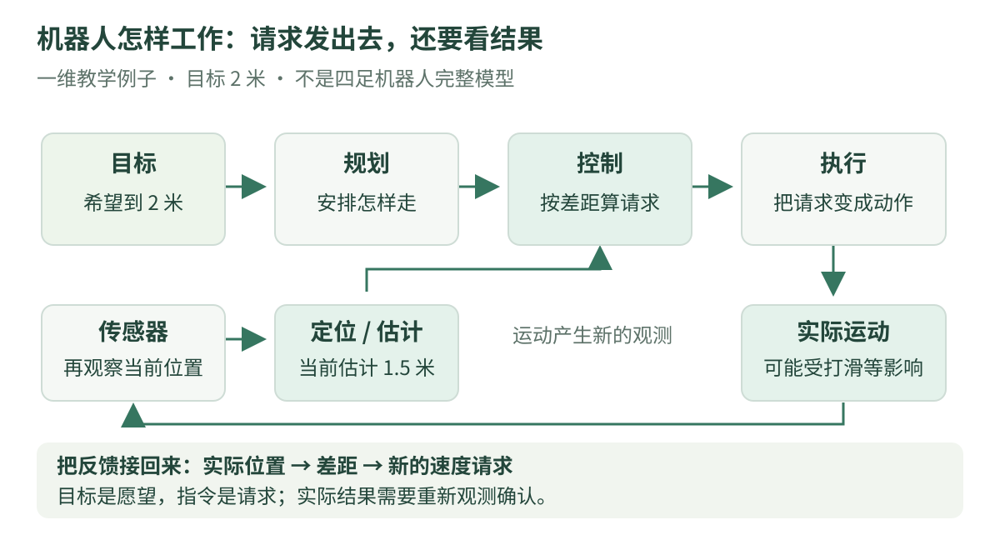

# 01 · 机器人怎样工作：从目标到反馈

你对机器人说“到前方 2 米的位置去”。它怎样知道自己在哪里？怎样决定走哪条路？电机已经转了，是否就说明真的到达了？本章先把这些问题串起来，后面再逐个学习。

!!! tip "先会这些就够了"

    会加减乘除，知道米表示长度、秒表示时间。没有编程基础也可以先看图和手算；代码语法可查 [Python 阅读入门](../programming/python-reading.md)。

    读完后，你应能区分目标、测量、估计、指令和实际运动，并能说明为什么机器人要反复读取反馈。

## 1. 看图：一句目标，需要几个模块配合

{ .learning-figure }

[打开大图](../assets/learning/robotics-start.svg)

可以把机器人想成一个会移动的系统：传感器收集外界信息，程序计算下一步，执行器把指令变成运动。机器人不是“只要装上人工智能，就自动做好所有事情”。

本章用沿直线移动的**理想点**帮助理解信息流。它没有身体大小、障碍、轮子或腿；这是教学模型，不是四足机器人的完整模型。

| 模块 | 用人话解释 | 本例中负责什么 |
| --- | --- | --- |
| 传感器 | 获取一次观测 | 提供位置相关数据 |
| 状态估计 / 定位 | 根据观测推测当前状态 | 给出当前位置及可信程度 |
| 规划 | 安排到目标的路线 | 在无障碍的例子里选直线 |
| 控制 | 根据实际偏差不断调整 | 计算这一刻需要多少速度 |
| 执行器 | 把请求变成物理动作 | 电机、驱动机构等产生运动 |
| 日志 | 留下过程，便于回看 | 记录目标、观测和指令 |

真实系统中，定位可能要结合多种传感器；规划也可能需要地图。先弄清职责，再学习具体工具，会比先记住一串软件名字更容易。

## 2. 同一个数，放在不同位置，意思会变

目标位置是 2 米，测到当前位置是 1.5 米，算出请求速度是 0.25 米/秒。这三个数分别回答三个问题：

1. **目标**：希望最终到哪里？
2. **观测 / 估计**：目前认为机器人在哪里？
3. **指令**：接下来要求怎样运动？

“我发出了前进指令”只能说明发出了请求。机器人可能打滑、受阻，或还没来得及响应，所以不能直接把指令当成已经发生的运动。

| 数据 | 示例 | 能不能直接当作事实 |
| --- | --- | --- |
| 目标位置 | 2.0 米 | 是愿望，不是当前位置 |
| 位置估计 | 1.5 米 | 是根据观测得到的估计，可能有误差 |
| 请求速度 | 0.25 米/秒 | 是要求，不是测到的速度 |
| 测量速度 | 0.22 米/秒 | 是一份观测，也要检查时间和质量 |
| 预计下一位置 | 1.525 米 | 是模型预测，需要下一次观测核对 |

在放牧机器人中，羊的位置也通常是估计：检测框需要经过标定、坐标转换或跟踪，才可能变成带单位的位置数据。不能把图片里的像素直接当作世界里的米。

## 3. 反馈：看过一次，还要继续看

想象蒙着眼睛往前走 4 步：这是“预先定好动作，执行后不再确认”。睁着眼睛看距离，再决定下一步：这是利用反馈。机器人中的区别也类似。

**开环**：按事先算好的指令执行，不利用当前输出修正这次运动。**闭环**：持续把实际输出反馈回来，比较目标和实际，再调整指令。

开环并不是永远没用；例如某些校准好的短动作可能采用它。但有反馈也不自动保证表现好：观测延迟、增益过大和执行限制仍可能造成问题。

闭环控制中“不断读取测量并更新执行请求”的概念，可核对 [Modern Robotics 作者教材的控制系统导论](https://modernrobotics.northwestern.edu/nu-gm-book-resource/11-1-control-system-overview/)。下面的数字是本站自行设定的教学例子。

## 4. 手算一次：还差多少，就先请求多少

只考虑一维位置，全部沿同一条世界坐标轴，单位米。规定正速度朝坐标增大的方向。

本例采用一个很简单的规则：每差 1 米，先请求 0.5 米/秒；速度大小最多允许 0.5 米/秒。

$$
e = x_{\mathrm{target}} - x_{\mathrm{current}},\qquad
v_{\mathrm{request}} = k e
$$

把公式读成“差距 = 目标 − 当前；速度请求 = 系数 × 差距”。本例的 $k=0.5$，单位是 $1/\mathrm{s}$：米乘以每秒，才能得到米/秒。

当前 1.5 米，目标 2 米：

1. 差距：`2.0 − 1.5 = 0.5` 米。
2. 请求：`0.5 × 0.5 = 0.25` 米/秒。
3. 0.25 没有超过上限，保留它。
4. 若理想地保持该速度 0.1 秒，位移为 `0.25 × 0.1 = 0.025` 米。
5. 模型预计到达 `1.5 + 0.025 = 1.525` 米。

下一次应该重新读取实际位置。真实位置可能是 1.520 米，而不是预计的 1.525 米；控制应依据新观测继续计算。

### 限幅：把请求放进允许区间

若当前位置为 0 米，原始请求为 `0.5 × 2 = 1` 米/秒，超过本例上限，所以只保留 0.5 米/秒。若已到 2.2 米，差距为 −0.2 米，请求为 −0.1 米/秒，表示往反方向调整。

| 当前值 / 米 | 差距 / 米 | 原始请求 / 米每秒 | 限幅后 / 米每秒 |
| --- | --- | --- | --- |
| 0.0 | 2.0 | 1.0 | 0.5 |
| 1.5 | 0.5 | 0.25 | 0.25 |
| 2.0 | 0.0 | 0.0 | 0.0 |
| 2.2 | −0.2 | −0.1 | −0.1 |

这些行是独立条件下的计算结果，不是已经模拟出来的连续轨迹。限幅约束的是数字大小，不能代替避障、平衡控制或完整的停止机制。

## 5. 阅读代码：三次虚构观测，三次计算

下面是完整的纯 Python 阅读示例，只计算固定数字、输出文字。无需连接设备；每次观测已经写在列表中，没有模拟机器人自行走到这些位置。

```python title="根据三次虚构观测计算请求 · 完整阅读示例"
def clamp(value, lower, upper):
    # 小于下界时取下界；大于上界时取上界。
    return min(upper, max(lower, value))


# 目标、观测都沿同一条世界坐标轴；位置单位为米。
target_m = 2.0
# 列表中的每个数字是假设已经获得的一次观测。
observations_m = [0.0, 1.5, 2.2]

# 本例系数单位为 1/秒；速度限制单位为米/秒。
gain_per_second = 0.5
max_speed_mps = 0.5

for current_m in observations_m:
    # 正差距表示目标在坐标增大的方向。
    error_m = target_m - current_m
    requested_mps = gain_per_second * error_m

    # 同时允许正向和反向，区间是 [-0.5, 0.5]。
    command_mps = clamp(requested_mps, -max_speed_mps, max_speed_mps)

    # :.2f 把数字显示到小数点后两位，不改变内部数值。
    print(
        f"当前位置 {current_m:.2f} m，差距 {error_m:.2f} m，"
        f"请求 {requested_mps:.2f} m/s，限幅后 {command_mps:.2f} m/s"
    )
```

预期输出：

```text
当前位置 0.00 m，差距 2.00 m，请求 1.00 m/s，限幅后 0.50 m/s
当前位置 1.50 m，差距 0.50 m，请求 0.25 m/s，限幅后 0.25 m/s
当前位置 2.20 m，差距 -0.20 m，请求 -0.10 m/s，限幅后 -0.10 m/s
```

### 怎样逐行读

`def clamp(...)` 定义一个小工具；`return` 把计算结果交回调用处。第一次可以只把它理解为“把数限制在上下界之间”。

`for current_m in observations_m` 从列表依次取一个观测。每一轮先算差距，再算速度请求，最后限幅。`_m` 和 `_mps` 是变量名中的单位提醒，并不会让 Python 自动检查单位。

代码没有把上一次指令加到当前位置上，正是为了区分**观测**与**预测**。完整系统需要驱动、采样、时间管理和异常处理；本章只说明一个环节。

## 6. 和放牧任务怎么连接

“把羊群引导到指定区域”是任务目标；“机器人下一步向左走还是向右走”是决策；“请求机身速度后怎样保持运动”是执行与控制。它们在不同层次，不能用一个变量混在一起。

高层策略可能输出目标点，也可能输出速度或其他动作，具体取决于接口。动作的含义要写清楚：坐标系、单位、更新频率、约束和无效数据处理。

例如，本章的“反方向调整”只对一维点模型成立。在羊群附近如何转身、让路或停下，需要结合机器人能力、场地和任务设计，不能照抄这一维规则。

## 7. 动手想一想：先解释，再计算

保持目标 2 米、系数 0.5 每秒、速度上限 0.5 米/秒。假设当前观测是 1.8 米，回答：差距多少？限幅后多少？若理想地执行 0.1 秒，预计下一位置是多少？

**提示**：按“相减 → 乘系数 → 查上下界 → 速度乘时间”的顺序。预计位置仍需下一次测量确认。

??? example "展开参考答案与解释"

    差距是 `2 − 1.8 = 0.2` 米。请求是 `0.5 × 0.2 = 0.1` 米/秒，在允许区间内，限幅后仍是 0.1 米/秒。

    理想位移是 `0.1 × 0.1 = 0.01` 米，预计位置 1.81 米。实际执行不一定达到该位置。

    下面是替换上面完整示例中观测列表的**修改片段**，不是另一份独立程序：

    ```python title="只修改观测列表"
    # 保留完整示例的其他内容，用这一行替换旧列表。
    observations_m = [1.8]
    ```

第二问：若程序每轮都重复使用 10 秒前的 1.8 米观测，这算“读到当前状态”吗？

??? example "展开时间问题的答案"

    不算。程序在重复处理旧数据，机器人可能早已移动。要记录观测采集时间，并确认它与当前时刻可在同一时间基准中比较；[第 2 章](units.md) 会具体计算数据年龄。

## 8. 常见误区

| 容易误解的说法 | 更准确的理解 |
| --- | --- |
| 发出指令就到了 | 指令要经过执行，结果要靠观测确认 |
| 定位给的值就是真值 | 定位是估计，应检查质量与时间 |
| 加了反馈就永远稳定 | 反馈设计仍受模型、延迟和约束影响 |
| ROS 2 就是导航算法 | ROS 2 提供通信等工具，具体算法另行实现 |
| 把羊看见就知道它在哪米 | 图片坐标还需要合适的几何与标定处理 |

## 9. 本章自测与继续学习

请用自己的话解释：“目标 2 米”“观测 1.5 米”“指令 0.25 米/秒”各自是什么。如果能说明为什么执行后还要再看一次，就抓住了本章主线。

本章控制数值是教学设定；控制系统的信息流参考前文链接的作者教材。后续坐标、单位采用 [ROS REP 103 官方源文档](https://github.com/ros-infrastructure/rep/blob/master/rep-0103.rst) 的常用约定，设备实际接口仍需逐项核对。

[返回机器人学习路线](index.md) · [下一章：02 · 位置、速度与时间 →](units.md)
