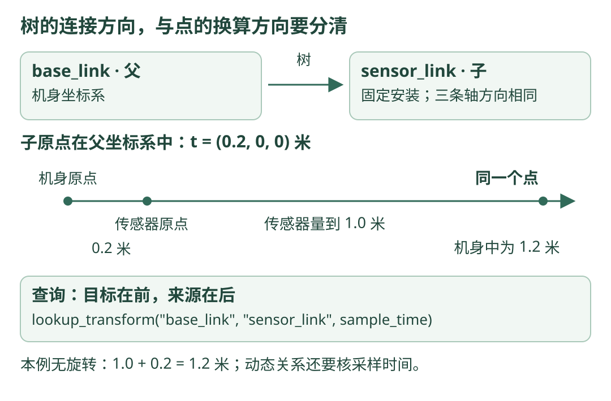

# 08 · tf2：把带时间的坐标换到同一个参照系

!!! tip "这一章的目标"

    传感器报告某点在自己前方 1 米，传感器又安装在机身前方 0.2 米。你应能说明：这个点相对机身在哪里、变换应该查哪个方向、为什么动态变换还要对应采样时间。

    **前置知识**：[坐标系与二维变换](frames.md)、[ROS 2 节点与话题](ros2.md)。代码沿用 ROS 2 Jazzy、Ubuntu 24.04、Python 3.12；Windows 读者先按步骤阅读即可。

## 为什么 1 米有时不能直接拿来用？

“前方 1 米”缺了参照物：是相机前方、机器人机身前方，还是世界坐标原点的前方？同一个点，在不同坐标系下可以有不同数字。

**tf2 管理坐标系之间随时间变化的关系，帮助查询和应用变换。** 它不会替你检测目标、标定相机，也不会凭空知道传感器装在哪儿；安装位置或定位算法得到的关系，需要由对应程序提供。

## 看图：树的连接方向与点的换算方向

{ .learning-figure }

[打开大图](../assets/learning/robotics-tf2.svg)

图上 `base_link → sensor_link` 表示“机身是父坐标系，传感器是子坐标系”。下面的算式则是把**点的坐标从传感器换到机身**。不要只凭箭头猜加法还是减法。

## 先写清楚本例约定

| 项目 | 本章约定 |
| --- | --- |
| `base_link` | 机身参照系；x 向前，y 向左，z 向上 |
| `sensor_link` | 传感器参照系；与机身三条轴方向相同 |
| 安装位置 | 传感器原点相对机身为 `(0.2, 0, 0)` 米 |
| 安装是否变化 | 固定安装，不随时间改变 |
| 点的观测值 | `sensor_link` 中的 `(1.0, 0, 0)` 米 |

这里是一个普通教学传感器坐标系，**不是相机 optical 坐标系**。相机 optical 常用 z 向前、x 向右、y 向下，不能直接套本章的同向轴假设。

## 一个加法，先看懂变换

由于两套坐标轴方向相同，不需要旋转，换算为：

$$
p_{base} = p_{sensor} + t_{base,sensor}
$$

`p` 是点的位置，`t` 是传感器原点相对机身的位置。下标读起来有点长，但它提醒你每个数字属于哪里。

本例 `1.0 + 0.2 = 1.2`，所以同一个点在 `base_link` 中为 `(1.2, 0, 0)` 米。反过来，从机身换回传感器，需要减去 0.2 米。

如果传感器有旋转，则需要先将点的方向旋转到机身轴，再加安装平移，即 `p_base = R × p_sensor + t`。tf2 的点变换工具会应用旋转和平移；本章选无旋转，是为了先手算核对方向。

### 点和方向向量不要混着变换

点有位置，原点换了要考虑平移。一个纯方向向量描述朝向，不会因为原点平移就变长。因此不能把 `PointStamped` 的处理方式直接当作速度变换。

如果只是把**同一个物理速度向量**换一套轴表示，只需要旋转；如果计算旋转机身上另一点的速度，还可能需要角速度与位置产生的项。

## 三个字段分别说什么？

| 消息或字段 | 人话解释 | 本例 |
| --- | --- | --- |
| `PointStamped.header.frame_id` | 这个点的数字使用哪套坐标轴 | `sensor_link` |
| `PointStamped.header.stamp` | 这条点观测对应哪个时间 | 构造教学观测时的 ROS 时间 |
| `TransformStamped.header.frame_id` | 父坐标系，也就是变换关系的参照系 | `base_link` |
| `TransformStamped.child_frame_id` | 子坐标系 | `sensor_link` |
| `transform.translation` | 子坐标系原点在父坐标系中的位置 | `(0.2, 0, 0)` 米 |
| `transform.rotation` | 子坐标系轴相对父坐标系轴的旋转 | 本例单位四元数，无旋转 |

ROS 的四元数字段按 `x, y, z, w` 命名；无旋转时为 `(0, 0, 0, 1)`。默认四个零不是合法的单位四元数，不能遗漏 `w = 1.0`。

字段定义可直接对照 [PointStamped](https://github.com/ros2/common_interfaces/blob/jazzy/geometry_msgs/msg/PointStamped.msg) 与 [TransformStamped](https://github.com/ros2/common_interfaces/blob/jazzy/geometry_msgs/msg/TransformStamped.msg)。

## 查询函数：目标在前，来源在后

```python title="API 读法 · 片段，不是独立文件"
# 把 sensor_link 中的坐标换成 base_link 中的坐标。
transform = buffer.lookup_transform(
    "base_link",     # target：希望换到哪里。
    "sensor_link",   # source：输入坐标原本属于哪里。
    sample_time,     # 对应点观测的时间。
)
```

`target` 是“目标参照系”，不是机器人要去的导航目标。该函数返回的变换能把 `source` 中的点转换到 `target`。

`rclpy.time.Time()` 的零时间在此查询 API 中表示“最新可用变换”，**不是让机器人回到历史起点**。本章完整代码使用观测时间；静态安装关系在不同时间相同，仍保留正确的时间读取习惯。参数顺序和零时间含义见 [Jazzy 的 Buffer API 源码](https://github.com/ros2/geometry2/blob/jazzy/tf2_ros_py/tf2_ros/buffer.py)。

## 完整文件：发布固定安装关系，再查询一个点

保存为 `tf_example.py`。一个节点同时提供本例的固定关系并接收 tf2 数据，避免刚入门就要维护多个文件。固定关系也只用于这个教学模型。

```python title="tf_example.py · 完整文件"
import rclpy
from rclpy.executors import ExternalShutdownException
from rclpy.node import Node
from rclpy.time import Time
from geometry_msgs.msg import PointStamped, TransformStamped
from tf2_geometry_msgs import do_transform_point
from tf2_ros import (
    Buffer, StaticTransformBroadcaster, TransformException, TransformListener,
)


class FrameExample(Node):
    def __init__(self):
        super().__init__("learning_frames")
        self.buffer = Buffer(node=self)  # 存放已收到的坐标关系。
        self.listener = TransformListener(self.buffer, self)
        self.broadcaster = StaticTransformBroadcaster(self)

        mounting = TransformStamped()
        mounting.header.stamp = self.get_clock().now().to_msg()
        mounting.header.frame_id = "base_link"  # 父坐标系。
        mounting.child_frame_id = "sensor_link"  # 子坐标系。
        mounting.transform.translation.x = 0.2  # 传感器装在前方 0.2 米。
        mounting.transform.rotation.w = 1.0  # x/y/z 默认为 0：无旋转。
        self.broadcaster.sendTransform(mounting)  # 固定安装使用静态广播。
        self.timer = self.create_timer(0.5, self.show_point)

    def show_point(self):
        point = PointStamped()  # 这是教学假设观测，不来自真实传感器。
        point.header.frame_id = "sensor_link"
        point.header.stamp = self.get_clock().now().to_msg()
        point.point.x = 1.0  # y/z 默认 0，单位为米。
        sample_time = Time.from_msg(point.header.stamp)
        try:
            transform = self.buffer.lookup_transform(
                "base_link", point.header.frame_id, sample_time
            )  # 默认不阻塞等待；初次没收到关系时交给下一次回调。
        except TransformException:
            self.get_logger().info("暂时没有变换，等待下一次回调")
            return  # 缺少关系时，不能假装换算成功。

        result = do_transform_point(point, transform)  # 应用旋转和平移。
        # 此工具使用变换消息的 header；显式保留观测采样时间。
        result.header.stamp = point.header.stamp
        self.get_logger().info(
            f"{result.header.frame_id}: "
            f"({result.point.x:.2f}, {result.point.y:.2f}, "
            f"{result.point.z:.2f}) m"
        )


def main():
    rclpy.init()
    node = FrameExample()
    try:
        rclpy.spin(node)  # 使 tf2 接收回调和教学定时器都得到处理。
    except (KeyboardInterrupt, ExternalShutdownException):
        pass
    finally:
        node.destroy_node()
        rclpy.try_shutdown()


if __name__ == "__main__":
    main()
```

静态广播器发布到 `/tf_static`，并使用适合固定关系的保留策略；动态关系通常通过 `/tf` 更新。这里需要保留广播器对象并保持节点运行，不是发完消息就把进程退出。[静态广播器实现](https://github.com/ros2/geometry2/blob/jazzy/tf2_ros_py/tf2_ros/static_transform_broadcaster.py) 与 [点变换工具实现](https://github.com/ros2/geometry2/blob/jazzy/tf2_geometry_msgs/src/tf2_geometry_msgs/tf2_geometry_msgs.py) 是本例的接口依据。

## 执行顺序与预期结果

| 顺序 | 程序做什么 | 如果省略会怎样 |
| --- | --- | --- |
| 1 | 建立 Buffer 与 Listener | 没有地方接收并保存关系 |
| 2 | 发送 `base_link` 与 `sensor_link` 的静态关系 | 查询可能找不到两个坐标系之间的路径 |
| 3 | 进入 `spin` | 收到的数据和定时器回调无法持续被处理 |
| 4 | 建立带坐标系和采样时间的点 | 只看到三个数，无法确定该如何变换 |
| 5 | 按来源、目标与时间查询 | 查反方向会得到不同的结果 |
| 6 | 应用返回的变换 | 查询本身不会自动修改输入点 |

预期日志正文如下；开头可能先提示暂时没有变换。这里是依照固定几何关系推导的结果，不是已经运行 ROS 的日志。

```text title="日志正文示意"
base_link: (1.20, 0.00, 0.00) m
```

已有 Jazzy，且包含 `tf2_ros`、`tf2_geometry_msgs`、`geometry_msgs` 的 Ubuntu 读者，可以把文件放入 `~/robotics_learning/`。以下命令是可选验证说明：

```bash title="Ubuntu Bash · 只运行这个教学坐标例子"
source /opt/ros/jazzy/setup.bash
export ROS_DOMAIN_ID=84
cd ~/robotics_learning
python3 tf_example.py
```

本网站不需要为此新建环境，也不会执行 ROS。按 Ctrl+C 结束可选验证。

## 为什么时间对上了才有意义？

固定安装关系不变，但机器人相对世界的位置会变。假设 t=1 秒时机身世界 x 为 2 米，t=2 秒时为 3 米，朝向始终不变。t=1 秒采到的点，在机身中为 1.2 米，应换成世界中的 `2+1.2=3.2` 米。

若错用 t=2 秒的位置，会得到 `3+1.2=4.2` 米，相差 1 米。数字能算出来，并不代表你换算了同一时刻的观测。

| 时间相关问题 | 先用人话理解 |
| --- | --- |
| 变换还没到达 | 所需时刻的信息仍在路上；本例稍后重试 |
| 请求比最新动态数据还晚 | 查询到了将来，不能凭空外推 |
| 请求比保留历史更早 | 历史已不在缓冲区，不是随时都能回放 |
| 一个节点用仿真时间、另一个用系统时间 | 时间数字来源不同，不能直接当成同一时间线 |

如果传感器消息已有采样时间，要使用它，不要收到数据后随便写成“现在”。只在明确允许使用最新状态的任务中，才选择零时间查询。

## tf2 树怎样连接？

常见的连接是 `map → odom → base_link → sensor_link`：地图、连续里程计、机身和传感器。每个名字只是参照系的约定，关系要有明确的提供者。

tf2 通过中间关系组成需要的变换，因此不必额外发布 `map → sensor_link`。一棵树中同一个子坐标系只有一个父坐标系；不要让两个不同程序同时给 `base_link` 发布互相矛盾的父关系，也不要形成环。

## 练习：向后安装，并给点换一个时间

若传感器原点在机身后方 0.1 米、轴方向仍相同，传感器中的点为 `(0.5, 0, 0)`，机身坐标是多少？若这一点采于 t=1 秒，能否直接用 t=2 秒的机身世界位置？

??? note "展开参考答案"

    安装平移为 −0.1 米，机身坐标为 `0.5−0.1=0.4` 米。完整文件中对应修改 `translation.x` 为 −0.1，`point.x` 为 0.5。

    换成世界坐标时，动态关系应对应 t=1 秒。不能因为最新关系已经到达，就自动把它用于旧观测。

## 常见错误与自测

| 错误 | 改进方法 |
| --- | --- |
| 只改 `frame_id`，不改数字 | 改标签不等于坐标变换，必须应用旋转和平移 |
| 忘记四元数 `w = 1` | 单位旋转要写成合法的单位四元数 |
| 把查询的 source 与 target 写反 | 先写一句“从哪里换到哪里”，再写目标、来源 |
| 阻塞等待导致接收回调没机会执行 | 本例使用不阻塞查询和下一次定时器重试 |
| 用静态广播提供正在运动的关节关系 | 静态关系只描述不随时间变化的安装关系 |

自测时分别说清：`frame_id` 标记什么、安装平移是谁相对谁、时间戳由什么确定、查询失败为什么不能继续给出“成功结果”。

[返回学习路线](index.md) · [上一章：ROS 2 通信](ros2.md) · [下一章：URDF 机器人描述 →](urdf.md)
