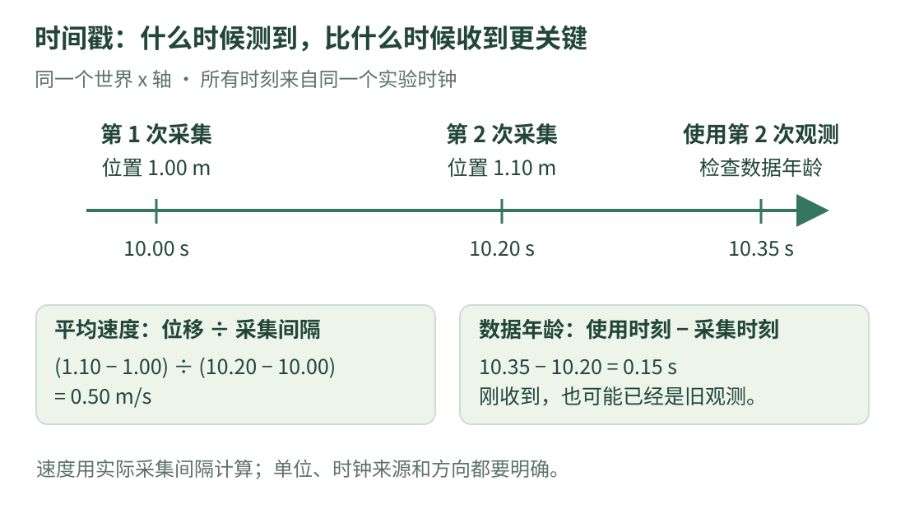

# 02 · 位置、速度与时间：让数字有明确含义

一条消息写着“速度 50”。它是 50 米/秒，还是 50 厘米/秒？另一条消息刚刚收到，却拍摄于半秒前，能不能直接当成现在的位置？这一章把最容易忽略的单位和时间讲清楚。

!!! tip "学习目标与前置知识"

    先读 [01 · 机器人怎样工作](start.md)，会做乘除即可。读完后，应能换算厘米与米、度与弧度，按真实时间间隔估计速度，并判断观测是否过旧。

## 1. 看图：数值、单位、方向和时间要一起看

{ .learning-figure }

[打开大图](../assets/learning/robotics-units.svg)

`0.5` 本身只有大小。`0.5 米/秒，沿世界 x 正方向，采集于 10.2 秒` 才告诉你怎样使用它。位置还应说明原点和坐标系；[第 4 章](frames.md) 会展开。

## 2. 先区分位置、位移和路程

沿一条直线设定原点，向东为正。

| 量 | 用人话解释 | 例子 |
| --- | --- | --- |
| 位置 | 相对于原点在哪里 | x = 2 米 |
| 位移 | 最后位置减开始位置 | 从 2 米到 1 米，位移 −1 米 |
| 路程 | 途中实际走过的总长度 | 先走 1 米再回来 1 米，路程 2 米 |
| 速度 | 位置改变多快，带方向 | 向东 0.5 米/秒或向西 −0.5 米/秒 |
| 速率 | 速度的大小 | 上述两种运动的速率都是 0.5 米/秒 |

从 0 米走到 1 米又返回 0 米，总位移为 0，路程为 2 米。因此“位移除以总时间”是平均速度，“路程除以总时间”是平均速率，两者不要混称。

二维速度通常要有两个分量 `(vx, vy)`。只写“0.5 米/秒”时还缺少方向，除非接口已经明确它就是机身前进方向的速度。

## 3. 最常用的单位：先统一，再计算

本教程内部使用米、秒、弧度。ROS 常用单位约定也使用 SI 单位，并规定角度使用弧度，可核对 [REP 103 的单位章节](https://github.com/ros-infrastructure/rep/blob/master/rep-0103.rst)。

| 原始数据 | 换成教程使用的单位 | 为什么这样换 |
| --- | --- | --- |
| 150 厘米 | 1.5 米 | 100 厘米 = 1 米 |
| 250 毫米 | 0.25 米 | 1000 毫米 = 1 米 |
| 200 毫秒 | 0.2 秒 | 1000 毫秒 = 1 秒 |
| 50 厘米/秒 | 0.5 米/秒 | 只把长度单位换成米 |
| 90 度 | π/2 弧度 | 180 度 = π 弧度 |

150 厘米和 1.5 米描述相同长度；换单位不会让机器人变小。错误通常发生在“忘了换，直接把 150 当成米”。

### 为什么三角函数喜欢弧度？

弧度把转过的角和圆上的弧长联系起来：半径为 1 米的圆，沿圆周走 1 米对应 1 弧度。绕一圈是 $2\pi$ 弧度，也就是 360 度。

$$
\theta_{\mathrm{rad}}=\theta_{\mathrm{deg}}\frac{\pi}{180}
$$

这里的下标 rad 和 deg 分别表示弧度和度。90 度代入后是 `90 × π / 180 = π/2`，约 1.5708 弧度。

Python 的 `math.sin` 和 `math.cos` 接收弧度；`math.radians` 帮你把度转成弧度。这些接口可核对 [Python 3.14 官方 math 文档](https://docs.python.org/3.14/library/math.html#angular-conversion)。

## 4. 手算速度：一定用采集时间差

假设同一世界 x 轴上，两次位置观测分别是：

| 次数 | 采集时间 / 秒 | 位置 / 米 |
| --- | --- | --- |
| 第一次 | 10.0 | 1.00 |
| 第二次 | 10.2 | 1.10 |

1. 位移：`1.10 − 1.00 = 0.10` 米。
2. 采集间隔：`10.2 − 10.0 = 0.2` 秒。
3. 区间平均速度：`0.10 / 0.2 = 0.5` 米/秒。

$$
\bar v_x=\frac{x_2-x_1}{t_2-t_1}
$$

横杠表示区间平均值，不代表知道区间中每一时刻的瞬时速度。若中途加速又减速，两端位置可能一样，但内部速度不同。

两次位置估计本身也有误差。如果两端各有小幅抖动，而时间差非常小，差分速度可能明显波动；“算出了数字”不等于数字准确。

### 标称频率不一定等于实际间隔

10 Hz 表示名义上每秒 10 次，对应理想间隔 0.1 秒。真实数据可能有丢帧、排队和调度抖动，不能见到“10 Hz”就给所有位置差除以 0.1。

例如实际间隔是 0.2 秒，位移 0.1 米，却误用 0.1 秒，会算成 1 米/秒，刚好多出一倍。

## 5. 时间戳：采集、收到、使用，是三个时刻

假设图像在 10.20 秒采集，10.28 秒收到，10.35 秒被决策使用。三个时刻使用同一实验时间基准。

| 计算 | 本例结果 | 表示什么 |
| --- | --- | --- |
| 收到 − 采集 | 0.08 秒 | 包含传输、处理等的接收延迟 |
| 使用 − 采集 | 0.15 秒 | 使用时观测已有多旧 |
| 使用 − 收到 | 0.07 秒 | 收到以后又等待了多久 |

本例把可接受数据年龄设为 0.1 秒，0.15 秒就超出了。这个阈值只是教学设定，不是所有机器人通用的合理阈值。

若假设目标在此期间一直以 0.5 米/秒匀速移动，0.15 秒内会移动 0.075 米。若有加速、转向或遮挡，这个匀速估算就可能失效。

两个设备的时钟如果相差 2 秒，直接相减会得到错误年龄。墙上日期时间、开机计时、仿真时间不能混着减；要先明确时钟来源和同步方式。

## 6. 阅读代码：一口气检查单位、速度和数据年龄

这份完整示例只使用 Python 标准库。所有位置、时间和阈值都是虚构数值；不读取系统设备，也不要求安装机器人软件。

```python title="单位与时间检查 · 完整阅读示例"
import math  # Python 自带的数学工具。


# 原始位置以厘米给出；先转换为米，再做后面的计算。
first_cm = 100.0
second_cm = 110.0
first_m = first_cm / 100.0
second_m = second_cm / 100.0

# 两个采集时刻来自同一个实验时钟，单位为秒。
first_time_s = 10.0
second_time_s = 10.2
dt_s = second_time_s - first_time_s

# 同时刻或倒序时间无法构成本例的正向采样间隔。
if dt_s <= 0.0:
    raise ValueError("采集时间必须向前推进")

average_vx_mps = (second_m - first_m) / dt_s

# 只在进入三角函数之前把角度换成弧度。
heading_deg = 90.0
heading_rad = math.radians(heading_deg)

# 使用观测的时刻与采集时刻仍来自同一个时钟。
use_time_s = 10.35
age_s = use_time_s - second_time_s
max_age_s = 0.10  # 教学阈值，不是设备推荐参数。

# 负年龄在本例中也不接受，避免把未来时间戳当新鲜数据。
fresh = 0.0 <= age_s <= max_age_s

print(f"位置: {first_m:.2f} m -> {second_m:.2f} m")
print(f"采集间隔: {dt_s:.2f} s")
print(f"区间平均 vx: {average_vx_mps:.2f} m/s")
print(f"90 度: {heading_rad:.4f} rad")
print(f"使用时数据年龄: {age_s:.2f} s")
print(f"满足本例新鲜度要求: {fresh}")
```

预期输出：

```text
位置: 1.00 m -> 1.10 m
采集间隔: 0.20 s
区间平均 vx: 0.50 m/s
90 度: 1.5708 rad
使用时数据年龄: 0.15 s
满足本例新鲜度要求: False
```

`False` 是布尔值“假”，说明本例年龄不合要求。它不是说传感器一定坏了；可能是处理慢、队列积压，或者阈值与任务不合适。

### 怎样对照代码看公式

| 代码 | 人话 |
| --- | --- |
| `second_cm / 100.0` | 把厘米统一为米 |
| `second_time_s - first_time_s` | 真实采集间隔 |
| `(second_m - first_m) / dt_s` | 位移除以时间差 |
| `math.radians(90.0)` | 90 度转成弧度 |
| `use_time_s - second_time_s` | 使用时观测已有多旧 |
| `0.0 <= age_s <= max_age_s` | 年龄落在允许范围才接受 |

这里用浮点数存数值，显示到两位小数只改变文字表现。时间判断的边界在真实系统中还需考虑时钟精度和同步误差，本例没有实现这些机制。

## 7. 再辨清两种“转动的数”

朝向角是“现在朝哪里”，角速度是“朝向每秒改变多少”。面朝北对应本教程的朝向 $\pi/2$ 弧度；角速度 0.2 弧度/秒则描述还在逆时针转动。

保持角速度 0.2 弧度/秒持续 0.5 秒，朝向增加 `0.2 × 0.5 = 0.1` 弧度，约 5.73 度。不能把 0.2 当成“转到 0.2 弧度”。

本教程俯视平面，世界 x 向东、y 向北，朝向从 x 正方向起算，逆时针为正。传统指南针通常从北起算且顺时针增加，两者需要转换。

## 8. 练习：先写单位再写答案

第一次位置 120 厘米、采集时间 20.0 秒；第二次位置 105 厘米、采集时间 20.3 秒。求平均 vx。又在 20.38 秒使用第二次观测，数据年龄多少？本例阈值仍是 0.1 秒。

**提示**：负位移意味着朝坐标减小的方向；年龄使用的是第二次采集时间，不是第一次。

??? example "展开参考答案"

    位置变为 1.20 米和 1.05 米，位移 −0.15 米；间隔 0.3 秒，平均 vx 为 −0.5 米/秒。

    年龄 `20.38 − 20.3 = 0.08` 秒，满足本例年龄要求，但这项检查没有证明位置准确。

    可在上面的完整示例中替换对应输入。不要把 20.3 秒和毫秒单位的使用时刻直接相减。

再问：机器人从 0 米走到 1 米，再回到 0 米，总共用 4 秒。平均速度和平均速率各多少？

??? example "展开位移与路程的答案"

    总位移为 0 米，平均速度为 0 米/秒；总路程为 2 米，平均速率为 0.5 米/秒。这段运动并不是一直静止。

## 9. 常见误区与自测

| 错误做法 | 修正方式 |
| --- | --- |
| 看到 50，就默认是米/秒 | 先看接口说明，明确单位 |
| 用 `cos(90)` 表示 90 度 | 先转弧度，再调用三角函数 |
| 收到新消息就当成新观测 | 核对采集时间和使用时间 |
| 每次都用标称周期 | 使用本次真实采集时间差 |
| 新鲜的数据就是准确数据 | 新鲜度与准确度分别检查 |

请解释为什么位置差 0.1 米、时间差 0.2 秒会得到 0.5 米/秒，并说出为什么不能用不同设备的未同步时钟直接计算延迟。

本章单位与坐标约定参考前文 REP 103；角度转换接口参考 Python 官方文档。全部数值算例为本站虚构教学条件。

[返回机器人学习路线](index.md) · [上一章：01 · 机器人怎样工作](start.md) · [下一章：03 · 传感器与数据质量 →](sensors.md)
