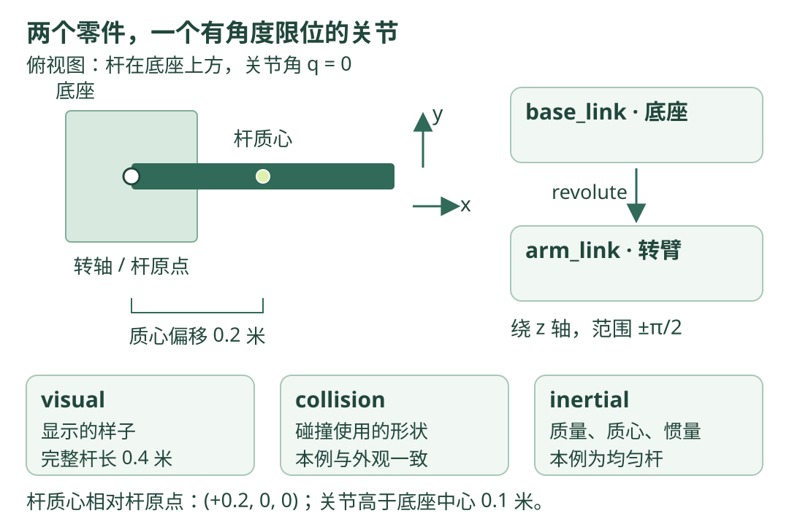

# 09 · URDF：用文字描述机器人有哪些零件

!!! tip "这一章的目标"

    看懂一份由底座和转臂组成的完整描述文件：哪个零件连接哪个零件，连接点在哪里，能绕什么轴转动，以及外观、碰撞和质量分别写在哪里。

    **前置知识**：[坐标系](frames.md) 与 [tf2](tf2.md)。本章以 ROS 2 Jazzy 的 URDF 使用方式为参考；先阅读 XML 和图解，不需要安装建模软件或连接机器人。

## URDF 是说明书，不是运动程序

URDF 全称为 Unified Robot Description Format，可以先理解为“机器人零件和连接关系的描述格式”。它用 XML 文本表达形状、关节和物理属性。

比如桌上有一个底座，底座上安装一根能左右摆转的直杆：底座和杆各是一个 `link`，它们之间的连接是一个 `joint`。

文件说明“允许怎样连接和运动”，不会自己不断更新关节角，也不会自动生成电机控制程序。解析、显示、碰撞检查和仿真各由对应工具负责。

## 看图：两个 link，由一个 joint 连接

{ .learning-figure }

[打开大图](../assets/learning/robotics-urdf.svg)

图显示关节角为 0 时的形状。底座坐标系原点放在底座中心，杆坐标系原点放在转轴处；杆的几何中心和质心都在杆坐标系的 x=0.2 米处。

## XML 先读成括号

`<link name="arm_link">` 表示开始描述一个零件；`</link>` 表示描述结束。`name="arm_link"` 是属性，给这个零件起名字。

`<mass value="1.0"/>` 是没有内部内容的标签，结尾的 `/>` 表示“这条写完了”。`<!-- ... -->` 是给人看的注释，解析器不把它当作几何或物理参数。

同一文件里的名字必须前后一致。`arm_link` 和 `arm` 不是同一个名字；关节引用一个不存在的零件，不能靠形状看起来相似来补救。

## 一个零件，为什么有三种描述？

| 元素 | 它解决什么问题 | 可以怎样类比 |
| --- | --- | --- |
| `visual` | 显示时长什么样 | 外观图 |
| `collision` | 碰撞检查用什么形状 | 判断能否占据这块空间的包络 |
| `inertial` | 质量、质心与转动惯量 | 这个零件推动和转动有多难 |

漂亮模型不等于物理模型完整。实际项目常让碰撞形状比视觉网格简单，以降低计算成本。本章三个部分采用同一个均匀长方体，便于核对。

### 本例的所有尺寸

| 零件 | 完整尺寸 x、y、z，单位米 | 质量 | 坐标系与质心关系 |
| --- | --- | --- | --- |
| 底座 `base_link` | `0.2 0.2 0.1` | 2 kg | 原点在几何中心，质心也在原点 |
| 转臂 `arm_link` | `0.4 0.04 0.04` | 1 kg | 原点在转轴；质心在 `(0.2, 0, 0)` 米 |

底座中心是 z=0；底座上表面是 z=0.05 米。关节放在底座坐标系 `(0,0,0.1)` 米，给杆留出高度。这里略去支撑柱的外观，关注连接关系。

## 完整文件：learning_arm.urdf

把以下内容作为一个完整文件阅读；若以后自己验证，可以保存到 `~/robotics_learning/learning_arm.urdf`。**本章不会把这个模型称作 Go2 或已完成的放牧机器人。**

```xml title="learning_arm.urdf · 完整文件"
<?xml version="1.0"?>
<robot name="learning_arm">
  <!-- 底座：0.2 × 0.2 × 0.1 米的均匀长方体。 -->
  <link name="base_link">
    <visual>
      <origin xyz="0 0 0" rpy="0 0 0"/>
      <geometry><box size="0.2 0.2 0.1"/></geometry>
      <material name="base_green">
        <color rgba="0.25 0.50 0.40 1"/>
      </material>
    </visual>
    <collision>
      <origin xyz="0 0 0" rpy="0 0 0"/>
      <geometry><box size="0.2 0.2 0.1"/></geometry>
    </collision>
    <inertial>
      <origin xyz="0 0 0" rpy="0 0 0"/>  <!-- 质心在底座原点。 -->
      <mass value="2.0"/>
      <inertia ixx="0.0083333333" ixy="0" ixz="0"
               iyy="0.0083333333" iyz="0" izz="0.0133333333"/>
    </inertial>
  </link>

  <!-- 转臂：原点在关节处，几何中心沿 x 方向偏移 0.2 米。 -->
  <link name="arm_link">
    <visual>
      <origin xyz="0.2 0 0" rpy="0 0 0"/>
      <geometry><box size="0.4 0.04 0.04"/></geometry>
      <material name="arm_green">
        <color rgba="0.12 0.28 0.23 1"/>
      </material>
    </visual>
    <collision>
      <origin xyz="0.2 0 0" rpy="0 0 0"/>
      <geometry><box size="0.4 0.04 0.04"/></geometry>
    </collision>
    <inertial>
      <origin xyz="0.2 0 0" rpy="0 0 0"/>  <!-- 不是关节原点。 -->
      <mass value="1.0"/>
      <inertia ixx="0.0002666667" ixy="0" ixz="0"
               iyy="0.0134666667" iyz="0" izz="0.0134666667"/>
    </inertial>
  </link>

  <!-- 有范围的转动关节，绕关节坐标系的 z 轴旋转。 -->
  <joint name="base_to_arm" type="revolute">
    <parent link="base_link"/>
    <child link="arm_link"/>
    <origin xyz="0 0 0.1" rpy="0 0 0"/>
    <axis xyz="0 0 1"/>
    <!-- 角度用弧度；effort 为 N·m，velocity 为 rad/s。 -->
    <limit lower="-1.5707963268" upper="1.5707963268"
           effort="0.5" velocity="1.0"/>
    <dynamics damping="0.1" friction="0"/>
  </joint>
</robot>
```

文件中的 `limit` 是描述里的边界，不意味着所有控制器都会自动替你限幅。实际执行仍要检查所用控制器和仿真工具怎样读取、执行这些约束。

## 三种 origin，千万别一起改

| origin 出现在哪儿 | 它相对谁，描述什么 | 本例 |
| --- | --- | --- |
| `joint/origin` | 零关节位置时，关节坐标系相对父 link 的位姿 | 转轴比底座中心高 0.1 米 |
| `visual/origin` | 显示形状相对本 link 坐标系的位置和姿态 | 杆中心比转轴向前 0.2 米 |
| `collision/origin` | 碰撞形状相对本 link 坐标系的位姿 | 与本例杆外观对应 |
| `inertial/origin` | 质心位置与惯性坐标系相对本 link 的位姿 | 均匀杆质心也在前方 0.2 米 |

若把杆的 `visual/origin` 改成 0，杆会围着关节左右各伸出一半，但关节本身的位置没有因此移动。若只改外观、不改碰撞形状，两套几何可能不再重合。

URDF 的 `rpy` 三个值以弧度表示绕 x、y、z 的固定轴旋转；本例全部为 0，因此只需要核对平移。官方 [视觉建模教程](https://github.com/ros2/ros2_documentation/blob/jazzy/source/Tutorials/Intermediate/URDF/Building-a-Visual-Robot-Model-with-URDF-from-Scratch.rst) 详细区分了零件外观原点和关节原点。

## 用手算检查零关节位置

当关节角 q=0，杆原点在底座坐标系 `(0,0,0.1)`，杆几何中心在杆坐标系 `(0.2,0,0)`，所以中心在底座中为 `(0.2,0,0.1)` 米。

当 q=π/2，即绕 z 轴正方向转 90°，杆中心的局部 `(0.2,0,0)` 旋转为 `(0,0.2,0)`，再加关节平移，得到 `(0,0.2,0.1)` 米。

这里“绕 z 正方向”按右手规则理解：右手拇指朝 z 正方向，四指弯曲的方向为正旋转。不要把角度值直接当成米。

## 惯量为什么不能随便写成 1？

质量告诉你平移有多难；惯量告诉你绕某条轴改变转动有多难。惯量单位是 `kg·m²`，尺寸不同的零件，即便同样重，惯量也不同。

对质量为 m、完整边长为 a、b、c 的均匀长方体，在**质心处、与边平行的坐标轴**下：

$$
I_{xx}=\frac{m(b^2+c^2)}{12},\quad
I_{yy}=\frac{m(a^2+c^2)}{12},\quad
I_{zz}=\frac{m(a^2+b^2)}{12}.
$$

杆的 `Izz = 1 × (0.4² + 0.04²)/12 = 0.013466…`。这正是 XML 中质心处的值；它**不是绕杆端转轴的惯量**。端部转轴的 z 惯量还要加 `m×0.2²`，约为 0.0534667。物理引擎结合质心偏移处理这一关系，不能把端部惯量再填回质心位置造成重复计算。

`ixy`、`ixz`、`iyz` 是惯量矩阵的交叉项；本例均匀长方体且轴与边平行，因此为零。任意形状并不一定为零。[官方物理属性教程](https://github.com/ros2/ros2_documentation/blob/jazzy/source/Tutorials/Intermediate/URDF/Adding-Physical-and-Collision-Properties-to-a-URDF-Model.rst) 说明了 `collision` 与 `inertial` 的作用。

## revolute 和 continuous 有什么区别？

| 类型 | 人话 | 常见例子 |
| --- | --- | --- |
| `fixed` | 焊死，不提供相对运动自由度 | 固定传感器支架 |
| `revolute` | 绕一根轴转动，有角度上下限 | 有机械限位的摆臂 |
| `continuous` | 绕一根轴转动，不设有限角度上下限 | 可连续转动的轮子 |
| `prismatic` | 沿一根轴滑动，有位移上下限 | 直线滑台 |

本例使用 `revolute`，不能一边写 `continuous`，一边解释“超过 ±90° 就由这个类型挡住”。`continuous` 仍可描述 effort 与 velocity；其区别是没有有限角度上下界，不是没有任何物理约束。

## 怎样从描述得到显示？

| 步骤 | 谁来做 | 输入与输出 |
| --- | --- | --- |
| 1 | URDF 解析工具 | 读取 XML，检查零件和关节关系 |
| 2 | 关节状态来源 | 提供 `base_to_arm` 的当前角度，不是只给目标角 |
| 3 | `robot_state_publisher` | 用描述与关节状态计算 link 间关系，发布到 tf2 |
| 4 | RViz 等显示工具 | 根据形状和对应坐标关系显示模型 |

固定关节与可动关节的变换发布方式不同。可动关节需要当前 `JointState`；一份静止的 XML 自己不会给出“这根杆现在转到哪里”。官方 [robot_state_publisher 说明](https://github.com/ros/robot_state_publisher/tree/jazzy) 描述了这条数据链。

如果后来加入世界中的位置，还需要确定 `world` 或 `map` 与底座之间的关系。URDF 根 link 的名字叫 `base_link`，并不自动表示底座焊在世界中，也不自动决定模型如何落地。

## 先做不依赖 ROS 的文本检查

下面片段适合读懂“完整 XML 文件里有哪些名字”。若自己验证，放在与 `learning_arm.urdf` 同一目录下，保存为 `inspect_urdf.py`。它只检查基础 XML 和列出结构，**不替代完整 URDF 解析或动力学检查**。

```python title="inspect_urdf.py · 完整文件，仅使用标准库"
from pathlib import Path
import xml.etree.ElementTree as ET

# 按本脚本的位置寻找文件，不依赖终端从哪个目录打开。
urdf_path = Path(__file__).with_name("learning_arm.urdf")
root = ET.parse(urdf_path).getroot()  # 标签没正确闭合时会报 XML 错误。
print("机器人：", root.attrib["name"])
print("零件：", [link.attrib["name"] for link in root.findall("link")])
for joint in root.findall("joint"):
    parent = joint.find("parent").attrib["link"]
    child = joint.find("child").attrib["link"]
    print("连接：", parent, "->", child, joint.attrib["type"])
```

```text title="根据完整文件得到的预期输出"
机器人： learning_arm
零件： ['base_link', 'arm_link']
连接： base_link -> arm_link revolute
```

读出名字并不证明惯量正确或仿真稳定。理解后继续用手算核几何尺寸，再由具体工具核模型；不要把“XML 能读”理解为“机器人物理一定正确”。

## 练习：把杆缩短一半

保持质量 1 kg，横截面仍为 `0.04 × 0.04` 米，将杆长度改为 0.2 米。应改哪些字段？新质心在哪里？新 `Izz` 是多少？

??? note "展开参考答案"

    `visual` 和 `collision` 的 box 完整尺寸改为 `0.2 0.04 0.04`；两者的 x 偏移改为 0.1 米。`inertial/origin` 的 x 也改为 0.1 米。

    新 `Izz = (0.2²+0.04²)/12 = 0.0034666667 kg·m²`，`Iyy` 相同。`Ixx` 仍为 `0.0002666667 kg·m²`，因为横截面和质量未变。

    关节位置不因杆变短而自动变化。本题明确保持总质量不变，相当于更短、更密的教学杆；如果保持材料密度，质量也应改变。

## 常见错误与自测

| 错误 | 为什么不对 |
| --- | --- |
| URDF box 尺寸按半长填写 | `size` 是完整边长，会把模型缩小一半 |
| 几何单位是厘米，数值却按米读取 | 长度差 100 倍，惯量等属性也会不匹配 |
| 在惯量中填 0、负数或随便写的巨大值 | 可能不符合实际零件，甚至导致工具拒绝或仿真异常 |
| 改 visual 后以为 collision 自动跟随 | 两者独立描述，要分别检查 |
| 多个根或连接成环 | 普通 URDF 描述树需要唯一根，关节引用要一致 |

自测：能否指出杆的转轴与质心？能否说明角度 0 和 π/2 时杆中心的坐标？能否解释显示模型与控制电机之间还差哪些程序？

[返回学习路线](index.md) · [上一章：tf2](tf2.md) · [下一章：MuJoCo 仿真基础 →](mujoco.md)
