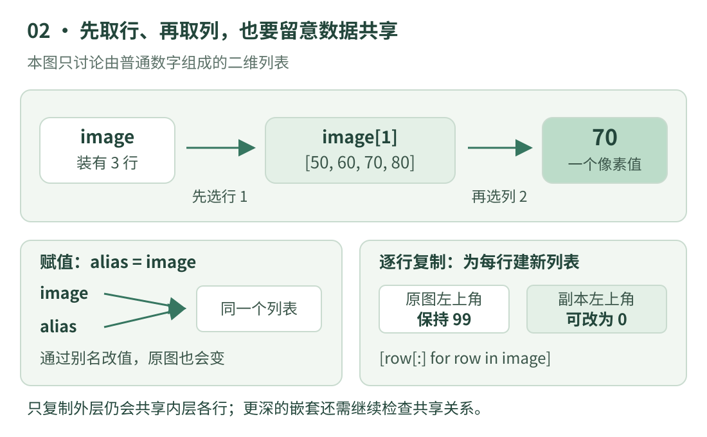

# 02 · Python 与数组：把视觉代码读成一句句话

上一课我们会从小图中取一个数。这一课要解决另一个常见困惑：**看见 `image[y0:y1, x0:x1]`、`shape`、`copy()`，到底应该怎样读？** 不先解释这些语法，后面一句“取感兴趣区域”就容易变成死记代码。

本课先用 Python 3 的嵌套列表做可独立运行的演示，再认识 NumPy 数组的对应写法。两种容器有相似处，也有区别；本课不需要安装 NumPy 或 OpenCV。

## 看图：从外层列表一直找到一个像素

{ .learning-figure }

[打开大图](../assets/learning/cv-arrays.svg)

把三行灰度值装在 `image` 中，相当于一个装着三张小纸条的大盒子；每张纸条按顺序写四个数。“外层”管理有哪些行，“内层”管理每行的值。`image[1][2]` 先拿中间那张纸条，再取其中索引 2 的值，所以得到 70。

这个比喻也解释了数据共享：让另一个名字指向同一个盒子，盒子里的纸条并没有自动复印。若只换一个外盒、里面仍装着原来的纸条，改纸条上的数，原盒中看到的内容也会变。稍后会用代码把它验证出来。

## 最小的语法积木

`image`、`height` 都是变量名，帮我们记住某个对象。`=` 把右侧计算结果交给左侧名字；`==` 才是在比较相等。`height = len(image)` 的阅读顺序是从右边开始：先数 `image` 里有几个元素，再把这个数量记为 `height`。

`[10, 20, 30, 40]` 是列表；`(3, 4)` 是一个元组，本课用它记录两个尺寸。**元组**中的位置不能直接重新赋值，适合打包一组信息；它不代表数学乘法。`height, width = (3, 4)` 叫解包，就是把右侧第一个值给 `height`、第二个值给 `width`。

`image[0]` 中方括号表示取元素。`row.append(value)` 中的点号表示找到这个列表提供的操作 `append`，括号里给出要追加的值。“调用函数或方法”可以先理解成：把参数交给一个已有操作，请它做事。中文注释从 `#` 开始，只是解释，程序不会执行注释。

这些语法都可在 Python 官方入门文档中逐项查到；先掌握本课用到的一小组，比一开始记住所有容器方法更实用。[Python 3.14 数据结构](https://docs.python.org/3.14/tutorial/datastructures.html)

## 切片：起点包含，终点不包含

若一行是 `10、20、30、40`，写 `row[1:3]` 就取索引 1 和索引 2，得到 `20、30`；不取索引 3。区间也可写成 `[1, 3)`：左方括号表示包含，右圆括号表示不包含。这样长度刚好是 `3 - 1 = 2`。

给三行图像做 `image[1:3]`，先选出行索引 1 和 2，再对这两行各做 `[1:3]`，最终得到 `[[60, 70], [100, 110]]`。注意，**列表不能直接用 `image[1:3, 1:3]` 取二维区域**。这个逗号索引是后面 NumPy 数组支持的写法，不能因为长得像就互换。

Python 切片可以容忍某些越界终点，例如一行只有 4 个值，`row[1:99]` 仍会返回从索引 1 到末尾的值。初学时这很方便，但也可能掩盖坐标错误。若业务要求“裁出固定宽高”，还应检查边界和裁剪后的实际尺寸。

## 先手算：局部区域的大小与平均值

沿用第一课的小图，取行 `[1, 3)`、列 `[1, 3)`。结果有 `3 - 1 = 2` 行、`3 - 1 = 2` 列，4 个数之和为 `60 + 70 + 100 + 110 = 340`，平均为 85。

此处“形状”表示各方向的长度，不是说画面中物体是圆形还是方形。灰度图的形状常记为 `(高, 宽)`，本例是 `(3, 4)`，区域是 `(2, 2)`。如果是常见的交错存储三通道彩色数组，形状通常是 `(高, 宽, 3)`；它仍然只有高乘宽个像素，每个像素存 3 个通道值。

## 完整示例：切片、循环与真正的副本

```python title="数组阅读 · 标准库独立教学示例"
image = [
    [10, 20, 30, 40],
    [50, 60, 70, 80],
    [90, 100, 110, 120],
]

height = len(image)
width = len(image[0])
print("原图形状：", (height, width))

# 取行索引 1、2，每行再取列索引 1、2。
# 用展开的循环，先看清步骤，再认识简写形式。
roi = []
for row in image[1:3]:
    selected_row = row[1:3]
    roi.append(selected_row)
print("区域：", roi)

# sum(row) 求一行之和；再把各行的和累加。
total = 0
for row in roi:
    total += sum(row)
count = len(roi) * len(roi[0])
print(f"区域平均值：{total / count:.1f}")

# 赋值并不会复制图像；alias 与 image 指向同一个列表。
alias = image
alias[0][0] = 99
print("改别名后原图左上角：", image[0][0])

# 只复制外层列表，内层各行依然共享。
outer_copy = image.copy()
outer_copy[0][1] = 88
print("改外层副本后原图下一格：", image[0][1])

# 对本例的“二维数值列表”，逐行切片会新建各行。
# 下式等价于循环中对每行 row[:]，再 append 到新列表。
independent_copy = [row[:] for row in image]
independent_copy[0][0] = 0
print("独立副本左上角：", independent_copy[0][0])
print("原图左上角：", image[0][0])
```

预期输出：

```text
原图形状： (3, 4)
区域： [[60, 70], [100, 110]]
区域平均值：85.0
改别名后原图左上角： 99
改外层副本后原图下一格： 88
独立副本左上角： 0
原图左上角： 99
```

先看前三行输出，确认裁剪和平均值。再看后四行：它们刻意展示共享带来的影响。原图第一个数先被改为 99，之后独立副本把自己的对应位置改为 0，原图仍为 99。**最后的 99 是正确结果**，并不是我们忘了改原图。

`[row[:] for row in image]` 是列表推导式。先读右半句“依次取 `image` 的每一行”，再读左半句“把这一行切片得到的新列表放进结果”。它适用于本例只含不可变数字的二维列表；若每个像素自己又是可变列表，例如三通道的 `[R, G, B]`，仅逐行复制仍可能共享更深处的对象，不能把本例结论推广到任意嵌套层数。

## 对照 NumPy：同样的任务，更适合大图的容器

NumPy 的 `ndarray` 是多维数组。本课不要求安装它，但真实 Python 视觉项目经常用到，先把常见语法读懂。`shape` 给各轴长度，`dtype` 说明元素类型，例如 `uint8` 指 8 位无符号整数。下面是假定 `image` 已经是有效灰度 `ndarray` 的**阅读片段**，不是上面的列表程序续写。

```python title="NumPy 写法对照 · 阅读片段，未在本站运行"
# 前提：image 是二维 NumPy 灰度数组，不是嵌套列表。
height, width = image.shape
roi = image[1:3, 1:3]     # 逗号前选行，逗号后选列。
safe_roi = roi.copy()     # 复制数组数据，以便独立修改这个区域。
mean_value = roi.mean()   # 调用数组的求平均方法。
```

NumPy 的这种基本切片通常产生共享数据的**视图**：可把它想成对原数组某个区域开的窗口；修改窗口中的值可能影响原数组。`copy()` 创建独立的数组数据。其他索引方式的规则可能不同，例如某些高级索引会复制，因此不能把“所有索引都共享”当通则。[NumPy 数组入门](https://numpy.org/doc/stable/user/quickstart.html)

再记一个容易混淆的例子：Python 列表 `[1, 2] + [3, 4]` 会拼接成四个元素；数值 NumPy 数组相加通常是对应位置相加，得到 `[4, 6]`。**同一个符号，含义与对象类型有关。** 读代码时先确定“它究竟是什么类型”，比背一串公式更有效。

## 动手练习：写清每一层究竟取了什么

<div class="practice-card" markdown="1">

<p class="practice-kicker">练习 02 · 从切片读出区域</p>
<p class="practice-title">从原始小图裁出右上角 2 × 2 区域</p>

请使用本课最开始、尚未修改的图像，取最上面两行、最右边两列。写下行区间、列区间、完整结果和平均值，再用循环验证。

??? tip "先看提示"

    上面两行是 `[0:2]`，右边两列的索引是 2 和 3。终点不包含，因此列区间的终点要写 4。

??? example "展开参考答案"

    行 `[0:2]`、列 `[2:4]`，结果是 `[[30, 40], [70, 80]]`，总和 220，平均值 55.0。

    ```python title="练习答案 · 接在尚未修改的 image 后"
    # 每行各取右边两列，再把这两行放进新的列表。
    top_right = [row[2:4] for row in image[0:2]]
    print(top_right)
    # 此处明确选到了两行两列，所以有四个数。
    print(sum(sum(row) for row in top_right) / 4)
    ```

    这段是接在原始 `image` 定义后的答案片段。不要接到主程序末尾，因为主程序为展示共享已经把左上角的两个数改过；本题虽然选到的区域未受影响，养成区分输入状态的习惯仍很重要。

</div>

学完这一课，看到陌生表达式时先问三个问题：对象是列表还是数组？索引先选哪个轴？结果与原数据共享吗？这三步能解释大量视觉程序中的基础错误。

[返回视觉学习路线](index.md) · [上一课：01 · 图像、像素与坐标](images.md) · [下一课：03 · 颜色、灰度与数值范围 →](color.md)
