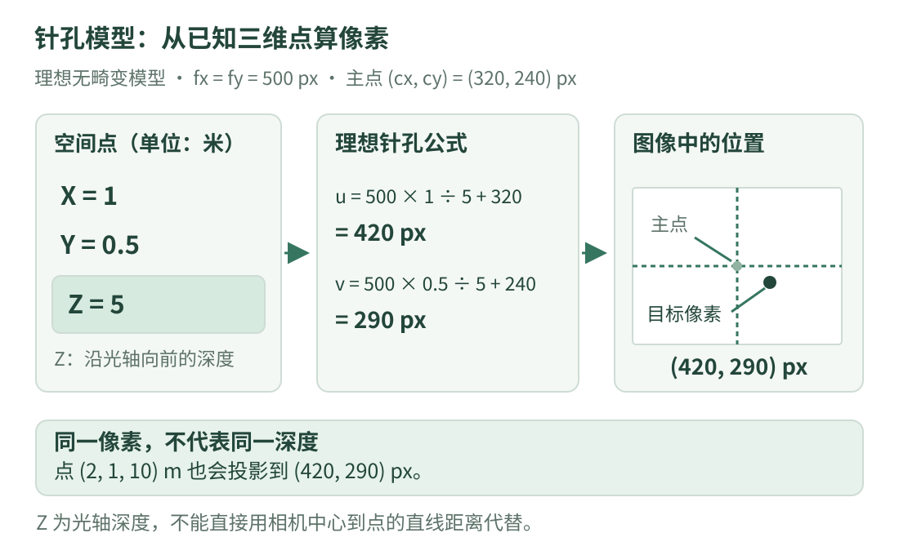

# 08 · 相机成像与标定：像素怎样与空间联系起来

照片里的一个点在 `(420,290)`。这说明它位于哪一个像素位置，却没有直接告诉你它离相机几米。想把图像和空间联系起来，先要回答：相机怎样把三维点变成二维位置？相机自己的参数是什么？这些参数怎样检查？

!!! tip "学习目标与前提"

    先读 [07 · 特征与匹配](features.md)，知道图像位置通常用 `(u,v)` 表示。本课用理想针孔模型讲清楚输入、输出与单位，再介绍真实镜头的畸变和标定流程。

    数字都是教学设定，不来自实际设备。完整代码只用 Python 标准库演示投影和误差，不读取相机、不完成真实标定。

## 1. 看图：三维到二维会丢掉一部分信息

{ .learning-figure }

[打开大图](../assets/learning/cv-camera.svg)

先把相机想成一个固定的观察点。空间中同一条视线上的两个点，可能在图像上落到同一个位置。因此从已知三维点算像素，和只凭像素找三维位置，是不同难度的问题。

我们采用常见计算机视觉坐标约定：相机坐标的 $X$ 向右、$Y$ 向下、$Z$ 沿光轴向前；图像的 $u$ 向右、$v$ 向下。换项目时必须再查约定，不能只凭字母猜方向。

## 2. 针孔模型：先除深度，再换成像素

理想模型中，忽略镜头畸变，并采用零倾斜的内参形式：

$$u=f_x\frac{X}{Z}+c_x,\qquad v=f_y\frac{Y}{Z}+c_y$$

| 符号 | 本章含义 | 单位或要求 |
| --- | --- | --- |
| $X,Y,Z$ | 三维点在相机坐标中的分量 | 都用米；本章只接受 $Z>0$ |
| $X/Z,Y/Z$ | 归一化成像坐标 | 无单位，不是像素索引 |
| $f_x,f_y$ | 水平、竖直方向的焦距参数 | 像素；不能直接填镜头的毫米焦距 |
| $c_x,c_y$ | 主点在图像中的位置 | 像素，不保证恰好等于图像中心 |
| $u,v$ | 投影后的像素坐标 | 可为小数，不保证落在有效画面范围 |

从这个公式可以看出，同样的 $X$，$Z$ 越大，偏离主点的像素量就越小。远处物体看起来小，正与“先除深度”的操作有关。

内参常压缩写成矩阵：

$$K=\begin{bmatrix}f_x&0&c_x\\0&f_y&c_y\\0&0&1\end{bmatrix}$$

暂时不会矩阵乘法也没关系：这张表把横向缩放、纵向缩放和主点偏移集中保存起来。完整坐标关系与模型定义可对照 [OpenCV 4.11 相机模型参考](https://docs.opencv.org/4.11.0/d9/d0c/group__calib3d.html)。

### 跟着算一次投影

设 $f_x=f_y=500$ 像素，$c_x=320,c_y=240$ 像素。一个点在相机坐标中为 `(1.0,0.5,5.0)` 米：

1. 横向归一化位置为 `1/5=0.2`。
2. 横向像素偏移为 `500×0.2=100`，加主点得到 `u=420`。
3. 竖向归一化位置为 `0.5/5=0.1`。
4. 竖向像素偏移为 `500×0.1=50`，加主点得到 `v=290`。

`(2.0,1.0,10.0)` 米也投影到 `(420,290)`，因为两组比值相同。单个像素没有告诉我们这两个点谁在前、谁在后。

## 3. 反过来算：必须额外知道什么

如果已经知道点的光轴深度 $Z$，并且像素坐标符合上面的理想无畸变模型，就可以移项：

$$X=\frac{u-c_x}{f_x}Z,\qquad Y=\frac{v-c_y}{f_y}Z$$

这里 $u-c_x$ 是离主点的横向像素偏移；除以 $f_x$ 得到无单位比例；再乘米制 $Z$，才得到米制 $X$。代入 `(420,290)` 与 `Z=5`，算回 `X=1、Y=0.5` 米。

**光轴深度不是到相机中心的直线距离。** 本点的直线距离为：

$$r=\sqrt{X^2+Y^2+Z^2}=\sqrt{1+0.25+25}\approx5.123\ \mathrm{m}$$

如果设备给的是 $r$，直接把它填入 $Z$ 会算错。必须先核对设备输出的定义，以及它与当前像素、时刻和坐标系的对应关系。

## 4. 内参与外参：一份管成像，一份管坐标关系

内参描述三维相机坐标怎样变成图像坐标。外参描述一个参考坐标系中的点怎样转换到相机坐标系。

一种常见写法为：

$$P_c=R P_w+t$$

$P_w$ 是点在参考坐标系中的坐标，$P_c$ 是同一点在相机坐标系中的坐标，$R$ 负责旋转，$t$ 负责平移。这里明确是“参考系到相机系”的方向。它的 $t$ 通常不能直接当作“相机在参考系中的位置”；逆变换为 $P_w=R^T(P_c-t)$，所以相机中心在参考系的位置为 $-R^Tt$。初学时不必背推导，但要先看坐标变换的方向再使用参数。

给标定板拍多张照片时，同一台固定配置相机可以共享内参，每张照片中板与相机的相对关系却会变化，因此每张图可以有自己的外参。外参包括旋转和平移，不能只用三个平移量概括；它随所选参考系与相机之间的关系而变化。

## 5. 真实镜头为什么还需要畸变参数

理想针孔模型假定某些直线投影后仍是直线，真实镜头可能让画面边缘出现弯曲。常见模型包含径向和切向畸变，用额外参数描述偏移。它与相机晃动造成的模糊、曝光过度和读图失败是不同问题。

**去畸变**是按选定模型重新映射图像或点。它不会凭空恢复遮挡的细节，也不会自动得到深度。处理后的像素对应哪组新内参、是否又裁剪过，都要记录；不能把去畸变后的像素再当成原始像素重复纠正。OpenCV 的具体流程见 [官方相机标定教程](https://docs.opencv.org/4.11.0/dc/dbb/tutorial_py_calibration.html)。

当图像缩放时，焦距和主点的像素表示也要随所用像素坐标映射调整。例如在理想连续坐标按 0.5 缩放的约定下，`500→250`，`320→160`。但真实接口可能使用像素中心偏移，裁剪又会改变坐标原点，所以实际应把缩放与裁剪映射完整写出，再更新内参，不能只记住“所有数字除以二”。

## 6. 标定与验证：做题和检查不是同一步

可以把标定理解成“用已知形状的图案，估计相机参数”，把验证理解成“拿额外观测检查这些参数解释图像的能力”。

| 阶段 | 具体做什么 | 需要留下什么 |
| --- | --- | --- |
| 准备 | 确认标定图案尺寸、平整度与角点顺序 | 尺寸单位、图案定义、拍摄配置 |
| 采集 | 拍多个角度和画面位置，保留清晰图像 | 原始分辨率、焦距/对焦状态 |
| 提取 | 建立已知图案点与像素点的一一对应 | 成功检测结果和被拒绝图像 |
| 估计 | 按模型求内参、畸变及每张图的外参 | 模型、配置、参数、拟合误差 |
| 验证 | 用额外图像检查残差和边缘区域 | 与标定数据分开的检查结果 |

棋盘格常说的“7×6”可能指每行 7、每列 6 个**内部交点**，不是纸张上方格个数，具体必须查检测接口。格子物理边长的单位影响得到的平移尺度；点顺序、行列数量和单位不一致，都会让后面的结果失去正确含义。

只反复选择让误差好看的图像，并不能证明真实效果好。画面中心误差小，也不保证边缘好；全部照片都正对图案，可能缺少足够几何变化。保持设备配置一致，并覆盖需要使用的视场位置，比背一个“至少几张”的数字更有帮助。

## 7. 完整代码：投影、回算与独立误差

下面直接给定教学内参；**没有估计任何参数**，所以不能把它称为标定程序。后面的两个点和手工像素观测用来演示“如何计算一种误差”，不代表实际相机的精度。

```python title="理想相机几何与重投影误差 · 独立教学示例"
import math


def project(point, fx, fy, cx, cy):
    # 输入点必须已经在相机坐标系，三项统一使用米。
    x, y, z = point
    if not all(math.isfinite(value) for value in (x, y, z, fx, fy, cx, cy)):
        raise ValueError("输入必须是有限数")
    if z <= 0 or fx <= 0 or fy <= 0:
        raise ValueError("本例要求 Z、fx、fy 为正数")
    # 忽略畸变、无倾斜项；不把小数坐标强行转成整数。
    return fx * x / z + cx, fy * y / z + cy


def backproject(u, v, z, fx, fy, cx, cy):
    # z 是已知光轴深度，不是相机中心到点的直线距离。
    if not all(math.isfinite(value) for value in (u, v, z, fx, fy, cx, cy)):
        raise ValueError("输入必须是有限数")
    if z <= 0 or fx <= 0 or fy <= 0:
        raise ValueError("本例要求 Z、fx、fy 为正数")
    return (u - cx) * z / fx, (v - cy) * z / fy, z


fx, fy, cx, cy = 500.0, 500.0, 320.0, 240.0
point = (1.0, 0.5, 5.0)
u, v = project(point, fx, fy, cx, cy)
print(f"像素: ({u:.3f}, {v:.3f})")
x, y, z = backproject(u, v, 5.0, fx, fy, cx, cy)
print(f"已知深度回算: ({x:.3f}, {y:.3f}, {z:.3f}) m")
distance = math.sqrt(sum(value * value for value in point))
print(f"光轴深度: {point[2]:.3f} m, 直线距离: {distance:.3f} m")

# 假想的独立检查点；参数固定，不用这些观测重新拟合。
checks = [
    ((1.0, 0.5, 5.0), (423.0, 294.0)),
    ((0.0, 0.0, 2.0), (320.0, 242.0)),
]
squared_errors = []
for number, (point_3d, measured_uv) in enumerate(checks, start=1):
    predicted_u, predicted_v = project(point_3d, fx, fy, cx, cy)
    measured_u, measured_v = measured_uv
    du = measured_u - predicted_u
    dv = measured_v - predicted_v
    error_squared = du * du + dv * dv
    squared_errors.append(error_squared)
    print(f"检查点 {number}: 像素距离误差={math.sqrt(error_squared):.3f} px")

# 本例 RMS：先对每点二维误差的平方求平均，再开平方。
rms = math.sqrt(sum(squared_errors) / len(squared_errors))
print(f"逐点二维距离 RMS: {rms:.3f} px")
```

预期输出：

```text
像素: (420.000, 290.000)
已知深度回算: (1.000, 0.500, 5.000) m
光轴深度: 5.000 m, 直线距离: 5.123 m
检查点 1: 像素距离误差=5.000 px
检查点 2: 像素距离误差=2.000 px
逐点二维距离 RMS: 3.808 px
```

第一个检查点预测 `(420,290)`，观测 `(423,294)`，两方向差为 3 和 4，距离是 `sqrt(3²+4²)=5` 像素。第二个点预测 `(320,240)`，观测 `(320,242)`，误差为 2 像素。

本例 RMS 公式为：

$$\mathrm{RMS}=\sqrt{\frac{1}{N}\sum_{i=1}^{N}\left[(u_i-\hat u_i)^2+(v_i-\hat v_i)^2\right]}$$

$N$ 是检查点数；不带帽的是观测，带帽的是模型预测。本例 `sqrt((25+4)/2)=sqrt(14.5)≈3.808`。它既不是两点距离的算术平均数 3.5，也不是按四个坐标分量平均后的数；报告误差时要写清统计定义和单位。

## 8. 动手练习：像素一样，深度不同

<div class="practice-card" markdown="1">

<p class="practice-kicker">先确认已知量，再代入公式</p>
<p class="practice-title">同一个像素 (420,290)，若已知 Z=10 米，X、Y 应是多少？</p>

使用本课相同内参。解释为什么结果与 `Z=5` 米不同，而投影像素仍相同。

??? tip "展开提示"

    `(u−cx)/fx=0.2`，`(v−cy)/fy=0.1`。这两个比例只约束方向。

??? example "展开参考答案"

    $X=0.2×10=2$ 米，$Y=0.1×10=1$ 米。`(1,0.5,5)` 与 `(2,1,10)` 在相机中心出发的同一条视线上；单个像素本身没有提供哪一个深度正确的证据。

</div>

## 9. 使用前先检查什么

先查像素来自原图还是处理后的图，再查内参分辨率、裁剪和畸变模型。使用三维坐标时，确认单位、坐标系方向，以及输入深度是否真是 $Z$。像素误差小只说明在所检查数据和模型下投影一致，不自动保证任意场景的米制距离准确。

下一课进入神经网络：它可以学习从像素提取特征，但同样需要明确输入、输出和验证数据，不能跳过这些基础约定。

---

[返回视觉学习路线](index.md) · 上一课：[07 · 特征与匹配](features.md) · 下一课：[09 · 神经网络入门](networks.md) →
