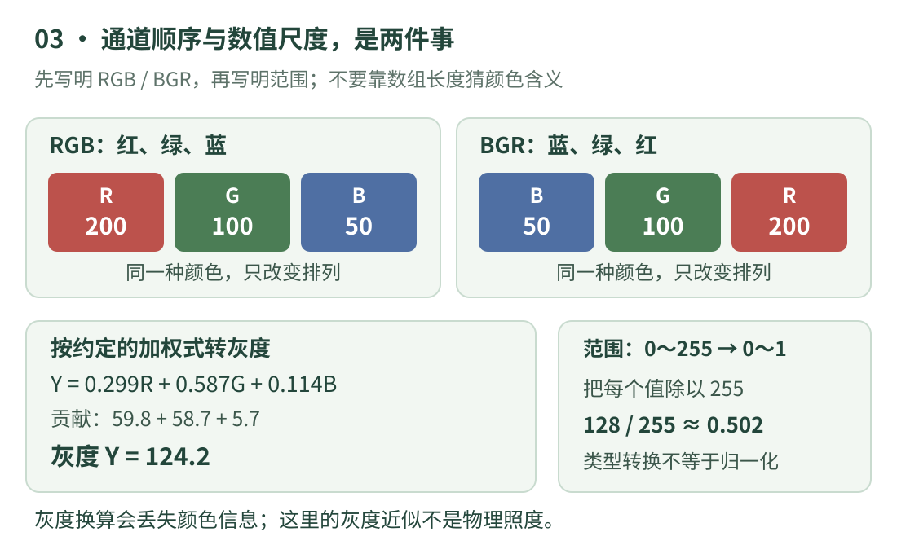

# 03 · 颜色、灰度与数值范围

同一个像素明明没有换位置，为什么换一个库显示就从红色变成了蓝色？为什么给 250 加 10，有的代码得到 255，有的得到 4？这一课先把**通道顺序、灰度换算、数据类型**分开讲清楚。它们常同时出现在一行视觉代码里，但实际上是三件事。

示例使用 Python 3 的普通整数、浮点数和列表；OpenCV 对照采用 4.13 文档中的约定。本课不安装图像库，不读取文件，所有数字都能手算。

## 先看图：一个像素为什么有三个数

{ .learning-figure }

[打开大图](../assets/learning/cv-color.svg)

**通道**可理解为图像里分别保存的一份分量。RGB 是红 Red、绿 Green、蓝 Blue 三个分量；本课用 `(200, 100, 50)` 表示红分量为 200、绿分量为 100、蓝分量为 50。它是一个像素的三个值，不是三个相邻像素。

如果接收端要求按 BGR 读取，同一颜色的数据应排列为 `(50, 100, 200)`。这只是把三个分量的位置换掉，值所代表的颜色分量并没有改变。把 RGB 的 `(200, 100, 50)` 原样交给 BGR 接口，接收端就会把第一个 200 当蓝分量，于是颜色变了。

OpenCV 的常见默认彩色读图结果按 BGR 排列，但“所有库、所有图像一定都是 BGR”是错误的。文件、相机接口、神经网络输入和绘图库可能约定不同；还可能带第四个透明度通道 Alpha。看见数组最后一维长度为 3，只能确定有三个分量，不能单凭长度确定它们是 RGB、BGR 还是其他颜色表示。[OpenCV 颜色转换说明](https://docs.opencv.org/4.13.0/de/d25/imgproc_color_conversions.html)

## 灰度不是把三个数随便平均

想把彩色图简化成一张明暗表，可以按指定规则合成一个数。这里采用 OpenCV 文档给出的常用 RGB 到灰度加权式：

\[
Y = 0.299R + 0.587G + 0.114B
\]

`R、G、B` 是三个输入分量，`Y` 是这次换算得到的灰度量。三个权重相加为 1，所以黑 `(0,0,0)` 得到 0，白 `(255,255,255)` 得到 255。绿色分量的系数较大，因此同为 255 的纯绿与纯蓝，按这个规则换成灰度后并不一样亮。

给本课颜色代入：红色贡献 `0.299 × 200 = 59.8`，绿色贡献 `0.587 × 100 = 58.7`，蓝色贡献 `0.114 × 50 = 5.7`，相加是 **124.2**。若直接算三者平均，得到约 116.67，那是另一种规则，不能声称它等于本式结果。

这里的 `Y` 是对输入编码分量做的灰度近似，**不是测量出来的物理照度或严格的线性光亮度**。实际颜色管理还涉及颜色空间、传递函数、白点等。初学先把“我按什么输入顺序、什么公式、什么数值范围进行处理”写明，比提前背许多颜色术语更实用。

转换成灰度会损失颜色信息。两块颜色不同的区域可能得到相同或很接近的灰度，后面只看灰度便无法恢复它们原本的颜色。做算法时要根据任务选择：边缘练习可先用灰度；若目标和背景主要靠颜色区分，直接丢掉颜色可能让任务更难。

## 数值范围：0～255 与 0～1 说的是不同表示

**数据类型**说明程序允许怎样存和运算这些数。`uint8` 的意思是“8 位无符号整数”：只能表示 0～255。Python 的普通 `int` 并不是这种固定 8 位类型，所以 `250 + 10` 会正常得到 260；不要用 Python 整数的结果猜测所有图像数组的行为。

**归一化**在本课只指一件明确的事：把 0～255 的值除以 255，得到 0～1 范围的浮点数。例如 0 变成 0，255 变成 1，128 变成约 0.502。它不意味着“图片已经更准确”，只是换了一套数值尺度。有些模型还要求减均值、除标准差，那是另外的预处理，必须遵循具体模型的输入约定。

改变表示时也要改变阈值。原来比较 `value >= 128`，除以 255 后应比较 `value >= 128 / 255`。若图像已经在 0～1，却继续和 128 比，当然一个位置也达不到；这不是目标消失了，而是两边单位不一致。

## 为什么“加亮 10”可能出现不同结果

先只问一个数：250 加 10 数学上等于 260。若输出被要求仍是 8 位数，需要规定超范围怎么办。

**饱和处理**把太大的值截到最大值，260 就变为 255；太小的值截到 0。**环绕处理**相当于取 256 的余数，260 会变为 4，视觉上可能从亮变暗。OpenCV 的 `cv.add` 与常见 NumPy `uint8` 数组加法在这里有不同约定，不能把二者当作所有情况下都可互换的表达式。[OpenCV 图像算术操作](https://docs.opencv.org/4.13.0/d0/d86/tutorial_py_image_arithmetics.html)

本课选择“先在 Python 普通整数中计算，再明确截断”，让边界行为直接看得见。它是加常数的教学模型，不等于完整的曝光、照明校正或相机成像过程；某些值达到 255 后，原来超过多少已经无法从截断后的数恢复。

## 完整示例：每一步都明确输入与输出

```python title="颜色与范围 · 标准库独立教学示例"
# 本课明确使用 RGB 顺序；一个元组装一个像素的三个分量。
rgb = (200, 100, 50)
red, green, blue = rgb

# 改成 BGR 表示时，只交换分量排列，不改变它们的含义。
bgr = (blue, green, red)
print("RGB：", rgb)
print("BGR：", bgr)

# 用约定的灰度加权式；保留小数以便核对手算。
gray = 0.299 * red + 0.587 * green + 0.114 * blue
print(f"加权灰度：{gray:.1f}")

# 除以 255，明确把 [0, 255] 改成 [0, 1] 的浮点表示。
normalized = []
for value in rgb:
    normalized.append(value / 255.0)
print("归一化：", ", ".join(f"{value:.3f}" for value in normalized))

# 下面的输入特意放在暗、中、亮三种位置。
values = [0, 100, 250]
offset = 10
brighter = []
for value in values:
    computed = value + offset      # 先用普通整数算，不会在 255 处环绕。
    clipped = max(0, min(255, computed))
    brighter.append(clipped)       # 再明确限制到 0～255。
print("加亮并截断：", brighter)

# % 是余数操作：这里用来单独演示“环绕”，不用于加亮结果。
print("260 饱和到八位范围：", max(0, min(255, 260)))
print("260 对 256 取余：", 260 % 256)
```

预期输出：

```text
RGB： (200, 100, 50)
BGR： (50, 100, 200)
加权灰度：124.2
归一化： 0.784, 0.392, 0.196
加亮并截断： [10, 110, 255]
260 饱和到八位范围： 255
260 对 256 取余： 4
```

`red, green, blue = rgb` 是上一课的解包：右边恰有三个分量，左边恰有三个名字。`min(255, computed)` 取两者中较小者，先压住上限；外面的 `max(0, ...)` 再压住下限。两步合起来才完整覆盖“过亮”和“过暗”。

`", ".join(...)` 把每个格式化后的数字字符串用逗号和空格连接起来；循环中的 `value` 此时来自 `normalized`，所以已经是 0～1 的数。格式 `:.3f` 只决定显示三位小数。若以后读取这个显示结果再继续计算，会比直接用原浮点数损失更多精度。

## 与真实 OpenCV 语句对照

下面只帮助读懂已有程序，假定 `image` 已经是有效的 8 位三通道 BGR 数组，`cv` 已由调用方导入。它是**阅读片段**，没有在本站运行。

```python title="OpenCV 颜色转换 · 阅读片段，未在本站运行"
# COLOR_BGR2GRAY 写明“输入按 BGR 解释，输出灰度”。
gray_image = cv.cvtColor(image, cv.COLOR_BGR2GRAY)

# 若后面的接口要求 RGB，要明确转换顺序。
rgb_image = cv.cvtColor(image, cv.COLOR_BGR2RGB)

# 类型转换之后再除法：结果是浮点数，尺度改为约定的 0～1。
float_image = image.astype("float32") / 255.0
```

`cvtColor` 中 `cvt` 表示 convert，即转换；第二个参数是转换规则。真正的 8 位灰度输出需要取整，库还可能用定点实现，所以不要把本课保留小数的 124.2 当成每次都会原样出现在 8 位输出中的数。核对库结果时，应同时核对输出类型、取整和具体版本。

`float32` 只是数据类型名；转成浮点数本身不会自动把 255 变成 1，是后面的 `/ 255.0` 做了尺度变换。同样，BGR 转 RGB 本身也不会自动归一化。读到一条预处理链，要分别列出“顺序变了什么、类型变了什么、数值尺度变了什么”。

## 动手练习：白色为何保持不变？

<div class="practice-card" markdown="1">

<p class="practice-kicker">练习 03 · 分清顺序与尺度</p>
<p class="practice-title">用白色检查公式，用边界检查截断</p>

先手算 RGB `(255, 255, 255)` 的加权灰度和归一化值。再用本课截断规则，计算灰度 5 加上偏移量 −10 的结果。最后解释：RGB 换成 BGR 会不会改变白色这个元组？

??? tip "先看提示"

    三个权重之和为 1。截断时先算 `5 + (-10)`，再与上下限比较。白色的三个分量相同。

??? example "展开参考答案"

    加权灰度为 `255 × (0.299 + 0.587 + 0.114) = 255`；三个归一化分量都是 1.0。

    `5 - 10 = -5`，截断后为 0。白色换成 BGR 仍是 `(255, 255, 255)`，因此只拿一张纯白图检查通道顺序，可能发现不了红蓝交换；应再用分量明显不同的颜色验证。

</div>

[返回视觉学习路线](index.md) · [上一课：02 · Python 与数组阅读](arrays.md) · [下一课：04 · 裁剪、缩放与插值 →](transforms.md)
