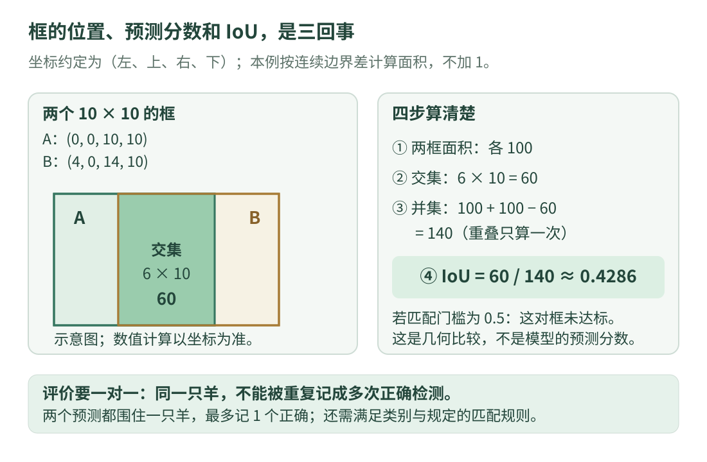

# 10 · 目标检测：从图片到位置框

上一课的分类回答“整张图片更像哪一类”。这次我们要回答：**一张照片里有几只羊，每只羊大致位于哪里？** 这就是目标检测。本课先不训练模型，而是学会读懂检测结果、核对框格式，并判断两个框是否足够接近。

前提是知道图像横坐标向右、纵坐标向下，以及列表和函数。程序只处理人为给定的框，使用 Python 标准语法；它不是检测器，也不需要图片或模型文件。学会这一层后，未来接任何检测框接口，都有一套检查方法。

## 看图：一个结果里不只有四个坐标

{ .learning-figure }

[打开大图](../assets/learning/cv-detection.svg)

一项常见检测结果包含**类别、分数、框**。类别说明模型认为是什么，分数用于表达模型对当前预测的偏好，框说明对象在图像中的大致范围。不同库的数据结构不同；例如 Torchvision 的一个检测接口分别返回 `boxes`、`labels`、`scores`，其中框用 `[x1,y1,x2,y2]` 表示。[官方检测输出说明](https://docs.pytorch.org/vision/stable/models/generated/torchvision.models.detection.fasterrcnn_resnet50_fpn.html)

如果只把四个数抄出来，不记录格式和原图尺寸，数据很容易接错。一个框中心在 `(120,80)`，单位通常是像素，它不等于“羊在机器人前方 120 米”。检测框也没有自动携带真实身份，下一帧的第一个框不一定还是同一只羊，这将在下一课讨论。

## 三种常见框格式，先翻译再使用

本页统一采用连续坐标的边界差，框写成 `(左,上,右,下)`，记作 `xyxy`。例如 `(10,20,50,60)`，宽为 `50−10=40`，高为 `60−20=40`。这里坐标描述几何边界，面积是 `40×40`，**不额外加 1**。一些历史接口采用包含端点的整数像素规则，因此接入时要查明约定，不能把两种规则混算。

另一个常见格式是 `(左,上,宽,高)`，通常叫 `xywh`。同一框写成 `(10,20,40,40)`。还有 `(中心x,中心y,宽,高)`，常叫 `cxcywh`，同一框写成 `(30,40,40,40)`。它们都用四个数，但第三、第四个数含义不同。

| 记法 | 四个数分别是什么 | 本页同一矩形 |
| --- | --- | --- |
| `xyxy` | 左、上、右、下 | `(10,20,50,60)` |
| `xywh` | 左、上、宽、高 | `(10,20,40,40)` |
| `cxcywh` | 中心x、中心y、宽、高 | `(30,40,40,40)` |

若数值归一化到 0～1，还要按图像宽高恢复。假设图像宽 200、高 100，归一化的中心 `(0.5,0.4)` 对应 `(100,40)` 像素；横纵分别乘宽、高，不能都乘 200。图像缩放、裁剪或补边后，也要按实际预处理还原坐标，单纯乘原图尺寸未必正确。

## 检测器大致在做什么？

可以先把常见检测流程理解成：图像转成数值，网络提取特征，再给出候选对象的位置与类别，最后按照模型约定整理输出。某些方法先提出候选区域再分类，某些方法直接预测大量位置，另一些采用集合预测；不同算法的中间结构和输出解释不能互相套用。

因此，本课不规定“所有检测器都有一个目标存在概率，再乘一个类别概率”。有些接口确实使用这样的组合，另一些分数定义不同。碰到实际模型时，应查该模型的官方输出文档，而不是看到 `confidence` 就使用网上某个固定公式。常见家族的差异可以先记为“它们怎样产生候选”，本课的坐标与评价思路仍然有用。

框通常只包围对象，不表示每个像素都属于对象。若要分开羊的精确轮廓，需要研究分割；若要区分腿或头等关键部位，可能需要关键点任务。**把输出目标说清楚，才能选对问题。** [Torchvision 官方任务分类](https://docs.pytorch.org/vision/stable/models.html)

## 分数阈值：留下多少预测，不等于证明多少正确

假设模型报出三项分数 `0.90、0.65、0.30`。阈值设为 `0.5` 时保留前两项，设为 `0.8` 时只保留第一项。提高阈值常会减少低分误报，也可能删掉真实但难辨认的羊；两者如何变化，要用固定数据实际计数。

分数 `0.9` 不代表框的 IoU 是 `0.9`，也不自动等于预测有 90% 的现实正确率。它首先是某个模型接口给出的分数。使用阈值前，要确定分数是不是已经做过归一化、类别分数怎样解释，并用验证集选择设置，而不是反复看测试集改阈值。

## IoU：两个框究竟重叠多少？

我们需要比较一个预测框和人工标注框。只看中心差不够：一个巨大的框也可能与真实框中心一致。**交并比 IoU** 同时考虑重叠面积和合并面积：

\[
\operatorname{IoU}(A,B)=\frac{|A\cap B|}{|A\cup B|}
=\frac{\text{交集面积}}{\text{A面积}+\text{B面积}-\text{交集面积}}
\]

竖线在这里表示面积，不是绝对值；`∩` 是同时属于两个框的部分，`∪` 是至少属于其中一个框的部分。减去交集一次，是因为“两个面积直接相加”把重叠部分算了两遍。

令 A 为 `(0,0,10,10)`，B 为 `(4,0,14,10)`。两框面积都是 100，重叠宽 `10−4=6`、高 10，交集 60，并集 `100+100−60=140`，所以 `IoU=60/140≈0.4286`。完全相同的两个有效框 IoU 为 1，完全不相交时为 0。边缘接触但没有正面积重叠时也为 0。

计算交集时，左边界取两个左边界的较大者，右边界取较小者。若右小于左，说明没有横向重叠，宽度应取 0，不能让负宽和负高相乘后得到一个假交集。

## 完整小程序：格式转换和 IoU

```python title="box_geometry.py · 独立教学示例"
def xywh_to_xyxy(box):
    # 输入为左、上、宽、高；输出改为左、上、右、下。
    left, top, width, height = box
    if width <= 0 or height <= 0:
        raise ValueError("框的宽高必须为正")
    return (left, top, left + width, top + height)


def area(box):
    # 本页采用连续边界坐标，不使用整数端点加 1 的规则。
    left, top, right, bottom = box
    if right <= left or bottom <= top:
        raise ValueError("需要有效的正面积框")
    return (right - left) * (bottom - top)


def iou(first, second):
    first_area = area(first)
    second_area = area(second)
    overlap_width = max(0, min(first[2], second[2]) - max(first[0], second[0]))
    overlap_height = max(0, min(first[3], second[3]) - max(first[1], second[1]))
    intersection = overlap_width * overlap_height
    union = first_area + second_area - intersection
    return intersection / union


converted = xywh_to_xyxy((10, 20, 40, 40))
first = (0, 0, 10, 10)
second = (4, 0, 14, 10)
print("转换后的框:", converted)
print(f"A与B的IoU: {iou(first, second):.4f}")
print(f"A与自身的IoU: {iou(first, first):.4f}")
print(f"不相交时的IoU: {iou(first, (20, 0, 30, 10)):.4f}")

# 用于检查“是否存在足够重叠”的教学门槛，不是网络分数阈值。
overlap_threshold = 0.5
print("这对框达到0.5门槛:", iou(first, second) >= overlap_threshold)
```

预期输出：

```text
转换后的框: (10, 20, 50, 60)
A与B的IoU: 0.4286
A与自身的IoU: 1.0000
不相交时的IoU: 0.0000
这对框达到0.5门槛: False
```

先读 `xywh_to_xyxy`，确认第 3、4 项确实需要加上左上角。再看 `area` 的输入检查，它拒绝零面积和反向框；最后按横向、纵向、交集、并集四步读 `iou`。`first[2]` 是元组第 3 项，因为 Python 从 0 编号；这一点与数学下标的习惯要分清。

程序对有限数值和有效框演示几何计算，不负责检查图片尺寸、越界、无穷值或缺失字段。实际数据入口还需要这些检查。把每个函数负责的范围说明白，比在一个短函数里假装处理了全部异常更有帮助。

## 两个框都很像同一只羊，怎么算？

评价时，一只人工标注的羊最多只能给一个预测框记正确。假设一张图只有 1 只羊，模型给出两个都与它高度重叠的框，最多计 1 个正确、1 个重复误报，不能计成找到了 2 只真实羊。

许多检测流程会使用**非极大值抑制 NMS**：按分数保留较强候选，抑制与它高度重叠的其他候选。这是在模型预测之间去重；评价匹配是在预测和标注之间判定正确，二者输入与目的不同。并非所有检测器都依赖同样的 NMS，类别处理与阈值也需查接口。两只羊紧靠在一起时，过度抑制可能误删真实对象。[Torchvision NMS 官方接口](https://docs.pytorch.org/vision/stable/generated/torchvision.ops.nms.html)

正式评估会明确类别、分数排序、IoU 门槛及特殊标注处理。COCO 还汇总多个 IoU 门槛的 AP，不能把本页的单对框演算称作完整 COCO 评价。[COCO 官方评价说明](https://cocodataset.org/dataset/detection-eval.htm)

## 动手练习：分清两种门槛

<div class="practice-card" markdown="1">

<p class="practice-kicker">先画框，再算数字</p>
<p class="practice-title">高分框是否一定匹配正确？</p>

把 B 改成 `(2,0,12,10)`，求它与 A 的 IoU。假设模型给 B 的分数是 `0.95`，分数保留门槛为 `0.8`，评价 IoU 门槛为 `0.75`。它会留下吗？在只有这一个候选和一个同类标注时，它能算正确匹配吗？

??? tip "提示"

    横向重叠是 8，纵向重叠是 10。分数门槛比较 `0.95`；IoU 门槛要比较你算出的交并比。

??? example "展开参考答案"

    交集 80，并集 `100+100−80=120`，IoU 为 `2/3≈0.6667`。分数达到 `0.8`，所以候选留下；IoU 没达到 `0.75`，所以在上述简化条件下不能正确匹配。高分、框准、类别对是需要分别核对的问题。

</div>

## 常见误区与下一步

把 `xywh` 当作 `xyxy` 会导致框变小、反向或错位；把像素中心当作米制位置，会使后续计算失去单位依据；只看精美的画框视频，则可能漏掉重复框、远处小目标和遮挡漏检。检查顺序应是：先看原图与坐标格式，再核对类别表和分数含义，然后按固定规则统计误检漏检。

检测只处理“这一帧有哪些对象”。即使每一帧都框得准确，也还需要回答“这一帧的哪只羊对应上一帧的哪只”，这就是跟踪与关联。

## 继续阅读

- [Torchvision 检测接口](https://docs.pytorch.org/vision/stable/models/generated/torchvision.models.detection.fasterrcnn_resnet50_fpn.html)：查看一种具体模型的框、类别和分数约定；不要推断其他模型完全相同。
- [NMS 官方接口](https://docs.pytorch.org/vision/stable/generated/torchvision.ops.nms.html)：了解基于重叠和分数的候选去重。
- [COCO 评价说明](https://cocodataset.org/dataset/detection-eval.htm)：进阶核对 IoU 门槛与正式指标。

---

[返回视觉学习路线](index.md) · [上一课：网络与图像分类](networks.md) · [下一课：目标关联与跟踪 →](tracking.md)
