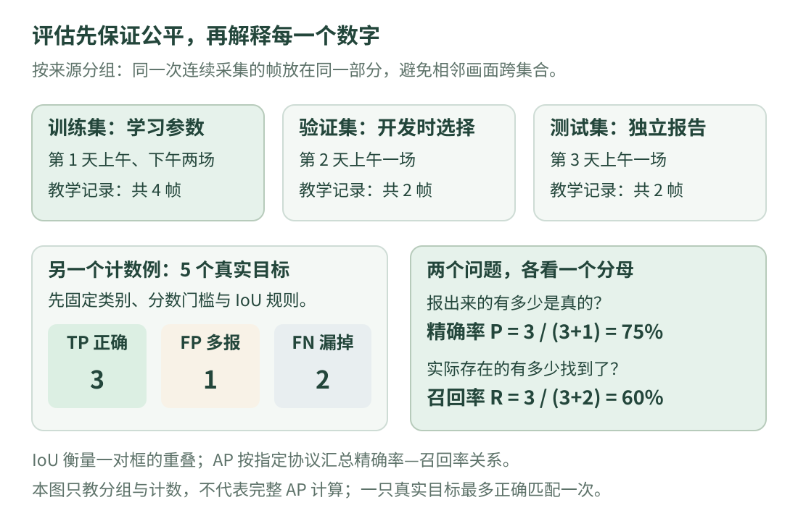

# 12 · 数据集与评估：怎样知道方法真的有效？

你给同一段羊群视频调了很久，最后画框看起来很好。这能说明换一天、换一块场地仍然可靠么？**这一课学会安排公平的检查，再解释“找到了多少、报错了多少”两个最基础的数字。**

前提是理解 [目标检测中的框与 IoU](detection.md)，知道类别和预测分数。代码只处理虚构记录和已核对的匹配计数，不下载数据、不训练模型，也不需要机器学习依赖。计数虽小，原则与大实验相通：评估规则先定下来，检查数据与调参数据要分开。

## 看图：先分数据，再讨论分数

{ .learning-figure }

[打开大图](../assets/learning/cv-evaluation.svg)

**数据集**不只是一个图片文件夹。它还包括图片来源、拍摄条件、标注规则，以及用于训练或检查的分组。**标注**是人工按照规则给出的参考答案，例如哪一类对象、框的坐标和遮挡情况；标注也可能漏画或不一致，所以需要抽查，不能认为文件存在就一定可靠。

例如要检测羊，就要先约定只露出半个身体的羊要不要标、画可见部分还是估计完整身体、远处难分辨的小点怎样处理。同一条件在训练和检查阶段应采用一致定义。否则算法可能被判错，实际却是两个标注员使用了不同规则。

## 训练集、验证集、测试集各做什么？

可以把三部分想成练习题、练习后的自测题与最后保留的考试题，但不要把比喻理解成绝对固定比例。**训练集**用于学习参数，**验证集**用于在开发期间比较选择，例如分数阈值和方案设置，**测试集**用于方案定下来后的独立报告。

如果反复看测试集错误，再根据它调整模型和规则，测试集逐渐参与了开发，就不再是同样独立的检查。不是“没有对测试图片调用训练函数就绝对不会泄漏”；用它选择方案，也会使最终结论偏乐观。scikit-learn 官方还特别提醒，像均值、方差或特征选择这样的数据统计，也应只在训练数据中学习。[官方数据泄漏说明](https://scikit-learn.org/stable/common_pitfalls.html#data-leakage)

不同任务需要不同划分。若希望证明“对未见过的采集场次有效”，应尽量让场次互不重叠；若希望证明能适应新场地，还要专门保留未见场地。同场次不重叠并不自动保证不同天气、不同相机或不同羊群上都有效，结论范围要与实际留出的条件一致。

## 为什么连续视频不适合随便按帧打乱？

假设同一视频的第 100 帧和第 101 帧几乎一样，背景、相机角度、羊的位置都相近。如果随机将它们分到训练和测试，模型可能只需要记住熟悉场景，就得到很高分。这个分数更接近“同一段采集的附近画面表现”，不能直接支撑“未见场景表现”。

一种入门做法是按**场次 ID** 分组：同一次连续采集的所有帧放在同一组。即使你截成了多个视频文件，只要仍属于同一场次，也不能仅靠文件名不同就认为独立。数据增强的图片同样应跟随原图的分组，不能把原图放训练、翻转版放测试。

真实项目可能需要更严格的分组，例如相机、日期、场地或个体。先写出打算面对的未知变化，再设计划分；不是找到一个固定的 `8:1:1` 比例就完成了实验设计。分组划分工具的“组”通常对应不应跨集合重复的来源单位。[GroupShuffleSplit 官方说明](https://scikit-learn.org/stable/modules/generated/sklearn.model_selection.GroupShuffleSplit.html)

## 先定匹配规则，才能数正确和错误

对检测任务，判断一个框是否正确，至少要明确类别一致、IoU 达到规定门槛、同一标注不能重复匹配。还要按照所用评估协议处理分数顺序、重复框、忽略项等。本页只讨论同类、无忽略项的简化情况。

在一张图里实际有 5 只羊，模型保留了 4 个预测，其中 3 个与不同标注正确匹配，1 个是多报，另外 2 个真实目标没被找到。三种计数是：

| 名称 | 缩写怎样读 | 本例数量 | 说人话 |
| --- | --- | ---: | --- |
| 真阳性 | TP，正确报出正类 | 3 | 框到了，而且按规则算对 |
| 假阳性 | FP，错误报出正类 | 1 | 报出来了，但按规则不对 |
| 假阴性 | FN，漏掉正类 | 2 | 本来有，却没被正确找出 |

在这个简化检测计数中，`TP+FN` 是标注目标数 5，`TP+FP` 是预测数 4。一个框如果类别对但位置不达标，也可能成为一个 FP，同时它没匹配到的真实目标仍算 FN。重复检测同一只羊也不能额外增加 TP。

## 精确率与召回率：它们问的是两个问题

**精确率 Precision** 问“我报出来的这些，有多少是真的？”：

\[
P=\frac{TP}{TP+FP}=\frac{3}{3+1}=0.75
\]

**召回率 Recall** 问“实际存在的目标，有多少被我正确找到了？”：

\[
R=\frac{TP}{TP+FN}=\frac{3}{3+2}=0.60
\]

本例是精确率 75%、召回率 60%。若只报告前一个数，会掩盖漏掉两只羊；只报告后一个数，则看不见多报问题。不要笼统写“准确率 75%”，让读者猜它究竟是哪一个指标。[精确率与召回率官方定义](https://scikit-learn.org/stable/modules/generated/sklearn.metrics.precision_recall_curve.html)

没有任何预测时，精确率分母为零；没有任何标注目标时，召回率分母为零。必须说明采用哪种统计约定。本页用 `None` 表示当前比值没有定义，显示成“未定义”，不会随意把它记成 100%。正式评估工具的处理规则要另行核对。

## 改分数阈值，得到不同工作点

设本页虚构的预测按分数从高到低排列，匹配结果已经按照同类、固定 IoU 门槛和一对一规则核对：

| 分数 | 是否正确匹配 | 直观解释 |
| ---: | --- | --- |
| 0.95 | 是 | 一个正确框 |
| 0.85 | 是 | 第二个正确框 |
| 0.70 | 否 | 一个误报 |
| 0.60 | 是 | 第三个正确框 |
| 0.35 | 否 | 另一个误报 |
| 0.25 | 是 | 第四个正确框 |

标注仍有 5 个。阈值为 `0.8` 时，只留下前两个，TP=2、FP=0、FN=3，精确率 1、召回率 0.4；阈值为 `0.5` 时留下前四个，得到上一节的 0.75 与 0.6；阈值为 `0.2` 时六个都留下，精确率约 0.6667、召回率 0.8。

这几组数是不同的**工作点**。降低阈值可能多找回目标，也可能增加误报，具体精确率不保证每一步都严格下降。本例里阈值只决定是否保留这些固定预测，没有重新训练或改框。

## 完整小程序：分组检查和指标计数

```python title="evaluation_numbers.py · 独立教学示例"
def divide_or_none(numerator, denominator):
    # 明确处理分母为零；None 表示当前比值未定义。
    return None if denominator == 0 else numerator / denominator


def show_ratio(value):
    return "未定义" if value is None else f"{value:.4f}"


# 记录名只为演示；同一 session 的帧必须留在同一部分。
session_split = {
    "day1_morning": "train",
    "day1_afternoon": "train",
    "day2_morning": "validation",
    "day3_morning": "test",
}
records = []
for session in session_split:
    for frame_number in [0, 1]:
        records.append({"session": session, "frame": frame_number})

parts = {name: [] for name in ["train", "validation", "test"]}
for record in records:
    part_name = session_split[record["session"]]
    parts[part_name].append(record)

session_sets = {
    name: {record["session"] for record in rows}
    for name, rows in parts.items()
}
assert session_sets["train"].isdisjoint(session_sets["validation"])
assert session_sets["train"].isdisjoint(session_sets["test"])
assert session_sets["validation"].isdisjoint(session_sets["test"])
print("各部分帧数:", len(parts["train"]), len(parts["validation"]), len(parts["test"]))

# 这些 True/False 是提前核对的教学匹配结果，不是用分数判断真伪。
# 每个 True 对应不同的标注目标，总标注数为 5。
predictions = [(0.95, True), (0.85, True), (0.70, False),
               (0.60, True), (0.35, False), (0.25, True)]
ground_truth_count = 5
for threshold in [0.8, 0.5, 0.2]:
    kept = [correct for score, correct in predictions if score >= threshold]
    true_positive = sum(kept)  # Python 中 True 可作为 1，False 可作为 0。
    false_positive = len(kept) - true_positive
    false_negative = ground_truth_count - true_positive
    precision = divide_or_none(true_positive, true_positive + false_positive)
    recall = divide_or_none(true_positive, true_positive + false_negative)
    print(f"阈值{threshold:.1f}: TP={true_positive} FP={false_positive} FN={false_negative}",
          f"P={show_ratio(precision)} R={show_ratio(recall)}")

print("无预测时的精确率:", show_ratio(divide_or_none(0, 0)))
```

预期输出：

```text
各部分帧数: 4 2 2
阈值0.8: TP=2 FP=0 FN=3 P=1.0000 R=0.4000
阈值0.5: TP=3 FP=1 FN=2 P=0.7500 R=0.6000
阈值0.2: TP=4 FP=2 FN=1 P=0.6667 R=0.8000
无预测时的精确率: 未定义
```

先读 `session_split`，它是我们提前指定的场次划分，而不是从帧号随机猜分组。`set` 是只保留不同元素的集合；`isdisjoint` 检查两个集合是否没有共同项。三条 `assert` 只检查场次 ID 是否交叉，不会替我们发现同一视频被错误起了两个不同名字，因此仍需核对数据来源。

再读 `predictions`：分数与正确性是两个不同字段，`True` 是已经按匹配规则核对的参考结果，不是“分数超过 0.5 就是真”。程序也没有实现检测匹配或 AP。这样拆开，是为了先把计数含义学清，再使用正式评价工具。

## IoU、AP、mAP，为什么不能混着说？

**IoU** 比较一对区域的几何重叠。**精确率与召回率** 描述某套筛选和匹配规则下的总体计数。**AP（平均精确率）** 则根据按分数排序后得到的精确率—召回率关系，按照指定协议汇总多个工作点。它不是框 IoU 的简单平均，也不是只把本页三个精确率加起来除以 3。

不同任务的 AP 细节可能不同，例如插值规则、召回采样、类别汇总与忽略标注处理。COCO 的常见主指标会在多个 IoU 门槛和类别上汇总；只写“AP=0.6”却不写协议，很难比较。[COCO 官方指标说明](https://cocodataset.org/dataset/detection-eval.htm)

`AP50` 的 50 通常指评价时的 IoU 门槛 0.50，**不是模型分数门槛 0.50**。`mAP` 常用来强调跨类别平均，但不同平台的命名并不完全统一。报告时写明数据集版本、类别范围、指标工具与设置，比背缩写更重要。不要直接拿一个分类指标函数，对未完成检测匹配的框列表计算，就称为标准检测 AP。

## 指标还要和实际失败画面一起看

总体分数可能把重要差异平均掉。例如大羊容易识别，远处小羊却经常漏掉；晴天良好，逆光很差。保留场景标签，分别报告目标大小、遮挡和光照条件下的表现，会比只有一个总数更容易定位问题。样本太少时，百分比的波动也可能很大，应同时报告数量。

若最终用于视频，静态检测指标还不能代替跟踪检查。身份切换、长时间遮挡、时间戳异常需要另外检查。速度指标也要说明包含哪些环节、使用什么图像大小和设备；网络本身耗时短，不代表采集到结果的全流程延迟同样短。

## 动手练习：把“看起来不错”改成可复查报告

<div class="practice-card" markdown="1">

<p class="practice-kicker">先说明规则，再给数字</p>
<p class="practice-title">五个目标，六个预测，怎么算？</p>

假设固定 IoU 门槛和同类一对一规则后，5 个标注中有 4 个被正确匹配，保留的预测共有 6 个。求 TP、FP、FN、精确率与召回率。再判断：将同一连续视频的奇数帧放训练、偶数帧放测试，能说明对未见场次有效吗？

??? tip "提示"

    正确预测数是 TP；预测总数减去 TP 是 FP；标注总数减去 TP 是 FN。相邻帧是否可能非常相像？

??? example "展开参考答案"

    TP=4、FP=2、FN=1，精确率为 `4/6≈0.6667`，召回率为 `4/5=0.8`。奇偶帧仍来自同一场次，不能支撑“未见场次”结论；应按研究希望检验的变化分组，并核对数据来源。无论数字多高，都要先检查评估设计。

</div>

## 继续阅读

- [scikit-learn 数据泄漏说明](https://scikit-learn.org/stable/common_pitfalls.html#data-leakage)：检查哪些统计和选择只能依赖训练数据。
- [分组划分工具的定义](https://scikit-learn.org/stable/modules/generated/sklearn.model_selection.GroupShuffleSplit.html)：理解按来源分组的思路；本页不要求使用该库。
- [COCO 检测评价](https://cocodataset.org/dataset/detection-eval.htm)与 [官方评价源码](https://github.com/cocodataset/cocoapi/blob/master/PythonAPI/pycocotools/cocoeval.py)：正式比较前，核对完整协议。

---

[返回视觉学习路线](index.md) · [上一课：目标关联与跟踪](tracking.md) · [下一课：视觉小项目 →](project.md)
