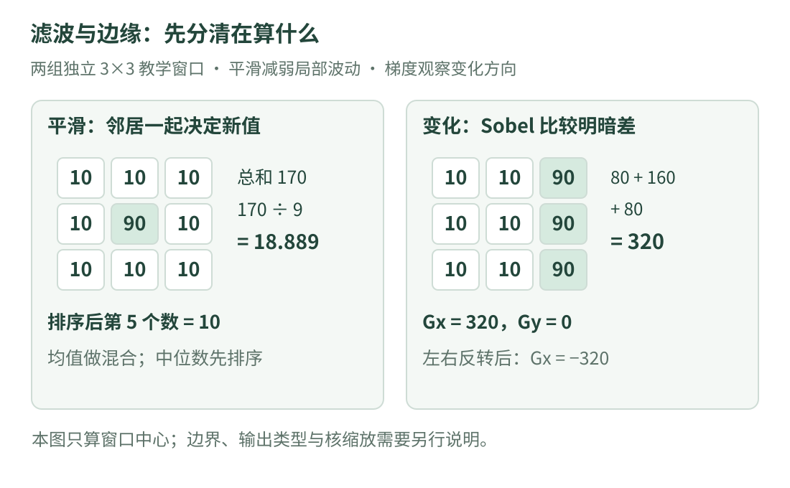

# 05 · 滤波与边缘：先整理像素，再观察变化

一张灰色纸片的照片里，有一个像素突然特别亮。它是纸片上的白点，还是拍摄时的噪声？另一处明暗突然变化，是纸片边缘，还是一道影子？这一课先用九个数解释“滤波”，再用相邻像素的差解释“边缘”。

!!! tip "这一课要学会什么"

    先读 [04 · 图像几何变换](transforms.md)，知道图像按行、列保存。本课不要求先学微积分：乘法、加法、排序，就能完成所有手算。

    学完后，应能解释均值、中位数和高斯滤波的区别，手算一个 Sobel 响应，并知道“变化大”为什么不能直接等于“找到了物体”。

## 1. 看图：滤波与边缘回答两种问题

{ .learning-figure }

[打开大图](../assets/learning/cv-filtering.svg)

滤波可以理解成“每个位置都请附近的像素参与一次计算”。**平滑滤波**希望减弱小范围的波动；**梯度算子**关注亮度在某个方向变化得多快。两者都使用邻域，却不一定做同一件事。

例如把某个像素和周围八个像素的平均数作为新值，是平滑；把右边亮度减去左边亮度，是检测横向变化。算法没有看到“纸片”这个词，只在处理数字。

| 词语 | 先这样理解 | 本课例子 |
| --- | --- | --- |
| 邻域 | 一个像素附近的小范围 | 以中心为锚点的 3×3 九个位置 |
| 核 / kernel | 各位置怎样参与计算的权重表 | 均值核的九个权重均为 1/9 |
| 平滑 | 让小范围波动减弱 | 把孤立亮点与附近值混合 |
| 梯度 | 某方向的亮度变化 | 右边亮、左边暗时横向响应为正 |
| 边界处理 | 邻域伸到图像外面时的约定 | 不算边界、复制边界、镜像等 |

## 2. 第一次手算：九个数求平均

假设中心附近的灰度如下，数值越大越亮：

```text
10  10  10
10  90  10
10  10  10
```

我们暂时假定这片纸本应是均匀的，中心 90 是一个偶发亮点。九个数相加为 `8×10+90=170`，除以九得到 `18.888…`。只计算中心时，中心的新值约为 18.889，其他位置如何变化，要等各自移动窗口后再计算。

用公式写是：

$$
J(v,u)=\frac{1}{9}\sum_{a=-1}^{1}\sum_{b=-1}^{1} I(v+a,u+b)
$$

| 符号 | 本课的意思 |
| --- | --- |
| $I$ | 原灰度图像，输入数据 |
| $J$ | 新图像，输出数据 |
| $v,u$ | 正在计算的位置，先行后列 |
| $a,b$ | 相对于中心的行、列偏移，各取 −1、0、1 |
| $\sum$ | 把列出的各项加起来；这里一共九项 |

公式只是把“取九个数、相加、除以九”缩短了。示例的输出保留小数；真正保存到 8 位整数图像时，还要考虑实现规定的舍入和饱和处理，不能默认所有实现都会得到相同的最后一位。

### 中位数为什么得到不同的结果

把九个数从小到大排成：`10、10、10、10、10、10、10、10、90`。第 5 个数为 10，所以中位数滤波在这里得到 10。它没有求九个数的加权和，而是取排序后居中的数。

这个例子说明中位数对孤立的极端值有用，却不说明中位数永远更好。如果中心 90 是真实的小白点，滤掉它就丢失了有效信息。**先说明希望保留什么，再比较处理结果。**

### 高斯滤波怎样区别于简单平均

简单平均给每个邻居同样的权重；高斯滤波给离中心近的位置较大的权重。可以先把它想成一次“邻近像素按距离投票”。实际权重由核大小和标准差等参数决定，不能把任意一张中心权重较大的表都叫作高斯核。函数参数和边界约定可核对 [OpenCV 4.11 图像滤波参考](https://docs.opencv.org/4.11.0/d4/d86/group__imgproc__filter.html)。

平滑会把相邻区域混合。例如黑纸与白纸的交界处，平滑后可能出现一条灰色过渡带。因此核越大，并不代表结果越准确。

## 3. 再看变化：为什么需要带正负号的权重

比较一行 `[10, 10, 90]`，右边比左边亮。若用右边减左边，得到 `90−10=80`。反过来 `[90, 10, 10]` 得到 −80。正负号提供变化方向，绝对值提供变化大小。

常见 3×3 Sobel 核的一组写法为：

$$
K_x=\begin{bmatrix}-1&0&1\\-2&0&2\\-1&0&1\end{bmatrix},\qquad
K_y=\begin{bmatrix}-1&-2&-1\\0&0&0\\1&2&1\end{bmatrix}
$$

本课行向下、列向右。$K_x$ 比较右侧和左侧；$K_y$ 比较下方和上方。把核与九个灰度按位置相乘，再把九个乘积相加，分别得到 $G_x$、$G_y$。

这里直接使用核上写出的排列，不先翻转核，严格说是互相关计算。数学教材中的卷积若先把核翻转，Sobel 的符号可能相反；比较公式或库输出前，先核对运算与方向约定。OpenCV 的 [filter2D 文档](https://docs.opencv.org/4.11.0/d4/d86/group__imgproc__filter.html)也明确区分这一点。

假设三行都是 `[10, 10, 90]`：

1. 第一行横向贡献是 `−10+90=80`。
2. 第二行中间权重大，贡献是 `−20+180=160`。
3. 第三行贡献仍是 80，合计 $G_x=320$。
4. 上下两行相同，因此 $G_y=0$。

这里的 320 不是灰度、长度或物体数量，而是本例未缩放 Sobel 核的数值响应。它可以超出 0～255，所以不能看到输入是 8 位灰度，就认定输出也应强行装进 8 位无符号数。Sobel 的输出类型和方向参数可查 [OpenCV 梯度教程](https://docs.opencv.org/4.11.0/d5/d0f/tutorial_py_gradients.html)。

梯度的大小可用：

$$G=\sqrt{G_x^2+G_y^2}$$

$G_x,G_y$ 是两个方向的响应，平方后相加，再开平方。本例为 $\sqrt{320^2+0^2}=320$。这是两方向合成的一种方式；若换了核、缩放或合成方式，阈值也需要重新考虑。

## 4. 完整代码：只算中心，避免边界问题混在一起

下面只用 Python 标准库，不读取照片、不需要 OpenCV。两组 3×3 表格各完成一个明确计算；它不是完整图像滤波器，也没有计算图像外面的像素。

```python title="九数平滑与中心 Sobel · 独立教学示例"
import math
import statistics


def weighted_sum(patch, kernel):
    # 本函数约定 patch 和 kernel 都恰好是 3×3 数字表。
    total = 0
    for row in range(3):
        for col in range(3):
            # 相同位置相乘，然后把结果累加。
            total += patch[row][col] * kernel[row][col]
    return total


spot = [
    [10, 10, 10],
    [10, 90, 10],
    [10, 10, 10],
]

# 把三行的数字依次放入一个列表，共得到九个数。
values = [value for row in spot for value in row]
print(f"中心均值: {statistics.mean(values):.3f}")
print(f"中心中位数: {statistics.median(values):.3f}")

# 这次左暗右亮，上下三行完全相同。
step = [
    [10, 10, 90],
    [10, 10, 90],
    [10, 10, 90],
]
kernel_x = [[-1, 0, 1], [-2, 0, 2], [-1, 0, 1]]
kernel_y = [[-1, -2, -1], [0, 0, 0], [1, 2, 1]]

gx = weighted_sum(step, kernel_x)
gy = weighted_sum(step, kernel_y)
magnitude = math.hypot(gx, gy)  # 等价于 sqrt(gx² + gy²)。
print(f"Sobel: Gx={gx}, Gy={gy}, 大小={magnitude:.3f}")

# 反转每一行，让右亮左暗变成左亮右暗。
reversed_step = [list(reversed(row)) for row in step]
print(f"左右反转后 Gx={weighted_sum(reversed_step, kernel_x)}")
```

预期输出：

```text
中心均值: 18.889
中心中位数: 10.000
Sobel: Gx=320, Gy=0, 大小=320.000
左右反转后 Gx=-320
```

### 从外到内读这段代码

`patch[row][col]` 先选择一行，再选择行中的一列。两个 `for` 循环把九个位置都访问一次；`total += ...` 是“把这个乘积加进原来的总数”。最后 `return` 把累加结果交回调用处。

`values` 的列表推导式可以口头读成：“对每一行，再取行里的每个值，把这些值依次放进新列表”。`:.3f` 只控制输出保留三位小数，没有把内部计算改成三位精度。

反转后的响应是 −320，说明方向变了、强弱没变。若在计算绝对值前丢掉负数，一类明暗过渡就可能消失。

## 5. Canny 为什么比一个差值更复杂

普通梯度图中，一条边附近可能有好几列都出现响应。Canny 的思路包括处理噪声、计算梯度、沿梯度方向压掉非极大值，以及利用双阈值和连通关系保留边缘。双阈值针对的是梯度相关响应，不能当成“把原图灰度大于某数的像素选出来”。可对照 [OpenCV Canny 教程](https://docs.opencv.org/4.11.0/da/d22/tutorial_py_canny.html)。

“概念上先处理噪声”也不等于所有接口都会自动替你完成任意高斯平滑配置。阅读实际程序时，要确认输入预处理、梯度大小计算选项、核大小和阈值。两行函数名相同的代码，也可能因为这些设置不同而得到不同边缘。

## 6. 动手练习：把变化方向说清楚

<div class="practice-card" markdown="1">

<p class="practice-kicker">先手算，再对照代码</p>
<p class="practice-title">把三行都改为 [90, 90, 90]，Sobel 应得到什么？</p>

先计算一行对 $G_x$ 的贡献，再检查上、下两行对 $G_y$ 的贡献。解释“全图很亮”与“亮度变化很大”的区别。

??? tip "展开提示"

    横向核每行的权重加起来为 0。常数乘以一组和为 0 的权重，得到什么？

??? example "展开参考答案"

    三行都是常数时，$G_x=0$、$G_y=0$，大小为 0。Sobel 关注局部变化，不是在统计绝对亮度。此结论针对本例只算中心的窗口；若把图像外面补成黑色，图像最外侧可能出现由边界约定引入的变化。

</div>

## 7. 常见误区与检查顺序

- **边缘就是物体轮廓**：阴影、纹理和反光也产生明暗变化；弱对比物体边界可能没有强响应。
- **平滑次数越多越好**：噪声减弱的同时，小文字、细线和真实角点也可能被抹掉。
- **可以一边改原图、一边继续取邻域**：后算的位置可能读到已经更新的结果。初学时保留输入，写到另一个输出表中。
- **边界处理可以忽略**：本课故意只算中心；完整程序必须明确图像外像素怎样处理。

比较效果时，保留原图，记录滤波方法、核、输出类型和边界方式，再看同一区域的细节是否保留下来。接下来我们把“亮或暗”变成明确的 0/1，再学习怎样判断哪些像素连在一起。

---

[返回视觉学习路线](index.md) · 上一课：[04 · 图像几何变换](transforms.md) · 下一课：[06 · 二值图与连通区域](regions.md) →
