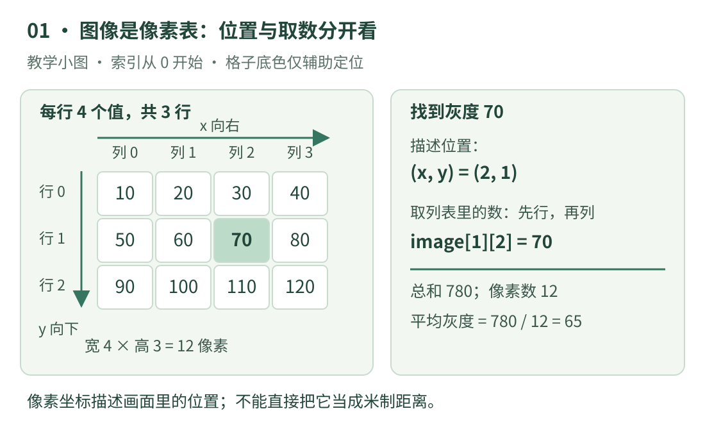

# 01 · 图像、像素与坐标

你在屏幕上看到一只羊，计算机最先拿到的却是一批数字。第一课先解决一个小问题：**给出图像位置 `(2, 1)`，怎样找到那里保存的数值？** 这个问题弄清楚，后面读裁剪、检测框和相机代码才不会把横纵方向弄反。

本课不需要摄像头或图片文件。我们亲手写一张只有 12 个像素的灰度图，用它理解真实图片的基本组织方式。示例只使用 Python 3 标准功能，按 Python 3.14 文档核对。

## 先看图：把图片放大成一张数字表

{ .learning-figure }

[打开大图](../assets/learning/cv-images.svg)

**像素**可以先理解为数字图像中的一个采样位置。**灰度图**在每个位置存一个表示明暗的数；**彩色图**通常在每个位置存多个颜色分量。不要把“一个像素”与“一个字节”当成同义词：存多少字节还要看通道数和数据类型。

本课采用常见的 8 位无符号灰度表示：允许的整数是 0～255，显示时通常 0 为黑、255 为白，中间值为不同深浅。这里的数值表示和显示约定是明确选定的；深度图、16 位图、浮点图以及经过特殊变换的数据，不能直接套这个范围。

**分辨率**在这里指图像的宽和高。例如“宽 4、高 3”表示每行有 4 个位置，共有 3 行，所以有 `4 × 3 = 12` 个像素。放大显示这 12 个像素，并不会变成拍到了更多细节。屏幕上的显示尺寸与原图真正包含的像素数是两回事。

## 坐标与数组，为什么顺序看起来反着？

我们约定：左上角像素的整数索引是 `(x=0, y=0)`，`x` 向右增加，`y` 向下增加。宽 4 的有效横索引是 `0、1、2、3`；高 3 的有效纵索引是 `0、1、2`。`x=4` 已经走到图像右侧之外。

人们说“横坐标、纵坐标”时常写 `(x, y)`。但用一层列表装所有行、每行再装各列数值时，取数顺序自然是**先选哪一行，再选这一行里的哪一列**。因此写作 `image[y][x]`。例如 `(2, 1)` 表示第 2 行中的第 3 个像素，因为索引从零开始；代码是 `image[1][2]`，值为 70。

这里的“第 2 行”是从一开始的人类计数，“行索引 1”是从零开始的程序计数。教学时把两种说法一起写出来，可以减少差一格的错误。OpenCV 的 Python 图像通常是 NumPy 数组，访问单个灰度像素常写 `image[y, x]`，依然是先行后列；它不是 Python 嵌套列表的语法。[OpenCV 4.13 图像基本操作](https://docs.opencv.org/4.13.0/d3/df2/tutorial_py_basic_ops.html)

!!! note "本课的坐标约定"

    此处讨论的是像素的整数索引。后面做几何变换时，还会用到像素中心、像素边界和带小数的图像坐标。它们需要单独说明；不能仅凭“左上角是零”就推断所有库的坐标转换细节。

## 先手算：读数、计数、求平均

把小图写成三行：第一行 `10、20、30、40`，第二行 `50、60、70、80`，第三行 `90、100、110、120`。先用手完成三件事。

1. 位置 `(x=2, y=1)`：找到中间一行，往右数到索引 2，得到 70。
2. 大于或等于 80 的像素：80、90、100、110、120，共 5 个。
3. 所有像素的平均值：总和 780，像素数 12，平均为 `780 / 12 = 65`。

**平均灰度**只是这些数的算术平均。在这张人为小图里，它帮我们检查是否读对全部数据。真实照片的平均灰度不能直接当照度计读数，更不能仅用平均值判断“有没有羊”：一张图中可以有很亮的背景与很暗的前景，平均以后位置和结构都丢失了。

“阈值”是人为选定的一道数字门槛。这里设为 80，问的是“哪些数达到门槛”，并没有训练识别模型，也没有理解物体。若门槛改为 81，值为 80 的位置就不再计入。这也是为什么条件中的 `>=` 和 `>` 不能随意互换。

## 完整示例：让程序重复我们的手算

下面整段可以独立阅读或保存为一个 `.py` 文件执行。它不读取磁盘图片、不安装库，也不调用相机。

```python title="图像入门 · 标准库独立教学示例"
# 外层列表装“行”；每个内层列表装这一行从左到右的灰度值。
image = [
    [10, 20, 30, 40],
    [50, 60, 70, 80],
    [90, 100, 110, 120],
]

# len(image) 数行数；len(image[0]) 数第一行有多少列。
height = len(image)
width = len(image[0])
print(f"尺寸：宽 {width}，高 {height}")

# 位置用 (x, y) 描述；列表访问必须先 y 后 x。
x = 2
y = 1
if 0 <= x < width and 0 <= y < height:
    value = image[y][x]
    print(f"位置 ({x}, {y}) 的灰度：{value}")
else:
    print("位置在图像之外")

total = 0             # 累加所有灰度，初始还没有加任何数。
bright_count = 0      # 记录达到门槛的像素数量。
threshold = 80

# 外层循环依次取行；内层循环依次取这行中的每个值。
for row in image:
    for value in row:
        total += value
        if value >= threshold:
            bright_count += 1

pixel_count = width * height
mean = total / pixel_count
print(f"达到门槛的像素数：{bright_count}")
print(f"灰度总和：{total}")
print(f"平均灰度：{mean:.1f}")
```

预期输出：

```text
尺寸：宽 4，高 3
位置 (2, 1) 的灰度：70
达到门槛的像素数：5
灰度总和：780
平均灰度：65.0
```

## 怎样一行一行读代码

`image = [...]` 是给数据起名字；等号在这里表示赋值。“列表”是按顺序放元素的容器，用方括号包起来、逗号隔开。`image[0]` 取第一行，接着的 `[2]` 再取这一行中索引 2 的元素。`len(...)` 返回元素数，不返回最大索引。

`if 0 <= x < width and 0 <= y < height:` 先问横索引是否合格，再问纵索引是否合格，`and` 要求两者同时成立。冒号后缩进的语句属于这个分支。Python 列表允许负索引，例如 `image[-1]` 是最后一行；因此不能只检查“小于宽高”，还要检查“不小于零”，否则负坐标可能被悄悄当作从末尾取数。

`for row in image:` 可以读成“依次拿到图中的每一行”。`for value in row:` 再读成“依次拿到这一行中的每一个数”。`total += value` 等价于先计算 `total + value`，再把结果存回 `total`。本例从上到下、从左到右走一遍，一共访问 12 个像素。[Python 3.14 列表与循环](https://docs.python.org/3.14/tutorial/datastructures.html)

`print(f"平均灰度：{mean:.1f}")` 中的 `f` 表示可以把变量嵌入文字，花括号内的 `:.1f` 要求显示一位小数。**显示成一位小数**不等于把所有中间计算都改成一位小数。先保存计算结果，最后再决定展示格式，通常更方便检查误差。

## 接真实图片以前，还要检查什么

这个例子保证图像非空、每行一样长、数值合法，所以可以直接取 `image[0]`。如果输入来自文件或外部程序，这些条件要检查。空列表没有第一行；某行少一个元素就不是本课所说的矩形灰度图。真实读图还可能因路径错误或格式问题失败，不能看到变量名叫 `image` 就假定里面一定有有效图像。

像素距离也不能直接变成真实距离。两只羊的图像中心相隔 20 像素，只说明它们在这张图片里的间隔；离相机的距离、镜头参数、视角等都会改变成像大小。若要得到米制距离，还需要额外的几何或深度信息。

## 动手练习：在写代码前先定位

<div class="practice-card" markdown="1">

<p class="practice-kicker">练习 01 · 建立坐标直觉</p>
<p class="practice-title">找到最右下角，并重新设置门槛</p>

先写下最右下角的 `(x, y)` 与灰度，再把程序里的位置改过去。把门槛从 80 改成 100，预测计数会变成多少。不要修改图像数据。

??? tip "先看提示"

    最大有效横索引是 `width - 1`，最大有效纵索引是 `height - 1`。数达到门槛的值时，请把等于 100 的位置也算进去。

??? example "展开参考答案"

    最右下角是 `(3, 2)`，访问 `image[2][3]`，值为 120。把 `x` 改成 3、`y` 改成 2 即可。

    门槛设为 100 后，计入 100、110、120，共 3 个。只改变门槛不会改变总和 780 与平均值 65.0。

</div>

读下一课前，用自己的话说清楚两句话即可：“位置通常写 `(x, y)`，这张列表图却要先取行再取列”；“灰度大小是数据表示的一部分，不能把它直接当物体类别或实际距离”。

[返回视觉学习路线](index.md) · [下一课：02 · Python 与数组阅读 →](arrays.md)
