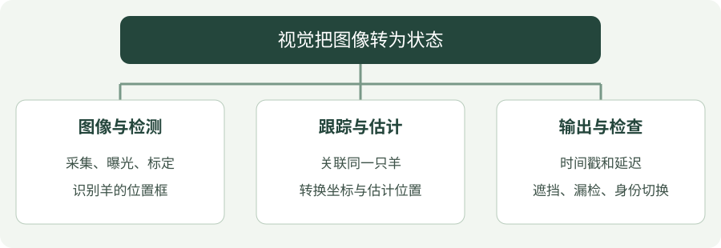
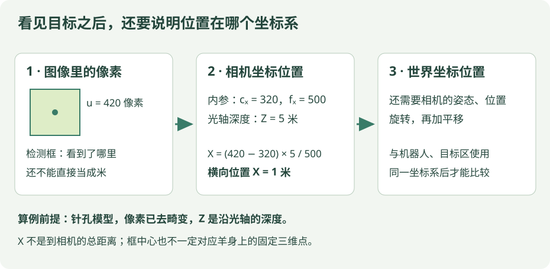

# 视觉学习概览

视觉模块的目标是把图像转化为放牧策略能够使用的羊群状态。

先想象一个具体任务：给你两张间隔 0.1 秒拍摄的照片，判断编号 2 的羊有没有向目标方向移动。你需要先找到羊、确认两张照片里是同一只、把图像位置换成有明确单位的位置，最后才能计算移动。每一步都有自己的输入和误差，不能跳过中间环节。


## 看图梳理

{ .learning-figure }

[打开大图](../assets/learning/vision-index.svg)

**图像与检测**：采集、曝光、标定，识别羊的位置框；**跟踪与估计**：关联同一只羊，转换坐标与估计位置；**输出与检查**：时间戳和延迟，遮挡、漏检、身份切换。


## 感知链路

### 一个视频画面里，其实有三种不同问题

“图中有三只羊”是**检测**；“这一只还是上一帧编号 2 的羊”是**跟踪**；“它在机器人前方 5 米”是**位置估计**。检测框、身份编号和米制位置是不同输出，后一步往往需要额外数据。

先在一帧上给每个框画出左上角与右下角，再连续看几帧编号是否稳定，最后才讨论相机标定与实际位置。这样每一步失败时，知道该检查哪一个模块。

### 一张图像首先是一张像素表

宽 640、高 480 的图像，可把左上角记作 `(0, 0)`，横坐标 u 向右增加，纵坐标 v 向下增加。使用整数像素索引时，u 为 0～639，v 为 0～479。每个位置保存亮度或颜色；神经网络是在这些数值上做处理，不是天然知道每个像素对应哪只羊。

检测框常用四个数表示，但格式可能不同：`(左, 上, 右, 下)` 与 `(中心x, 中心y, 宽, 高)` 都很常见，有时数值还被除以图像宽高归一化到 0～1。接数据时先查格式，不能只看到四个数就直接画框。

### 置信度不是准确率

检测器给一个框置信度 0.9，是模型给这次预测的分数，不等于“所有 0.9 分的框都一定有 90% 正确率”。要用带人工标注的数据单独检查。

假设一帧实际有 5 只羊，模型输出 4 个框，其中 3 个正确匹配、1 个误检，另外 2 只羊漏检。在已约定类别与框匹配规则下，精确率为 3/4 = 75%，召回率为 3/5 = 60%。前者问“报出来的有多少是真的”，后者问“实际目标找到了多少”。真实评估还需处理重复框、匹配阈值和跨场景统计。

**图像采集 → 目标检测 → 多目标跟踪 → 位置估计 → 状态输出**

| 环节 | 学习重点 | 检查内容 |
| --- | --- | --- |
| 图像采集 | OpenCV、相机参数、时间戳 | 分辨率、曝光和帧率是否稳定 |
| 目标检测 | 检测框、置信度、误检与漏检 | 遮挡与远距离场景的表现 |
| 多目标跟踪 | 身份关联、轨迹与丢失恢复 | 身份切换和轨迹中断 |
| 位置估计 | 相机标定、坐标变换 | 图像位置与世界位置的误差 |
| 状态输出 | 数据结构、频率和延迟 | 策略收到的数据是否过期 |

### 跟踪：为什么要知道是同一只羊？

上一帧有两个框，下一帧也有两个框，并不能确定“第一个框”仍是同一只羊。检测结果的排列可能改变，羊也可能互相遮挡。跟踪器利用位置、运动预测、外观等信息建立关联，给轨迹分配 ID。

如果上一帧 ID 2 在左边，下一帧算法误把右边另一只羊当成 ID 2，就会出现看似突然跳跃的轨迹，速度估计也随之出错。ID 只是跟踪器的内部标签，并不是自动获得的真实身份；遮挡后也可能无法恢复原来的编号。

## 建议实践

### 用一帧图像理解“检测”与“定位”

假设检测框左上角是 `(100, 60)`，右下角是 `(140, 100)`，那么框中心是 `(120, 80)`。这两个数字的单位是**像素**，只能说明羊在图像里的位置，不能直接当作“离机器人 120 米”。

把“取中心”拆成可读的代码如下。它只做几何计算，不包含检测模型，也不需要训练。

```python
# 输入采用 (左, 上, 右, 下)，坐标单位都是像素。
box = (100, 60, 140, 100)
left, top, right, bottom = box  # 一次拆出四个数，不是执行四次检测。

# 本例用连续坐标的边界差求宽高；具体像素包含规则仍要对照数据接口。
width_px = right - left
height_px = bottom - top

# 中心是两端坐标的平均值；除以 2 后可能得到小数。
center_u = (left + right) / 2
center_v = (top + bottom) / 2
print(width_px, height_px)  # 预期：40 40。
print(center_u, center_v)  # 预期：120.0 80.0。
```

框移动不一定是羊移动：相机自己移动或转向，也会让图像中的羊移动。所以“中心右移 20 像素”只能描述图像变化；要说羊向世界东侧移动多少米，还必须处理相机运动和坐标转换。

想得到实际位置，还需要相机标定、深度或场景几何，并明确输出坐标系。下一帧认出“这是上一帧同一只羊”则属于跟踪，不是检测框本身提供的能力。

??? tip "检查自己：检测框稳定，是否意味着世界位置准确？"

    不一定。相机参数不准、深度误差或坐标变换错误，都可能使稳定的图像位置对应错误的世界位置。检测、跟踪和定位需要分别检查。

先用一段固定视频检查检测与跟踪，再连接仿真或控制模块。为遮挡、光照变化、目标重叠分别保留样例，避免只根据少量顺利的视频判断效果。

## 记录模板

??? example "小练习：只检测到一只羊，能说明模型很好吗？"

    若画面有五只羊，只报出一只且确实正确，精确率为 1/1 = 100%，召回率却只有 1/5 = 20%。只看报出的框是否正确，会忽略漏掉的目标，所以两类指标要一起看。

### 从像素到米：还缺哪一步？

{ .learning-figure }

[打开位置估计示例大图](../assets/learning/vision-units-example.svg)

在**已去畸变的针孔模型**中，设像素横坐标 u = 420，主点横坐标 cₓ = 320，横向焦距 fₓ = 500 像素；若该像素对应点的相机坐标深度 Z = 5 米，则：

$$
X=(u-c_x)Z/f_x=(420-320)\times5/500=1\ \text{米}
$$

X 是相机坐标中的横向位置，不是到相机的总距离；Z 是沿光轴的深度，也不一定等于深度设备报告的斜距。纵向坐标同样需要 v、cᵧ、fᵧ。随后还要用相机姿态与位置，把相机坐标转换到世界坐标。

如果不知道 Z，单靠这一个像素不能得到唯一的米制位置。检测框中心也不保证对应羊身上的固定三维点；地面投影通常需要接地点、相机标定与地面假设。这个算例只解释投影关系，不能直接充当羊群定位算法。模型与坐标定义见 [OpenCV 标定文档](https://docs.opencv.org/4.x/d9/d0c/group__calib3d.html)。

按算式逐步读：像素离图像主点向右偏了 `420 − 320 = 100` 像素；除以焦距 500 像素得到 0.2，这个比例没有长度单位；再乘光轴深度 5 米，才得到横向 1 米。

**同一个像素方向，深度不同，实际位置就不同。** 如果 Z 改为 10 米，X 就变成 2 米；图像里方向一样，不代表目标距离一样。相机标定给出焦距、主点等参数，并不凭空补出每个目标的深度。

| 名词 | 大白话 | 本例中管什么 |
| --- | --- | --- |
| 内参 | 相机把三维点映到图像的参数 | fₓ、fᵧ、cₓ、cᵧ |
| 畸变参数 | 镜头让直线等图形偏弯的描述 | 先校正像素，才能使用上述理想投影式 |
| 外参 | 相机相对另一个坐标系的位置与朝向 | 把相机坐标变到世界坐标 |
| 深度 | 点沿约定深度轴有多远 | 本例中光轴方向的 Z |

外参要说明“从谁变到谁”。相机装在运动机器人上时，相机相对机身的固定安装关系，与机身相对世界的实时位姿，需要一起考虑。

### 从位置到速度：时间也要参加计算

假设两次可靠定位得到：在同一世界坐标系里，某只羊的 x 从 2.0 米变成 2.2 米，采集时间从 10.0 秒变成 10.1 秒。区间平均 x 方向速度是：

`(2.2 − 2.0) / (10.1 − 10.0) = 2.0 米/秒`。

这里求的是两次测量之间的平均速度，不是保证准确的瞬时速度。成立前提包括：两次是同一只羊、坐标系一致、时间间隔非零，且位置估计可信。若 ID 换错或误把处理完成时间当采集时间，结果就可能失真。短时间差还会放大位置噪声，因此后续通常需要结合多帧估计，而不是只相信一个差分。

### 给策略的输出，至少解释这些字段

| 字段 | 示例 | 缺少它会怎样 |
| --- | --- | --- |
| ID | 2 | 很难判断是不是同一条轨迹 |
| 位置与单位 | `(2.2, 1.0)` 米 | 数字无法直接用于距离计算 |
| 坐标系 | world | 可能把相机右侧误当机器人前方 |
| 采集时间 | 10.1 秒 | 不能判断位置是现在的还是旧的 |
| 有效性 / 丢失时长 | 最近一帧有效 | 可能把已丢失的预测位置当作真实测量 |

检测置信度、跟踪状态、位置不确定性是不同信息，应分别说明。检测器很确信“这里有羊”，不代表深度测量也很准确。

### 检查效果时，分开问三个问题

| 问题 | 具体检查 | 不能由它直接推断 |
| --- | --- | --- |
| 看见了吗？ | 与人工标注比较误检、漏检 | 看见目标不代表定位准确 |
| 认对身份了吗？ | 查看遮挡前后 ID 与轨迹 | ID 稳定不代表位置误差小 |
| 位置准且及时吗？ | 对照参考位置，统计误差与延迟 | 平均误差小不代表难例可靠 |

先划分训练、验证与测试数据，同一段视频的相邻帧尽量不要跨集合，避免画面相似造成过于乐观的评价。保存遮挡、重叠和远距离案例，分别看结果。

训练集用于调整模型；验证集帮助选择参数；测试集用于最后检查没有参与调参的数据。如果反复根据测试集挑模型，测试集也就参与了选择过程。一个简单起点是按拍摄场次分组，而不是把相邻帧打散到各个集合。

??? example "综合练习：一只羊右移了 10 像素，可以算出米/秒吗？"

    还不行。至少需要可靠的空间换算、相机运动信息、同一目标的关联，以及两帧采集时间。即使已知两帧间隔 0.1 秒，也只能直接得到图像横向变化率 100 像素/秒，不能把单位改写成米/秒。

- 数据来源与场景条件
- 模型和参数配置
- 标注与评估方法
- 误检、漏检及身份切换案例
- 单帧耗时与整体延迟
- 对放牧策略输入的影响

[查看放牧任务的状态设计](../herding/index.md) · [浏览视觉学习资料](../opensource/index.md)
