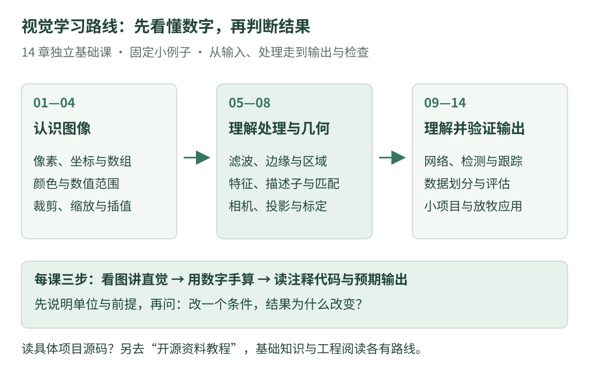

# 计算机视觉：从看懂像素到检查一条视觉结果

独立基础课程 · 14 章 · 图解、手算与中文注释

照片在程序里是一张怎样的数表？为什么一个框不能直接告诉你距离？检测到一个物体，又怎样知道下一帧还是它？这条路线从最基础的问题开始，每次只增加一层知识。

[从第 01 课开始 →](images.md){ .md-button .md-button--primary }
[查看小项目](project.md){ .md-button }

## 每课按三步读

**先看图、讲直觉**：知道这一章解决什么问题。**再用数字解释原理**：逐项看公式中的量是什么、单位是什么。**最后读注释代码**：对照输入、步骤、预期输出和练习，不把代码直接扔给读者。

这套课讲通用视觉知识。想读具体开源工程时，再到独立的[开源资料教程](../opensource/tutorials/index.md)中选择项目；rm.cv.fans 的源码课程已经归入该栏目。

## 看图找到现在的位置

{ .learning-figure }

[打开大图](../assets/learning/cv-roadmap.svg)

- **第一阶段 · 认识图像**

    第 01～04 课：像素、数组、颜色与插值。先能解释程序正在处理哪一组数。

- **第二阶段 · 理解处理与几何**

    第 05～08 课：滤波、区域、特征与相机。先用小图和纸笔看清方法的前提。

- **第三阶段 · 判断结果是否可信**

    第 09～14 课：网络、检测、跟踪、评估和小项目，再讨论放牧应用。

## 第一阶段：图像是什么

| 章节 | 一个具体问题 | 读完后的目标 |
| --- | --- | --- |
| [01 · 图像、像素与坐标](images.md) | 横坐标是 2、纵坐标是 1，数组该怎么取？ | 分清行列、坐标、大小与像素值 |
| [02 · Python 与数组阅读](arrays.md) | 切片和复制以后，改的是同一份数据吗？ | 读懂列表、索引、循环与数组视图的区别 |
| [03 · 颜色、亮度与数值范围](color.md) | RGB、BGR 和 0～1 分别在说什么？ | 分清通道顺序、灰度近似和数值缩放 |
| [04 · 裁剪、缩放与插值](transforms.md) | 新像素落在两个旧像素之间，取什么值？ | 手算区域坐标与一个双线性插值 |

## 第二阶段：怎样处理图像

| 章节 | 一个具体问题 | 读完后的目标 |
| --- | --- | --- |
| [05 · 滤波与边缘](filtering.md) | 为什么去噪也可能把边缘弄模糊？ | 用小邻域理解平均、中位数与梯度 |
| [06 · 二值图与连通区域](regions.md) | 一堆亮点，怎样按相邻关系分成几块？ | 区分阈值、邻域与区域标签 |
| [07 · 特征与匹配](features.md) | 两张图里，哪些局部内容可能对应？ | 分清关键点、描述子、距离与错误匹配 |
| [08 · 相机成像与标定](camera.md) | 一个像素为什么不能唯一决定三维位置？ | 分清投影、内外参、畸变与独立验证 |

## 第三阶段：从输出走到评价

| 章节 | 一个具体问题 | 读完后的目标 |
| --- | --- | --- |
| [09 · 网络与图像分类](networks.md) | 数字怎样经过网络变成类别分数？ | 手算一次小型前向计算，区分训练与推理 |
| [10 · 目标检测](detection.md) | 一张照片中，物体在哪些框里？ | 读懂框格式、置信度、IoU 与评价前提 |
| [11 · 目标关联与跟踪](tracking.md) | 结果排列变了，还是同一个对象吗？ | 理解轨迹身份、关联与遮挡的不确定性 |
| [12 · 数据集与评估](evaluation.md) | 数字看起来很好，为什么换场景就失效？ | 分场次划分数据，手算误检与漏检指标 |
| [13 · 视觉数据检查小项目](project.md) | 怎样把形状、坐标、时间和有效性检查接起来？ | 读懂一份完整的合成记录检查程序 |
| [14 · 放牧视觉的应用与限制](herding.md) | 羊群策略收到的状态，究竟有哪些前提？ | 区分图像结果、真实位置、身份与延迟 |

## 代码与环境怎样安排

完整基础算例以 **Python 标准库**为主，使用固定的小图矩阵和虚构记录，不需要安装模型、下载数据或创建新的虚拟环境。先按注释推算输出，也能完成学习。

讲 NumPy、OpenCV 等接口时，页面会标明依赖和阅读片段的上下文。独立教学代码用于说明原理，不冒充库的全部实现；接口行为要以对应版本文档为准。网站不会执行正文中的程序，也不会自动启动训练。

Python 的变量、列表和函数若还不熟悉，可随时查[Python 阅读入门](../programming/python-reading.md)。想继续读 C++ 视觉项目，再转到[开源资料教程中的 rm.cv.fans](../opensource/rm-cv-fans/index.md)，按它自己的版本和范围学习。

## 学习效果怎么检查

每一章都问自己三件事：我能不看答案算出这个小例子吗？我能解释代码里每个输入代表什么吗？换掉一个条件后，我能说明输出为什么改变吗？

不要只记“调哪个函数”。同一个函数在不同数值类型、坐标约定或边界设置下，结果可能不同。清楚说明前提，比得到一条看起来平滑或漂亮的曲线更有用。

原来的视觉综述保留在[第 14 章：放牧视觉](herding.md)，其中的检测、深度、坐标与时间例子可以在学完基础后串起来读。

[开始第一课 →](images.md) · [开源项目配套教程](../opensource/tutorials/index.md) · [放牧研究问题](../herding/index.md)
