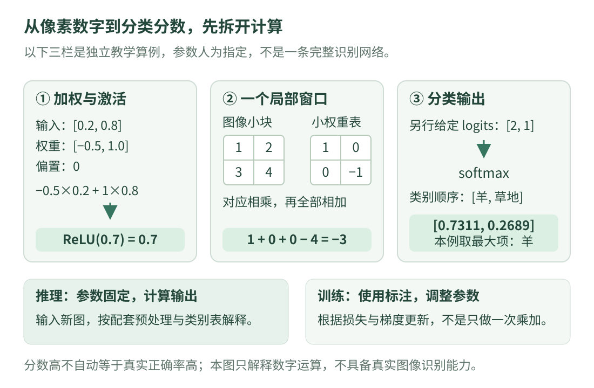

# 09 · 神经网络与图像分类

这一课回答一个具体问题：**图片原本是一堆数字，神经网络怎样把它们变成“更像羊”或“更像草地”的分数？** 先别急着记网络名称，也不用安装深度学习框架。我们先拿两个输入数做一次完整计算，再把同一套思路放回图像。

前提是知道像素、颜色通道，以及 Python 的列表、循环和函数。还不熟悉语法时，可以同时打开 [Python 代码阅读入门](../programming/python-reading.md)。本页的参数全部人为指定，只用来解释计算，没有经过训练，不能用来识别真实图片。

## 先看整条路

{ .learning-figure }

[打开大图](../assets/learning/cv-networks.svg)

想象你在判断一张照片是否拍到了羊。你可能会看轮廓、纹理和身体结构。神经网络没有人的这些直接经验，它收到的是像素数值；内部的一连串计算把原始数值变成新的数值，最后给每个预先约定的类别打分。**中间算出的数值叫特征，参与计算且可被学习调整的数叫参数。**

这里的“特征”并不总是一个能说出名字的部件。某层对明暗变化比较敏感，另一层组合前面的响应；不能仅凭某个数变大，就断言它一定表示“羊耳朵”。解释网络时要区分便于理解的比喻和经过验证的实际行为。

## 从像素开始：输入形状也是接口的一部分

一张高 2、宽 2 的灰度小图，只有 4 个亮度数，可以按约定顺序排成一个列表。彩色图还有颜色通道，一张高 480、宽 640、3 通道的图共有 `480×640×3` 个数。实际网络常将多张图片组成一批，额外增加一个批次维度；这些维度的排列必须按具体接口确认。

有些模型要求 RGB，有些读图接口默认得到 BGR；有些要求先缩放尺寸，再减去给定均值、除以给定标准差。**不能把任意图片除以 255，就认为已经满足任意模型的输入要求。** 对 8 位图像，除以 255 是把 0～255 映射到 0～1 的一种缩放；它解决数值范围，不会自动解决颜色顺序、图像尺寸和训练时的其他预处理。模型和预处理必须配套。[Torchvision 官方预处理说明](https://docs.pytorch.org/vision/stable/models.html#using-the-pre-trained-models)

本页只取两个已经缩放好的数 `0.2` 和 `0.8`。真实图像远大于它们，但一个计算单元如何处理输入，原理可以先用这两个数看清楚。

## 加权求和：不同输入可以有不同影响

把一个最小的计算单元写成公式：

\[
z=w_1x_1+w_2x_2+b
\]

`x` 是输入，`w` 是权重，`b` 是偏置，`z` 是加权后的结果。下标 1、2 只是区分第几个数。权重像一个调节旋钮：正权重让输入增加时结果增加，负权重让输入增加时结果减少；偏置是在所有乘加结束后额外加上的固定量。

令 `x₁=0.2`、`x₂=0.8`，权重分别为 `−0.5` 和 `1.0`，偏置为 `0`，那么：

\[
z=(-0.5)\times0.2+1.0\times0.8+0=-0.1+0.8=0.7
\]

这不是“0.8 对应的像素有 80% 概率是羊”。它只是一次乘加计算，单位和含义由前后层定义。我们手动选权重是为了能算清；实际监督学习会根据带标注的样本和损失函数调整大量参数。

## 激活函数：为什么乘加后还要处理一次？

如果每一层都只做“乘权重再加偏置”，把许多层连起来，仍能合并成一层这样的运算。为了表达更复杂的输入输出关系，网络常在层之间加入非线性函数。一个常见例子是 ReLU：

\[
\operatorname{ReLU}(z)=\max(0,z)
\]

`max` 表示取两者中较大的那个。输入 `0.7` 时输出 `0.7`，输入 `−0.3` 时输出 `0`。它不是概率转换，也不是“负数都是错误数据”；它是网络结构中人为约定的一种运算。不同任务和网络会选用不同激活，不能认为每一层都必须使用 ReLU。

把上一节的 `0.7` 送进 ReLU，结果仍为 `0.7`。多个计算单元会产生多个输出，后续层再把这些输出当作新的输入，这就形成了网络的“层”。[PyTorch 官方神经网络入门](https://docs.pytorch.org/tutorials/beginner/blitz/neural_networks_tutorial.html)

## 卷积：拿同一把小尺子看不同局部

直接把整张大图摊平成一个长列表，会让位置结构变得不明显，也可能产生大量连接。卷积层的一种直观理解是：拿一张很小的权重表，在图像的不同位置做相同的局部乘加。

例如灰度图中的一个 `2×2` 小块为：

\[
\begin{bmatrix}1&2\\3&4\end{bmatrix}
\]

小权重表为：

\[
\begin{bmatrix}1&0\\0&-1\end{bmatrix}
\]

不加偏置时，在这个位置得到 `1×1+2×0+3×0+4×(−1)=−3`。将同一张权重表移动到另一个位置，再得到一个数，全部位置的结果组成新的二维表，叫特征图。这里没有将权重表翻转，符合深度学习框架里常称为卷积的互相关计算方式。[PyTorch Conv2d 定义](https://docs.pytorch.org/docs/stable/generated/torch.nn.Conv2d.html)

“步长”说明小窗口每次挪多少格，“填充”说明边缘是否先补一些值；二者会改变输出大小。多个输入通道时，还会对相应通道的结果求和。初学时先画出一个位置的乘加，再画第二个位置，不必一次背下所有形状公式。

小权重表不一定是人提前设计的边缘检测器。训练时，它的数值也可以被学习。局部复用参数是卷积的关键直觉，但不是所有图像网络都采用卷积；这里学的是一种常见结构。

## 分类输出：分数、概率形式和真实正确率

假设最后一层输出两个原始分数，按类别表依次为“羊”和“草地”，数值是 `[2,1]`。原始分数常叫 **logits**，可以为负，也不要求加起来等于 1。

单标签分类常用 softmax 把它们变成和为 1 的正数：

\[
p_i=\frac{e^{z_i}}{\sum_j e^{z_j}}
\]

`e` 是自然常数，`i` 表示当前类别，分母把所有类别的指数值加起来。为了避免数值太大，程序可以先从所有分数减去相同的最大值，结果不变。本例变成 `[0,−1]`，所以第一项为 `1/(1+e⁻¹)≈0.7311`，第二项约为 `0.2689`。[PyTorch Softmax 定义](https://docs.pytorch.org/docs/stable/generated/torch.nn.Softmax.html)

取最大分数的位置叫 `argmax`。位置 0 对应哪种类别，必须查类别表，不能想当然。softmax 输出可解释为模型给当前类别的概率形式，但 `0.7311` **不自动意味着这些预测在现实中有 73.11% 的正确率**；还要用独立标注数据检验和校准。即使一张图既不像羊也不像草地，二选一的 softmax 仍会给出总和为 1 的数。

本页讨论“每张图只选一个类别”的分类。多标签任务允许同一图有多个类别，常用的输出处理不同。检测还要给出每个实例的位置，不能直接拿整图分类分数当作检测框。

## 完整小程序：把三种基础计算分开看

这份程序只用 Python 标准库 `math`。三部分是独立的算术示范，**不是前后连接的完整图像识别网络**：第一部分算一个单元，第二部分算一个局部窗口，第三部分把另行指定的 logits 变成分类分数。这样每个数字都有出处。

```python title="network_numbers.py · 独立教学示例"
import math  # 标准库：这里用 exp 计算指数，不需要额外安装。


def relu(value):
    # 对当前单个数字应用 ReLU：负数变 0，其余保留。
    return max(0.0, value)


def softmax(scores):
    # 必须至少有一个类别，否则最大值和分母都没有意义。
    if not scores:
        raise ValueError("类别分数不能为空")
    largest = max(scores)
    # 减去最大值，避免直接对很大的正数求指数。
    exponentials = [math.exp(score - largest) for score in scores]
    total = sum(exponentials)
    return [value / total for value in exponentials]


# 第一部分：两个输入进入一个带偏置的计算单元。
inputs = [0.2, 0.8]
weights = [-0.5, 1.0]
bias = 0.0
weighted = sum(x * w for x, w in zip(inputs, weights)) + bias
print(f"加权结果: {weighted:.2f}")
print(f"ReLU结果: {relu(weighted):.2f}")

# 第二部分：仅计算 2×2 局部窗口的一个响应，不移动窗口。
patch = [[1, 2], [3, 4]]
kernel = [[1, 0], [0, -1]]
response = 0
for row in range(2):
    for column in range(2):
        response += patch[row][column] * kernel[row][column]
print(f"局部响应: {response}")

# 第三部分：独立演示分类输出，logits 不是上面的响应算出来的。
class_names = ["羊", "草地"]
probabilities = softmax([2.0, 1.0])
best_index = max(range(len(probabilities)), key=lambda i: probabilities[i])
print("分类分数:", " ".join(f"{p:.4f}" for p in probabilities))
print("预测类别:", class_names[best_index])
```

预期输出：

```text
加权结果: 0.70
ReLU结果: 0.70
局部响应: -3
分类分数: 0.7311 0.2689
预测类别: 羊
```

先读 `inputs` 与 `weights`，用手算确认 `0.7`；再跟着两个循环，在纸上写出局部窗口的四个乘积。最后读 `softmax`：列表推导式是“把每个分数处理一次”，`sum` 是把结果相加，`lambda i: probabilities[i]` 表示比较各位置保存的分数。`:.4f` 只控制显示四位小数，不会把模型变得更精确。

## 训练和推理究竟差在哪里？

**推理**是参数已经给定，输入一张新图，得到输出。本页做的就是固定参数下的算术。本页讨论的**监督分类训练**需要带标注的样本：先预测，再用损失函数衡量预测和标注的差别，根据梯度更新参数，反复进行；其他训练方式的学习信号可能不同。梯度可以先理解为“参数稍微变一下，损失倾向如何变”；它不是额外的人工正确答案。[PyTorch 官方训练过程](https://docs.pytorch.org/tutorials/beginner/blitz/neural_networks_tutorial.html)

例如正确类别是羊，模型却给羊很低的分数，合适的分类损失会较大。优化器尝试让训练样本的损失下降，但训练集表现更好不等于新场景也更好，后面还要学习数据划分。真实框架中，某些层的训练和评估行为不同；评估模式与是否记录梯度也不是同一个设置。[Torchvision 模式说明](https://docs.pytorch.org/vision/stable/models.html#using-the-pre-trained-models)

## 动手练习：先预测，再改数字

<div class="practice-card" markdown="1">

<p class="practice-kicker">只改数字，不需要训练</p>
<p class="practice-title">哪些变化会改变结果？</p>

把第三部分的分数改成 `[12.0,11.0]`，先猜 softmax 会不会变。再把第一部分偏置改为 `−1.0`，算出新的加权值与 ReLU 输出。两项修改分别属于不同示范，不要把它们误看成一条网络。

??? tip "提示"

    softmax 的稳定写法先减去最大值；两个分数都增加 10 后，相减结果会怎样？ReLU 要比较输入与 0。

??? example "展开参考答案"

    `[12,11]` 减去最大值仍为 `[0,−1]`，输出仍约为 `0.7311、0.2689`。偏置改为 `−1` 后，加权值为 `−0.3`，ReLU 输出为 `0`。改变分类分数的共同偏移，与改变某一层偏置是两个不同问题。

</div>

## 常见误区与自查

“网络越大就一定越准”忽略了训练数据、模型选择和实际测试；“模型分数很高就不用检查”忽略了新场景和置信度校准；“图像分类能告诉我羊在哪里”混淆了类别与位置。看到模型接口时，先写清输入形状、数值范围、类别表和输出含义，再判断它是否适合当前任务。

读完后，应能亲手算出一个乘加、一个 ReLU 和一个 softmax，并解释为什么这还不是可以识别羊的系统。接下来把“整张图是什么”变成“有哪些对象、分别在哪里”。

## 继续阅读

- [PyTorch 神经网络入门](https://docs.pytorch.org/tutorials/beginner/blitz/neural_networks_tutorial.html)：完整框架中的前向计算、损失和更新流程；本页不要求安装运行。
- [Conv2d 官方定义](https://docs.pytorch.org/docs/stable/generated/torch.nn.Conv2d.html)与 [Softmax 官方定义](https://docs.pytorch.org/docs/stable/generated/torch.nn.Softmax.html)：核对算子的精确定义。

---

[返回视觉学习路线](index.md) · [上一课：相机与空间几何](camera.md) · [下一课：目标检测 →](detection.md)
