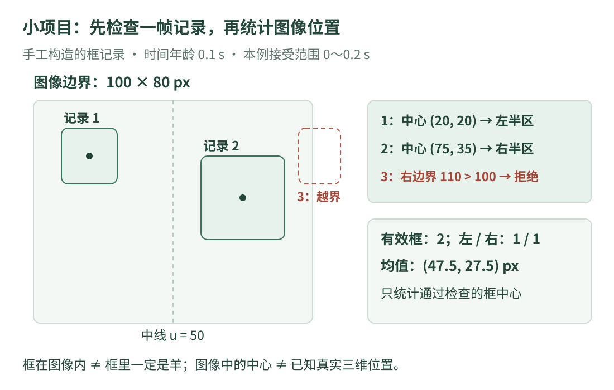

# 13 · 小项目：先检查视觉记录，再统计结果

现在把前面几章接起来。任务很明确：**给你一帧已经写好的框记录，检查它的时间、尺寸和坐标，再统计有效框的图像位置。**

本章使用手工构造的数据，不读取照片、不加载模型。它不是一个自动检测器；我们练习的是视觉模块中同样重要的“检查接口与整理结果”。先完成[目标检测](detection.md)和[数据评估](evaluation.md)，再读完整程序。

## 1. 先画清任务边界

{ .learning-figure }

[打开大图](../assets/learning/cv-project.svg)

输入图像宽 100、高 80，坐标单位为像素。框采用连续边界 `(左, 上, 右, 下)`；右边界允许等于 100，下边界允许等于 80。**这是边界坐标，不是直接访问数组的整数像素下标。**

三个记录编号只用来解释输出，不代表跨帧跟踪身份：

| 记录 | 类别 | 框边界 | 本例预期 |
| --- | --- | --- | --- |
| 1 | sheep | `(10,10,30,30)` | 中心 `(20,20)`，位于图像左半区 |
| 2 | sheep | `(60,20,90,50)` | 中心 `(75,35)`，位于图像右半区 |
| 3 | sheep | `(95,10,110,30)` | 右边界超出图像，本例拒绝 |

这里的“左、右”仅相对这张图像。它不自动变成世界方向，也不能说明羊在机器人左边多少米。

## 2. 检查的顺序为什么重要

先确认整帧是否可用，再计算单个框。帧的采集时间若已经过期，继续统计也只是在整理旧观测。

本例约定：采集时间与当前时间来自同一个时钟；数据年龄必须在 0～0.2 秒之间。采集时刻是 10.0，当前时刻是 10.1，年龄约为 0.1 秒。**时间范围是教学设置，不是所有系统的通用标准。**

单个框依次检查类别、四项数是否有限、宽高是否为正、是否位于图像边界内。与图像边界相交的框在真实系统里也可以采用裁剪等其他规则，但本例明确选择拒绝；不能悄悄裁剪后还把结果当成原框。

## 3. 先手算预期结果

前两个中心分别为 `(20,20)` 和 `(75,35)`。图像宽度的一半是 50；本例规定中心横坐标小于 50 为左半区，等于或大于 50 为右半区。

因此有效框为 2 个，左右各 1 个。中心的算术平均值为：

$$
\bar u=(20+75)/2=47.5,\qquad
\bar v=(20+35)/2=27.5.
$$

这个结果是**两个有效框中心在图像中的平均值**，不是已确认的羊群真实重心；没有被记录、被遮挡或未通过检查的羊都没有进入这个统计。

## 4. 完整代码：每个阶段保留自己的含义

程序只使用 Python 标准库 `math`。输入字典的字段和类型固定如本例所示；它不是能接受任意 JSON 的通用校验器。

```python title="检查一帧合成视觉记录 · 独立教学示例"
import math


def frame_problem(frame, now_s):
    # 先检查图像尺寸，避免对不存在的图像范围做统计。
    if frame["width"] <= 0 or frame["height"] <= 0:
        return "invalid image size"

    captured_s = frame["captured_s"]
    if not math.isfinite(captured_s) or not math.isfinite(now_s):
        return "invalid time"

    age_s = now_s - captured_s  # 必须采用同一个时钟的秒数。
    if age_s < 0.0:
        return "future timestamp"
    if age_s > 0.2:
        return "frame too old"
    return None  # 本例用 None 表示“没有发现帧级问题”。


def box_problem(record, width, height):
    if record["label"] != "sheep":
        return "other category"

    # 这里约定 box 恰好有四个数，顺序固定，不自动猜格式。
    left, top, right, bottom = record["box"]
    if not all(math.isfinite(value) for value in record["box"]):
        return "invalid number"
    if not left < right or not top < bottom:
        return "non-positive size"
    if left < 0.0 or top < 0.0 or right > width or bottom > height:
        return "outside image"
    return None


def summarize(frame, now_s):
    problem = frame_problem(frame, now_s)
    if problem is not None:
        print(f"frame rejected: {problem}")
        return  # 整帧无效，不继续把里面的框当成新观测。

    age_s = now_s - frame["captured_s"]
    print(f"frame age: {age_s:.3f} s")
    valid_centers = []
    counts = {"left": 0, "right": 0}

    for record in frame["records"]:
        problem = box_problem(record, frame["width"], frame["height"])
        if problem is not None:
            print(f"record {record['number']}: rejected ({problem})")
            continue  # 跳过这个框，不是结束整帧循环。

        left, top, right, bottom = record["box"]
        center_u = (left + right) / 2.0
        center_v = (top + bottom) / 2.0
        zone = "left" if center_u < frame["width"] / 2.0 else "right"
        valid_centers.append((center_u, center_v))
        counts[zone] += 1
        print(f"record {record['number']}: center=({center_u:.1f}, "
              f"{center_v:.1f}) px, zone={zone}")

    print(f"valid boxes: {len(valid_centers)}")
    print(f"left/right: {counts['left']}/{counts['right']}")
    if not valid_centers:
        print("no valid centers")  # 没有数据，不写成中心 (0,0)。
        return

    mean_u = sum(center[0] for center in valid_centers) / len(valid_centers)
    mean_v = sum(center[1] for center in valid_centers) / len(valid_centers)
    print(f"mean center: ({mean_u:.1f}, {mean_v:.1f}) px")


frame = {
    "width": 100,
    "height": 80,
    "captured_s": 10.0,
    "records": [
        {"number": 1, "label": "sheep", "box": (10, 10, 30, 30)},
        {"number": 2, "label": "sheep", "box": (60, 20, 90, 50)},
        {"number": 3, "label": "sheep", "box": (95, 10, 110, 30)},
    ],
}
summarize(frame, now_s=10.1)
```

预期输出：

```text
frame age: 0.100 s
record 1: center=(20.0, 20.0) px, zone=left
record 2: center=(75.0, 35.0) px, zone=right
record 3: rejected (outside image)
valid boxes: 2
left/right: 1/1
mean center: (47.5, 27.5) px
```

## 5. 这几种 Python 写法分别在做什么

`frame["width"]` 按字典键取一项数据；`record["box"]` 则得到四个数构成的元组。`left, top, right, bottom = ...` 把四项按顺序拆到四个变量，不是在运行四次检测。

`all(...)` 要求每个分量都通过有限性检查；`None` 是本例函数表示“没有发现问题”的约定。它与一个具体字符串原因区分，不能把它当作合法框的数值。

列表中的 `(center_u, center_v)` 保留了横纵顺序。最后的 `center[0]` 只取横坐标，`center[1]` 只取纵坐标，分别求平均。先排除空列表，是为了避免除以零，也避免把缺失信息显示成一个看似可信的位置。

## 6. 为什么仍然不能据此宣布视觉系统准确

| 程序完成的事 | 它没有证明的事 |
| --- | --- |
| 框在图像内，宽高为正 | 框里一定真的是羊 |
| 类别字段写为 sheep | 类别判断必然正确 |
| 数据时间满足本例约定 | 两个设备时钟一定已经对齐 |
| 算出了中心 | 中心对应羊身上稳定的三维点 |
| 统计了两个有效框 | 整个场景中只有两只羊 |

同一只羊若被重复记录，当前程序会重复统计；记录编号本身不会自动去重。下一步应按任务定义检查重复、误检与漏检，而不是仅把打印结果接到动作指令中。

## 7. 练习：过期与缺失，分别怎样处理

第一题只把调用处的 `now_s` 改成 10.3，其他不变。第二题保持原时间，把前两个框也改成超出图像范围，让三条都被拒绝。第三题思考：中心横坐标恰好为 50 时属于哪一侧？

??? tip "先看帧，再看框"

    第一题会在进入逐框循环前返回；第二题能够处理帧，但有效中心列表最后为空。第三题只需找比较符号是否包含等号。

??? example "展开答案"

    第一题只输出 frame rejected: frame too old，不继续打印框中心。第二题输出逐条拒绝原因、valid boxes: 0、left/right: 0/0，最后输出 no valid centers，不会显示平均位置 (0,0)。

    第三题进入右半区，因为本例只有严格小于 50 才归左侧。边界归哪一侧是人为约定，需要让统计与展示采用相同规则。

## 8. 继续前，用一句话复述这个项目

“我检查了已有记录的时间与几何合法性，统计图像坐标；我还没有从原始照片识别羊、验证全部类别、恢复跨帧身份或估计真实三维位置。”能清楚说明这些范围，就知道后续每一步还需要什么证据。

[返回视觉学习路线](index.md) · [上一章：数据集与评估](evaluation.md) · [下一章：放牧视觉的应用与限制 →](herding.md)
