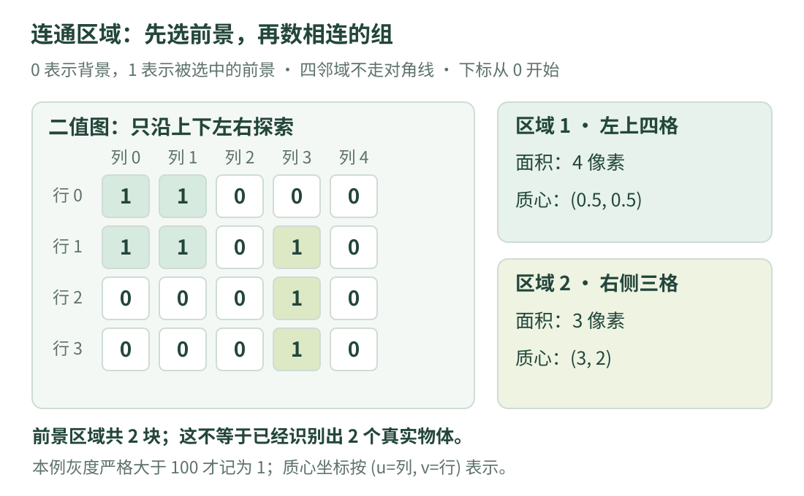

# 06 · 二值图与连通区域：从亮点表格到一块块区域

桌面上有几张亮色小纸片，背景较暗。我们能否先把“较亮的位置”挑出来，再数有几块相连的亮区域？这个任务可以拆成两步：先做阈值判断，生成二值图；再按照明确的邻居规则，把相连的前景像素分成组。

!!! tip "学习目标与前提"

    先读 [05 · 滤波与边缘](filtering.md)，知道灰度是图像中的数字。本课只使用一个 4×5 数字表，不需要安装图像库。

    学完后，应能手算阈值结果，区分四邻域与八邻域，解释面积、外接框和质心，并明白“连通区域数量”为什么不一定等于“真实物体数量”。

## 1. 看图：三个阶段别混在一起

{ .learning-figure }

[打开大图](../assets/learning/cv-regions.svg)

**灰度图 → 二值图 → 区域编号图**。灰度图保留明暗强弱；二值图只回答是否被选中；区域编号图进一步说明，被选中的像素属于哪一组。

二值图常用 0 和 255 显示黑白。本课为了容易数数，使用 0 和 1：0 为背景，1 为前景。这里的“前景”只是我们要分析的像素集合，不代表算法已经认识纸片。

## 2. 阈值：把一句判断写成公式

本课设阈值 $T=100$：灰度严格大于 100 才变成 1；等于或小于 100 都变成 0。

$$
B(v,u)=\begin{cases}1,&I(v,u)>T\\0,&I(v,u)\leq T\end{cases}
$$

| 符号 | 通俗解释 |
| --- | --- |
| $I(v,u)$ | 第 $v$ 行、第 $u$ 列的原始灰度 |
| $T$ | 判断门槛，本例为 100 |
| $B(v,u)$ | 只含 0/1 的输出 |
| $>$、$\leq$ | 严格大于、或小于等于，边界含义必须说清 |

输入如下：

```text
120 130  20  20  20
125 140  20 180  20
 20  20  20 190  20
 20  20  20 200  20
```

逐个比较得到：

```text
1 1 0 0 0
1 1 0 1 0
0 0 0 1 0
0 0 0 1 0
```

阈值不会自动选择“最有意义”的对象。若纸片处于阴影里，灰度可能低于门槛；背景反光也可能被挑中。OpenCV 的普通 `THRESH_BINARY` 使用上述严格大于规则，只是最大输出值由调用者指定；Python 接口返回使用的阈值及结果图。可核对 [OpenCV 阈值教程](https://docs.opencv.org/4.11.0/d7/d4d/tutorial_py_thresholding.html)。

## 3. 连在一起，到底怎样算“邻居”

先固定一个前景像素，问下一步可以往哪里走：

| 规则 | 允许的直接一步 | 对角线接触算不算直接连接 |
| --- | --- | --- |
| 四邻域 | 上、下、左、右 | 不算 |
| 八邻域 | 四邻域加四个对角方向 | 算 |

“同一个连通区域”指从一个前景像素出发，只沿允许的方向经过前景像素，能够走到另一个像素。路径可以拐弯，不要求两个像素直接挨着。

用最小例子观察区别：

```text
1 0
0 1
```

四邻域下有两个前景区域；八邻域下有一个。哪种规则合适，要看任务和约定，不能以“数出来更像预期”为理由随意更换。

本章固定用四邻域。4×5 表中，左上有一块 2×2 区域，右侧有一条竖着的三像素区域，中间没有前景路径相连，所以共两块。

## 4. 给每块区域描述大小和位置

为避免“x、y 谁先写”的混淆，本课坐标统一写 `(u, v)`，即列、行，左上索引为 `(0, 0)`。

左上区域的四个位置是 `(0,0)、(1,0)、(0,1)、(1,1)`。由此计算：

- **像素面积**：前景像素个数，等于 4。它不是平方米。
- **外接框**：最小列 0、最大列 1，最小行 0、最大行 1。本例按包含两端像素索引计数，宽是 `1−0+1=2`，高也是 2。
- **质心**：把所有前景像素中心的坐标分别平均，得到 `(0.5, 0.5)`。

对于 $N$ 个同权重前景像素：

$$\bar u=\frac{1}{N}\sum_{i=1}^{N}u_i,\qquad\bar v=\frac{1}{N}\sum_{i=1}^{N}v_i$$

$i$ 是当前数到的像素编号；$u_i,v_i$ 是它的位置；横线表示平均结果。质心可以是小数，也可能落在背景或区域外部，例如弯月形区域。它不一定是某个实际前景像素。

**面积与外接框面积也不同。** L 形的三个像素可占一个 2×2 外接框：区域面积为 3，框面积为 4。不要把框里所有背景都算作前景。

## 5. 完整代码：像沿小路探索一样找区域

下面采用广度优先搜索（BFS）。可以把 `queue` 想成“接下来还要检查的位置清单”：发现一个新邻居就把它加入清单，检查完一个再取下一个。代码完整且只使用 Python 标准库。

```python title="阈值与四邻域区域统计 · 独立教学示例"
from collections import deque


def find_regions(binary):
    # 本函数约定输入是非空、各行等长的 0/1 二维列表。
    height = len(binary)
    width = len(binary[0])
    visited = set()  # 集合保存已经加入过队列的位置，避免重复。
    regions = []
    neighbors = [(-1, 0), (1, 0), (0, -1), (0, 1)]

    for row in range(height):
        for col in range(width):
            if binary[row][col] == 0 or (row, col) in visited:
                continue  # 背景或已处理过的位置，跳过。

            queue = deque([(row, col)])
            visited.add((row, col))
            pixels = []

            while queue:
                current_row, current_col = queue.popleft()
                pixels.append((current_row, current_col))
                for dr, dc in neighbors:
                    nr = current_row + dr
                    nc = current_col + dc
                    # 先检查范围，不能让负下标绕到列表末尾。
                    if not (0 <= nr < height and 0 <= nc < width):
                        continue
                    if binary[nr][nc] == 0 or (nr, nc) in visited:
                        continue
                    # 加入队列时就标记，避免同一像素反复入队。
                    visited.add((nr, nc))
                    queue.append((nr, nc))

            regions.append(pixels)
    return regions


gray = [
    [120, 130, 20, 20, 20],
    [125, 140, 20, 180, 20],
    [20, 20, 20, 190, 20],
    [20, 20, 20, 200, 20],
]
threshold = 100
binary = [[1 if value > threshold else 0 for value in row] for row in gray]
regions = find_regions(binary)
print(f"四邻域前景区域数: {len(regions)}")

for number, pixels in enumerate(regions, start=1):
    # 保存时是 (行, 列)，输出位置时转为 (u=列, v=行)。
    rows = [row for row, col in pixels]
    cols = [col for row, col in pixels]
    area = len(pixels)
    left, top = min(cols), min(rows)
    width = max(cols) - left + 1
    height = max(rows) - top + 1
    center_u = sum(cols) / area
    center_v = sum(rows) / area
    print(f"区域 {number}: 面积={area}, 框=({left}, {top}, {width}, {height}), "
          f"质心=({center_u:.3f}, {center_v:.3f})")
```

预期输出：

```text
四邻域前景区域数: 2
区域 1: 面积=4, 框=(0, 0, 2, 2), 质心=(0.500, 0.500)
区域 2: 面积=3, 框=(3, 1, 1, 3), 质心=(3.000, 2.000)
```

`set()` 是集合，用来回答“这个位置以前见过吗”；`deque` 是适合从两端取放数据的队列。`popleft()` 取出最早加入且尚未检查的位置，不会自动去图像中寻找对象，寻找逻辑由后面的四邻域循环完成。

外层循环每遇到一个尚未访问的前景像素，就启动一次完整探索。探索结束后才把这块像素清单保存下来。这里的编号按扫描发现顺序产生，并不代表真实物体身份。

OpenCV 提供 `connectedComponentsWithStats` 计算编号、统计与质心。它的标签 0 留给背景，返回总标签数包含背景；输入要求、四/八连通选择及统计字段应查 [OpenCV 区域分析参考](https://docs.opencv.org/4.11.0/d3/dc0/group__imgproc__shape.html)。本例 `len(regions)` 只数前景，与包含背景的返回总数不能直接比较。

## 6. 连通区域、轮廓与形态学的区别

连通区域保存“属于同一块的像素”；轮廓主要描述边界。对带孔的形状，轮廓还可能有内外层级。用轮廓围成的几何面积，不一定等于逐个数前景像素的面积，尤其是很小的区域。阅读代码时先查统计方法，再比较两个面积数字。

形态学使用小邻域形状处理前景：腐蚀通常收缩亮前景，膨胀通常扩张亮前景。它们可以帮助处理细小断裂或孤立点，但也会改变真实形状。两个物体只隔一列像素，膨胀后可能粘成一块；很细的一条真实线，也可能被腐蚀去掉。因此“清理后只剩两块”不等于“画面确实只有两个物体”。基本定义和边界细节可继续查 [OpenCV 滤波与形态学参考](https://docs.opencv.org/4.11.0/d4/d86/group__imgproc__filter.html)。

## 7. 动手练习：为什么物体数量可能数错

<div class="practice-card" markdown="1">

<p class="practice-kicker">先改变一个像素，再解释影响</p>
<p class="practice-title">在行索引 1、列索引 2 的位置补一个 1，会不会把两块连起来？</p>

这里行列都从 0 开始。先画四邻域路径，再看区域数量、面积和质心会怎样变化。你无需先改代码，就能预测关键结果。

??? tip "展开提示"

    新位置 `(u=2, v=1)` 的左邻居是左侧区域，右邻居是右侧区域。注意不是“第一个显示行”的意思。

??? example "展开参考答案"

    会。它连接 `(1,1)` 与 `(3,1)`，两块变成一块，面积为 `4+1+3=8`。新区域列坐标之和为 13、行坐标之和为 9，因此质心为 `(13/8, 9/8)=(1.625, 1.125)`。一个桥接像素就能改变连通关系，这说明区域计数依赖二值化质量。

</div>

## 8. 检查清单

先确认前景选亮还是选暗、阈值是否包含等号，再确认四/八邻域和背景编号。统计时注明是像素个数、轮廓面积还是外接框面积。图像缩放后像素面积会变，阈值也可能因插值变化；不能直接把像素统计当作真实尺寸。

纸片重叠可能合成一块，一张纸片有阴影又可能断成两块。下一课改用局部纹理的“特征”，尝试在两张图中寻找相似的小区域。

---

[返回视觉学习路线](index.md) · 上一课：[05 · 滤波与边缘](filtering.md) · 下一课：[07 · 特征与匹配](features.md) →
