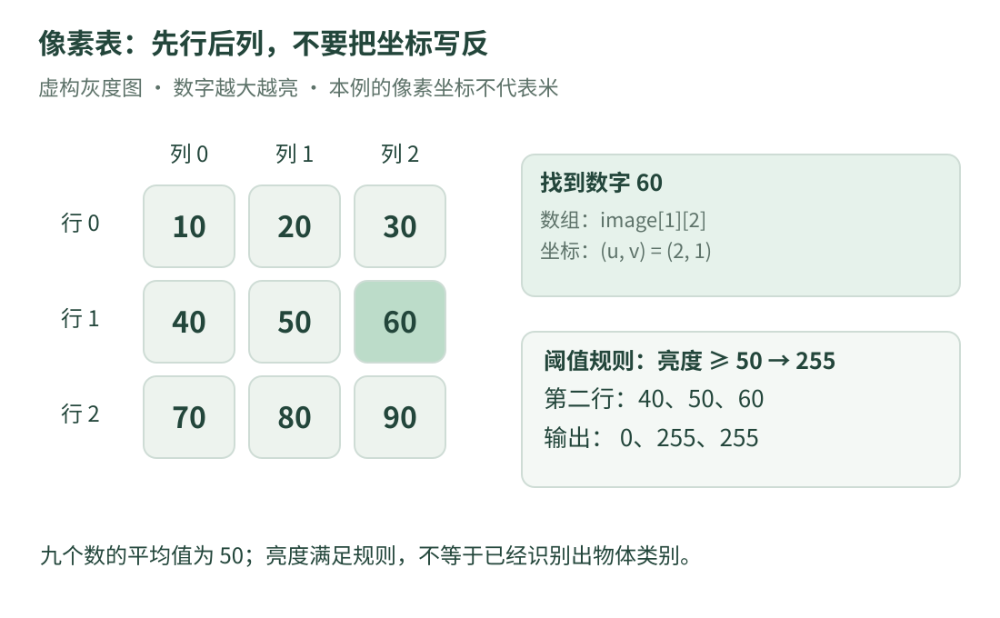

# 04 · 图像其实是数字：像素、通道与简单处理

为什么视觉工程会出现很多数组、行列和数值类型？因为图像在计算机中，首先是一份**带形状和格式的数字数据**。本课用一张虚构的 3×3 灰度图，从读一个像素开始。

先会第二课的循环即可。不要求相机、照片或 OpenCV 安装；本章程序只处理自己写在代码中的九个数。

## 1. 小图也有坐标规则

{ .learning-figure }

[打开大图](../../assets/learning/rmcv-pixels.svg)

本例三行三列，数组下标从 0 开始：第 0 行是 `10、20、30`，第 1 行是 `40、50、60`，第 2 行是 `70、80、90`。我们约定数字越大越亮。

| 名称 | 本例约定 | 找到数值 60 |
| --- | --- | --- |
| 行 row / r | 自上而下增加 | 第 1 行 |
| 列 column / c | 自左向右增加 | 第 2 列 |
| 横坐标 u / x | 与列方向一致 | u = 2 |
| 纵坐标 v / y | 与行方向一致 | v = 1 |

所以这个像素的坐标写成 `(u, v) = (2, 1)`，数组访问却写 `image[1][2]`，先行后列。看到两个数，先问约定是什么，不要直接互换。

**像素坐标不是米制位置**。图像里向右移动 10 个像素，不能不经标定和几何条件就说物体移动了 10 米。更完整的几何说明见[视觉概览](../index.md)。

## 2. 通道，是每个位置保存几项数

一张常见的 8 位灰度图，每个像素用 0～255 的一个整数表示亮度。彩色图的每个位置可能保存三项颜色分量；“三通道”不是三张不同时间拍的照片。

RGB 表示红、绿、蓝三个分量。OpenCV 常见彩色读取方式返回 BGR 顺序，但不能把它扩大成“任何相机和任何 OpenCV 数据都一定是 BGR”；要查采集或解码接口。把红蓝顺序读反，颜色解释就会错。

`CV_8UC3` 可以拆成：8 位、无符号、3 通道。OpenCV 的图像也可以采用其他位深、浮点数或其他通道数。接口约定与容器说明可核对 [OpenCV Mat 入门](https://docs.opencv.org/4.13.0/d6/d6d/tutorial_mat_the_basic_image_container.html)。

## 3. 一个算法，先说清输入和规则

**算法**就是为某类问题规定的处理步骤。本章只演示两个非常小的操作：

1. 求这九个亮度的平均值：总和 450，除以 9，得到 50。
2. 做阈值比较：本例规定“数值大于或等于 50 输出 255，其余输出 0”。

“大于或等于”是我们明确规定的规则。不同库的某些阈值接口用严格大于；看到接口名字相同也需要核对边界。

阈值结果表示亮度是否满足本例规则，**不表示程序已经知道哪里是羊、哪里是草地**。语义识别是另一个问题，不能把亮度分类当成类别识别。

## 4. 完整代码与输出

```cpp title="读取像素并比较亮度 · 独立教学示例"
#include <array>     // 固定大小的数组。
#include <iomanip>
#include <iostream>

int main() {
    using Row = std::array<int, 3>;  // 一行有 3 个整数。
    const std::array<Row, 3> image{{
        Row{10, 20, 30},
        Row{40, 50, 60},
        Row{70, 80, 90},
    }};

    // at() 按下标取值；这里先行 1，再列 2，得到 60。
    std::cout << "row 1, col 2: " << image.at(1).at(2) << '\n';

    double sum = 0.0;
    for (const auto& row : image) {
        for (int pixel : row) {
            sum += pixel;  // 把每个像素的亮度加入总和。
        }
    }

    // 本例形状固定为 3×3，恰好 9 个像素。
    std::cout << std::fixed << std::setprecision(1);
    std::cout << "mean: " << sum / 9.0 << '\n';

    const int threshold = 50;
    for (const auto& row : image) {
        for (std::size_t col = 0; col < row.size(); ++col) {
            // >= 是本课自己的规则；?: 根据条件二选一。
            const int mask = row.at(col) >= threshold ? 255 : 0;
            if (col != 0) {
                std::cout << ' ';  // 同一行的数字用空格分开。
            }
            std::cout << mask;
        }
        std::cout << '\n';  // 一行结束，再处理下一行。
    }
}
```

预期输出：

```text
row 1, col 2: 60
mean: 50.0
0 0 0
0 255 255
255 255 255
```

程序用 `int` 保存教学亮度，方便打印。它没有模拟真实图像格式的全部内存布局，也没有做图像文件读取。真实 8 位无符号数若直接累加到同样窄的类型，可能溢出；累加应选合适的类型。

## 5. 新语法放回代码里解释

`std::array<int, 3>` 中，第一项是元素类型，第二项是编译时确定的长度。`std::array<Row, 3>` 是三行，每行又是三个整数。它与可变长度的 `vector` 不是同一容器。

`const auto& row` 是只读引用，逐行处理时不复制整行。内层循环的 `int pixel` 则取出一个整数副本；这里整数很小，两种写法都容易理解。

`++col` 把列下标加一；`col < row.size()` 确保有效下标从 0 到 2。`.at()` 会检查范围，越界会抛异常；这不等于使用者可以忽略下标规则。

条件表达式 `condition ? A : B` 在本例是：“若条件成立，结果为 255，否则为 0。”它得到一个值，不是在这里修改原图。原图被定义为 `const`。

## 6. 平均值与均值滤波，不要混成一个概念

本程序求的是**整张 3×3 小图的一个平均数**。均值滤波通常在每个像素附近取一个邻域，分别求平均，产生一张新图。

如果只计算本例中心像素周围的 3×3 邻域，它刚好包含这九个数，所以结果也是 50。这个巧合不表示“整图均值就是完整均值滤波”。边缘处邻域不完整，还要规定补边方式，不能悄悄随便少算几个数。

均值滤波常能减少局部波动，也会模糊边缘；它不保证恢复真实图像。可查 [OpenCV 的平滑说明](https://docs.opencv.org/4.13.0/d4/d13/tutorial_py_filtering.html)，重点看核大小、归一化和边界处理。

## 7. 看到 cv::Mat，先查是否共享像素

真实视觉工程常用 `cv::Mat` 保存图像。对于普通、由 OpenCV 管理存储的矩阵，`cv::Mat b = a;` 通常共享像素存储，只复制矩阵头；修改共享区域可能影响另一份视图。需要独立像素副本时，可根据需求使用 `clone()` 或 `copyTo()`。

这与第三课的“值复制要继续看内部资源”呼应。只看到赋值符号，不能保证得到独立照片。若矩阵包装了外部内存，外部数据的生命周期还需另行保证，不能靠矩阵头自动延长所有外部资源寿命。上述行为以 [OpenCV Mat 文档](https://docs.opencv.org/4.13.0/d6/d6d/tutorial_mat_the_basic_image_container.html)为依据。

## 8. 练习：边界 50 应该去哪边

把完整示例唯一的 `>=` 改成 `>`，其他不变。第二行的三个输出会变成什么？为什么数值 60 的位置不用变化？

??? example "展开答案"

    第二行变成 0 0 255。40 和 50 都不严格大于 50，60 严格大于 50。改变的是比较边界，不是像素所在的位置。

    再确认数组中 60 是第 1 行第 2 列，坐标是 (u,v)=(2,1)。行列顺序与比较规则是两件不同的事。

[返回课程路线](index.md) · [上一课：类型与所有权](cpp-types.md) · [下一课：05 · 矩阵与误差 →](math.md)
