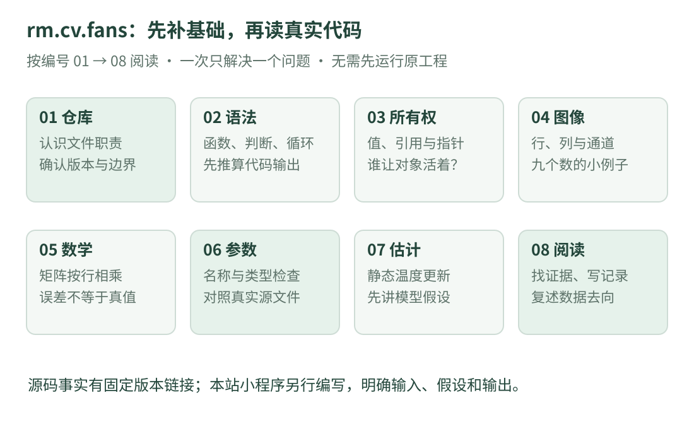

# rm.cv.fans 阅读入门：从看懂一行 C++ 开始

开源项目阅读课 · 零基础路线

第一次打开一个视觉工程，满屏的英文、尖括号和公式很容易让人失去方向。我们把阅读拆成八课：先认文件，再学语法，用小数字理解图像与数学，最后沿着一条真实的参数读取路径读源码。

[从第一课开始 →](repository.md){ .md-button .md-button--primary }
[查看原仓库](https://github.com/julyfun/rm.cv.fans){ .md-button }

## 先认识这个项目

`julyfun/rm.cv.fans` 是 RoboMaster 视觉工程仓库，README 标题为 **LMTD — Linear Modelled Top Detector**。仓库含视觉相关组件、数学工具、参数管理与线程间共享设施，也包含比赛专用的瞄准和火控模块。它是实际工程代码，**不是按初学者顺序编排的教材**。项目用途以[作者的 README](https://github.com/julyfun/rm.cv.fans/blob/6abd1bf359356d1d603766c4b3bcabbb1d6432b2/README.md)为准。

这套课讲通用的 C++、图像、矩阵、测量估计和源码阅读方法。专用的瞄准、弹道与发射控制部分只介绍职责，不提供实现或接入设备的教程。独立例子使用虚构的亮度、温度和配置记录。

**与放牧研究的关系**：可以学习如何组织视觉软件、检查数据和阅读 C++；这个仓库本身没有因此变成羊群识别或放牧系统。不同任务的数据、类别、模型与评价方式需要重新设计。

## 看图选择学习顺序

{ .learning-figure }

[打开大图](../../assets/learning/rmcv-roadmap.svg)

- **第一阶段 · 找到方向**

    认识仓库、源文件和依赖；能说明“这一页代码在做哪一件事”。

- **第二阶段 · 补齐基础**

    读懂变量、函数、引用、指针与类型；用纸笔算图像和矩阵。

- **第三阶段 · 回到源码**

    认识配置、对象生命周期和测量估计；完成一次有证据的阅读记录。

## 八课分别解决什么问题

| 顺序 | 本课的问题 | 读完能做什么 |
| --- | --- | --- |
| [01 · 仓库与文件](repository.md) | 打开后应该先看哪里？ | 分清说明、声明、实现、配置和构建文件 |
| [02 · C++ 第一眼](cpp-basics.md) | 一行代码该从哪里读？ | 顺着一个有注释的小程序算出输出 |
| [03 · 类型与所有权](cpp-types.md) | `&`、`*`、`<>` 到底什么意思？ | 区分值、引用、指针、共享指针与可选值 |
| [04 · 图像其实是数字](images.md) | 程序怎样表示一张图？ | 区分行列、坐标、通道、均值与阈值 |
| [05 · 矩阵与误差](math.md) | 为什么视觉代码到处是矩阵？ | 手算矩阵乘法，理解平方误差与模型假设 |
| [06 · 参数与共享对象](configuration.md) | 配置里的数怎样进入 C++？ | 顺着真实参数模块解释查找、类型与更新 |
| [07 · 测量与滤波](estimation.md) | 有噪声的数怎样逐步合并？ | 手算一个静态温度估计，区分 KF 与 EKF |
| [08 · 带着问题读源码](reading-lab.md) | 学了基础后怎样自己继续？ | 完成阅读表、排查常见误会，并复述数据去向 |

零基础按顺序读；不需要先掌握整个机器人系统。每课先读图和数字，再读完整代码。暂时不懂的英文先查本课表格，不要一口气追进所有依赖库。

## 代码怎样使用

带“**独立教学示例**”标题的代码是本站另写的简化例子，包含自己的 `main()`，主要使用 C++17 标准库。它们解释一个概念，**不等同于原仓库实现**，也没有调用原项目或设备。页面给出完整代码与预期输出，阅读时可以先自己推算。

想自行编译前，先学本站的 [C++ 环境入门](../../programming/cpp/setup.md)和 [CMake 入门](../../programming/cpp/tooling.md)。不要求为阅读这套课安装 OpenCV、CUDA 或创建 Python 虚拟环境；不提供示例下载包。

## 版本、证据和限制

本次源码核对日期为 **2026-10-15**，阅读基准固定为提交 [`6abd1bf`](https://github.com/julyfun/rm.cv.fans/tree/6abd1bf359356d1d603766c4b3bcabbb1d6432b2)。后续作者改动 `main` 时，页面中的固定链接仍指向本次阅读的内容。

我们区分三种文字：**源码事实**附固定版本的文件链接；**通用概念**附标准或库的文档；**教学例子**明确输入、单位、假设和输出。README 中的效果描述属于作者说明，本课不把它们当成独立复现结论。

本次没有构建或运行原工程，也没有连接硬件。原仓库的[模块说明](https://github.com/julyfun/rm.cv.fans/blob/6abd1bf359356d1d603766c4b3bcabbb1d6432b2/aimer/auto_aim/README.md)保留了已知问题与历史记录；阅读时需区分当前实现、旧版记录与作者设想。第一课会具体说明构建材料的边界。

[返回视觉概览](../index.md) · [前往第一课：仓库与文件 →](repository.md)
