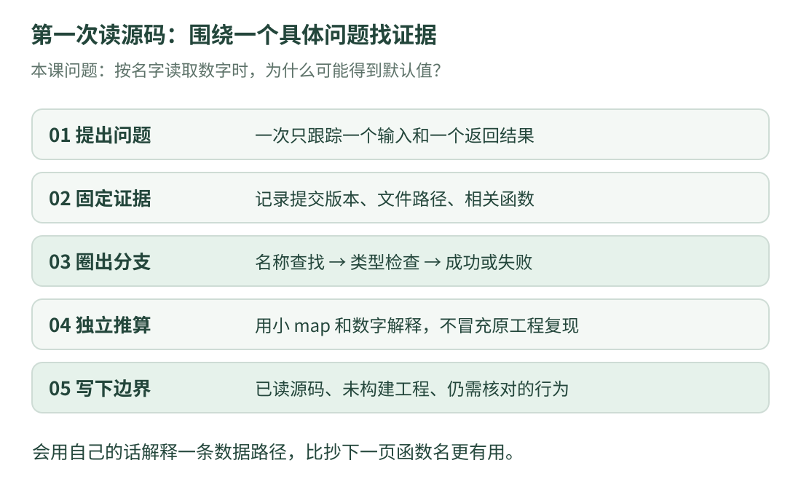

# 08 · 带着问题读源码：完成第一份阅读记录

最后一课把零散知识接起来：**只选一个小问题，找到源文件，解释输入、判断、输出和限制。** 不用把整个工程每一行都读完，才算学过一个项目。

先完成前七课。今天的问题是：“程序按名称取一个数字时，可能在哪些地方失败？”我们只沿通用配置模块阅读。

## 1. 用固定路径找到文件

{ .learning-figure }

[打开大图](../../assets/learning/rmcv-reading.svg)

依次打开下面三个**固定提交的源码页面**。浏览器看代码即可；这些链接不是本站下载包。

| 顺序 | 文件 | 本次只找什么 |
| --- | --- | --- |
| 1 | [parameter.hpp](https://github.com/julyfun/rm.cv.fans/blob/6abd1bf359356d1d603766c4b3bcabbb1d6432b2/base/param/parameter.hpp) | 参数类型、查找接口、读取失败的分支 |
| 2 | [parameter.cpp](https://github.com/julyfun/rm.cv.fans/blob/6abd1bf359356d1d603766c4b3bcabbb1d6432b2/base/param/parameter.cpp) | 名称从哪里来、谁创建和保留对象 |
| 3 | [ObjManager.hpp](https://github.com/julyfun/rm.cv.fans/blob/6abd1bf359356d1d603766c4b3bcabbb1d6432b2/UltraMultiThread/include/umt/ObjManager.hpp) | 查找结果、弱指针和对象生命周期 |

浏览器的页内查找能帮助定位名字。查到一次后，读它所在函数的完整条件分支；不要只截取命中的一行就推断全部行为。

## 2. 第一遍：先圈接口，不钻进库

在头文件找到 `get_param`。按第三课的方法读类型：模板参数决定希望得到什么类型；函数参数提供名称；返回值采用指定类型。

然后只圈出三个关键动作：查找、检查空值、检查所存类型。第一遍先把日志函数理解为“记录发生什么”，不用立即读它如何格式化字符串。

**检查自己能否回答**：这个函数有没有直接打开 TOML 文件？它是否像第二课那样返回 `optional`？答案都是否。它从已经建立的参数对象读取值，并采用自己的失败处理约定。源码事实见上表第一项。

## 3. 第二遍：追输入来自哪里

回到实现文件，不要从头到尾无目的滚动。围绕这三个问题找证据：

1. 配置表的嵌套名称，怎样变成查找时使用的路径？
2. 同名对象已存在时，创建新对象还是更新已有内容？
3. 谁持有共享指针，让创建的参数对象持续存在？

第六课已经逐步解释过这些职责。现在试着先用自己的话回答，再对照[该课](configuration.md)。这种“先预测、再找证据”的方式比反复抄函数名更容易发现误解。

### 遇到看不懂的长表达式怎么办

把它按功能拆成“先获得路径”“再读取”“最后交给解析”，逐个查返回类型。表达式中的圆括号可能是函数调用，大括号可能是初始化，尖括号可能是模板实参；先判断语法层次，再理解业务含义。

`::base::print` 最前面的 `::` 表示从全局命名空间开始找名字。`std::visit` 按 `variant` 当前保存的类型调用访问器；访问器可以先理解为“给不同候选值安排处理方式”。第一遍知道用途就足够，不需要马上实现变参模板。

## 4. 第三遍：区分两种“入口”

再看[参数 entry.cpp](https://github.com/julyfun/rm.cv.fans/blob/6abd1bf359356d1d603766c4b3bcabbb1d6432b2/base/param/entry.cpp)：它把 C++ 功能通过 pybind11 暴露给嵌入式 Python 模块。**嵌入式**在这里是“程序内嵌 Python 解释器”的技术含义，不是说这份文件必然能直接部署到某块单片机。

文件里的 Lambda 可以读成“一小段可被调用的代码”，捕获说明它需要保留外部哪些变量；线程负责并发执行其中的工作。宏调用则让库生成相应的接口注册代码。看到宏、线程、函数，先分别标注职责，不要全都当成普通的顺序函数调用。

这个文件没有因为叫 `entry.cpp` 就自动成为带 `main()` 的独立程序。构建和上层调用上下文仍需另外核对。

## 5. 用一份阅读表，把知道与不知道分开

| 要记录的项 | 本次可以怎样写 |
| --- | --- |
| 问题 | 按名称读数字时，为什么可能返回默认值？ |
| 版本 | 6abd1bf，记录完整提交链接 |
| 已确认 | 查找失败与读取类型不符都有处理分支 |
| 数据来源 | 配置解析与更新先建立参数对象 |
| 独立验证方法 | 用第六课的小 map 例子区分名称与类型 |
| 仍未确认 | 原工程整体构建与实际并发运行行为 |
| 下一步 | 继续查调用者是否正确处理失败与日志 |

“我还没运行”是一条清楚的状态，不是空白。只读过源码就写“已复现、完全正确”，会让未来的自己和读者误判证据。

## 6. 小练习的代码，先说任务再展示

为了练习“输入有条件才能统计”，我们写一个**独立亮度统计器**。它只接受有限且位于 0～255 的虚构亮度，返回平均值；没有合法数据就返回空结果。

输入是 `10、20、无效数、300、30`：无效数和 300 被排除，留下三个数，总和 60，平均数 20。这个检查规则用于本课数字，不是原项目的图像处理实现。

```cpp title="先检查再统计亮度 · 独立教学示例"
#include <cmath>
#include <iomanip>
#include <iostream>
#include <limits>
#include <optional>
#include <vector>

std::optional<double> valid_mean(const std::vector<double>& values) {
    double sum = 0.0;
    std::size_t count = 0;
    for (double value : values) {
        // ! 表示逻辑非；|| 表示“任意一个条件成立”。
        // 本例有限亮度范围固定为 [0,255]，包含两端。
        if (!std::isfinite(value) || value < 0.0 || value > 255.0) {
            continue;  // 跳过本次循环，不是结束整个函数。
        }
        sum += value;
        ++count;
    }

    if (count == 0) {
        return std::nullopt;  // 没有合法数，不用 0 伪装平均值。
    }
    return sum / static_cast<double>(count);
}

int main() {
    // NaN 是非数值状态；不能把它当作普通亮度累加。
    const double missing = std::numeric_limits<double>::quiet_NaN();
    const std::vector<double> values{10.0, 20.0, missing, 300.0, 30.0};
    const auto mean = valid_mean(values);
    if (mean) {
        std::cout << std::fixed << std::setprecision(1);
        std::cout << "valid mean: " << *mean << '\n';
    } else {
        std::cout << "no valid data\n";
    }
}
```

预期输出：

```text
valid mean: 20.0
```

本例假设列表很小，采用常见的浮点环境与表示；它没有实现无限规模统计或完整传感器协议。`continue` 跳过一条记录，`return` 则结束整个函数，两者位置不同，行为会差很多。

### 先做两题，再展开答案

第一题：输入改成 `{-1.0, 300.0}` 时应该输出什么？第二题：输入改成 `{0.0}` 时，能不能因为 0 看起来“像缺失”就拒绝它？

??? tip "做题方法"

    对每个数依次检查“是否有限、是否小于 0、是否大于 255”。本例用范围和有限性判断，不用数值是否为零判断。

??? example "展开答案与修改位置"

    第一题没有合法数，函数返回空结果，输出 no valid data。第二题的 0 是合法的亮度，输出 valid mean: 0.0。

    只替换 main 里的 values 初始化列表即可。函数、头文件和输出逻辑都沿用上方完整程序，不要把列表语句单独当成一个完整可编译文件。

## 7. 看完八课后，可以检查哪些能力

- 能说出一个 `.hpp` 与 `.cpp` 在当前阅读中的职责，而不只背后缀。
- 能逐行解释第二课程序，并提前算出输出。
- 能区分复制、引用、共享所有权和对象内容同步。
- 能从 `(u,v)` 找到像素的行列，区分图像数字与实际距离。
- 能手算两行矩阵乘法，解释平方误差依赖哪些假设。
- 能指出配置查询的名称失败与类型失败，并找到源码分支。
- 能解释滤波中的观测、估计与方差，不把平滑当成准确证明。

这些能力可以迁移到放牧机器人软件的阅读中：检查接口、单位、时间、对象生命周期与数据质量。但仍需要针对放牧任务自己的数据和实验，不能把另一个任务的参数与模型直接搬过去。

[返回课程路线](index.md) · [上一课：测量与滤波](estimation.md) · [继续学习 C++ 与现代 C++](../../programming/cpp/index.md) · [返回开源资料](../../opensource/index.md)
