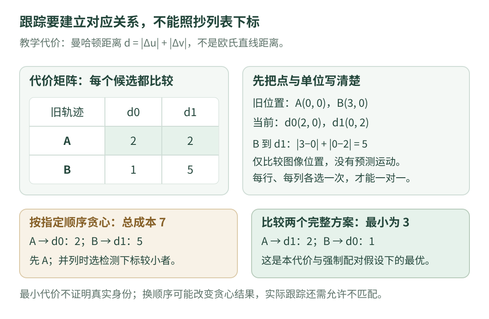

# 11 · 目标关联与跟踪：让编号跟着对象走

任务很具体：上一帧有两只羊，本帧也有两个检测框，**怎样知道哪个框属于上一帧的哪只羊？** 如果这个对应关系弄错，哪怕每帧的框都很漂亮，轨迹和速度也可能完全错误。

前提是读过 [目标检测](detection.md)，知道框中心与像素坐标。我们只使用虚构的二维点，学习“比较全部候选，再决定对应关系”。不安装跟踪库，不处理摄像头，也不把短算例说成实际羊群跟踪系统。

## 看图：检测结果的顺序可以变

{ .learning-figure }

[打开大图](../assets/learning/cv-tracking.svg)

检测器每次输出的列表顺序没有天然身份意义。上一帧列表是“左羊、右羊”，下一帧可能因为分数改变，列表变成“右羊、左羊”。如果直接用列表下标当身份，就会让编号在两只羊之间互换。

**检测**是一帧中的观测，**轨迹**是同一个假设对象随时间积累的记录，**ID** 是跟踪器给轨迹分配的标签。ID 2 不是自动识别出的真实耳标 2；它只是程序内部的一个身份假设。检测与轨迹之间建立对应关系，叫**数据关联**。

例如上帧轨迹 A 的中心是 `(10,10)`，B 是 `(50,10)`；本帧列表依次给出 `(51,10)`、`(11,10)`。从位置看，A 应对应列表第 2 项，B 对应第 1 项。此时“检测下标 0”与“轨迹 A”显然不是同一个概念。

## 先约定比较依据：本页用曼哈顿距离

仅凭位置的一种朴素想法是：中心比较近，就更像同一个对象。但“近”也要写成明确公式。本页为了手算方便，采用**曼哈顿距离**：

\[
d((u_1,v_1),(u_2,v_2))=|u_1-u_2|+|v_1-v_2|
\]

绝对值让向左差 2 与向右差 2 都记为 2，然后将横纵差相加。可以想成只能沿横线和竖线走的路程；两点 `(0,0)`、`(3,2)` 的代价为 `3+2=5`。

它与直线距离不同。**欧氏距离**为 `√((Δu)²+(Δv)²)`，上述两点的直线距离约 `3.606`，不是 5。本页代码、手算和图都使用曼哈顿距离，不能在中途换成欧氏距离还保留原来的结果。这是一种教学代价选择，不意味着它是所有跟踪器的最佳距离。

两种距离在这里都基于图像坐标，数值尺度是像素。离相机远近不同、透视变化、相机移动，都会影响图像位移与真实运动的关系。框中心变化也不等于对象身体某个固定三维点的变化。

## 把所有可能对应关系写成表

现在使用同一帧中两条旧轨迹的位置 A=`(0,0)`、B=`(3,0)`，当前两项检测 d0=`(2,0)`、d1=`(0,2)`。为了突出关联，本例拿旧位置直接作比较，没有运动预测。

| 曼哈顿代价 | 当前 d0 `(2,0)` | 当前 d1 `(0,2)` |
| --- | ---: | ---: |
| 旧轨迹 A `(0,0)` | 2 | 2 |
| 旧轨迹 B `(3,0)` | 1 | 5 |

这张表叫**代价矩阵**：每行是一条旧轨迹，每列是一个新检测，格子里的数说明把它们认作同一个对象要付出多大代价。代价小，只说明符合当前比较规则；它不是被证明的真实身份概率。

若让每条旧轨迹独立挑最近者，A 与 B 都可能选 d0，于是一个检测被分给两条轨迹。最基本的一对一限制是：每项检测最多分给一条轨迹，每条轨迹本帧最多接收一项检测。接下来要在满足限制的多种方案中作选择。

## 贪心：当前最便宜，整体未必最便宜

规定一个具体的贪心规则：先处理 A，再处理 B；在剩余检测中取当前代价最小的；**并列时取输入列表中较前的一项**。A 对 d0、d1 的代价都是 2，所以按本规则先选 d0。B 只能选 d1，总代价为 `2+5=7`。

但还有一种方案：A 选 d1，代价 2；B 选 d0，代价 1；总共只有 `3`。这说明该贪心顺序没有得到总和最小的方案。不是所有贪心过程都会得到 7，换处理顺序或并列规则可能改变结果；正因为如此，写清规则才有可复查的结论。

同时，“总和为 3”也只表示**在本页代价函数和强制配对假设下更优**，并没有证据证明现实中的羊就是这样移动的。如果输入观测不足或代价定义错误，全局最优也可能对应错误身份。

## 完整小程序：把两种方案都算一遍

这段程序只比较两条轨迹和两项检测。`itertools.permutations` 是 Python 标准库功能，用于列举排列。两个对象只有 `2!=2` 种分配，可以全部尝试；对象多时排列数量增长很快，不应照搬这个穷举方法。[Python permutations 官方说明](https://docs.python.org/3/library/itertools.html#itertools.permutations)

```python title="two_object_assignment.py · 独立教学示例"
from itertools import permutations  # 标准库：列举不同的对应顺序。


def manhattan(first, second):
    # 横纵差分别取绝对值再相加；本例没有使用欧氏距离。
    return abs(first[0] - second[0]) + abs(first[1] - second[1])


track_names = ["A", "B"]
old_positions = [(0, 0), (3, 0)]
detections = [(2, 0), (0, 2)]  # 第 0 项叫 d0，第 1 项叫 d1。

# 先算好每条轨迹到每个检测的代价，避免边选择边改原始数据。
costs = []
for old_position in old_positions:
    costs.append([manhattan(old_position, point) for point in detections])
print("代价矩阵:", costs)

# 教学贪心：先 A 再 B；代价并列时选择下标较小的检测。
available = list(range(len(detections)))
greedy_order = []
for row in range(len(old_positions)):
    chosen = min(available, key=lambda column: (costs[row][column], column))
    greedy_order.append(chosen)
    available.remove(chosen)  # 一项检测选中后，本帧不能再次分配。
greedy_total = sum(costs[row][column] for row, column in enumerate(greedy_order))

# 两对象穷举：一个排列依次说明 A、B 分别分到哪个检测。
best_order = None
best_total = float("inf")  # 正无穷，确保第一项有限代价会被接纳。
for order in permutations(range(len(detections))):
    total = sum(costs[row][column] for row, column in enumerate(order))
    if total < best_total:
        best_total = total
        best_order = order

print("贪心分配:", greedy_order, "总代价:", greedy_total)
print("最小分配:", list(best_order), "总代价:", best_total)
for name, detection_index in zip(track_names, best_order):
    print(f"轨迹{name} -> d{detection_index}")
```

预期输出：

```text
代价矩阵: [[2, 2], [1, 5]]
贪心分配: [0, 1] 总代价: 7
最小分配: [1, 0] 总代价: 3
轨迹A -> d1
轨迹B -> d0
```

读程序时，先在纸上写出四个格子，再看 `available` 为什么需要删去已经使用的项。`enumerate` 一次给出位置与该位置的值；本例 `row` 是轨迹下标，`column` 是分配的检测下标。`key` 返回的二元组按先后比较，因此先比代价，代价相同才比下标，规则是确定的。

最后看两个排列 `(0,1)`、`(1,0)` 的总和。程序只读取每个格子并相加，没有把输入位置改成新位置，也没有保存视频轨迹。它讲的是关联中的一个局部问题。

工程中可用专门的线性指派算法求总成本最小的匹配。例如 SciPy 的 `linear_sum_assignment` 接收代价矩阵并求解指派；其实现说明使用改进的 Jonker–Volgenant 方法，不能把所有类似接口都叫作同一个具体算法。[SciPy 官方指派定义](https://docs.scipy.org/doc/scipy/reference/generated/scipy.optimize.linear_sum_assignment.html)

## 现实中必须允许“这次对不上”

前面的程序强制两个旧轨迹与两个检测全部配对，这是它的重要限制。现实中一只羊可能走出画面，也可能被遮挡；新进入的羊则没有旧轨迹。如果强迫每条旧轨迹都找一个对象，旧 ID 就可能被硬塞到远处完全不同的羊身上。

因此，实际关联通常需要限制不合理候选，常叫**门控**。例如在已明确帧间隔和像素运动尺度的情况下，拒绝超出某个合理距离的候选。门槛不能凭本页坐标随意搬到另一种分辨率；也不能先强制求完整匹配，再随便删掉远配对，就宣称得到最佳的可选匹配。要让求解问题本身包含不匹配的代价与约束。

对不上时，轨迹可以暂时记为“未观测”，并增加漏失次数；连续确认后再建立新轨迹，长期没有观测则结束旧轨迹。具体多久确认、多久结束，要根据采集频率和需求设置，并记录在实验配置中。漏检时画一段预测位置，不等于真的观测到了对象。

## 运动预测和外观特征分别帮助什么？

假设同一轨迹在 `0.0秒`、`0.1秒` 的横坐标分别是 100、102 像素，平均图像速度为 `(102−100)/0.1=20像素/秒`。若暂时假设下一小段匀速，`0.2秒` 时预测横坐标为 104 像素。关联时可以与预测位置比较，而不只与旧位置比较。若对象急转或相机运动，这个预测也会出错，所以要保留不确定性。

卡尔曼滤波是把运动预测与带噪观测结合的一类方法；它不能凭空解决对象身份歧义。SORT 原论文将卡尔曼滤波和匈牙利算法用于跟踪，其中检测质量也影响整体结果。**本页的穷举小程序不是 SORT 实现**。[SORT 原论文](https://arxiv.org/abs/1602.00763)

外观特征尝试补充“看起来像不像同一个对象”。两只羊穿过彼此时，位置可能难以区分；外观也可能因相似毛色、遮挡和光照变化失效。只靠一个规则保证“永不换 ID”并不现实，需要单独统计身份切换与轨迹中断，不能仅凭检测精度判断跟踪是否正确。

## 动手练习：顺序和数量都要检查

<div class="practice-card" markdown="1">

<p class="practice-kicker">理解算法的前提</p>
<p class="practice-title">列表改顺序，真实身份会跟着改吗？</p>

交换 `detections` 两项的顺序，重新手算代价矩阵。你认为按本页特定规则，贪心总成本还一定是 7 吗？再思考：如果只剩一项检测，能直接沿用这段“两个全配对”的程序吗？

??? tip "提示"

    交换列表只会改变检测下标，不会改变点的位置。并列时按下标选的规则却可能受影响。少一项检测时，第二次选择剩余列表会发生什么？

??? example "展开参考答案"

    交换后矩阵为 `[[2,2],[5,1]]`。贪心先为 A 选新的 d0，即 `(0,2)`，B 再选 `(2,0)`，总成本为 3。因此不能说贪心总是得到 7。只有一项检测时，贪心会在第二行遇到空列表，全排列部分也没有合法完整方案；本例没有处理数量不等或漏检，需要先改变问题定义，允许不匹配。

</div>

## 常见误区与自查

ID 稳定不代表真实身份一定对，滤波平滑不代表没有关联错误，最小代价也不代表物理真相。相邻帧时间戳异常会影响预测；相机抖动会让所有目标同时移动；羊群紧密交错会使纯位置关联失效。检查时要同时看原始检测、预测位置、关联连线和未匹配项，并挑出遮挡与交叉片段逐帧查看。

本课的目标，是能解释为什么“列表第几个”不能当身份，以及为什么关联需要约束与失败处理。是否真的做好检测和跟踪，下一课用独立数据和明确指标来回答。

## 继续阅读

- [SORT 原论文](https://arxiv.org/abs/1602.00763)：查看经典检测后跟踪方法的组成与实验条件。
- [SciPy 指派问题定义](https://docs.scipy.org/doc/scipy/reference/generated/scipy.optimize.linear_sum_assignment.html)：核对总成本、一对一约束和矩形矩阵情形。
- [Python permutations](https://docs.python.org/3/library/itertools.html#itertools.permutations)：理解本页用于小规模演示的枚举工具。

---

[返回视觉学习路线](index.md) · [上一课：目标检测](detection.md) · [下一课：数据集与评估 →](evaluation.md)
